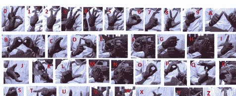
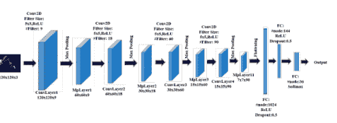
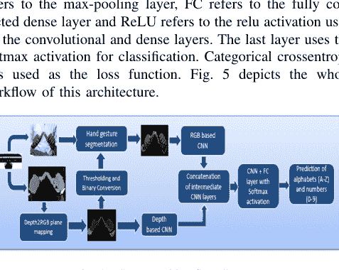
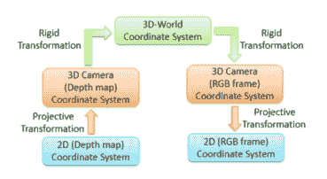
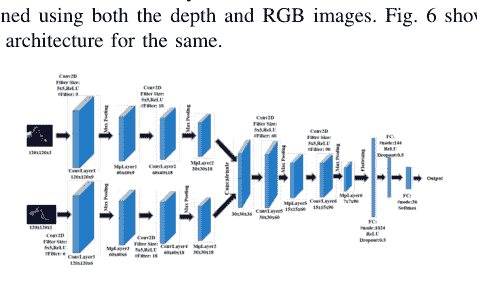
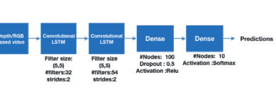
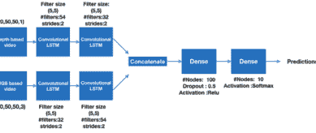
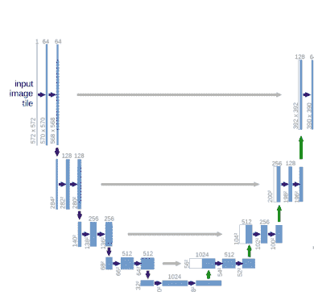
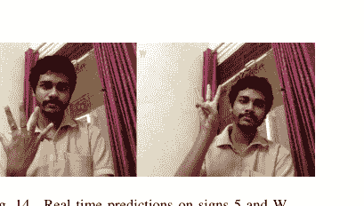

# 2020 IEEE 第10届国际消费电子会议 (ICCE-Berlin)

pratiklikhar@iiscac.in, neelbaghat@iiscac.in, ratha@iiscac.in

**摘要**—印度手语是印度特殊人士使用的语言。通常人们对手语并不了解，这阻碍了他们与他人之间的交流。为了弥补这一差距，我们使用了两种方法来解决这个问题。一种是使用 `Microsoft Kinect` 获取深度-RGB 数据实时预测手势。通过 3D 重建和仿射变换对手部分割，我们映射了深度和 RGB 信息。使用卷积神经网络分割印度手语中的 36 个静态手势，训练出的分类准确率达到 98.31%。测试模型也表现出良好的性能，分类准确率为 97.71%。使用带有卷积核的 `LSTM` 训练了 10 种动态手势。

**关键词**—印度手语、`U-Net`、`ResNet`、语义分割、`CNN`、`LSTM`、`Kinect`

## I. 引言

印度手语是印度使用的语言，包含残障人士用于交流的标准手势。普通人对这些手势几乎一无所知，因为这些手势极其复杂，阻碍了残障人士与普通人之间的知识共享。尽管计算机视觉和深度学习领域的研究激增，但印度手语（`ISL`）手势的识别非常有限。我们的论文专注于建立一个实时识别 `ISL` 手势的基准。众所周知，`ISL` 使用带有增强的动态手势。为了利用 `CNN` 方法，我们使用了带有卷积核的 `LSTM`。总共训练了 10 种动态手势，并为了训练目的生成了 1080 个视频。

在印度手语（`IS`）中，识别手势的锁定问题是一项具有挑战性的任务。这在在使用 `Hough` 变换 [3] 和尺度不变特征变换 [4] 等特征时增加了复杂性。我们知道，背景的复杂性对预测的准确性也起着巨大的作用。我们还看到使用颜色分割和 `Otsu` 技术 [5] 的技术可以采用，但它们在背景方面存在局限性。在本文中，我们使用了两种方法。首先是基于深度的分割（`Kinect RGB-D`），其次是语义分割（普通 `RGB` 数据）。在 `RGB` 像素和深度信息之间建立联系提供了手部分割。这项任务在论文的第四节中处理。此外，在使用深度信息时语义分割可能会非常困难。这使我们能够放弃笨重的 `RGB-D` 相机并使用普通的 `RGB` 相机。但在计算复杂度上存在权衡。为了利用 `CNN` 方法，我们使用了 `CNN` 来学习深度学习架构，因为我们已经在分割手部区域了。

本文是最初在 2019 年珀斯数字图像通信：技术与应用（`DICTA`）会议 [1] 上提出的工作的扩展。它与之前的工作不同之处在于，我们引入了一种新的印度手语识别方法，该方法在推理时不需要深度相机。本文与之前的相关工作有关。第三节解释了数据集以及用于实现生成的方法。第四节解释了使用来自 `Kinect` 相机的深度信息进行分割的性能表现，以及用于训练模型的不同架构，包括 `CNN` 和 `U-Net`。第五部分给出了我们获得的结果，第六部分总结了全文。

## II. 相关工作

到为止，我们看到在印度手语背景下，针对手势识别的工作文本极少。`Singh` 等人 [66] 为 24 名学生制作了一个包含 240 张图像的数据库。他们采用了这种方法：从图像中提取特征并基于欧式距离进行聚类。他们实现了 97% 的分类准确率，但大多数手势对背景条件不变，且手部是静态的。`Pei` 等人 [67] 开发的人机交互框架在 16 个手势上实现了 98% 的准确率，涉及使用滤波、高斯模糊和形态变换的处理。处理后，图像被提交到 `CNN` 以区分不同的动作，并使用 `Kalman` 估计器进行移动。

`Liao` 等人 [68] 开发了实时 `RGB-D` 传感器，使用卷积神经网络在 24 个手势上实现了 99% 的准确率。不仅如此，`Otsu` 等人 [9] 讨论了使用数据流的结果，在印度手语数据集上实现了 90.2% 的准确率。这种方法 [10] 使用了 3D 传感器来识别动态手势。

`Ok` 等人 [12] 提出了一种分层 `CNN`，在 `Jester` 基准上实现了 84.7% 的准确率，在 `NVIDIA` 基准上实现了 96.28% 的准确率。`Xiao` 等人 [13] 提出了使用密集图像网络（`DNN`），在 `NVIDIA` 基准上实现了 83.82 的准确率。`Kopuklu` 等人 [14] 提出了一种空域结构，在印度手语基准上实现了 91% 的准确率。`Mukesh` [15] 使用手持数据集训练 `CNN`，实现了 85.51% 的准确率。再次，该模型没有进行实时测试。



图 2. 数字和字母的 `ISL` 符号。

这里 `ConvLayer` 指卷积层，`MPLLayer` 指最大池化层，`fc` 指全连接稠密层，`ReLU` 指卷积层和全连接层的激活函数。最后一层使用 `softmax` 激活函数进行分类。使用类别交叉熵作为损失函数。图 5 展示了我们架构的完整工作流。

以不同的帧率（即 15, 18, 21, 24, 27, 30, 33 和 39 fps）捕捉，以便在训练数据中引入变异性，使其能够学习时间特征。

## IV. 方法论

本节的目的是讨论用于将手势映射到深度图的方法，以及用于训练 `CNN` 模型和 `U-Net` 模型所采用的架构。



图 4. 训练深度或 `RGB` `CNN` 架构

### A. 深度与 RGB 像素映射

我们使用计算机视觉技术来映射深度和 `RGB` 信息。在图 3 中，我们利用畸变长度、主点和焦距等外参数将 2D 深度图转换为 3D 坐标系。通过使用深度的外参数和平移向量，将 3D 相机坐标系转换为 3D 世界坐标系。通过使用 `RGB` 的外参数和 `RGB` 的内参数，将地图进一步从 3D 世界坐标系转换为 3D `RGB` 帧坐标系。



图 5. `ISL` 识别流程图

在迁移学习美国手语时使用了该架构。卷积层的权重保持不变，深度层和 `RGB` 层被重置为任意小的数值。另一个模型同时使用深度层和 `RGB` 层进行训练。图 6 展示了我们的架构。



图 3. 从深度帧坐标系到 `RGB` 坐标系的深度帧转换



图 6. 同时训练 `RGB-D` 图像的 `CNN` 架构

深度和 `RGB` 通过两个不同的通道，直到获得 20 组匹配深度和 `RGB` 18 的 30 个特征图。在这些通道逐一融合后，随后连接了更多的卷积层、最大池化层和全连接层。`Liao` 等人 [8] 使用了与我们类似的策略。

### B. 使用 Kinect(D) 相机训练静态手势的架构

对于静态手势，我们训练了三个卷积神经网络。我们首先使用 `RGB` 深度图像训练了一个模型。该架构适用于上述方法。相同的架构如图 4 所示。

### C. 使用 Kinect(D) 相机训练动态手势的架构

对于训练动态手势，我们采用了该策略。我们首先针对深度和 `RGB` 视频训练了带有卷积核的 `LSTM`。其对应的架构如图 7 所示。



图 7. 视频训练的通道架构

我们还通过每隔 6 帧考虑一次对视频进行下采样，并丢弃了其他帧。此举目的是为了去除重复帧，正如 `Amin Ullah` 等人 [16] 所述，下采样 5 或 6 倍不会降低时间分辨率。

双通道 `LSTM` 的架构如图 8 所示。深度和 `RGB` 记录代表了在添加层之前相同深度下卷积 `LSTM` 的两个独特通道。



图 8. 视频训练的双通道架构



图 9. 低分辨率下 32x32 像素的 `U-Net` 架构示例。每个框表示一个多尺度特征图。白框表示复制的特征图，箭头表示不同的操作。

### D. 使用普通模式 (RGB) 摄像头训练基于静态的手势的架构

```
$L_{local} = -\frac{1}{N} \sum_{n=1}^{C} (1-\gamma_{nc})^2 \gamma_{nc} \hat{\gamma}_{nc}$
```

这具有高置信度，使得真实系数接近于 0，反之对总损失没有贡献。该损失函数更关注被误分类的样本，而不是简单的例子。

`Olaf Ronneberger` 等人 [17] 为医学图像开发了 `U-Net`。该架构由两条路径组成，第一条是编码器路径（或解码器）。编码器由卷积层和最大池化层组成，用于捕捉图像的空间特征。第二条路径是解码器。解码器由上采样和卷积层组成，通过跳跃连接将编码器的特征传递给解码器。这种架构在医学分割任务中表现出色。这种 `U-Net` 架构在处理小分辨率图像时非常有效。



## VI. 结论与未来工作

在本文中我们提出了一种利用多种方法实现实时印度手语识别的方法。通过使用深度-RGB 相机和普通 `RGB` 相机，我们实现了高精度的语义分割。语义分割方法的使用完成了对深度相机和分割的必要需求。`U-Net` 模型实现了 0.9920 的 `IOU` 分数和 0.9957 的 `F1` 分数。对于深度-RGB 训练的模型，不同光照条件和数据增强在静态手势情况下有所帮助。对于动态手势，数据在某些值上不足，导致模型无法学习特征。在基于动态手势的模型中，我们显示出模型性能具有高方差，可以进一步研究以改进它。在硬件规格较低的系统上提高 `U-Net` 模型的实时性能还需要进行一些研究。我们还可以借此机会基于本文开发一种实时句子预测模型。

## 致谢

我们非常感谢班加罗尔科学学院电气工程数字信号实验室的工作人员的支持。我们感谢 `DSP` 的所有实习生在研究的各个阶段做出的宝贵贡献。

## 参考文献

- [1] N. K. Bhagat, V. Vishnu and S. Rath, "Indian Sign Language Gesture Recognition using Image Processing and Deep Learning," 2019 Digital Image Computing: Techniques and Applications (DICTA), Perth, Australia, 2019, 1-8, doi: 10.1109/DICTA47822.2019.8945850.
- [2] Q. Wu, Y. Liu, S. Ji and F. Li, "The depth of learning in complex scenes," 2017 Chinese International Conference on Computing (CAC), 2017, pp. 6522-6527.
- [3] D. Ballard, Generalizing the height transform to detect arbitrary shapes, Pattern Recognition, vol. 13, no. 2, pp. 11122, 1991.
- [4] D. G. Lowe, Distance Features from Scale-Invariant Keypoints, International Journal of Computer Vision, vol. 43, no. 2, pp. 9-72, 2004.
- [5] B. Bhavana, G. M. Surya Murali and G. V. Lakshmi, "Gesture Recognition Using Our' Method," 2017 IEEE International Conference on Computational Intelligence and Computing Research (CICR), 2017, pp: 1-4.
- [6] J. Singh and K. Das, "Indian Sign Language Recognition Using Weighted Euclidean Based Classification Technique," International Journal of Advanced Computer Science and Applications, vol. 10, no. 2, 2019.
- [7] Pei Xu, A real time gesture recognition and human-computer interaction. In: Proceedings of the Computer Vision and Pattern Recognition, 2017.
- [8] B. Lin, J. Li and G. Ouyang, "Hand Gesture Recognition with Generalized Hough Transform and DC-CNN Using," 2018 IEEE International Conference on Computer Science and Technology (ICIST), Odesa, 2018, pp. 88-94.
- [9] M. Pacholski, X. Yang, S. Gupta, K. Rin, S. Tune, and J. Kantz, "Continuous Gesture Recognition of Dynamic Gestures Using 3D Convolutional Recurrent Neural Networks," 2018 IEEE Conference on Computer Vision and Pattern Recognition (CVPR), pp. 475-484.
- [10] A. Kodriger and G. C. Rodriguez, "Hand Spelling Recognition from RGB Images Using Kernel Descriptors," IEEE Transactions on Graphics, Patterns and Images, 2013.
- [11] A. Karpathy, G. Shesky, T. Leung, and L. Lei-Fei, "Scale-large video classification with convolutional neural networks," 2014.
- [12] Okan Akl, Ahmet Gurdangar, Nishant Selvi, Ken Ghor, "Real-time Gesture Detection and Classification using Convolutional Neural Networks," in 2019 IEEE International Conference on Computer Vision and Pattern Recognition.
- [13] Xianhua Chen, Ke Ge Motion Recognition: Video-Temporal Feature Extraction with Spatial Attention Network, on 19 May 2018.
- [14] O. Okkaya, N. Rose, and G. Molij, "M Fusion Frames: Deep Learning Strategy for Hand Recognition, 2018 IEEE/CVPR Conference on Computer Vision and Pattern Recognition Workshops.
- [15] Mukesh Kumar Majumder, Sign Language Recognition, method using Deep Learning, in International Science, Bangalore, 2017.
- [16] M. S. Ahmed and M. S. Abdullah, "Action Recognition in Video Sequences using Deep Bi-LSTM Network with CNN Features," IEEE Access, vol. 6, pp. 1155-1166, 2018.
- [17] J. Ronneauer, M. Philipp, S. Koller, J. Kramer, L. Jaimeano, and L. Giuseppe, T. Camillo, C. Lee, and K. Vijay, J. Warsaw & Harwood, Joseph and Zenith, Jennifer., 2018: U-Net for MAV-based Inspection; in Implication of Fusion in Multi-class Segmentation.
