# 2020 IEEE 第12届人形机器人、纳米技术、信息技术、通信与控制、环境与管理国际会议 (HNICEM)(菲律宾马尼拉 2020.12.3-2020.12.7)

**摘要—** 生菜已变得流行，现在受控环境下特定特定子的使用依赖于种子萌发的表型分类。生菜栽培品种由叶片特征定义，而这些特征无法通过相同的光谱-纹理形态特征解释。对生菜种子的肉眼检查会导致种子现象学所需的分类。为了克服这一局限性，引入了结合计算智能的机器学习。在研究中，我们使用华为 P50 手机摄像头捕获单粒 RGB 图像，每个品种共采集 100 个样本，所用种子具有不同的光谱分辨率。使用带有额外类别的特征选择（FT-ETC）提取并选择了 26 个形态特征。使用决策树（DTC）和 SVM 学习模型，以纹理形态特征作为输入对生菜种子品种进行分类。通过 100 次交叉和保留验证，DTC 和 SVM 显示出高准确率，灵敏度达 99%。DTC 达到最快速度，SVM 最佳为48.157%。这种开发的 FT-DTC 模型对于受控环境栽培和育种具有高度必要。

**关键词—** 计算机、生菜种子、机器学习、种子萌发

# I. 引言

生菜是自然界流行的植物。它在植物包囊内含有胚胎结构，是植物繁殖的最终产品，通过初胚的融合包含遗传信息。种子包含了子叶、根尖、胚轴、孔和胚乳。然而，种子仅考虑种皮，这是人类视觉可见的最外层。

与其他作物一样，生菜种子在花期末期非常敏感。对于大多数品种，生菜在栽培 55 天后成熟。据记载，单株生菜可以收获一颗种子。然而，并非所有种子都有相同的休眠期。

生菜叶片可以作为确定其变种的遗传指标 [1-6]。生菜的基因型包括球生菜、bibb 生菜、冰球生菜和品种。红生菜包括红色和橙色的叶片。另一方面，具有红色或绿色，这使得对这些特定品种的研究变得困难。理性，当需要生菜变种时，其叶片的培养处于生命周期的第一阶段（萌发），必须进行精确分类。确定生菜种子品种是全球农民面临的主要挑战。

- 种子分类用于作物阶段 [, 播种、育种] 以及包装 [10]。已利用近红外（FT-NIR）中 1000 到 250 nm 波长的荧光检测单粒种子 [11]。FT-DTC 模型使用特定波长通过表皮来分类活非核种子。高光谱成像（HI）已用于分类不同物种的*Lactuca sativa* 生菜 [12]，利用短波红外（SWIR）和最小二乘支持向量机机器学习对西瓜种子进行作物品种分类 [13]，通过深度卷积神经网络（DNN）在 7734 nm 下记录了 8744 个种子 [14]，通过反射分析对冷冻种子进行分类 [15]，种子真菌检测 [16]，以及通过 SVM 和极端机器学习（ML）进行 CRISPR/Cas9 诱导突变检测 [17]。多光谱成像已应用于白玉米粒分类 [18] 并用于普通汉堡种子 [19]。

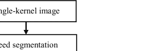

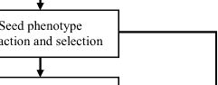

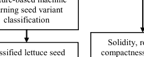

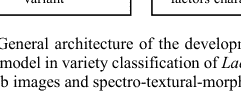

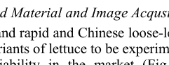

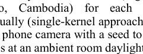

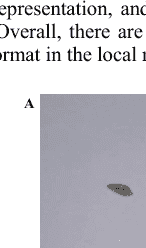

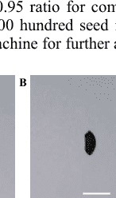

另一方面，数字 RGB 图像已用于分类水米表型，预测小麦、油菜、亚麻和白芥末种子的颜色和纹理 [21]，通过多层分类器对单倍体和二倍体种子进行深度分类 [22]，柑橘种内多样性分析 [24]，通过反向传播神经网络（BPNN）识别 Takong 9 种子 [25]，通过模糊逻辑区分灯笼和辣椒 (26)。我们在识别小麦粒 [27] 和种子 [28] 中使用了 RGB、SWIR 和各种近红外图像。VGG16 深度神经网络架构已用于区分小麦粒表示。

图 1. 使用单粒 RGB 图像和光谱形态特征进行生菜（Lactuca sativa）种子品种分类的基于特征的机器学习模型架构。

分类。在研究中，由于农业设备成本高昂，高光谱数据的使用比消费级图像更频繁。

尽管在种子分类和集成中缺乏比较方法，但计算机视觉和计算智能在长期提高提高准确性方面具有巨大潜力。结果，本研究表明了使用集成相机的机器学习模型对生菜类型进行分类，这是首次，但仍是一个开放领域。

图 2. 生菜（A）和中国生菜（B）精美的外部结构。

# II. 材料与方法

### A. 种子材料与图像采集

大生菜和中国生菜是本研究检查的两种生菜品种，以验证其市场变异性 [21]。使用 5700 万像素手机相机拍摄了 200 颗过滤后的种子，相机镜头距离为 6 英寸，在日光条件下并在浅灰色背景下以捕捉深色种子。

使用图像提取器进行处理，参数为 50，曝光时间为 1.00 ms，光圈为 0。图像属性包括空间分辨率 2992 x 2992 像素（96 dpi），位深为 24 位 RGB。每个种子均以 JPG 格式以 0.95 比例进行压缩，用于本地机器进行分析。

基于长度和生物量面积比例的结构，其中 $L$ 为主轴长度 (4-7)。

使用 MATLAB R2020 获取形态学特征。使用相同的数据通过 Haralick 算法获取特征。对于均匀的表面模式计算了灰度共生矩阵 (GLCM)。在提取特征时使用了数字粗糙度。利用 RGB 图像。对于 280 个样本使用了 22 个特征，包括长度、宽度、凸性、周长、直径、对比度、相关性、能量、熵、同态、RGB 颜色粗糙度、紧凑性、密度以及形状因子 1 到 4。

$S = A/C$

$R = 4\piA/p^2$

$CO = Ed/I$

$SF1 = L/A$

$SF2 = I/A$

$SF3 = A/(0.25\piL^2)$

$SF4 = A/(0.25nL^2)$

额外特征重要性确定了生菜种子两种最重要的属性。算法根据重要性水平确定了八个最显著的特征。仅使用四个最显著的特征训练分类器；这些特征是：蓝色、密度、相关性和紧凑性。

### C. 种子分割

种子分割对于去除非感兴趣（ROI）像素和突出种子点是必要的（图 3）。使用 RGB 空间中的颜色阈值分割来分割种子。颜色有三个通道，即红、绿、蓝，通过依赖于豆数量的固定范围内像素颜的数量，可以推导出具有光照不变特性的直方图 [29]。

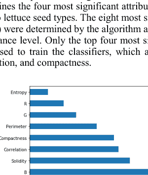

图 5. FI-EC 选出的八个最显著特征

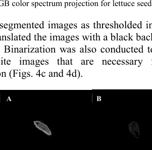

图 3. 用于生菜分割的 RGB 色谱投影

### E. 基于特征机器学习的种子变种分类

将 RGB 颜色空间内经过阈值处理的分割图像转换为黑色背景图像（图 4 和 4b）。进行二值化以获得表型提取所需的黑白图像（图 4c 和 4d）。

将四个选定的特征分为 80-20 比例用于训练和测试，并使用标准化算法进行标准化。独立变量使用标准化算法 (8) 进行缩放（变化），其中 $X$ 是原始值，$\mu$ 和 $\sigma$ 是标准差。

> $X_{changed} = \frac{X-\mu}{\sigma}$

使用了四种机器学习：K 近邻算法 (KNN)、决策树分类器 (DTC)、朴素贝叶斯 (NB) 和支持向量机 (SVM) 来训练数据。选择这些估计器是因为它们在分类应用中被证明是有效的。算法使用了默认超参数，产生了准确的结果，无需进一步优化。DTC 树产生（图 6）在分类两种种子类型时仅使用了蓝色特征。

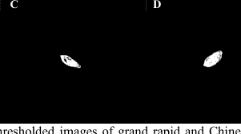

图 4. 奶油球生菜和中国散叶生菜的阈值图像 (a,b) 以及对应的二值化图像 (c,d)

## D. D. 种子表型提取与选择

| B=-0.29 |
| gain=0.55 |
| value=[82, 7] |
| True | False |

表型的提取是使用分割后的二值图像作为 `regions` 函数的输入数据完成的

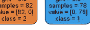

图 6. 决策树分类

### F. 模型评估与统计分析

交叉验证准确率和 KNN、DTC、SV 的 F1 分数。留出验证误差、灵敏度、特异性和 F1 分数。混淆矩阵也用于图形化显示小于 0.05。Minitab 19 平台 (Minitab, LLC) 用于执行统计分析。Python 语言用于种子变种分类的计算建模。四个最显著特征会影响模型的性能。

 B. 基于特征机器学习的生菜分类

基于特征的模型在分类种子变种方面是成功的，产生了高准确率和忽略不计的误差（表 2 和 3）。使用编码表示生菜种子变种，即奶油球和中国散叶。20% 的单核图像对于 KNN 是足够的。模型将中国散叶完美分类（图 7a），因此在准确性方面，DTC 和 SV 是最佳模型。

# III. 结果与讨论

### A. 生菜种子表型状

本研究显示了奶油球和中国散叶种子的表型状，包括面积、长轴面积、凸性、周长、重量、熵、同态红色和绿色（见表 1）。观察到面积、R-G 和 G 之间具有很强的相关性。相反，除了面积外，同态性（表 1）显示两种种子变种在周长和等密度方面存在显著差异。

| 种子变种 | 面积 | 长轴面积 | 周长 | 等密度 | R-G | G-B |
|---|---|---|---|---|---|---|
| 奶油球 | 0.899 | -0.943 | 0.745 | 0.528 | -1.000 | 0.712 | 0.009 | 0.995 |
| 中国散叶 | 0.998 | -0.156 | 0.740 | 0.217 | -0.176 | -0.118 | 0.992 | 0.991 |

表 I 从种子表型状分析中提取的相关系数

奶油球状的归一化 RGB 颜色在 R、G、B 中分别为 90.64%、89.92% 和 97.28%。在额外特征分析结果（图 5）中，RGB 叶在区分种子变种方面具有高相似性和权重。然而，蓝色是模型中唯一的光谱标记。此外，根据提取的纹理值，中国散叶种子的等密度比奶油球种子状高出 54.994% 和 0.09%。奶油球状的相关性和熵略高于变种。另一方面，两种种子变种的同态性具有相同值。生菜变种的相关性在 FI-ETC 结果中也定义良好。在交叉验证策略的基于特征的模型中，DTC 和 SV 完美覆盖了平均准确率和 F1 分数（表 2）。另一方面，KNN 的 F1 分数分别为 0.6278 和 0.6581。因此，方差小于 KNN，意味着使用方差作为区分它们的指标更好。

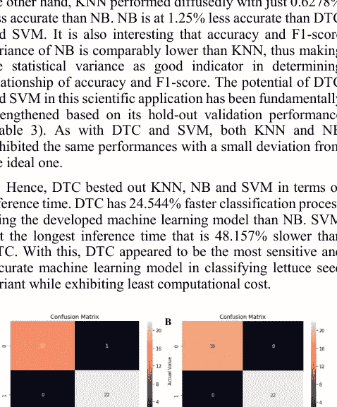

图 7. 使用 (a) KNN、(b) DTC、(c) NB 和 (d) SV 分类生菜变种的混淆矩阵

## 表 II 基于交叉验证策略的模型性能

| 模型 | 准确率平均 | 准确率方差 | F1 分数平均 | F1 分数方差 |
|---|---|---|---|---|
| KNN | 0.9813 | 0.0400 | 0.9810 | 0.0406 |
| DTC | 1.0000 | 0.0000 | 1.0000 | 0.0000 |
| NB | 0.9753 | 0.0373 | 0.9842 | 0.0355 |
| SVM | 1.0000 | 0.0000 | 1.0000 | 0.0000 |

## 表 III 基于留出验证策略的模型性能

| 模型 | 准确率误差 | 灵敏度 | 精确率 | FPR | F1 分数 |
|---|---|---|---|---|---|
| KNN | 0.9750 | 0.0250 | 0.9760 | 0.9454 | 0.0546 | 0.9749 |
| DTC | 1.0000 | 0.0000 | 1.0000 | 1.0000 | 0.0000 | 1.0000 |
| NB | 0.9750 | 0.0000 | 1.0000 | 0.0000 | 0.0000 |
| SVM | 1.0000 | 0.0000 | 1.0000 | 0.0000 | 0.0000 |

[1] R. G. Du Luna, E. P Pados, and A. Bandala, "Automated Image Capturing System for Deep Learning-based Tomato Leaf Leaf"

检测与识别，TECNCON 2018 - IEEE 2018 IEEE 会议，

S. C. Laughlin, R. S. Conception, J. D. Alejandro, R. R. Tobias, and E. Darius, "使用机器学习特征估计器和选择方法进行水果属性生命阶段分类，《国际机器学习进展学报》，vol. 10, no. 2, pp. 171-180，

R. S. Conception, S. C. Laughlin, R. R. Tobias, E. P. Darius, A. A. Bentley, and E. Sybing, "利用光谱学和可见光绿智能识别果实质量，2020年先进机器人与智能国际会议 (AIRIS)”，2020年。

R. Conception, S. C. Laughlin, J. D. Alejandro, E. Darius, and E. Sybing, "基于混合与叶片共现矩阵机器特征分析的监督神经网络分类，《ACS 农业与食品化学杂志》，vol. 58,, pp. 475-486, 2020年。

S. C. Laughlin, R. S. Conception, J. D. Alejandro, R. R. Tobias, E. Darius, and E. Bentley, "小规模分析中从基于模型的生菜阶段分类中学到的机器学习的应用，《国际机器学习进展学报》，vol. 11, no. 2, pp. 442-449, 2022年。

R. Conception, S. C. Laughlin, J. D. Alejandro, R. R. Tobias, E. Sybing, and E. Darius, "利用彩色高光谱成像进行多态品种的生命阶段识别，《国际信息学进展学报》，vol. 6, no. 3, pp. 261-277, 2020年。

T. G. S. Rao and N. Vadekar, "用于水果和杂草分类的 AgroNet：一种基于种子的自动农业，《计算机与电子》，vol. 148, no. 1, pp. 1-9, 2021年。

A. Yunus and A. Fadeed, "前言：物理近期趋势国际会议 (ICRTP 2016)，《工业技术国际会议信息》，809, no.1, 2017年。

L. J. Wang, "基于机器视觉技术的种子质量植物育种（种子到种子），《传感器报告》，vol. 9, no. 1, pp. 1-15, 2019年。

G. Liu, Y. Li, H. Su, F. Zheng, and Q. Shu, "利用多变量数据分析通过单粒近红外光谱检测超甜玉米 (Mays mays) 种子活力，《传感器 (Sensors)》，vol. 18, no. 8, 2018年。

W. Kong, C. Zhang, W. Huang, F. Liu, and Y. He, "高光谱成像在玉米种子质量评估中的应用，《 (Sensors)》，vol. 18, no. 1, pp. 1-16, 2018年。

Y. Seo, et al., "用于区分黄瓜病毒果实水浸种子的优化多变量分析，《食品分析杂志》，vol. 86, no. 2, pp. 95-102, 2019年。

N. Wu, et al., "利用高光谱成像分类燕麦种子：研究深度卷积神经网络的表征能力，《RSC. Adv.》，vol. 9, no. 22, pp. 12635-12664, 2021年。

[15] J. Zhang, L. Dai, and F. Chen, "使用高光谱/近红外反射成像技术筛选冻玉米种子，《分子》，vol. 24, 12,

[16] I. Back, et al., "用于检测变色病种的最优高光谱波段选择，《传感器报告》，vol. 5, no. 9, pp. 1-15, 2018。

[17] X. Peng, Y. Chen, X. Liu, X. Feng, and Y. He, "利用近红外高光谱成像区分 CRISPR 诱导的种子突变，《传感器报告》，vol. 9, no. 1,

[18] K. Sutton, M. Manley, and P. J. Williams, "利用高光谱成像对缺陷小麦种子分类，《食品化学》，vol. 323, 2020年。

[19] J. Salim and B. Boit, "利用高光谱图像对豆类（豇豆）分类，《传感器》，vol. 19, 4050, 2019年。

[20] K. Tan, P. Sukaskawan, and Y. Punasad, "使用数字图像分析通过统计方法对水米品种进行分类，《计算机与电子》，vol. 116, 105333, 2020年。

[21] W. Yuan, N. Wijewarande, J. Seks, B. Gai, Y. Ge, and G. L. Yu, "通过金丝雀成像颜色和纹理特征评估大种子，《传感器报告》，vol. 9, no. 1, pp. 1-17, 2019年。

[22] Y. Altuna, C. Omer, and A. F. Kocaman, "利用卷积神经网络识别杂交和二倍种子，《计算机与农业》，vol. 163, no. 4, pp. 1-11, 2021年。

[23] M. Mori and J. Ioka, "利用深度学习技术对彩色豆分类，《计算机与农业》，vol. 174, 105998, 2021年。

[24] M. La Bianco, O. Grillo, C. Onilla, G. Gomez, and G. Bacchetta, "利用机器视觉技术识别玉米种子质量，《食品》，vol. 19, no. 2, pp. 183-190, 2017年。

[25] S. Y M. Chen, "应用图像处理和模糊逻辑识别水稻品种的新方法，《传感器报告》，vol. 9, no. 2, pp. 4832-4839, 2020年。

[26] E. J. Elias, O. R. Erbaldo, A. R. Jordan, and J. Seeks, "利用高光谱成像对小麦粒分类，《IEEE Access》，vol. 8, pp. 22493-22505, 2020年。

[27] K. Nallaperula, et al., "用于从图像重建视觉合理屏幕的合适色彩空间分析，2013年 IEEE 智能与计算研究国际会议 IEEE ICCIC 2013，3月, 2013年。"

