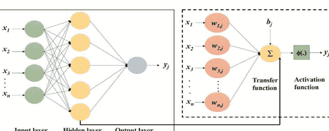
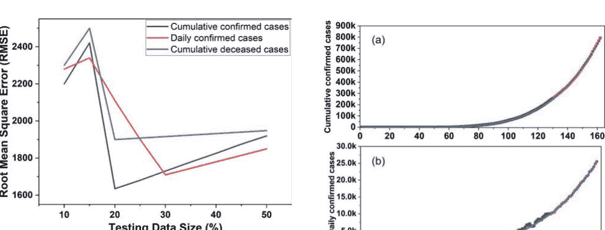
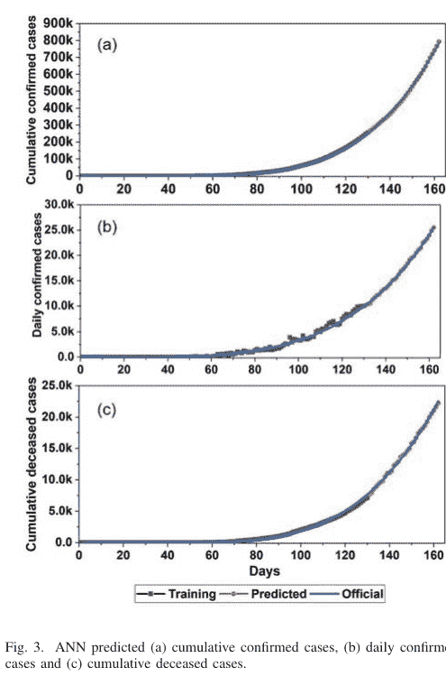
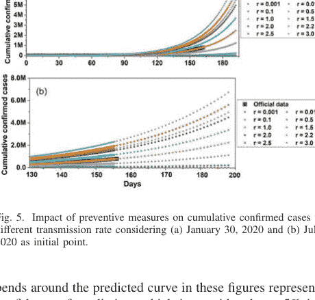
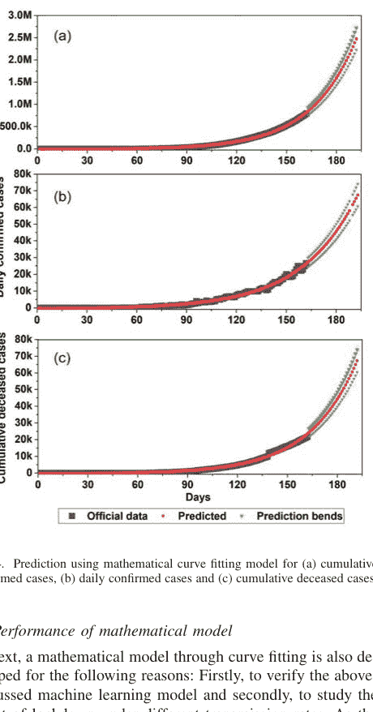

# 2020 IEEE 第15 届工业与信息系统国际会议 (ICIIS)(印度 鲁普纳加尔 2020.11.26-2020.11.28)


Pratama Kumari
计算机科学与工程系
印度理工学院
鲁尔基，印度
pkumumari@csitit.in

Durga Toshni
计算机科学与工程系
印度理工学院
鲁尔基，印度
durgatoshni@gmail.com

摘要——由于 COVID-19 疫情对公共卫生的影响，给全球主要国家的经济和资源造成了巨大压力。过去病例数量急剧增加，给卫生官员和政府带来了巨大的压力。因此，建立用于确定病例数量的预测模型是必要的的。在本研究中，首次提出了人工神经网络（ANN）来预测 COVID-19 的爆发情况。此外，我们还使用曲线拟合来评估了基于 ANN 的机器学习模型在不同阶段估计 COVID-19 增长的性能。

**索引术**——COVID-19、感染、预测、机器学习、神经网络

## I. 引言

由急性呼吸道综合病毒（SARS-CoV-2）引起的 COVID-19 病毒具有高度传染性，并于 2020 年被世界卫生组织宣布为全球大流行。它属于冠状病毒家族，与过去看到的 MERS 和 SARS-CoV-2 相似。该病毒会导致发热和咳嗽，许多人因癌症和糖尿病等严重疾病去世。截至 2020 年 7 月 20 日，全球已报告了许多确诊病例和死亡。一些欧洲国家，包括西班牙（307,335 例）、英国（294,792 例）以及美洲的许多国家（896,550 例），受这一全球健康危机的影响最大 [2]。在这方面，数学和科学在预测不同国家 COVID-19 病例方面的重要性日益凸。最近，Zhao 等人 [3] 开发了一个数学模型来预测印度的 COVID-19 病例。中国 [1] 在 2020 年 2 月至 3 月应用了通用增长模型。此外，自回归移动平均（ARIMA）、移动平均（MA）和线性回归模型等统计方法也被用于预测不同国家的 COVID-19 病例数量。

表 I：使用人工神经网络（ANN）对严重疾病增长率的研究

| 方法 | 参考文献 |
| :--- | :--- |
| ARIMA, ANN | 减少 [1] |
| BPNN, ANN, 和 ERNN | [2] |
| ARIMA, ANN | 伤寒 [3] |
| ARIMA, GRNN, 和 NFRS | 肝炎 [4] |
| BPNN, ANN, 和 NFRS | 脑热 [5] |
| ARIMA, ANN, 和 MPR | 疟疾 [6] |

开发的数学模型用于预测不同转换下的增长情况。开发的模型能够实现 COVID-19 预测，这可能提醒有关部门危机、必要的准备以及收治患者所需的医疗基础设施。本研究的其他部分组织如下：第 2 节讨论了数据收集和方法；第 3 节详细讨论了结果；第 4 节介绍了研究的结论。

## II. 方法

### A. 研究地点和数据收集

在这场疫情中，全世界都在讨论人口最多的国家——印度 [18]。印度近期确诊病例数量较少；但在过去的几周内迅速增加。截至 2020 年 7 月 20 日，印度近期报告了 1,119,442 例确诊病例 [19]。印度政府从 2020 年 3 月 24 日至 2020 年 5 月 31 日实施了分阶段长期封锁，以控制病毒传播 [20]。然而，政府已于 2020 年 7 月 1 日 解封，但每天仍有病例报告。根据近期病例的增长，专家警告印度可能是 COVID-19 的下一个指数中心。本研究使用的 COVID-19 时间序列数据集收集自印度政府官方网站 [19]。提取的数据包括确诊、康复和死亡病例等多个变量。可用数据集带有日期、月份和年份信息的时间序列数据。从 2020 年 1 月 30 日（印度报告首例 COVID-19 病例）到 2020 年 7 月 10 日（162 天）期间记录的数据用于开发预测模型。

### B. ANN 模型

人工神经网络（ANN）是人工智能领域应用最广泛的技术之一。许多研究人员已使用 ANN解决分类、回归和优化等各种问题。基于 ANN 的模型非常能够处理传染病的非线性数据和时间序列预测问题。此外，像 ARIMA 这样的统计模型是依赖于多个假设的参数方法。假设的参数会导致拟合效果差和准确率低，从而无法预测 COVID-19 的增长。因此，统计模型不足以泛化当前流行病中的模式。最近，少数研究人员使用机器学习技术作为统计方法的替代方案。Hu 等人 [8] 使用自编码器预测了中国的 COVID-19 病例 [21]。自适应神经模糊推理系统用于估计中国十天内的 COVID-19 病例。Chimilla 等人 [10] 提出了长短期记忆（LSTM）模型来预测确诊病例。然而，LSTM 不适用于小样本学习问题，并且在小样本学习中容易发生过拟拟风险 [11]。接下来，人工神经网络（ANN）由于其结构简单、实现速度快且处理非线性数据的能力，是时间序列问题的有效应用方法之一 [12]。由于其卓越的性能，许多 ANN 及其变体已用于预测肝炎、伤寒、结核等多种传染病，如表 I 所示。尽管 ANN 是非参数方法且不需要预先了解数据。此外，ANN 是非线性模型，对于终端用户来说相对容易使用和理解。基于 ANN 的预测模型尚未用于 COVID-19 的小规模分析。然而，我们意识到统计模型的局限性，在此工作中，建议使用现有历史时间序列数据开发一种基于 ANN 的机器学习模型。此外，在研究中，我们尝试使用数学拟合模型来关联所提出的基于 ANN 的机器学习模型的

```
X = x_1w_1 + x_2w_2 + ... + x_nw_n + b \quad (1)
```

其中 X 是输入网络，b 是偏置。隐藏层从输入数据中提取特征并将其转换为。




图. 1. 人工神经网络的基础架构。

用于输出输出的有用信息。应用非线性激活函数以获得实际值 ($y_j$)。在该模型中，采用 sigmoid 函数作为激活函数，如下所示：

$y_j = \frac{1}{1+e^{-x_j}}$ (2)

使用误差函数将神经网络的输出 ($y_j$) 与实际值 ($a_j$) 进行比较：

$$\delta_j = (a_j - y_j)(1 - y_j) (3)$$

隐藏层的误差计算方式如下：

$$\delta_j = y_j(1 - y_j) \sum^n \delta_k w_{kj}$$

其中，$\delta_k$ 是输出层的误差，$w_{kj}$ 是隐藏层与输出层之间的权重。为了调整连接层的权重，误差从输出层向输入层按如下方式反传播：

$$w_{kj}(t+1) = w_{kj}(t) + \eta \delta_j y_k + \alpha(w_{kj}(t) - w_{kj}(t-1)) (5)$$

其中，$\eta$ 表示学习率，$\alpha$ 表示动量因子。这些参数影响网络的学习和稳定性。学习率 ($\eta$) 控制 ANN 模型的收敛速度。较低的学习率会减慢收敛速度，而较大的学习率则会增加振荡幅度。正则化 ($\gamma$) 通过减少网络权重过拟合的概率来确保网络的稳定性。对网络进行训练直到平均误差值达到所需的阈值。最后，利用优化后的权重优化神经网络架构并应用于测试阶段。

本研究训练了一个前馈神经网络。前几天的数据作为输入提供给输入层。使用了具有不同隐藏神经元配置的 ANN 模型。在训练所提出的 ANN 模型期间，采用了 Levenberg Marquardt (LM) 学习算法来优化权重 [23]。

模型一直训练直到权重得到优化且均方误差 (MSE) 最小为止。表 II 显示了所开发的 ANN 模型的性能。

### C. 性能评估指标

预测模型的性能通常通过将预测值与实际值进行相关分析来评估。在三个性能评估指标中，利用均方根误差 (RMSE)、平均绝对百分比误差 (MAPE) 和平均绝对误差 (MAE) 来分析所提 ANN 模型的性能 [24, 25]。这些指标描述如下：

$$RMSE = \sqrt{\frac{1}{n}\sum^n(y_i - a_i)^2}$ (6)$$

$$MAE = \frac{1}{n}\sum^n|y_i - a_i|$ (7)$$

$$MAPE = \frac{100\%}{n}\sum^n\frac{|y_i - a_i|}{a_i}$ (8)$$

表 II
本研究开发的 ANN 模型架构与模型集。

| 架构 | 输入 |
|---|---|
| 输出 | 4 |
| 层数 | 3 |
| 隐藏层中的节点数 | 10 |
| 激活函数 | Sigmoid |
| 学习函数 | Levenberg-Marquardt |
| 性能函数 | MSE |

表 III
学生模型在数据集上的性能评估。

| | RMSE | MAE | MAPE |
|---|---|---|---|
| 累计确诊病例 | 1638,649 | 514,883 | 3.981 |
| 每日确诊病例 | 1793,188 | 686,396 | 4.173 |
| 累计死亡病例 | 1908,963 | 794,395 | 4.413 |




图. 2. 用于确定 ANN 模型训练和测试大小的数据集。其中 $y_i$ 和 $\hat{y}_i$ 分别是实际值和预测值。RMSE、MAE 和 MAPE 的值越低表示模型性能越好。

## III. 结果与讨论

### A. ANN 模型的性能

本节介绍了所提模型对印度的预测结果。为了指示训练-测试数据集总体规模，使用 80% 和 20% 的比例对 ANN 模型进行评估。对于此测试，该大小适用于确诊病例和死亡病例。当使用 80% 数据训练时获得最低的 RMSE，当使用 20% 数据训练 ANN 时也获得了最低的 RMSE，如图 2 所示。表 III 显示了所提 ANN 模型在 RMSE、MAE 和 MAPE 方面的性能。图 3a 显示了确诊病例。在图 3b 中，预测的死亡病例（红色）和实际病例（蓝色）显示了实际数据。可以观察到，预测的确诊和死亡病例与相应的实际值相符。



图. 3. ANN 预测的(a)确诊病例，(b)每日确诊病例和死亡病例。

表 IV
实际值与 ANN 预测值的比较。

| 日期 | 天数 | 实际 | 预测 | 误差 (%) |
|---|---|---|---|---|
| 累计确诊病例 | | | | |
| 2020年7月6日 | 第1580天 | 697413 | 693163 | -0.609 |
| 2020年7月7日 | 第1599天 | 719795 | 716318 | -0.483 |
| 2020年7月8日 | 第1608天 | 743517 | 738817 | -0.669 |
| 2020年7月9日 | 第1610天 | 767296 | 793802 | 3.455 |
| 累计死亡病例 | | | | |
| 2020年7月6日 | 第1580天 | 22488 | 23707 | 5.236 |
| 2020年7月7日 | 第1599天 | 25237 | 22752 | -3.654 |
| 2020年7月8日 | 第1608天 | 28479 | 25155 | -1.109 |
| 2020年7月10日 | 第1626天 | 36532 | 26250 | -0.965 |

同样，如图 3 所示，预测的确诊和死亡病例与实际值值致。


表 V
本研究开发的 ANN 模型比较。

| 研究 | 国家 | 方法 | MAPE |
|---|---|---|---|
| | 欧洲 | ARIMA | 4.752 |
| [26] | 印度 | ARIMA | 4.1 |
| [9] | 中国 | NHIS | 4.79 |
| 本研究 | 印度 | ANN | 3.981 |





为了预测 COVID-19 阳性病例，通过上述图 3、表 IV 所示的结果，可以得出结论。

### C. 封锁对 COVID-19 的影响

COVID-19 的爆发导致实施了各种限制措施以减少人员之间的流动。政府在全国实施了封锁以防止人员流动。此外，限制了社交场所，如购物中心和市场。这些限制措施减少了感染者向健康人员传播 COVID-19 的机会。本研究还分析了封锁对 0.001 到 3.0 传播率的影响。传播率代表感染者可以传染的平均人数。严格执行封锁措施和此类限制有助于保持安全 [27]。

### B. 数学模型的性能

接下来，由于以下原因还开发了数学模型：首先，为了验证机器学习模型，其次是为了观察不同传播率下的封锁效果。随着病毒在社区传播，感染呈指数级增长。我们使用指数函数 $f(x) = at$ 开发了数学模型。通过数学模型得到的累计确诊、每日确诊和累计死亡结果如图 4 (a)、(b) 所示。数学模型应用于 123 天的官方数据（从 2020 年 1 月 30 日到 7 月 10 日），对未来的 30 天（从 7 月 11 日到 8 月 9 日）进行预测。预测


373


社交距离和封锁等预防措施在减少疾病传播方面发挥着重要作用。现在我们考虑另一种情况：在2020年7月10日，尽管人们严格遵守了社交距离和预防措施，仍出现了293,802例确诊病例。在这种情况下，不同传播率下的确诊病例数量更高（图5b）。从图5b可以观察到，严格执行预防措施对于最大限度地减少COVID-19的增长非常有效。

在工作中，提出了一种机器学习模型（例如ANN）来估计印度COVID-19的增长情况。这些模型用于预测COVID-19的累计确诊人数、新增病例和死亡人数。此外，还提出了一个数学模型来验证预测模型。印度传播率的预测模型显示出指数增长，预计未来病例将大幅增加。此外，社交距离和封锁等预防措施的影响用于减缓疾病的传播。总之，这是首次使用机器学习模型预测印度COVID-19爆发的研究。该研究为未来提供了见解，政府和卫生机构可以利用这些见解来组织必要的医疗设施和资源。对于未来的工作，该研究可以扩展到预测省级别的COVID-19增长情况。

# 致谢

第一作者感谢印度教育部（MoE）提供的博士后奖学金。我们感谢ITR主任提供的研究设施。

# 参考文献

- ...
[10] V. K. Rahim and L. Liang, "Time series forecasting of covid-19 cases using lstm network," preprint, arXiv:2006.11994,
[11] Y. Wang, "Solar hourly irradiance estimation from satellite data,", 2019.
[12] S. Zhou, "The impact of covid-19 pandemic on dengue fever and other diseases," Scientific Reports, Vol. 10, no. 1, 2020,
[13] X. Zhang, Y. Liu, M. Tang, A. Zhang, A. Young, and X. Li, "Comparative study of four time series methods in forecasting covid-19 cases in China," IEEE Access, vol. 8, pp. 215-22,
[14] H. Ren, J. Li, J.-A. Yan, Y.-Y. Hu, and Y.-H. Hu, "Evaluation of the effect of lockdown measures on the spread of covid-19 in China," BMC Infectious Diseases, vol. 17, no. 1, p.421,
[15] K. Kumar, S. Ag, A. Gupta, P. Yuan, Y. Chen, and B. Li, "Two methods of lockdown for the incidence of covid-19 in India," PLOS One, vol. 10, no. 5, p. e023158, 2020.
[16] P. Kumar and Y. Babu. (2020). [Online]. Available: https://www.who.int/covid-19/outbreak-c1
[17] S. Jha, "Impact of lockdown during covid-19 on air quality across major cities around the globe," Urban Climate and Environment, vol. 2020,
[18] L. Motkafi, S. Mohan, and M. S. Fei, "Exponentially increasing trend of infected patients with covid-19 in Iran: A comparison of mathematical modeling approaches," Mathematical Health, vol. 42, pp. 92-100, 2020.
[19] S. Elahi and M. Kumaira, "Exponential neural network forecasting with adaptive learning rate based on gradient descent," Neural Networks, vol. 118, pp. 67-78, 2020.
[20] C. J. Wang and K. Ramadhani, "Wind power prediction using genetic algorithm in 2018 IEEE International Conference on Information and Industrial Systems (ICIIS),
[21] P. Kumar and D. Gosthani, "Extreme gradient boosting and deep neural network for forecasting electricity demand using solar irradiance," Journal of Clean Energy Production, vol. 279, p. 123825, 2020.
[22] WHO. (2020). World Health Organization. COVID-19 Situational Reports – Situation Report - 116 . [Online]. Available: https://www.who.int/
[6] T. Dehesh, H. Mardani-Far, and P. Dehesh, "Forecasting of covid-19 confirmed cases in different countries with array models," medRsw,
[1] T. Wang, X. Wang, Q. Li, N. L. Bagrazzi, S. Zhang, X. Yao, and J. Shi, "Estimation of the transmission rate of the 2019-nCoV outbreak and its impact on public health interventions," Journal of clinical medicine, vol. 9, no. 10,
[2] World Health Organization. (2020). [Online]. Available: https://www.who.int/
[4] K. Rosa, Y. Lee, A. Kirpik, R. Rochefort, J. Hyman, P. Yan, and G. Chowdell, "Real-time tracking of the covid-19 epidemic in china from January to February 2020," Infectious Diseases Modeling, vol. 5, p. 256-263, 2020.
[5] S. Cayan, "Estimation of covid-19 prevalence in Italy, spain, and france," Science: The Total Environment, p. 138177, 2020.

