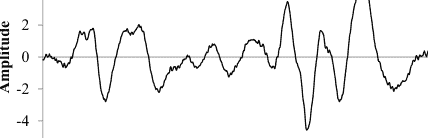
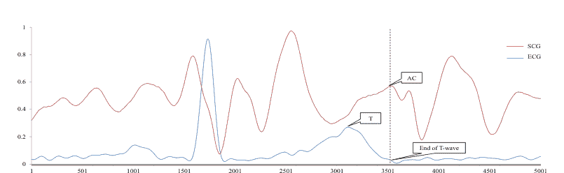
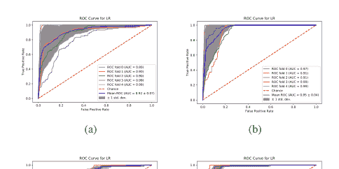

# 2020 IEEE 第17届印度理事会国际会议 (INDICON) ｜｜ 机器学习辅助 A

**Deepak Rai**

CSE 部门

Bennett University

Greater Noida, 印度

l1988@bennett.edu

**Hiren Kumar Thakkar**

CSE 部门

Bennett University

Greater Noida, 印度

hirenkumar.thakkar@bennett.edu

**Deepak Singh**

CSE 部门

Bennett University

Greater Noida, 印度

Deepak.Singh1@bennett.edu

**Harsha Vardhan Bathula**

CSE 部门

HITITM, Kurnool

Andhra Pradesh, 

harsha@iitm.in

*摘要—最近，心震图（SCG）被用于通过相关的 SCG 峰值标注来监测监测心脏健康参数。然而，准确标注 SCG 是一项具有挑战性的任务。在本文中，我们设计了二分类器来标注 SCG 的等容积运动和主动脉瓣关闭（AC）。实现并评估了逻辑回归、支持向量机、决策树、随机森林和高斯贝叶斯算法。实验在 PhysioNet 存储库提供的“echo”数据库上进行。特别是，若干性能结果显示在标注方面具有较高的准确性。*

## I. 引言

在过去几年，心血管疾病（CVD）已成为全球死亡人数增加的根本原因。心脏异常呈现间歇性出现，因此可能被忽视，使得患者护理成为了一项挑战性任务。定期监测心脏健康并开发成本效益的测量工具已成为基本的公共卫生需求。然而，如图1所示，有多种非侵入技术可以监测心脏健康。

然而，心震图（SCG）正越来越受欢迎，因为它是非侵入性的，并且使用低成本加速度计记录心脏震动。导致 SCG 认可度提高的主要因素是基础设施需求相对较低、加速度计技术门槛低，以及最重要的是其在家庭使用的适用性。此外，SCG 能够诊断心肌缺陷，如瓣膜缺陷。最近，基于 SCG 的心脏健康监测 [2] 和早期预警系统 [3] 已结合心电图（ECG）设计用于移动健康应用。

认为 SCG 揭示了心肌功能中的秘密，包括心肌运动、主动脉瓣运动、血流和力矩的变化。SCG 在监测心脏健康和检测心脏异常方面起着至关重要的作用。SCG 由 Roman Basel [4] 发现，首次用于测量主动脉震动。它对年龄、性别和健康状况等各种因素非常敏感。其灵敏度较低。在对 ECG 进行常规分析期间，甚至可以看到 SCG 的频率。

这些峰值的正确标注可以使 SCG 成为诊断心脏异常的强大技术。在本文中，我们提出了一种基于机器学习的二分类方法来标注 SCG 的 IM 和 AC 峰值，并比较了所提分类器的性能。

| | 心音图 |
| :--- | :--- |
| X 射线计算机断层 | 心电图 |
| 非侵入性心脏健康监测技术 | 弹性心电图 |
| 核医学心脏学 | 阻抗心电图 |
| 超声心脏学 | 心震图 (SCG) |

图 1：监测心脏健康的非侵入性技术。

图 2：ECG 信号上对应心脏事件的峰值。

已构建，并使用高斯导数滤波器检测 AO。在 [14] 中，使用了一种基于机器学习的分类方法来标注 ECG 特征点。形成了不同的区域，并根据每个区域的最大值和最小值识别了候选峰值。

最近在 [15] 中，使用了一种新信号——心脏雷达位（RDHI）来检测 AO。RDHI 信号通过傅里叶变换和信号带通滤波获得。在 [16] 中，使用了基于小波的光电脉搏波（PPG）信号处理来识别点。

## II. 相关工作

### A. 数据收集

在 [8] 中，提出了一种基于包络的方法，通过 ECG 检测 AO 和 IM。在 [9] 中，提出了一种基于模板的方法来检测 AO 和点。无论如何，计算了前几个心跳，并估计了 AO 和 IM 点的位置。使用滑动窗口优化了 AO 的位置。使用连续小波变换（CWT）方法检测 AO 和 IM 点。在 [11] 中，使用了一种基于机器学习技术的包络方法来估计 AO 和 IM。该方法使用了两种方式：带有 AO 和 IM 的 ECG 作为参考信号。

数据提取自 PhysioNet 存储库中的 'cebs' 数据库 [17]，包含三种状态（基线、运动和恢复）下受试者的 ECG、SCG 和呼吸记录。在本文中，考虑了三名受试者的 ECG 和 SCG 记录。总计包含 948 个心周期，其中用于 IM 的有 664 个心周期，用于 AC 的有 2864 个周期。

## III. 方法论

### B. 数据预处理

在 [12] 中，使用线性和非线性滤波器检测 AO 和 IM 点。在 [13] 中，使用基于机器学习的分类方法标注 ECG 特征点。形成了不同的区域，并根据每个区域的最大值和最小值识别了候选峰值。

最近在 [15] 中，使用了一种新信号——心脏雷达位（RDHI）来检测 AO。RDHI 信号通过傅里叶变换和信号带通滤波获得。在 [16] 中，使用了基于小波的光电脉搏波（PPG）信号处理来识别 SCG 上的点。

### C. 数据融合

在 [12] 中，使用线性和非线性滤波器检测 AO 和 IM 点。在 [13] 中，使用基于机器学习的分类方法标注 ECG 特征点。形成了不同的区域，并根据每个区域的最大值和最小值识别了候选峰值。

最近在 [15] 中，使用了一种新信号——心脏雷达位（RDHI）来检测 AO。RDHI 信号通过傅里叶变换和信号带通滤波获得。在 [16] 中，使用了基于小波的光电脉搏波（PPG）信号处理来识别 SCG 上的点。

使用平滑数据去除噪声。使用平滑数据去除噪声。如图 5 所示，使用方法去除噪声。

图 3：带噪声的原始 ECG。

### D. 使用的机器学习分类器

本文包含了适用于实时监测的机器学习分类器：逻辑回归 (LR)、支持向量机 (SVM)、决策树 (DT)、随机森林 (RF) 和高斯朴素贝叶斯 (NB)。

- **逻辑回归**：它是基础分类模型之一，使用 sigmoid 几率比和迭代法输出 0 或 1。

- **支持向量机**：被认为是最常见的学习模型之一。其核心思想是通过由 `w` 和 `b` 指定的超平面来分离两类。最优超平面是使超平面与两类最近支持点之间距离最大化的平面。

- **决策树**：这是一种简单的监督分类模型，根据某些规则连续分割数据。通过递归划分方法构建树，该方法迭代地将数据划分为分区。由于训练数据集被拆分成越来越小的子集，同时 DT 会被增量地开发。

- **随机森林**：是一种基于集成分类概念的分类模型。使用数据的自助采样构建分类树，并在每个节点上，候选变量集是变量的随机子集。通过使用袋法（bagging）组合树并进行随机变量选择，产生一个同时实现低偏差和低方差的集成模型。

- **高斯朴素贝叶斯**：朴叶斯是基于贝叶斯定理的监督分类分类器。它不是单一模型，而是一族模型，所有模型共享一个共同原理，即每对特征之间相互独立的。GNB 是针对真实属性的朴素贝叶斯名称，假设数据分布是高斯且连续的。在 GNB 中，任何新数据的概率都是通过高斯概率密度函数计算的。

图 6：相对于 ECG T 波波的 SC AC 点。

| 数据集 | 特征 | 总样本量 | 训练样本 | 测试样本 |
|---|---|---|---|---|
| IM_Dataset_1 | 幅 | 4053 | 2837 | 1216 |
| IM_Dataset_2 | 幅和 TOA_AO | 4053 | 2837 | 1216 |
| AC_Dataset_1 | 幅 | 1625 | 1137 | 488 |
| AC_Dataset_2 | 幅和 TOA_AO | 1625 | 1137 | 488 |

分类器基于 70% 的数据进行训练，剩余的 30% 数据用于测试。分类器的训练和测试数据的详细信息通过 5 折交叉验证方法确保。

## IV. 结果与讨论

所选分类器在 Python Jupyter notebook 中实现，使用了 Scikit 机器学习库。所有数据集的测试结果被用于计算性能指标的值。计算了特异性、准确率、精确率、召回率、F1 分、对数损失、错误率和 AUC。结果如表 II所示。此外，使用 5 折交叉验证验证了分类器的性能，相应的结果报告于表 III。此外，为分类性能的每一折计算了 roc 曲线。roc 曲线如图 7 所示。此外，RF、SVM、DT 和 GNB 分别于图 7 (a)、(b)、(c)、(d) 和 (e)。

图 7：LR 的 ROC 曲线；(a) IM_Dataset_1 (b) IM_Dataset_2 (c) AC_Dataset_1 (d) AC_Dataset_2。

表 II 报告的测试结果显示，估计器数量为 500 且经过 5 折验证的 RF 在 IM_Dataset_2 和 AC_Dataset_2 的标注上优于所有其他分类器。在图 10(a) 和 (b) 中也可以看到这一点。图 10(d) 显示 RF 以显著高的 AUC（0.977-0.992 和 0.970-0.972）优于其他。此外，表表所示，RF 在 AC 标注上的表现不佳。表 III 显示的 5 折交叉验证结果也证实了 RF 的优越性。表 II、表 III、图 7(c)、8(c)、9(c)、10(c) 和 11(c) 中根据 AC_Dataset_1 报告的分类器表明，仅用幅作为特征来标注 AC 是具有挑战性的。然而，可以用幅标注 IM。精确率、召回率和 F1 分的零值代表 LR、SVM 和 GNB 分类器在分类 AC_Dataset_1 正类 1 时的稀有性。然而，分类器在该数据集上的准确率更好，因为它们正确地分类了负类 i 为 0。这也通过表 III 显示的交叉验证结果得到了证实。

## V. 结论与未来范围

本文分析了用于 ECG 上 IM 和 AC 点标注的各种机器学习方法。分类器使用从 Physio 存储库公开获取的数据集进行训练和测试。使用两种特征以及“TO AO”组合准备了四个不同的数据集，每个用于 IM 和 AC。

| 分类器 | 数据集 | 准确率 | 精确率 | 召回率 | F1 分 | 对数损失 | 错误率 | AUC |
| :--- | :--- | :--- | :--- | :--- | :--- | :--- | :--- | :--- |
| Logistic | IM_Dataset_1 | 0.913 | 0.862 | 0.560 | 0.679 | 3.011 | 0.087 | 0.771 |
| Regression | IM_Dataset_2 | 0.936 | 0.855 | 0.735 | 0.790 | 2.215 | 0.064 | 0.855 |
| AC | IM_Dataset_3 | 0.887 | 0.528 | 0.590 | 0.695 | 5.075 | 0.014 | 0.894 |
| Support | IM_Dataset_4 | 0.883 | 0.652 | 0.690 | 0.660 | 4.034 | 0.117 | 0.807 |
| Vector | IM_Dataset_5 | 0.910 | 0.790 | 0.610 | 0.691 | 3.092 | 0.090 | 0.790 |
| Machine | IM_Dataset_6 | 0.847 | 0.826 | 0.665 | 0.746 | 3.303 | 0.112 | 0.831 |
| Decision | IM_Dataset_7 | 0.826 | 0.800 | 0.000 | 0.000 | 6.016 | 0.174 | 0.499 |
| Tree | IM_Dataset_8 | 0.910 | 0.819 | 0.688 | 0.772 | 3.992 | 0.115 | 0.879 |
| Random | IM_Dataset_9 | 0.854 | 0.854 | 0.032 | 0.532 | 0.056 | 0.149 | 0.714 |
| Forest | IM_Dataset_10 | 0.911 | 0.718 | 0.750 | 0.733 | 3.096 | 0.094 | 0.846 |
| AC | IM_Dataset_11 | 0.906 | 0.721 | 0.738 | 0.727 | 3.227 | 0.151 | 0.913 |
| Naive | IM_Dataset_12 | 0.905 | 0.759 | 0.615 | 0.680 | 3.095 | 0.095 | 0.798 |
| Bayes | IM_Dataset_13 | 0.918 | 0.776 | 0.830 | 0.798 | 2.358 | 0.066 | 0.902 |
| Gaussian | IM_Dataset_14 | 0.910 | 0.720 | 0.620 | 0.665 | 3.096 | 0.095 | 0.794 |
| AC | IM_Dataset_15 | 0.913 | 0.797 | 0.680 | 0.704 | 3.111 | 0.087 | 0.799 |

| 分类器 | 数据集 | 准确率 | 精确率 | 召回率 | F1 分 | Neg-loss | AUC |
| :--- | :--- | :--- | :--- | :--- | :--- | :--- | :--- |
| Logistic | IM_Dataset_1 | 0.907 | 0.797 | 0.522 | 0.530 | -0.321 | 0.907 |
| Regression | IM_Dataset_2 | 0.924 | 0.818 | 0.655 | 0.686 | -0.177 | 0.954 |
| AC | IM_Dataset_3 | 0.896 | 0.639 | 0.648 | 0.718 | -0.048 | 0.953 |
| Support | IM_Dataset_4 | 0.907 | 0.748 | 0.582 | 0.617 | -0.303 | 0.722 |
| Vector | IM_Dataset_5 | 0.915 | 0.866 | 0.627 | 0.735 | -0.319 | 0.839 |
| Machine | IM_Dataset_6 | 0.826 | 0.806 | 0.000 | 0.047 | -0.475 | 0.508 |
| Decision | IM_Dataset_7 | 0.906 | 0.816 | 0.739 | 0.784 | -0.796 | 0.924 |
| Tree | IM_Dataset_8 | 0.917 | 0.892 | 0.676 | 0.767 | -0.732 | 0.812 |
| AC | IM_Dataset_9 | 0.914 | 0.737 | 0.776 | 0.752 | -0.706 | 0.931 |
| Random | IM_Dataset_10 | 0.906 | 0.788 | 0.794 | 0.756 | -0.303 | 0.815 |
| Forest | IM_Dataset_11 | 0.921 | 0.826 | 0.032 | 0.038 | -0.449 | 0.751 |
| AC | IM_Dataset_12 | 0.905 | 0.814 | 0.912 | 0.864 | -0.225 | 0.821 |
| Naive | IM_Dataset_13 | 0.905 | 0.751 | 0.660 | 0.632 | -0.334 | 0.897 |
| Bayes | IM_Dataset_14 | 0.913 | 0.797 | 0.696 | 0.718 | -0.219 | 0.902 |

测试和交叉验证结果显示 RF 优于所有其他分类器。分析还表明，仅用幅作为特征，AC 点的标注是一个挑战性。可以包含更多数据来分析 SCG 图上分类点的显著性。

## 参考文献

- [1] S. S. Virani, A. Alonso, E. J. Benjamin, M. Bittner, C. C. Callaway, A. P. Carter, A. R. Chang, S. Sergey, F. J. N. Delling et al., “Heart disease and statistics-2020 update: a report from the american heart association.” Circulation, 141(9), e225–e333, 2020.

- [2] P. K. Salso, H. K. Takkar, W.-Y. Lin, P.-C. Chang, and M.-Y. Lee, "On the design of cardiac health monitoring system based on scg signals," Sensors, 18, no. 2, p. 379, 2018.

- [3] P. K. Salso, H. K. Takkar, and M.-Y. Lee, "Cardiac monitoring system with multi scg and ecg monitoring for health mobile," Sensors, 19, no. 4, p. 371, 2021.

- [4] R. Buresij, A. Gorky, and K. Kazarian, "The method of seismocardiography." Journal of clinical medicine, 23(1), pp. 45–52, 1968.

- [5] D. M. Salerno, "Seismocardiography: a new technique for detecting cardiac vibrations, and initial observations," *Journal of cardiology research*, vol. 2, no. 1, p–5, 2001.

- [6] J. Zanetti, M. Polici, and J. Lu, "Seismocardiography: waveform for identification and noise analysis," in *International Conference on Biomedical Engineering*, pp. 49–52.

- [7] R. S. Craven, P. D. Hamans, and M. Hedard, "Seismocardiographic analysis of the mitral valve." *The american journal of cardiology*, 190(4), pp. 88–96, 1994.

- [9] G. Shafiq, S. Tatini, and K. Veludu, "Automatic annotation of points in seismocardiography for functional heart intervals," in *18th Annual Conference of the IEEE in Medicine and Biology Society (EMBC)*. IEEE, 2016, pp. 2662–2667.
