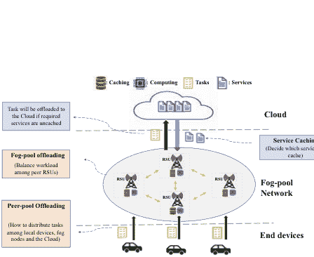

# 2020 IEEE 第17届移动自组织网络与传感器系统会议 (MASS) (印度德里 2020.12.10-2020.12.13)

**摘要**— 车辆网络中的雾计算变得至关重要，许多对高计算资源和低延迟有需求的应用（如联网与自动驾驶）依赖于在车辆网络中计算卸载和服务缓存来处理资源密集型服务。雾计算的计算资源数量是有限的。虽然计算卸载和缓存可以最大化系统性能时间，但车辆网络的异构性、密度和随机特性给资源分配带来了挑战。在本文中，我们提出了一种带有服务缓存的智能卸载架构，同时考虑了能量效率以及计算卸载与服务缓存问题。为了提高能量效率，我们提出了一种基于深度强化学习的算法来解决这一复杂问题，确保了我们方案的可行性。结果表明，与所选的基准方案相比，我们提出的方案展现了有效的性能提升。

车辆网络中的节点 [11], [5]–[8]。车辆用户可以将任务卸载到具有中等计算资源的雾节点以降低延迟。如果处理需求超过了雾平台的容量，这些任务将被卸载到云端，这相对于卸载到其他雾节点属于垂直卸载，从而形成了一种水平卸载方法。

此外，车辆用户的卸载任务往往依赖于其他服务。例如，为了确保自动驾驶系统中进行更准确的检测，需要高分辨率的目标检测。在检测任务中，需要一个具有足够计算资源的雾节点来处理传感器数据，例如来自视频传感器和雷达传感器的数据。为了提高效率，地图服务和相关数据库必须缓存在雾节点本身。然而，如果雾节点在卸载时（即目标检测时）没有缓存所请求的服务（即地图服务），则任务可以进一步卸载到其他雾节点，从而影响服务交付的质量。

**索引术语**— 车辆计算、计算卸载、服务缓存、强化学习。

# I. 引言

随着云计算和蜂窝网络等先进通信技术的出现，车辆网络及其应用正变得可行。车辆网络的显著发展使得大量应用成为可能，如增强现实（AR）和自动驾驶，这些应用都有复杂的处理需求和高可靠性要求 [1], [2]。然而，将所有任务卸载到云端会导致沉重的后端负载和不可接受的延迟 [3]。车辆计算（VFC）（又称为边缘计算）被提出作为有前景的解决方案，以解决从远程云到雾节点计算引起的问题。

因此，缓存服务是实现卸载到雾节点任务效率的重要因素。缓存以两种不同的形式出现：内容缓存和服务缓存。例如，内容缓存将高频使用的媒体数据存储在雾中供用户使用 [11]。服务缓存是在执行计算任务时存储程序代码的元数据以及相关的数据库/文件 [14]–[16]。在一个场景中，目标检测所需的地图被缓存在雾节点中。

最优计算卸载和服务缓存的设计面临许多挑战。存储空间的限制使得雾节点在本地缓存所有应用服务变得是不切实际的。如何缓存所需的服务（即缓存哪些服务）至关重要，影响着基于雾的车辆系统的卸载。不同雾节点上的计算资源可能分布不均。通过实现不同雾节点之间的协作来平衡计算负载是至关重要的。车辆的异构性增加了实现最优计算卸载和调度策略的难度。

# II. 相关工作

任务卸载。许多人员对移动云计算 [27], [28]、移动边缘计算（MEC）和泛在计算中的卸载投入了大量工作，主要集中在如何将任务从端到端卸载到雾服务器或云端。最近，许多人研究了 VFC 中任务卸载的各种因素。在工作 [17] 中，作者提出了一种利用队列论通过划分和移动节点来利用 VFC 的方法，以最小化响应延迟。在工作 [18] 中，作者设计了一种基于游戏的算法对车辆网络中的任务卸载进行建模，以将价格无政府降低到纳什均衡。

雾计算中的计算卸载已有一些研究 [17]–[21]，但它们没有考虑服务缓存问题。少数工作 [14]–[16] 解决了计算卸载问题，包括任务优化、本地决策设计和服务缓存。然而，与我们提出的方案相比，我们提供了一个更全面的系统架构，它包含了雾与池化卸载，包括任务优化和服务缓存管理。

同样地，在工作 [19] 中，考虑到车辆的移动性和负载的延迟对 VFC 中的任务卸载建模并解决了可靠性问题。在工作 [25] 中，作者提出了一种用于具有额外可靠性和低延迟 V2 基础设施的方法，利用了多服务器和网络传输延迟。工作 [29] 考虑了多边缘服务器场景。在 [31] 中，作者发现网络中的车辆可以从邻居处学习卸载策略。这项工作进一步设计了卸载策略并解决了最小化平均延迟的优化问题。

我们设计了基于强化学习（DRL）的深度策略梯度（DPG）[22] 来实现目标。

- 我们提出了一种基于雾的服务缓存车辆架构计算卸载。该架构采用雾-池计算管理来最大化系统效率。
- 我们将联合计算卸载和服务缓存的优化问题形式化，以降低任务复杂度。
- 我们基于算法 `DPG` [22] 设计了卸载策略，以获得该问题的解决方案。该策略允许对计算卸载和服务缓存进行高效决策。

实现任务性能和长期能耗的最小化。这促使我们开发一种新型架构来优化计算卸载和服务缓存，总结如下：

我们进行了实验和实际研究以评估所提算法的性能。

本文的其余部分结构如下：第二节讨论了任务卸载、服务缓存和基于 AI 的任务卸载的相关工作。我们在第三节介绍了带有服务缓存的架构。在第四节中，我们将联合计算卸载和服务缓存的优化问题形式化。第五节介绍了用于解决该问题的 DRL 算法。最后，在第六节评估了我们所提系统的性能。我们在第七节总结全文和未来工作。

服务缓存。服务缓存及其数据库/文件预存储在雾服务器中以便快速访问。这种方法减少了当相关任务卸载到雾服务器时获取服务的延迟和带宽消耗。例如，在工作 [32] 中，作者在网络中使用缓存来最小化流量负载。[33] 提出了一种用于 MEC 中请求路由框架。它进一步利用边缘缓存来最小化请求数量。更重要的是，工作 [34] 考虑了通信和计算，并将问题建模为混合整数非凸优化。



图 1：架构概述

服务缓存与任务分配以维持总卸载计算量。在工作 [16] 中，研究了针对现有系统的服务缓存与计算卸载方法的联合优化，以减少任务的总计算延迟和能量成本 [14]–[16], [34]；与我们相似，在执行卸载任务时，我们不考虑服务器之间对等雾网与雾网池之间的协作，尽管这有局限性，但为了提高系统性能，我们认为任务可以在对等池中考虑并利用某些 DRL 算法。

而 AI 任务卸载作为一个新兴领域，越来越多地应用于解决 VFC 中的优化问题。[23] 中的 VFC 使用双重解码深度 Q 网络（Double-Decoding Deep Q-Network）在一种可以动态重构网络和计算资源的框架下解决优化问题。[24] 中的作者使用了基于 DRL 的方法作为用户的卸载方案，并在考虑请求约束和通信信道约束的情况下解决优化问题。此外，我们的目标是计算卸载和服务缓存，针对服务器的对等雾网和雾网池协作，使用基于 DRL 的更合适且可靠的算法。

# III. 架构概述

在本节中，我们提出了一种高层架构，作为我们在 VFC 中计算卸载和服务缓存方案设计的基石。

- **架构层级。** 所提架构如图 1 所示，它包含三层：端设备 (ED)、雾网层和云层。

- **端设备：** 在 VFC 场景下，端设备主要是车辆和汽车。它们通常具有本地计算和存储资源，可以管理诸如机器学习和视频处理等高计算量任务的需求。

- **雾网层：** 该层由一组雾服务器（如路侧单元 RSU）组成，这些服务器之间互相连接。这些雾服务器提供中等的计算能力和容量，不仅处理它们自身的任务，还接收来自端设备的卸载任务。它们分布密集，并覆盖整个区域。

- **云层。** 云层通常拥有丰富的计算和存储资源，可以处理高计算需求的任务。在我们的系统中，雾网池连接了雾服务器中的计算资源和缓存服务。

卸载方法。在我们的架构中，我们的目标是通过引入两种类型来利用计算和缓存卸载：对等雾协作和雾网池协作。

- **对等雾协作。** 在对等雾场景下，计算资源有限的端设备可以将任务卸载到雾网池中的雾服务器。然而，由于雾网池中的计算资源有限，这可能会引入额外成本。在这种情况下，任务将卸载到资源丰富的云端，导致更高的成本。这样，在计算卸载和通信之间存在权衡。

- **雾网池协作：** 在雾网池协作场景下，雾服务器可以相互通信并互相帮助。雾网的资源可以处理来自端设备的异构请求。

服务缓存。基于 AR 的驾驶辅助多种应用包括目标识别和 3D 投影。为了执行这些任务，如图 1 所示，在雾网层进行服务缓存是必要的。鉴于缓存节点资源有限，缓存和存储数据库是不现实的。因此，一个关键问题是确定哪些服务应该被缓存。我们下一节中通过模型解决这个问题。

# IV. 系统模型

在本节中，我们首先介绍网络模型、通信模型和计算模型。然后，我们建立了一个优化问题，以使所有任务的总延迟和能量成本最小，其中 $G_{ij}$ 表示信道增益，$W_i$ 表示车辆 $i$ 与其关联 RSU 之间的通信带宽。符号 $\rho_i$ 是车辆 $i$ 的传输功率，$\sigma^2$ 是噪声功率。当端任务 $i$ 卸载到 RSU $j$ 的能耗可以表示为：

$e_{ij}^i = \rho_i^* \frac{d_i}{R_{ij}}$

### A. 网络模型

如图 1 所示，我们的系统中有三个参与者：路侧单元 (RSUs) 和车辆。车辆通过无线连接相互通信，而 RSU 与云有有线连接。有 $K$ 辆车辆和 $N$ 个任务，每个任务由 $(d_i, v_i)$ 表示，其中 $d_i$ 表示输入数据，$v_i$ 表示处理任务 $i$ 所需计算。为了简单起见，我们假设每辆车辆 $j \in K$ 都可以表示为 $\{M_j, V_j\}$，其中 $M_j$ 表示 RSU 的计算能力，$V_j$ 表示其计算成本。

我们在计算和卸载过程中定义了集合 $O = \{o_i\}$、$F = \{f_i\}$ 和 $C = \{c_{ij}\}$。

- **对等卸载：** $O = \{o_i\}$，如果 $o_i = 1$，则任务从车辆卸载到 RSU，而 $o_i = 0$ 车辆在本地处理任务。

- **雾网卸载：** $F = \{f_i\}$，只有当 $f_i=1$ 时，任务才能被卸载到最近的雾服务器，此处 $f_i$ 表示最近的雾服务器，且计算任务需要卸载到雾中的其他服务器。

- **云卸载：** $C = \{c_{ij}\}$，$C$ 到计算服务集 $C = \{0, 1, 2, ...\}$。由于 RSU 存储空间有限，缓存和存储数据库是不现实的。因此，一个关键问题是确定哪些服务应该被缓存。我们将在下一节中通过模型解决这个问题。在我们的系统中，优化决策在时片 $T = \{0, 1, ...\}$ 上做出，由 RSU 返回优化结果。我们假设所有决策在每个时片内保持稳定。

### B. 通信模型

- **车辆到 RSU（V2R）：** 我们假设 RSU 使用单跳自形成网络。车辆选择信道最强的 RSU 进行通信。因此，车辆 $i$ 与 RSU $j$ 的通信速率为：

$R_{ij} = W_{ij} \log_2(1 + \frac{\rho_i G_{ij}}{\sigma^2})$

其中 $G_{ij}$ 表示信道增益，$W_i$ 表示车辆 $i$ 与其关联 RSU 之间的带宽。

$e_{ij}^i = \rho_i^* \frac{d_i}{R_{ij}}$

- **RSU 到 RSU（R2R）和 RSU 到云（R2C）：** RJ 和 RC 通过光纤网络。$R_{ba}$ 是 RSU 与云之间的传输速率。我们可以计算 RSU 之间的通信能耗为：

$e_{ij}^i = \rho_i^* \frac{d_i}{R_{ij}}$

### C. 计算模型

- **1) 本地：** 为了简化分析，我们假设本地车辆以最大 CPU 速度 $m_i$ 运行端任务 $i$。那么，处理任务 $i$ 需要的时间为：

$t_i^l = \frac{q_i}{m_i}$

随后，任务 $i$ 的本地计算能耗表示为：

$e_i^l = \rho_i^* \frac{q_i}{m_i}$

其中 $\rho_i$ 表示任务 $i$ 卸载到服务器 $j$ 时的功率，

- **2) 雾：** 如果任务卸载到服务器 $j$，任务 $i$ 需要的时间可以根据以下情况计算：

$t_{ij}^f = \frac{d_i}{R_{ij}}$

并且在时片上的执行时间为：

$t_{ij}^i = \rho_i^* (\frac{q_i}{M_{ij}} + (1-c_{ij})t_{ij}^f)$

其中 $M_{ij}$ 表示分配给端任务 $i$ 的雾计算能力，$t_{ij}^f$ 表示指示。

当前服务器额外的开销是将此任务上传到云端，并在服务器缓存不可时获取所需的反馈。由于计算和存储资源在云端，云端会产生队列和队列延迟。用户需要考虑将任务卸载到云端的延迟。因此，我们有：

```
$E_{ij}^* = p_{ij}^* \cdot c_{ij}^* \quad (11)$
```

根据 (7) 和 (8)，处理任务 i 所需的时间为：

```
$T_{ij}^* = t_{ij} + t_{ij}^* \quad (10)$
```

卸载任务 i 的能耗由两部分组成：从终端将任务上传到 i RSU 或 j（如公式 (2) 所示），以及在 RSU 或云端中执行任务：

```
$E_{ij}^* = p_{ij} \cdot c_{ij} + (1 - c_{ij})c_{jcs} \quad (12)$
```

其中 $p_{ij}$ 表示雾节点中计算的功耗。因此，点对点卸载的成本为：

```
$T_{ij}^* = t_{ij} + t_{ij}^* \quad (13)$
```

雾与雾卸载。如果关联服务器 j 不是节点 i 的关联节点，则处理所需的时间为：

```
$t_{ij}^* = t_{im} + t_{mj}^* \quad (14)$
```

其中 $t_{im}$ 是任务从节点 i 上传到关联服务器 m 的时间（如 (7) 所示）；$t_{mj}^*$ 是任务在服务器 m 上的执行时间（如 (8) 所示）；$t_{mj}$ 表示关联服务器 m 与当前服务器 j 之间的传输时间，公式为：

```
$d_{mj} / R_{sw} \quad (15)$
```

在这种情况下，能耗由三部分组成：从终端卸载任务到 i RSU 或 j 的能耗，可以用公式 (2) 表示；从 RSU 传输到 j 的能耗，可以用公式 (3) 表示；因此，在 RSU 或 j 中执行任务的能耗为：

```
$E_{ij}^* = e_{ij} \cdot c_{ij} + e_{jcs} \quad (16)$
```

在云端完成处理后，云端将结果发回给终端设备。由于计算和存储资源在云端，我们可以识别该任务中的延迟和能量成本 [36]。

通过整合公式 (5)(6)(7)(8)(9)(10)(11)(13)(14)，处理任务 i 的总延迟表示为本地延迟或卸载延迟，其中包括卸载和上传任务 i 的延迟。因此，我们有：

```
$T_{total} = (1 - \alpha_{ij}) \frac{d_{ij}}{C_{ij}} + \alpha_{ij}(\frac{d_{ij}}{C_{ij}} + \frac{q_{ij}}{m_{ij}} + (1 - \alpha_{ij})\frac{c_{ij}}{R_{cloud}} + \frac{f_{ij}}{R_{sw}}) \quad (17)$
```

根据 (2)(3)(4)(6)(7)(12)(15)，处理任务 i 的总能量成本表示为卸载能量成本或卸载成本，其中包括上传和执行任务 i 的成本。我们有：

```
$E_{total} = (1 - \alpha_{ij})\frac{d_{ij}}{C_{ij}} + \alpha_{ij}(\frac{d_{ij}}{C_{ij}} + \frac{q_{ij}}{m_{ij}}) + (1 - \alpha_{ij})\frac{c_{ij}}{R_{cloud}} + \frac{f_{ij}}{R_{sw}}) \quad (18)$
```

### D. 问题公式

我们工作的主要目标是为雾环境设计卸载调度方案，以最小化处理时间和长期能量消耗。方案优化卸载决策 O、缓存 C、计算资源分配 M 和雾卸载能力，以最小化系统的加权终端卸载延迟和能量成本：


$$
\sum_{i \in T} \sum_{j \in J} (\lambda_{ij} T_{ij} + \mu_{ij} E_{ij})
$$
s.t.
- C1: $\alpha_{ij} \in \{0, 1\}, i \in T, j \in J$
- C2: $C_j \leq 1, i \in T$
- C3: $c_{ij} \leq m_j, i \in T$
- C4: $f_j \leq F_j, i \in J$

$O = \{\alpha_{ij}\}, C = \{C_j\}, M = \{m_j\}, F = \{F_j\}$。令 $\lambda_{ij}$ 代表能量成本，$\mu_{ij}$ 代表延迟。为了简化模型，我们设置 $\lambda_{ij} = 1$，且 $\mu_{ij} = 1$：
- 约束 1 表示任务可以通过雾节点卸载。
- 约束 2 表示任务最多在一个服务器执行。
- 约束 3 定义了雾服务器的限制。
- 约束 4 代表任务的大小。

为了解决这个优化问题，关键在于找到合适的 O、C、M 和 F。解决问题的挑战在于状态数量的增加。数学问题是非凸 NP 问题。因此，我们利用基于 DRL 的算法 DDPG 来简化挑战并找到解决方案。

# V. 强化学习方法

对资源的约束使得最小化系统成本变得困难。DRL 被视为解决复杂问题的有效方法。在 DRL 中，代理需要关于网络资源和多样化需求的信息。然后代理执行缓存决策并优化资源分配。在本文中，我们使用名为确定性策略梯度（DDPG）的强化学习算法来解决问题 (18)。

### A. 基于 DRL 的问题公式

使用 DRL 的动机是提高动态环境中系统的灵活性。任务出现并卸载到雾服务器。服务器处理这些任务并转发到云端，并将结果发回用户。这些过程可以被视为马尔可夫决策过程 (MDP)，系统的状态仅取决于上一个状态。令 $S = \{s_1, s_2, ..., s_n\}$，动作空间 $A = \{a_1, a_2, ..., a_m\}$，转移概率 $P = \{p(s_j|s_i, a_k)\}$，奖励函数 $R = \{r(s_i, a_k)\}$ 是可以在动态状态下最大化奖励并选择最佳动作的系统函数。

**状态**：状态用于反映环境。在这里由可用资源表示，包括计算缓存容量。状态空间定义为 $S = \{M_1, M_2, ..., M_n\}$，$V = \{v_1, v_2, ..., v_n\}$，$C = \{c_1, c_2, ..., c_n\}$，$B = \{b_1, b_2, ..., b_n\}$，$U = \{u_1, u_2, ..., u_n\}$ 以及 $L = \{l_1, l_2, ..., l_n\}$。

**奖励**：奖励用于反映当前状态的收益和消耗目标。公式问题的目标是最小化任务处理的总延迟和能耗。因此，我们将奖励设置为 $R = -\sum_{i=1}^{n} (delay_{i} + \beta energy_{i})$。

### B. 基于状态空间、动作空间和奖励的 DDPG

在定义状态空间、动作空间和奖励后，我们利用 DRL 来解决优化问题。对于强化学习，一个代表是 Q-learning。Q-learning 使用 Q 表记录不同状态和动作的 Q 值。然而，它可能不适用于动作空间很大的场景。深度 Q 网络 (DQN) 使用神经网络估计 Q 值，可以支持高维状态动作空间，但收敛速度慢。在这种情况下，我们利用确定性策略梯度（DDPG）无模型 actor-critic 算法来解决计算卸载和缓存问题。

我们可以将 DDPG 算法视为 DRL 算法的结合 [38]。DDPG 算法由三部分组成：主网络、目标网络和内存。主网络和目标网络每个包含两个网络（actor 和 critic），总共四个网络。我们利用 actor 网络探索策略，并利用 critic 网络评价策略。critic 还为更新策略内存提供关键值。通过存储训练期间的状态-动作对和奖励，代理将选择这些样本以减少数据相关性影响。在这一点中，我们遵循深度神经网络的方法。

# 算法 1：基于 DRL 的计算卸载与服务缓存联合决策算法

| 参数 | 数值 |
|---|---|
| RSU 数量 | M |
| 车辆数量 | N |
| RSU 计算能力 | 2 Cycles/sec |
| RSU 缓存容量 | 200 GB |
| 本地计算能力 | [300, 500] Cycles/sec |
| 存储单元 | 29.72 Cycles/bits |
| 每个任务的计算强度 | [2*10^2, 2*10^3] bits/sec |

**输入：** 可用资源、计算和缓存能力的初始状态 $S_0$；测试事件的参数；初始参数：$\theta_0, \omega_0, \alpha, m, n$；目标网络卸载容量 $Q$

**输出：** 最优 actor 参数 $\theta$；当前最优 critic 参数 $\omega$；计算与服务缓存的最优动作：

1. 初始化参数：$i=0, \theta=\theta_0, \omega=\omega_0$；
2. 清空内存集 $D$；
3. 对于 $i$ 从 1 到 $T$：
4. 初始化环境状态 $S_i$，获取 $\pi(S_i)$；
5. 执行动作 $A_i$，获取新状态 $S'$、奖励 $R$ 和结束索引 $end\_idx$；
6. 将 $(S_i, A_i, R, S', end\_idx)$ 存储在内存集中；
7. $S=S'$；
8. 从内存集 $D$ 中采样，如果 $end\_idx=0$，则计算当前目标 $Q$：
9. $y_i = R_i + \gamma Q'(S', \pi(S'))$；
10. 否则 $y_i = R_i$；
11. 更新 critic 网络参数 $\omega$
12. $J(\omega) = \sum_{i=1}^m (y_i - Q(s_i, a_i))^2$；
13. 通过策略梯度函数 (21) 更新 actor 网络参数 $\theta$；
14. 如果 $T\% < C$，更新当前 actor 和网络参数；
15. $\omega \leftarrow \alpha\omega + (1-\alpha)\omega$；
16. $\theta \leftarrow \alpha\theta + (1-\alpha)\theta$；
17. 如果 $S'$ 是结束状态，完成迭代，则；
18. 回到步骤 (4)。

RSU 位于一个 $200 \times 200$ 的正方形区域。每辆车辆与其关联的 RSU 之间的距离在 100 米以内。我们测试的场景受现实场景启发：在计算受限的雾边缘场景，用户密度不会很大。RSU 以不同的速度移动。在我们的评估中，扩展 RSU 的数量及其服务可以提高运行速度。

对于每个实验，缓存容量被设置为 200 GB。车辆的本地计算能力在 [300, 500] Cycles/sec 范围内随机完成。每个任务的计算强度为 29.72 Cycles/bits。每个任务卸载到雾边缘服务的计算在整个仿真过程中均匀分布。

- 我们使用以下算法的方法来控制总成本、时间和能量成本：
- DQN：该算法利用 Q 网络来优化计算卸载和服务缓存。
- Local（本地）：在车辆中执行所有任务，不进行任何卸载。
- Offloading（卸载）：将所有任务卸载到雾边缘服务器，不进行服务缓存。

我们选择累积奖励作为性能指标，基于延迟和能量消耗成本，这将导致奖励增加。

# B. 仿真结果

在本节中，我们评估了计算卸载和服务缓存算法的性能。我们考虑总成本、服务延迟和能量成本，比较了几种现有算法的性能。

## A. 实验设置与指标

我们的测试设置基于相关工作 [39]，并考虑了一个基于雾的车辆网络，由一个云端、$M=3$ 个 RSU 和 $N=6$ 辆车辆组成。三者在图 2(a) 中，我们使用 TensorFlow 绘制了 200 次迭代的累积奖励曲线。预期，基于 DRL 的策略比其他策略收敛更快且性能更好。图 2(b) 显示系统总成本随着车辆数量的增加而增加。根据方案，本地策略成本最高。由于雾服务器拥有比车辆更多的计算资源，卸载策略表现比本地策略好。DRL 和 DQN 算法表现更好，因为它们考虑了节点池协作和服务缓存。通过这些方法，所有可用资源可以合理地用于任务处理，从而观察到（成本的）减少。


(a) DDPG 和 DQN 的收敛。


(b) 总成本 vs 车辆数量。


(c) 总成本 vs RSU 容量。


(d) 总成本 vs RSU 缓存容量 (GB)。


(e) 延迟 vs RSU 容量。


(f) 能量成本 vs RSU 容量。

图 2：延迟和能量消耗的评估结果。另一方面，DDPG 算法在获取总和 RSU 计算资源方面优于 DQN。图 2(c) 描述了我们系统中总成本与 RSU 计算资源之间的关系。随着雾服务器计算能力的增加，DDPG、DQN 和仅卸载方案的总成本降低，产生了更好的结果。本地策略由于不使用雾中的任何资源，成本最高。图 2(e) 表示了所有方案在雾服务器计算资源方面的延迟。本地和仅卸载方案显示它们不依赖于雾服务器的缓存容量。仅卸载方案的成本比其他方案低，因为雾服务器能够将任务分配给缓存服务；否则，它们需要从云端请求，导致成本增加。在 DDPG、DQN 和仅卸载方案中，当雾服务器计算能力增加时，任务处理的延迟减少。然而，我们提出的方案比仅卸载方案性能更好。这是因为仅卸载方法不使用缓存，导致了较高的通信延迟。如果服务器对分配的任务没有所需的服务，它必须将任务卸载到远程云并产生卸载延迟。图 2(f) 表示每个任务的平均能量消耗与 RSU 容量的关系。仅卸载方案的任务能量消耗最高。能量消耗与设备功耗以及通信和计算资源有关。DDPG 和 DQN 方案的能量消耗较低，卸载到雾服务器的任务未使用缓存，它们获得了稳定的值。DDPG 和 DQN 方案的能量消耗随着 RSU 容量的增加而减少。评估结果显示深度强化学习算法在动态车辆环境中具有低总成本卸载策略优势。

# 致谢

此工作得到了挪威研究委员会 DITE 项目（资助号 262854/2）的支持，并受到中国自然科学基金 6200137 支持。

# VII. 结论

在本文中，我们设计了一种车辆网络架构，以延迟和能量消耗最小化任务卸载和服务交付的成本。我们的架构结合了节点池协作，在考虑缓存网络服务交付的同时优化卸载。

我们采用名为 DDPG 的 DRL 算法来解决该问题。大量的结果结果证明了有效性。在未来，我们将探索用户终端之间的社交关系以及联合卸载框架中的感知服务。

# 参考文献

1. Z. Jiang, J. Huang, and Y. Zhang, 'Vehicle fog computing for real-time task management for service cities,' IEEE Wireless Communications, vol. 26, no. 1, pp. 87–93, 2021.
2. Y. Liu, L. Chen, C. Qian, A. Taabordi, and F. Elissen, 'Latency analysis of wireless networks for proximity services in mobile and home automation: The case of IEEE,' Access, 10, pp. 55631–55645, 2022.
3. Y. Liu, A. Hassan, M. Karifakis, O. Wester, and G. Gong, 'Active offloading in mobile edge-enabled IoT networks,' IEEE Access, 10, pp. 6361–6364, 2022.
4. Z. Chen, H. Ma, J. Liu, and G. Gong, 'Data-centric internet of things based on edge,' IEEE Internet of Things Journal, 7, pp. 9158–9169, 2020.
5. X. Chen, L. Zhou, L. Liu, H. Zheng, and Y. Ma, 'An intelligence-driven perspective on mobile edge computing,' 2019 IEEE International Conference on Communications (ICCO), Press.
6. L. Liu, C. Chen, Q. Pei, S. Mahajan, and Y. Zhang, 'Joint offloading and network allocation in mobile edge cloud computing,' IEEE Access, 8, pp. 7791–7800, 2020.
7. J. Peng, et al., 'Joint offloading and resource allocation for block-enabled edge computing: Deep reinforcement learning approach,' 2020 International Conference on Communications (ICC), Press.
8. S. Liu, S. Tang, J. Bao, and Y. Wang, 'Optimizing task offloading and content caching in vehicular networks,' IEEE Technol., vol. 107, no. 8, pp. 1716–1729, 2021.
9. J. Kim, A. Taabordi, and M. Lin, 'Deep content caching in vehicular wireless networks: Cloudless caching,' IEEE Letters, 9, no. 5, pp. 995–999, 2020.
10. K. Zhang, S. Liu, Y. He, and Y. Zhang, 'Cooperative content caching with mobile edge computing,' IEEE, 25, no. 5, pp. 8077–8083, 2022.
13. H. Jiao, et al., 'CVC: Cooperative V2I aided transmission mechanism on popular content in vehicular-networks,' IEEE Trans. Mobile Comput., 2021.
14. Y. Liu, X. Zhang, and J., 'Cost-aware caching for mobile edge computing in dense networks,' INFOCOM, 2020.
15. T. X. Tran, K. Chen, and Dom., 'Cost-aware caching for mobile edge computing,' IEEE Trans. Mobile Comput., 2019.
16. S. Zhou and Y. Zhang, 'Joint optimization of service caching and offloading in mobile edge computing networks,' IEEE Trans. Mobile Comput., 2019.
17. X. Wang, Z. Wang, and L. Li, 'Offloading-based traffic management: real-time traffic management,' IEEE Transactions, vol. 14, no. 4, pp. 1155–1166, 2018.
19. J. Chen, et al., 'Workload scheduling in vehicle edge networks with edge caching,' IEEE Trans. Mobile Comput., 2021.
20. M. Zhou, et al., 'A deep learning approach for mobile network slicing,' IEEE Surveys & Tutorials, 2020.
21. S. Wang, et al., 'Deep reinforcement learning policy optimization in the proceedings of 31st IEEE International Conference of Communications (ICCO),' Press, 2020.
23. D. Liu, A. Taabordi, F. Elissen, Z. Chen, and Y. Liu, 'Deep reinforcement learning for content caching in vehicular networks,' IEEE Trans. Veh. Technol., vol. 69, no. 6, pp. 5989–5998, 2020.
24. N. C. Liu, et al., 'Applications of deep reinforcement learning in communication networks,' IEEE Surveys & Tutorials, 2020.
25. F. Fernandez, S. K. Lo, and W. Rahajan, 'Mobile cloud computing in decentralized vehicular networks,'
26. X. Chen, 'Decentralized cloud offloading game for mobile cloud computing in vehicular networks,' IEEE Trans. Mobile Comput., vol. 26, no. 4, pp. 9774–9783, 2021.
27. J. Zhou, L. Chen, F. Taabordi, and T. Xue, 'Edge caching for mobile computing: a survey,' IEEE Internet of Things J., vol. 7, no. 5, p. 1, 2020.
28. D. Ru, Y. Xu, J. Feng, and G. Lu, 'Joint offloading and caching in vehicular edge computing,' IEEE Trans. Mobile Comput., 2020.
29. Y. Zhang, et al., 'Dynamic caching in mobile edge networks,' 2018 15th IEEE International Conference of Communications (ICCO), Press.
30. Y. Liu, H. Su, X. Xie, and Y. Zhang, 'Deep reinforcement learning for caching in vehicle edge computing and networks,' IEEE Trans. Veh. Comput., 2021.
31. X. Chen, J. Liu, W. Li, and X. Fu, 'Multi-user collaborative caching in vehicular networks,' IEEE Trans. Networking, vol. 24, no. 5, pp. 2795–2808, 2016.
32. Y. Zhou, N. Wang, and X. Chen, 'VANET-modeling and clustering design under practical traffic, control,' IEEE Trans. Mobile Comput., 2018.
33. T. P. Lilliscarcj, J. H. Hunt, A. Pritzel, N. Heess, T. Ernst, Y. Tassa, D. Silver, and D. Wierstra, 'Continuous computing with deep reinforcement learning,' IEEE Trans. Mobile Comput., vol. 19, no. 9, pp. 5991–6003, 2020.
34. Y. Dai, S. M. Mahajan, and Y. Zhang, 'Joint balancing and offloading in vehicular edge computing,' IEEE Internet of T. J., 2018.
