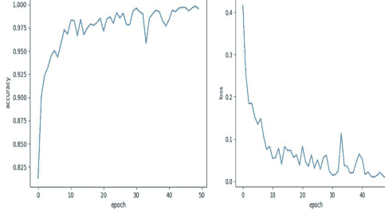
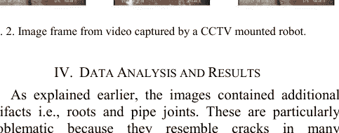
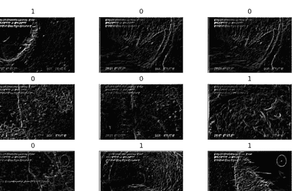

# 2020 IEEE 第17届智能社区国际会议：利用 ICT、IoT 和 AI 生活质量 (HONET)(美国北卡罗来纳州夏洛特 2020.12.14-2020.12.16)

## 摘要

地下设施尤其是下水道管道由于老化、土壤位移、交通增加、拥堵和安装不当而容易产生裂缝。运行中的主要挑战是对下水道网络进行有效的监测和检查。基于移动机器人闭路电视（CCTV）摄像头的视频信号标准状态监测系统在管道中运行。CCTV 画面由人工操作员记录并解释，并确定其是否对应裂缝和其他结构缺陷的位置。这一过程既耗时又昂贵。在项研究中，我们提出深度学习来实现基于视觉的目标检测的成功。在该项目中，我们从广泛的现场检查中收集了裂缝数据。使用卷积网络对噪声数据进行处理。我们用验证数据测试所提模型，以确定其准确性和有效性。地下管道中的裂缝可以被有效检测。

## 关键词

监测、下水道检查、CCTV、深度学习、卷积神经网络。

## 1. 引言

美国老化的下水道基础设施由于老化、安装不当、设计缺陷、内部运行、外部连接和制造工艺等各种影响，容易产生裂缝和其他结构缺陷 [1]。导致裂缝形成的因素包括土壤移动、酸性土壤、树根入侵以及与有毒废水和浸出物的化学反应。破裂的下水道管道容易渗透，并导致地下水渗入（I&I）和污水溢出（SSOs）。由于地下下水道不可见，很难防止溢出和有毒沉积物的积累。

为了防止溢出，公用事业专注于能够以高效且具有成本效益的方法维护地下管道状况的技术。该策略的一个主要要素是对其地下资产进行定期检查，这将导致管道清洗和对缺陷管段进行反应性维护。

历史上，釉陶管（V）被用作下水道管道是因为它们具有高抗压强度和对污水化学反应的抗性。尽管强度很高，但它们会随着时间的推移产生裂缝并由于根系入侵而失效。聚氯烯（PVC）管道现在广泛应用于下水道系统。改为 PVC 管道的主要原因是它们寿命长、重量轻、对废水化学反应抗性且易于安装。在美国，PVC 管道已根据 `ASTM D1784` [2] 成为行业标准。操作人员根据管道状况及其未来情况进行定期检查和维护。对于定期检查，下水道服务公司协会（NASCO）采用了一种基于安装在管道上的移动闭路电视（CCTV）摄像系统。机器人观察并记录视频。该系统需要一个带有发电机、光纤电缆和控制系统的 4x4 轨道，以便正确导航和识别缺陷。现有系统是人力密集型的。其目标是减少对操作人员检测管道中裂缝和其他结构缺陷的依赖。近年来，已使用图像处理和分割算法进行研究，例如使用神经网络的多层感知器（MLP）[3]。用于流程自动化的图像处理和分析的传统计算机视觉技术也是研究的重点 [4]。使用残差卷积网络（R-CNN）的深度学习也已被用于。

在本文中，我们展示了利用深度学习 CNN 检测从带有 CCTV 的线缆机器人下水道管道现场检查收集的实际数据视频图像中裂缝的发现。我们测试了各种滤波器来预处理数据，并使用批激活、双卷积、归一化和最大池化等技术参数分析了 CNN 的配置。这项工作的新颖贡献是，作者发现只有深度学习能够学习来自活体下水道视频图像中裂缝的复杂特征。

论文的其余部分组织如下：第二部分总结了相关工作；第三部分涵盖了项目的方法和发现；第四部分介绍了数据分析和方法；第五部分总结全文并指出未来工作方向。

## 2. 相关工作

最近的研究探讨了使用神经网络通过压力和（或）流量分析来检测水管的变化。使用神经网络分析了中国广州的实际情况 [5]。该工作促进了快速技术的发展。基于视觉的技术也被用于通过光照等传统图像处理技术在管道中进行自动检测。

## 3. 方法与发现

### 3.1 数据增强与实验环境

抖动、平移等。我们使用随机旋转对裂缝管道的图像进行数据增强。实验在带有集成显卡的 `Intel® Xeon(R) CPU E-1385 v6 @ 4.10GHz × 8` 以及 `64GB RAM` 的设备上进行。

### 3.2 图像预处理

为了消除图像中的环境噪声，我们必须找到能够暴露裂缝的解决方案。这是通过对图像应用内核大小为 3 的高斯模糊然后应用 Sobel 算子突出边缘实现的。

将增强后的图像作为输入到神经网络。

### 3.3 结果分析

图 4 显示了 50 个 epoch 的准确率。我们观察到验证准确率在 0.96 以上。原因是由于冗余图像和数据量导致的数据不平衡。我们存在固有的数据不平衡，通过采样进行了减少。虽然这样做是有效的，但数据在很大程度上仍然不平衡。

在对“无裂缝”（nocracks）类进行下采样后，我们处理的图像总数约为800张。

模型准确率和验证准确率的另一个原因是图像显示了隧道须须，裂缝显示了所关注的管道截面。此外，大量图像还显示了管道（隧道），其中的裂缝看起来与管道非常相似，如图 3 右侧图所示。

如前所述，图像中包含了额外的伪影、根部和接头管道。这些是特别棘手的，因为在许多情况下它们看起来像裂缝。某些图像即使通过人工观察也无法辨。

在测试期间，测试了超过 100 张图像，模型能够以超过 99% 的准确率预测图像中的裂缝。考虑到图像的低分辨率和额外的分辨率，这一结果具有显著意义。

## 4. 结论

由于公共健康和环境保护措施，地下下水道的裂缝检测对于运营商来说是一项重要的现代实用事业。现有的基于专家经验和人工检测管道裂缝的预检方法效率低下且成本高昂。更好的替代方案是使用自动化系统对管道内部图像进行分类，以用于监控。由于 CNN 深度学习模型在图像处理和分类方面具有稳健性能，开发这种扩展方法具有前景。

## 图表

| | | |
|---|---|---|
| 0 | 0 | 0 |
| 0 | 0 | 0 |
| 0 | 0 | 0 |

## 参考文献

- [1] D. Priddy., “Why Do PVC & CPVC Pipes Occasionally Fail?", Plastic Fibers Lab, Midland, MI document, available at Authorized licensed use limited to: University of Prince Edward Island. Downloaded on 2021/07/02 at 08:36:08 from IEEE X. Restrictions apply. http://www.californifornia.org/parklinterker/files/WhyCPVC-Occaif.pdf
- [2] D. Murray, Palgurt, G. Skipper, and S. Donovan, Demonstration of Innovative Sewer System Technology: SL-RAT, US EPA Office of Research and Development, Washington, DC, EPA8000-R-14-9031, 2014.
- [3] M. Hamidi, H. Hengchaei, Efficient Algorithm for Crash Detection in Sewer Images from Closed-Circuit Television Inspections, Journal of Infrastructure Systems, Vol. 20.
- [4] Y. Cha, and W. Choi, "Deep Learning-Based Crack Detection Using Convolutional Networks," Computer-Aided Civil and Infrastructure Engineering, Vol. 32, No. 5, pp. 361-376, 2017.
- [5] W. Shen, T. Yu, W. Zhong, C. Yi and S. Wen, "Countermeasures of fast detection of pipe bursts in Guangzhou based on neural network," 2011 International Conference on Electric Technology (ICETCE), Lushan, 2011, pp. 5824-5828.
- [6] A. Niparkar and A. Solanki, "Detection of Pipes by Differentiated Residual Blocks of Convolutional," 2019 IEEE 4th International Conference on Signal and Image Processing (ICIP), Wuxi, China, 2019, pp. 269-273.
- [7] Q. Xue, D. Li, J. Xu, Z. Yu and J. Wang, "Automatic Detection and Classification of Sewer Defects via Hierarchical Deep," in IEEE Transactions on Automation Science and Engineering, vol. 16, no. 4, pp. 1836-1847, 2019.
- [8] M. S. Khan, K. Zheng, N. Wu and I. Unwala, "Robotics and Deep Learning Framework for Structural Health Monitoring of Utility Pipes," International Conference on Robotics and Control (ICRC), Houston, USA, 2019, pp. B3-1-B3-5.
- [10] D. Antunesen, E. Stole, and D. Soukup, Single Multi-Object Detection Using a Split-Shared CNN, Computer Vision Open Access, 2019.
- [11] 管道检测图像可用: http://www.cuesine.com/Contact-Parts-Service.html
- [12] 下水道系统评估 - 密苏州圣路易斯市：https://www.gonalez.com/services/sewer.
