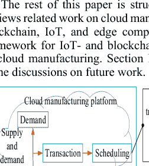
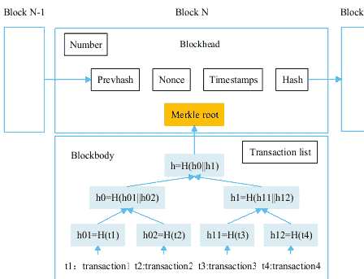
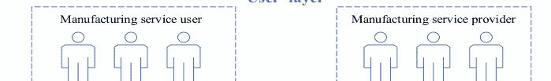
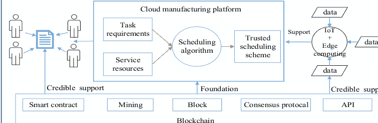
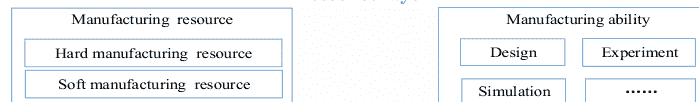

# 2020 IEEE 第18 届工业信息学会议 (INDIN)

刘永奎
西安电子大学 机械电子学院
中国 西安
yongkliu@163.com

张京鑫
长安大学 电子与控制学院
中国 西安
1556753630@qq.com

张林
北京大学自动化科学与电气工程学院
中国 北京
jlin9999@163.com

黄亮
长安大学 电子与控制学院
中国 西安
hliang@cctd.edu

**摘要—云制造是一种面向服务的制造模式，通过互联网为消费者提供按需制造服务。调度是云制造实现其目标的一项技术。然而，云制造中的调度面临着一系列挑战。确保调度方案的可信度（即能够按照预期运行）是这些挑战之一。物联网和区块链为解决这些挑战提供了关键技术。我们基于上述技术提出了一种云制造可信调度框架。该框架开发了基于物联网和区块链的调度服务的云制造可信调度框架。最后，通过对汽车行业的案例研究，验证了所提框架的有效性和可行性。**

**关键词—云制造，可信调度，物联网，区块链**

区块链为解决云制造调度的可信问题提供了有效手段。物联网与边缘计算的结合促进了对制造资源和制造能力的实时监控和可信感知，从而解决了制造过程中人机信任的问题。区块链技术凭借其去中心化的特性，为确保物理制造资源和制造能力的可信度以及制造过程中交易信息的可信度提供了有效手段。为了解决云制造调中的复杂性问题，本文重点关注未考虑可信度的调度过程中的数据和信息的置信度。

本文其余部分的结构如下：第二节回顾了关于云制造、调度、物联网和边缘计算的相关工作。第三节介绍了一种基于物联网和区块链的云制造可信调度框架。第四节总结了本文，并对未来工作进行了一些讨论。

## I. 引言

2010年，模仿云计算的概念并与物联网等技术相结合，提出了一种面向服务的新制造模式[1]。云制造的目标是通过互联网为消费者提供按需制造服务。大数据、人工智能、区块链等更多技术正在快速发展。这些技术集成到云制造中，使其成为云制造实现其目标的关键技术。

然而，云制造中的调度面临着一系列挑战[2]。确保调度方案的可信度（能够按照预期运行）是挑战之一。调度方案取决于数据和算法的可信度。物联网和区块链为确保数据和信息的可信度提供了关键技术。如图1所示，物联网、边缘计算和

图 1. 云制造调度中的问题。

问题 1：云调度信任容易建立，但交易双方的信誉无法保证，影响了透明并存在交易风险。

问题 2：参与公司资质参不齐，提供物理资源可靠数据的能力以及开发更好的算法具有困难性。

本工作受国家自然科学基金（NSFC）资（资助号：61973243和61873014）。

## II. 相关工作

本节介绍了云制造、调度、区块链、物联网和边缘计算的一些主要技术。

### A. 云制造中的调度

云制造是一种制造模式，它支持以可配置制造服务的形式聚合分布式制造资源，并实现云服务的按需使用。调度是云制造系统中的核心问题[4]。Li等人[5]提出了一种基于多任务的模型，考虑了动态资源、跨企业和企业间的物流。他们进一步研究了面向问题的基于工作的调度的云制造服务组合问题。Li等人[6]提出了一种多智能体架构，包括平台化智能制造系统中的调度和资源优化。Li等人[7]提出了一种基于深度强化学习（DRL）的云制造框架。用于云制造在线任务调度的DRL模型提高了该框架的有效性。Li等人[9]提出了一种基于深度Q网络的资源云策略，以最小化平均复杂性和速度。

### B. 区块链

区块链是由多个区块维护的数据链[10]。它通常包含一个头部和一个块体。头部包含索引、上一个区块的哈希值、时间戳以及每笔交易的哈希值。块体按顺序包含每个交易的数据。图2显示了区块链的结构。

- 区块链类型：为了适应不同应用场景的开放程度和透明度，区块链可以分为三类：公链、联盟链和私有链。
- 公有链：公链是最去中心化的。任何人都可以参与区块链的维护和读取，并可以自由加入和退出区块链。
- 联盟链：联盟链最为封闭，只有组织内的成员才能参与。不在链上的其他节点可以查询联盟的内容，但不能参与链中的共识过程。
- 私有链：私有链与之不同，它的去中心化程度最低。它限于企业内部或个人成员。链的查询和权限可以向公众开放。

图 2. 区块链结构

2）智能合约：智能合约是去中心化的，是部署在区块链上的共享代码[11]。数字与现状交互并执行智能合约条款是

目前，许多研究领域已关注，Li等人[12]提出了一种基于区块链的分布式制造平台，基于区块链和边缘计算的跨企业网络和服务框架。Li等人[14]提出了一种云制造中基于区块链的组合架构。添加后，区块链技术可以直接看到服务结果，并无需第三方平台即可执行合同。

### C. 物联网与边缘计算

物联网的概念于1982年提出。连接是指通过传感器、RFID等技术将设备连接到互联网，实现智能识别和管理。随着网络、RFID和传感器技术的快速发展，物联网已广泛应用于生活。Yang等人[15]提出了一种面向多种制造方法的面向服务的架构。Li等人[16]开发了一个基于物联网的包装食品链平台。

边缘计算是实现云制造所需技术之一。它是一种去中心化的计算架构，将数据和服务从中心节点移动到边缘节点。现场设备可以嵌入计算功能以实现分布式信息处理的自主性[17]。随着互联网的快速发展，Georgopoulos等人[18]提出了边缘计算与物联网制造结合的路线图，以提高产品质量和适应变化的能力。Sug等人[19]提出了一种基于多智能体的边缘计算架构，适用于大规模物联网系统。

## 用户层

## 核心功能层

## 基础层

## 感知层

## 资源层

> 图 3. 一种基于物联网和区块链的可信调度建议框架

## III. 基于物联网和区块链的可信调度框架

制造业中的物联网、边缘计算和区块链可信调度确保了三个方面的可信度：物理资源、云边协作以及云端生成的解决方案。物理资源的可信度可以通过物联网、边缘计算、监控、调度来确保；云边协作的可信度可以通过区块链确保；而物联网、边缘计算和区块链的可信度得到了保障。我们提出了一个由 5 层组成的框架，即用户层、核心功能层、基础层、感知层和资源层。每一层的功能如下：

- 1) 用户层：用户层中的用户包括平台运营者、服务提供商和服务消费者。每个

- 2) 核心功能层：核心功能层负责执行云制造系统的各种核心功能。在本文中最重要的功能是执行任务分解为子任务、服务搜索与匹配、组合与调度等。在物联网、边缘计算和区块链的帮助下，本文中的调度通过两个特性得到了增强：云边协作和可信。前者意味着调度考虑了云端边缘制造资源和能力的实时状态，并且云与边缘之间存在实时协作；后者意味着生成的调度解决方案在边缘计算和物联网的帮助下作为消费者需求发挥作用，我们可以确保数据和信息的实时交互，并有信地制造产品；通过区块链，可以在智能合约的帮助下执行调度和传感器，以确保用户交易的安全可靠，从而确保制造过程从每一个环节都是可信的。

- 3) 基础层：基础设施指的是云平台、边缘计算、存储、物联网等基础设施，以及传感器、执行器等。这一层在实现整个系统的层级功能中起支持作用，确保信息采集和交互的完整性。

- 4) 感知层：感知层通过 RFID 和传感器感知制造资源和制造能力的状态，以确保企业提供的服务和制造数据是可靠的。物联网和边缘计算在感知资源状态并将其连接到云端起着重要作用。

- 5) 资源层：资源层由各种制造资源和制造能力组成。制造资源分为硬件资源和软件制造资源。制造能力包括实验、设计、仿真等能力。

### A. 可信制造资源

制造资源的可信度通过物联网与边缘计算结合实时数据来确保。物理资源和云边连接可以通过调度策略的一部分来实现，该策略决定了制造资源的工艺和质量。只有实时处理制造资源信息才能实现全局调度优化，确保调度的效率和可信度。生成调度解决方案后，相应的指令将从云端传输到边缘。通过配备 RFID 等传感器的物理资源，指令从云端传输到边缘进行执行。通过物联网技术，云边缘之间的实时通信改进了大量数据的性能。边缘计算确保了物理资源的可信性。图 4 展示了物理资源的可信结构。

### B. 服务可信

服务可信包括调度可信和交易可信。用户进入系统后首先需要向平台提供信息。通过验证后，用户进入系统。只有经过认证的用户才能进入网络。系统的每个用户充当节点，有助于系统的稳定性。在云端，用户请求任务，服务提供者发布信息。云平台根据任务需求进行合理的调度并存储信息。通过区块验证后，调度信息存储在区块链中。用户根据调度信息签署智能合约。任务完成并提交后，用户将交易区块发送给服务提供者以创建交易区块。通过节点验证后区块加入区块链。如果交易失败，该区块也会添加到区块链中。这种设计等同于服务。如果后期出现问题，回顾查询可以进行得更快。由于整个调度信息和交易信息都存储在区块链中，因此无法修改，确保了调度过程的可信度。图 5 显示了操作流程。

### C. 案例研究

我们将通过车辆示例来更好地说明上述架构。首先，用户登录系统注册钱包名称，然后向云平台发布相关信息（如生产日期、颜色和型号），云平台生成任务调度策略以形成交易。之后，用户利用交易双方形成智能合约，相应的规则嵌入区块中。每个制造商将生产过程中产生的数据加载到区块中，并在验证后最终加入区块链。

企业物流网络持续交互，以确保交易的顺畅完成。在此过程中，信息在交付过程中被实时消耗和更新，区块被自由地传输或创建；区块链网络的用户可以将其作为车辆信息的网络源。图6展示了案例研究。

本文提出了一种可信调度框架，但文章仍缺少部分内容。未来的工作包括：(1) 构建一个区块链网络以实现所提系统；(2) 专注于将包装制造资源和数据封装进区块；(3) 考虑基于区块链特性的云的可扩展性。

## IV. 结论与未来工作

在本文，我们引入了云制造中“可信调度”的概念，并提出了一个实现可信调的框架。我们基于物联网、边缘计算和区块链等多种技术实现了可信调度。这些技术在增强调度可信度方面发挥着不同的作用。在云制造调度的背景下，可信调度面临着许多挑战，包括制造业的信誉度、数据采集过程、整个云区块链过程的信誉度、云服务的信誉度以及服务运营。例如，通过物联网进行实时数据交换。区块链技术能够实现云制造中的可信调度过程和交易。未来的工作可以从以下方向进行：

## 参考文献

- [1] B. H. Li, Zhang, and X. Chai, "Introduction to Cloud Manufacturing." IEEE Transactions on Industrial Informatics, 14(4): 5-12, 2018.
- [2] J. Liu, Y. Wang, X. Xu, and X. Zhang, "Credible scheduling in cloud manufacturing: state-of-the-art and challenges." International Journal of Production Research (2021): 4854-4869.
- [3] Y. Liu, L. Wang, X. Xu, and X. Li, "A Revit to Cloud Manufacturing Scheduling Problem based on deep learning and reinforcement learning." IEEE Access, 2019:22816-22828.
- [4] L. F. Zhou, L. Zhang, and Y. Li, "Review of Resource Scheduling in Cloud Manufacturing." International Journal of Computer Applications, 180(24): 45-52, 2019.
- [5] Y. Liu, X. Xu, and Y. Wang, "Work-based multi-task scheduling in cloud computing with robotics and manufacturing." IEEE Access, 2020: 95435-95443.
- [6] Y. Liu, X. Zhang, F. Luo, Y. Wang, "A multi-agent architecture for scheduling in smart-based manufacturing systems." Frontiers of Information Technology, 16(11): 1492-1502.
- [7] W. C., L. Zhou, Y. Liu, S. Shu, E. K. Huang, Y. Ma, "Blockchain-based Distributed Scheduling for Cloud Manufacturing." IEEE International Conference on Distributed Systems (2011): 9140-9145.
- [8] Y. Liu, L. Zhang, Y. Wang, X. Xu, M. Ma, "A framework for scheduling in cloud manufacturing with deep reinforcement learning." 2019 IEEE International Conference on Industrial Informatics (IIII), 1002-1007.
- [9] Y. Liu, L. Wang, Y. Xu, X. Xu, M. Wang, "A framework for scheduling in cloud manufacturing with deep reinforcement learning." 2021 IEEE International Conference on Industrial Informatics (IIII), 1-6.
- [10] Y. Lang, "Blockchain: State-of-the-art and research challenges." Journal of Computer Applications, 2016: 13-20.
- [11] Y. Yuan, et. al., "Development and Prospects of Blockchain Technology." (2016)
- [12] Z. Li, W. M, G. Wang, L. Li, and J. He, "Online scheduling in cloud computing with 50 reinforcement learning." International Journal of Management & Data Management, 9(4): 1338-1344.
- [13] C. Yu, Y. Zhou, Z. Zhang, and X. Wang, "A blockchain-based service architecture in cloud manufacturing." International Journal of Computer Science, 15(6): 1050-1065.
- [14] C. Wang, Y. Chen, T. Lin, and X. Wang, "IoT-enabled dynamic service selection across multiple cloud platforms." Manufacturing Letters 7 (2019): 28.
- [15] G. Qi, L. Liu, L. Li, X. Liu, and G. Xu, "IoT-based tracking and tracing for prepacked food supply chain." Industrial Management & Data Management, 32: 100555.
- [16] B. Chen, J. Wang, A. Celisi, D. Li, and H. Zhang, "Edge computing in IoT-based manufacturing." IEEE Communications Magazine, 56(6): 103-109.
- [17] D. Georgakopoulos, P. J. Fayaraman, M. Marina, V. Ricci, and R. Regan, "Internet of Things and edge computing roadmap for manufacturing." IEEE International Conference on Computer Communications (2018): 112-117.
- [18] T. Saganuma, T. Onde, S. Kitagata, K. Sugawara, and N. Shitarai, "Multifagent-based edge computing architecture for IoT." IEEE Network 32.1 (2018): 16-23.
