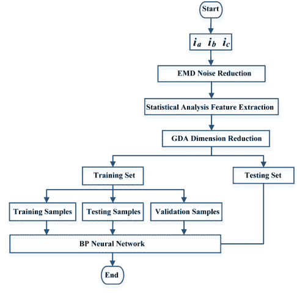
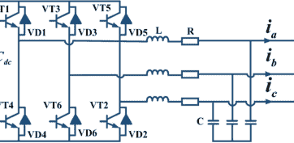
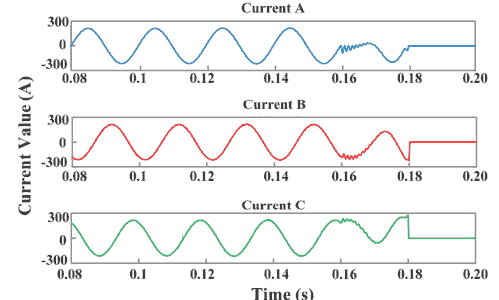
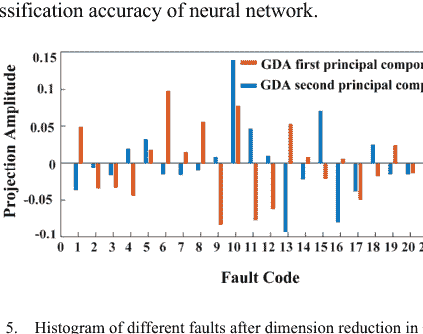

# 2020 IEEE 第一届中国国际电气青年会议 (CIYCEE)（中国武汉 2020.11.1-2020.11.4） 2020 IEEE 第一届中国国际电气青年会议（


摘要 — 提出了一种基于统计分析的IGBT开路故障新型诊断方法，以提高光伏发电系统的可靠性。首先，利用经验模态分解（EMD）减少信号中噪声的真实影响。其次，利用统计分析和遗传矩分析进行特征提取和降维。然后使用神经网络进行故障识别。最后，通过仿真实验验证了该方法的有效性。同时，将该方法与传统的基于特征提取和主成分分析（PCA）的降维方法进行了比较。结果表明，该方法具有较高的识别精度和简单的神经网络拓扑结构。

索引词—BP神经网络、EMD降噪、GDA、开路故障诊断

## I. 引言

随着光伏产业的快速发展，故障系统不仅会导致经济损失，还会对电网产生巨大影响。因此，光伏发电系统的安全性和可靠性至关重要。绝缘栅极双极晶体管（IGBT）被用于各种逆变器中控制大电流。然而，由于内部设备所处的恶劣环境以及电热应力，IGBT非常容易失效。研究表明，半导体器件对各种故障敏感 [1]。当发生IGBT短路故障时，电流引起的电热应力会导致IGBT的末端击穿。因此，短路故障通常由硬件电路消除 [2]，二次保护可以在短时间内防止过流或过电压，但在没有系统保护的情况下会持续很长时间。如果长时间未检测到IGBT开路故障，剩余电流可能会流经电路导致损坏。在生产中快速识别IGBT开路故障具有重要意义。

IGBT开路故障诊断有三种方法：数学模型法、信号处理法和人工智能方法。数学模型法通过构建观测器来估计系统输入与输出之间的关系。当状态观测器的输出结果大于阈值时，认为发生了故障。然而，它对多次发生的噪声非常敏感，不利于非专业人员操作 [3]。信号处理可以细分为时域分析、频率分析和时频分析。这些方法分别应用于这些阶段，但故障分析对噪声敏感 [5]。例如，利用经验模态分解（EMD）分解轴电流以获取特征。然而，这种方法对处理变化较为敏感。通过机器学习算法对电流值进行变换以故障识别。但存在特征维度过高的问题 [7], [8]。此外，快速傅叶变换（FFT）广泛应用于逆变器中检测逆变器的输出电流，以提取故障诊断的特征值 [9], [10]。此外，该方法能够处理故障检测领域的噪声变化 [11], [12]。通过数值变换将输出转换为二维图像，利用卷积神经网络卓越的图像识别能力进行故障分类。例如，参考文献 [14] 使用卷积神经网络感知故障信号的真实表示，其效果对于快速识别故障也非常有效。

在本文中，图1所示的方法描述了光伏并网逆变器的主要故障类型，并分析了发生开路故障时逆变器的输出。第三节介绍了所提方法的原理，第五节进行了仿真分析并给出结论。

这项工作受国家自然科学基金（NSFC）资助，编号为21775107，以及河北大学可再生能源技术国家联合实验室的支持。（2537990102@qq.com, myyama@hdt.edu.cn, 23009, 60858401@qq, 415990803@qq.com; hgyi@jsut.edu.cn）

因此，我们只采集故障发生后的基波电流。开关频率为5kHz。在一个基波内等等间隔采集100个点，在驱动信号闭合0.02s后逆变器与电网断开。

表 I：IGBT开路故障类型

| 故障类型 | 故障代码 | 故障类型 | 故障代码 |
|---|---|---|---|
| 正常 | 1 | VT1&VT6 | 12 |
| VT1 | 2 | VT2&VT3 | 13 |
| VT2 | 3 | VT2&VT4 | 14 |
| VT3 | 4 | VT2&VT5 | 15 |
| VT4 | 5 | VT2&VT6 | 16 |
| VT5 | 6 | VT3&VT5 | 17 |
| VT6 | 7 | VT3&VT5 | 18 |
| VT1&VT2 | 8 | VT3&VT6 | 19 |
| VT1&VT3 | 9 | VT4&VT5 | 20 |
| VT1&VT5 | 11 | VT4&VT6 | 22 |



图1. 基于统计分析与机器学习的故障诊断流程图

## II. IGBT开路故障分析

三相半桥逆变器因其结构和灵活的控制模式被广泛应用于各种 [15]。因此，本文的研究对象是三相半桥并网逆变器。光伏逆变器的电路拓扑如图2所示。



图2. 并网逆变器主电流。

三相半桥逆变器中有六个IGBT。不同位置的开路故障会导致并网电路产生不同程度的失真。通常情况下，三个或多个IGBT同时发生故障。因此，本文仅研究IGBT开路。下方列了共21种开路故障和正常状态。

当IGBT开路故障发生时，逆变器的电流会发生失真。本文展示了0.06s时VT1开路故障的三相电流波形。故障影响上半部分，B相和C相相位消失。还应注意的是，开路故障可能在任何时间发生。通过机器学习算法对电流值进行变换以实现故障识别。但存在特征维度过高的问题 [7], [8]。



图3. 开路故障的三相电流。

当IGBT开路故障发生时，逆变器的电流会发生失真。本文展示了0.06s时VT1开路故障的三相电流波形。故障影响上半部分，B相和C相相位消失。还应注意的是，开路故障可能在任何时间发生。通过机器学习算法对电流值进行变换以实现故障识别。但存在特征维度过高的问题 [7], [8]。

## III. 针对IGBT开路故障的方法

### A. 降噪

经验模态分解（EMD）用于减少信号中噪声的真实影响。为了确保最终方法的准确性，利用EMD将信号分解为若干固有模态函数（IMF）。随着IMF数量增加，残差逐渐减少。

表 II：时域特征

| 统计特征 | 计算公式 |
|---|---|
| 平均值 | $\frac{1}{N} \sum x_i$ |
| 最小值 | $\min(x_i)$ |
| 最大值 | $\max(x_i)$ |
| 方差 | $\sigma^2 = \frac{1}{N-1} \sum (x_i-\mu)^2$ |
| 标准差 | $\sigma = \sqrt{\frac{1}{N-1} \sum (x_i-\mu)^2}$ |
| 峰值 | $P \frac{1}{N}$ |
| 脉冲 | $P_u$ |
| 裕度 | $M$ |
| 波形 | $W = \sqrt{\frac{1}{N} \sum x_i^2} $ |
| 峭度 | $K = \frac{\frac{1}{N} \sum (x_i-\mu)^4}{(\frac{1}{N} \sum (x_i-\mu)^2)^2}$ |
| 偏度 | $S = \frac{\frac{1}{N} \sum (x_i-\mu)^3}{(\frac{1}{N} \sum (x_i-\mu)^2)^{3/2}}$ |

### B. 特征提取

统计分析和遗传矩分析用于特征提取和降维。通过数值变换将输出转换为二维图像，利用卷积神经网络卓越的图像识别能力进行故障分类。

### C. 故障识别

使用神经网络进行故障识别。例如，参考文献 [14] 使用卷积神经网络感知故障信号的真实表示，其效果对于快速识别故障也非常有效。


> 用于 CIIEEE 2020 论文 <

获取一个更小的训练器。

```
$O = \frac{n_c}{e}$ (4)
```

GDA 也称为基于核的线性判别分析 (LDA)。与 PCA 不同，GDA 和 LDA 使用有监督的降维技术。GDA 和 LDA 通过样本分类来实现监督降维。这种基于类别的监督降维被广泛应用于人脸识别、故障诊断、手写处理等领域。GDA 使用核函数将数据从低维映射到高维。核函数的输入是原始空间 $X$，输出是特征空间 $H$ 的内积。通过这个核，我们可以在低维空间中获得高维空间的乘积，这将极大地降低复杂性和提高计算速度。特别是，核方法满足有限正半定定的要求。线性核、多项式核和 RBF 核常用于核函数中。其公式如下：

$I_{n,n}$ 是一个 $n \times n$ 的对角矩阵，对角线元素全为 1。

GDA 的变换矩阵 $P$ 可以通过拉格朗日法极大化 (13) 得到。我们对 $r(e)$ 求导并使其置于 0。然后得到 (14)。寻找 $e$ 等价于求解广义特征值问题。$P$ 的每一列根据广义特征值 $e$ 的大小进行排序。低维 $P$ 通过 (16) 计算。我们使用矩阵 $Y$ 作为 BP 神经网络的输入。

```
$e = \max \frac{e^{S_X^{GDA}}}{e} = \max r(e)$ (13)
```

```
$S_X^{GDA} = r(e)S_X^{GDA}$ (14)
```

```
$S_Y^{GDA} = e^{e}S_Y^{GDA}$ (15)
```

```
$Y = XP$ (16)
```

GDA 用于将原始的 36 维特征减少到 2 类。GDA 的核函数使用高斯核，且 $\sigma$ 设置为 1.4。降维后，GDA 将 36 位特征切割为 2 维数据。图 5 显示，在 GDA 中，每个故障类特征在两个轴之间显著不同。特征差异越大，神经网络的分类准确率越高。

### 线性核

```
$k(x,y) = \langle x,y\rangle+1, r \in \mathbb{R}^*$ (5)
```

### 多项式核

### RBF(高斯)核

```
$k(x,y) = \exp(-\frac{\|x-y\|^2}{2\sigma^2})$ (7)
```

GDA 希望找到一个变换矩阵 $P$，使得原始数据 $X$ 投影通过 $P$ 时，类间距离与类内距离之比最大化。类间距离定义为 $S_X^{GDA}$，类内距离定义为 $S_Y^{GDA}$。



```
$P = \{e_1, e_2, ..., e_c\}$ (8)
```

并且是 GDA 的投影方向。

```
$S_X^{GDA} = X^T BX$ (9)
```

```
$W = \frac{1}{diag}(\log(\frac{n_1}{I_{1,n_1}}, ..., \frac{n_c}{I_{c,n_c}})) - diag(\log(\frac{I_1}{n_{1,n_1}}, ..., \frac{I_c}{n_{c,n_c}}))$ (10)
```

```
$S_Y^{GDA} = X^T W$ (11)
```

$W = diag(\log(\frac{n_1}{I_{1,n_1}}, ..., \frac{n_c}{I_{c,n_c}})) - diag(\log(\frac{I_1}{n_{1,n_1}}, ..., \frac{I_c}{n_{c,n_c}}))$ (12)

$L$ 是原始数据 $X$ 的类别数。$n_l$ 是第 $l$ 类中的样本数。$n$ 是 $X$ 的样本总数。$I_{n_l,n_l}$ 是一个 $n_l \times n_l$ 的全1 矩阵。

图 5. GDA 降维后的特征直方图

### D. BP 神经网络

BP 神经网络是一种通过误差传播算法训练的多层前馈网络。它是使用最广泛的网络模型之一。BP  网络使用各种学习规则通过反向传播来调整权重和阈值。BP 神经网络需要指定的参数包括输入层、隐藏层和输出层的神经元数量、每层的传递函数以及学习规则。为了避免 BP 神经网络在训练过程中陷入局部最小值，我们需要随机初始化权重和阈值值。使用 [16] 中的神经网络训练算法来训练该网络。隐藏神经元的数量将根据性能和故障识别准确率进行调整。BP 神经网络的一些参数如表 III 所示。

### TABLE III
BP 神经网络参数

| 参数 | 参数 |
| --- | --- |
| 输入层神经元数量 | |
| 输出层神经元数量 | |
| 隐藏层传递函数 | |
| 输出层传递函数 | |
| 学习规则 | |
| 激活函数 | |

### TABLE V
不同方法的准确率

| 诊断方法 | 准确率 |
| --- | --- |
| FFT+BP | 85.23% |
| FFT+LDA+BP | 59.27% |
| FFT+PCA+BP | 38.37% |
| FFT+GDA+BP | 98.50% |
| EMD+BP | 37.50% |
| EMD+PCA+BP | 21.59% |
| EMD+GDA+BP | 97.66% |
| 所提方法 | 100% |

## IV. 仿真分析

为了验证所方法的有效性，在 MATLAB/Simink 平台上对逆变器系统进行了建模。逆变器的拓扑结构如图所示。

## TABLE IV
BP 网络参数

| 直流电压 | 滤波器（线路） | 电感 | 电容 |
| --- | --- | --- | --- |
| 650V | 0.5mH | 400uF | |

在 MATLAB/Simink 中，逆变器的结果如所示。图 6 显示了该网络效果良好。

## V. 结论

本文提出了一种基于机器学习的光伏连接逆变器开路诊断方法，该方法是简单的。

## 六. 致谢

作者感谢中国国家科学基金的支持

## VII. 个人简介

陆宇出生于中国，目前在合肥理工大学攻读硕士学位。她的研究方向是光伏连接逆变器的诊断。

马明耀出生于中国，2006 年至 2010 年在浙江大学获得学士和博士学位。他曾在格拉斯哥的斯特莱德大学担任访问学者。2011 年，他在美国佛罗里达中央大学工作，随后加入英国纽卡斯尔大学担任副教授。自 2015 年以来他在 IEEE 工作。他的研究兴趣包括新能源发电系统的状态监测技术和诊断方法、分布式发电及其电子稳定控制技术、电力电子设备、运行控制以及电动汽车动力系统的维护。

高维兵出生于中国，目前在合肥理工大学攻读博士学位。他的研究方向是功率模块的温度估计和 IGBT 的健康监测。

李飞出生于中国，2015 年在合肥理工大学获得博士学位。2010 年至 2011 年，他在奥尔堡大学学习并参加学术交流。他目前是合肥理工大学电气与自动化学院的博士生。他的研究兴趣包括多电级功率变换器和并网逆变器的高阶滤波器和滤波。

常星出生于中国，1984 年、1990 年和 2003 年分别在合肥理工大学获得学士、硕士和博士学位。从那时起他在合肥理工大学电气与自动化学院任教。2008 年至 2016 年，他担任该院副院长。他兼任教育部光伏研究中心主任。

他的研究兴趣包括光伏发电及其逆变器控制技术、分布式发电及其电子稳定控制技术以及新能源汽车电动驱动技术。

