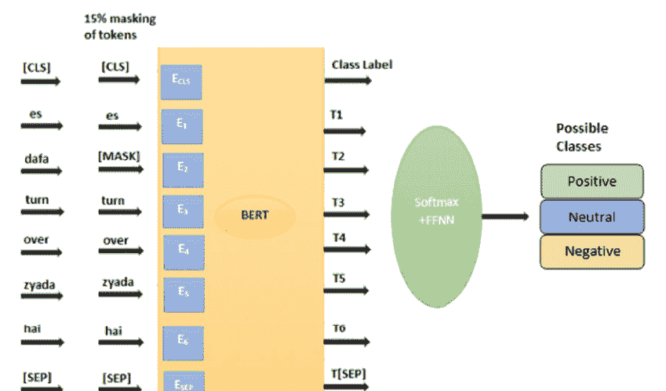

# 2020 IEEE 第23 届计算科学与工程国际会议 (CSE) (中国广州 2020.12.29-2021.1.1)

**Aqsa Younas**  
计算机科学系，  
法沙尔巴德农业大学，  
法沙尔巴德，巴基斯坦，38000。  
`aqayounasp@gmail.com`

**Rahela Nasim**  
计算机科学系，  
法沙尔巴德农业大学，  
法沙尔巴德，巴基斯坦，38000。  
`rahela.nasim@uaf.edu.pk`

**Saqib Ali†, 王国军***  
计算机科学学院，  
广州大学，  
中国广州，510006。  
电子邮箱：`{saqib,csgjwang}@gzhu.edu`

**秦芳**  
中南大学  
中国长沙，410083。  
`csifang@cu.edu.cn`

## 摘要

情感分析是对针对特定问题、产品、个人和组织的态度、观点和情感的计算性研究。随着人工智能和自然语言处理的发展，情感分析正变得日益智能化。由于这些平台上的大量文本使用了如罗马乌尔都语混合英语等不完善且非正式的语言结构，以往这类代码混合、不完善且研究较少的语言有限。在此类媒体数据上使用深度学习模型是一种很有前景的解决方案。本文的目标是对代码混合的罗马乌尔都语和英语社交媒体文本进行情感分析。我们使用了多语言 BERT (`mBERT`) 和 XLM-RoBERTa (`XLM-R`) 模型进行情感分析。结果显示，`XLM-R` 情感分析优于 `mBERT`，F1 分数为 71%。

**索引术语**—情感分析、代码混合文本、罗马乌尔都语、深度学习、BERT、XLM-RoBERTa、多语言

## I. 引言

情感分析是一种检查用户对某个主题或话题的情绪、观点和行为的技术 [1]。从社交媒体中手动提取情感是一项艰巨且耗时的任务。媒体数据规模非常大。随着自然语言处理和人工智能技术的发展，情感分析对于社区和小型公司来说变得更加易接触且负担得起。客户通常在查看数据上的客户评论后选择购买的产品。因此，评论已成为买家决策过程的重要部分，并影响了底层地区的贸易模式。

乌尔都语是南亚流行的语言之一。它也是巴基斯坦的官方语言。世界上有超过 6000 万人使用乌尔都语 [4]。如今，人们使用非正式和代码混合的社交媒体语言来发布评论。

在南亚，社交媒体平台上的主要语言是罗马乌尔都语混合英语，因为他们发现很难用乌尔都语输入。因此，社交媒体上生成的大短文本包含非正式和代码混合的罗马乌尔都语-英语语言。这是研究较少的语言之一，因此使用深度学习执行 NLP 任务变得极具挑战性。

解决上述问题的方法之一是将目标语言翻译成英语，然后使用英语资源进行情感预测 [6]。然而，这对于不完善的语言并不适用，因为它们没有翻译资源。最近的方法使用深度学习模型进行情感分析 [7]。研究人员评估了这些基于字符的预训练嵌入模型。他们提出了一种使用语言模型嵌入 (`ELMo`) 的深度学习模型来进行实验 [5]。然而，这些模型无法同时利用目标词左侧和右侧的上下文的优势。因此，在我们的工作中，我们使用基于转换器的模型来提高对低资源代码化罗马乌尔都语-英语语言情感分析的准确性。

结果显示，`ADAN` 在跨语言方面取得了令人瞩目的性能。在这些方法中，作者使用了语言翻译。然而，在翻译过程中，单词通常会丢失其上下文，这会导致对客户情感的洞察力下降。

最近，深度学习方法被用于情感分析并在客户情感方面提供了改进的结果 [7]。例如，Kumar 和 Dhar [18] 使用了带有表面特征的深度学习方法。他们的网络消除了在代码混合印地语社交媒体数据上进行情感分析的学习技术的局限性。在 [5] 中，开发了一种用于罗马乌尔都语和英语数据集的方法。他们发现了适应非正式语言的困难性。他们开发了用于代码混合数据的深度学习模型。然而，这些深度学习方法没有使用子词嵌入。

本文的目标是对代码混合的罗马乌尔都语和英语社交媒体文本进行情感分析。我们使用了多语言 BERT (`mBERT`) 和 XLM-RoBERTa (`XLM-R`) 模型进行情感分析。结果显示，情感分析优于 `mBERT`，F1 分数为 71%。本文其余部分的结构如下：第二节讨论文献综述；第三节描述本文的方法；第四节分析了结果；最后，第五节总结了本文的结论和未来工作。

## II. 文献综述

情感分析对企业非常重要，因为它提取了有用信息。他们提出了一种使用语言模型嵌入 (`ELMo`) 的深度学习模型来进行实验 [5]。然而，这些模型无法同时利用目标词左侧和右侧的上下文的优势。因此，在我们的工作中，我们使用基于转换器的模型来提高对低资源代码化罗马乌尔都语-英语语言情感分析的准确性。

结果显示，`ADAN` 在跨语言方面取得了令人瞩目的性能。在这些方法中，作者使用了语言翻译。然而，在翻译过程中，单词通常会丢失其上下文，这会导致对客户情感的洞察力下降。

最近，深度学习方法被用于情感分析并在客户情感方面提供了改进的结果 [7]。例如，Kumar 和 Dhar [18] 使用了带有表面特征的深度学习方法。他们的网络消除了在代码混合印地语社交媒体数据上进行情感分析的学习技术的局限性。在 [5] 中，开发了一种用于罗马乌尔都语和英语数据集的方法。他们发现了适应非正式语言的困难性。他们开发了用于代码混合数据的深度学习模型。然而，这些深度学习方法没有使用子词嵌入。

## III. 方法论

### A. 数据收集

### B. 分类

## 表 II：带有情感标记的混合代码罗马乌尔都语-英语推文

| 混合代码罗马乌尔都语-推文 | 标签 |
| :--- | :--- |
| basically to ki central punjab results reject kar denay chahayn | 0 |
| na hi 7 qajarri par sit uhay 6 parish mein marcher i 49 900 votes | 1 |
| dise jaliya riakhi hai lol | 2 |
| ppk ka p o orgar jan mein iski hukumat nahi sukar ayaz sidiq ke par janbari ki sukar istifa ki mutaluba | 0 |
| imra ho us peech se bhi pak jam le ki kr di hai | 1 |
| cast system bohat horai hai par meri khali ther 50 ho pohira hai ishar sath sit peay ler k kmn ko di gai hain | 0 |
| nimrankakhteps we did i mbarook to too to arwa naypakistan | 2 |
| karachi karachi ne jishar par hum ne banaya 244 par ki ali zaid na 255 par khald maqoob | 1 |
| ik ki ki bad aik aumeed paida ho behtri ki bhi bt se neay dost tu ik ki speech se him press ho go | 2 |
| same goes for patwas ki diwarsi jisay deta hai dhandali ka rona | 0 |
| chi nisar ki jyi diwarsi har hai choudry sawar | 1 |
| Es dafar turn over zyada hai | 2 |

`softmax` 是为了分类目的在此处添加的新层。分类层具有维度为 `K x H`，其中 `K` 是类别的数量（即三个：正性、中性和负性），而 `H` 是隐藏状态的大小，对于 `mBERT` 模型，隐藏状态大小为 768。

### D. 超参数调优

为了获得更好的情感分析结果，我们对表 III 所示的两个模型的超参数进行了调优。每个分类模型都有一个参数字典。为了调优超参数，我们使用参数字典更改了模型的默认学习率、`epoch` 数量和批大小 (`batch size`)。更改关键超参数后，我们在 `MultiSentiment` 数据集上训练了模型。

### E. 训练与评估

在这一步中，我们使用了预训练的 `mBERT` 和 `XLM-R` 序列分类模型处理混合代码罗马乌尔都语和英语文本。我们有意识地使用预训练模型，因为当数据集较小时，从头训练这些模型会导致过拟合。

## 表 III：超参数调优

| 模型 | 批大小 | 学习率 | epoch 数量 |
| :--- | :--- | :--- | :--- |
| `mBERT` | 16 | `2e-5` | 3 |
| `XLM-R` | 16 | `2e-6` | 3 |

## 表 IV：模型性能评估

| | 未微调 | | | 已微调 | | |
| :--- | :--- | :--- | :--- | :--- | :--- | :--- |
| 模型 | 准确率 | F1-Score | MCC | 准确率 | F1-Score | MCC |
| `mBERT` | 0.41 | 0.65 | 0.45 | 0.69 | 0.69 | - |
| `XLM-R` | 0.00 | 0.49 | 0.52 | 0.71 | 0.71 | - |

我们在实验中使用了五种评估指标，即：分类结果、模型输出、错误预测得分和准确率。结果的马特修斯相关系数 (`MCC`) 用于计算每个项目的模型，适用于低资源语言。此外，模型是基于 `BERT` 架构的，而 `mBERT` 在高资源语言上表现更好。`XLM-R` 是一个 `transformer`，为混合代码罗马乌尔都语和英语文本提供了最高的 F1 分。`ELMo` 是长短期记忆 (`LSTM`)，无法学习左侧或右侧的上下文。`BERT` 是一个 `transformer`，可以同时学习左侧和右侧的上下文。`BERT` 表示了高达 30,000 个词的输入。`XLM-R` 和 `BERT` 是在 `BERT` 上实现的，但在混合代码罗马乌尔都语中获得了更高的 F1 分。

$$
MCC = \frac{TP \times TN - FP \times FN}{\sqrt{(TP + FP)(TP + FN)(TN + FP)(TN + FN)}}
$$

`MCC` 是用于计算实际值与预测值之间相关系数的分类矩阵。模型输出提供了每个项目的得分，即：正性、负性。准确率衡量了所有正确预测的比例。

$$
Accuracy = \frac{TP + TN}{TP + TN + FP + FN}
$$

最后，我们根据公式计算了错误分类预测的 F1 分。

$$
F1 = 2 \times \frac{Precision \times Recall}{Precision + Recall}
$$

### F. 实现

我们使用 `Transformers` 库进行训练和测试。通过更改默认的批大小、学习率和 `epoch` 数量对模型进行了微调。我们使用 `tqdm` 库可视化进度。使用 `sklearn.metrics` 库评估模型性能。

## IV. 结果与讨论

我们根据表 IV 中的 `MCC`、准确率和 F1 分对模型结果进行了比较。我们发现对于混合语言，`XLM-R` 的性能优于 `mBERT`。这是因为 `XLM-R` 在更大规模的多语言语料库上进行预训练，能更好地处理低资源语言和代码混合文本。

## V. 结论与未来工作

在本文中，我们使用多语言 `XLM-R` 模型对混合代码罗马乌尔都语和英语社交媒体进行了分析。这些是基于 `BERT` 的预训练模型。发现 `XLM-R` 对混合代码罗马乌尔都语和英语具有更高的准确率和 F1 分。在未来的工作中，我们将构建一个神经网络并扩展 `MultiSent` 数据集。

## 致谢

这项工作得到了中国国家科学基金（资助号61360）、广东省自然科学基金（资助号2017a033）以及广东人才计划的支持。

## 参考文献

[1] M. Kaity and V. Basilakrishnan, “情感词典与非英语：综述，” *Knowledge and Information Systems*, pp. 1–36, 2020. [Online]. Available: https://doi.org/10.1007/s10115-020-01497

[20] W. McKinney et al., "`pandas`: 数据分析和统计的基础库,” *Python for High Performance Computing*, vol. 14, no. 9, 2011.

[29] N. Singh, D. S. Tomar, and A. K. Sangaiya, M. Haider, S. J. Ali, M. Khan, and S. Ahmed, "社交媒体数据中的情感分析：系统评价，” *Concurrency and Computation: Practice*, vol. 32, no. 4, e2168, [Online]. Available: https://doi.org/10.1002/wcc.2168 (Accessed: 2021-05-20)

[31] A. Vaswani, N. Sharma, K. Parmar, J. Uszkoreit, L. Jones, A. Gomez, and N. Polosukhin, "注意力即一切," *arXiv preprint arXiv:1706.03762*, 2017. [Online]. Available: https://arxiv.org/abs/1706.03762

[31] T. Toomuru and S. Saha, "现状," *Journal of Computer Science and Mathematical Applications*, vol. 38, no. 1, pp. 28–33, 2020. [Online]. Available: https://doi.org/10.3153/jccm.2020.313

[32] C. O. Das-Lin, "`tqdm`: 用于迭代循环的快速智能进度条，” *Advances in Data Mining and Systems*, 2019.

[32] M. Eloradi, M. Ali, and S. Mohammad, "短文本评论情感分类的深度学习，” *Proceedings of the 35th ACM Symposium International Conference on Knowledge Discovery and Data Mining (SAC '20)*, pp. 903–906, 2020. [Online]. Available: https://doi.org/10.1145/3394734.339474

[33] E. Bisong, "在情感分析中使用机器学习技术，” *Machine Learning and Data Mining for Social Media*, Springer Berlin, 2019.

[33] X. Chen, Y. Sun, B. Aithavarni, C. Chang, and K. Weinberg, "基于方面的情感分析，” *Transactions of the Association for Computational Linguistics*, vol. 6, pp. 45–68, 2018. [Online]. Available: https://arxiv.org/abs/1812.0925
