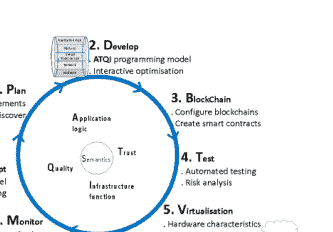

# 2020 IEEE 第26 届国际并行与分布式系统会议 (ICPADS) (香港 2020.12.2-2020.12.4)

Ziming Zhao¹, Chunming Rong¹, 和 Martin Gilje Jaatun*

¹荷兰阿姆斯特丹大学，z.hao@uva.nl

*挪威斯塔万格大学 [chunming.rong, martin.j.jaatun]@uis.no

**摘要**—高质量的去中心化应用（DApp）对性能和服务质量有要求，涉及异构基础设施（云端、边缘计算、物联网），并依赖于数据源参与者与基础设施提供者之间的无信任合约。DApp 必须解决区块链技术由于协作效率低带来的性能挑战。另一方面，云端的韧性使得软件定义存储、网络、基础设施和每项技术取得了显著进展。然而，由于缺乏合适的架构和编程方法，新硬件加速器（基础设施中）的优势无法在 DApp 中得到有效利用。

**索引术语**—DevOps，云计算，区块链

# I. 引言

云计算、物联网（IoT）、人工智能和大数据的最新进展极大加速了业务应用向下一代互联网（[1]）的数字化进程，这使得：

- 在自动化业务流程（例如广泛的供应链）时无缝处理动态事件；
- 保证在线运营的可靠性（例如活动中的实时众故事）；
- 在复杂决策（例如金融投资）期间进行业务运营（例如风险评估）。

这些创新提供了一种新的应用范式，这些应用对性能和服务质量有要求，涉及异构基础设施（云、边缘、物联网），并依赖数据源与提供者之间的无信任合约来交付最佳价值，而这被经典的中心化架构完全支持。因此，我们将这种新范式称为高质量去中心化应用（QDApp）。区块链技术在实现业务应用中的信任（通过不可变账本和点对共识）、容错（去中心化节点间无单点故障）方面展现了巨大潜力，并为去中心化应用（DApp）提供了基础。然而，目前的区块链技术面临账本成本高、节点间共识协作效率低以及区块链交易离线数据源不安全的问题。

另一方面，云计算具有重大的颠覆性，为各种互联网应用提供资源即服务。云环境不仅提供了容量，还提供了大型网络上虚拟信息的可消费性和成本。云端的韧性使得软件定义存储、网络、基础设施和每项技术取得了显著进展，促进了可交换的异构可编程基础设施和软件框架的出现。不同的云和设备之间，这种基础设施的丰富性，特别是基础设施中新硬件加速器的优势，在高质量去中心化应用的开发和运维（DevOps）中无法被有效利用。

# II. 背景

高质量去中心化应用（QDApp）关注软件架构和三个领域：去中心化应用、质量关键系统和可编程基础设施。在本节中，我们回顾了最先进的 DApp（[1]）、高质量 DApp（[2]）、数字应用中的可信性和隐私、用于 QDApp 开发的软件技术，以及异构硬件基础设施。

去中心化应用（DApp）专注于实现点对点信任的技术，并在后端提供无许可的逻辑。区块链主系统（例如参与者之间的交易）维护一个全球且去中心化的账本，通过点对点共识机制（例如比特币中的工作量证明 [2]）来更新账本。存储在区块链上的所有交易都是公开且不可篡改的。以太坊是二代区块链，允许将通用程序（称为智能合约）存储在区块链上，并通过以太坊虚拟机（VM）概念执行。DApp 的业务逻辑由底层区块链的一个或多个智能合约管理。由于数据是去中心化的，如果网络中的某点或节点被破坏，网络中的其他节点将安全地恢复数据。DApps 在广泛的应用领域展示了其潜力，包括物联网 [4]、金融 [5]、物流 [6] 和社交网络 [7]。高质量业务应用考虑服务质量（QoS）或用户体验、公平性或延迟。由于网络的不确定性，使得在时间关键应用中，满足实时性以延迟的要求是困难的。

可信性被认为是软件的非功能性需求，在复杂应用中通常通过信誉系统进行评估 [9]，但其他方法基于信誉概念或形式化方法 [10]。隐私是分布式应用（云、边缘计算）中的另一个基础性挑战；特定的质量限制包括能耗 [12]、安全性（例如网络攻击）[13]。

DApp 的质量保证状态不仅面临去中心化的挑战，还面临性能标准：

1. 需要一种有效的激励模型来维护系统的公平性。这种类型可以防止恶意执行合约；
2. 参与者之间的去中心化共识为许多公共区块链建立了信任（许可），但比特币产生区块的平均时间为 10 分钟，交易确认时间达到一小时（需要 6 个区块）。即使以太坊显著降低了延迟，公共区块链尚未实现支持通用交互的小延迟。
3. DApp 的顺序性能取决于网络中所有节点的延迟，因为所有交易/操作都应由所有节点执行和验证。然而，应用中软件组件或逻辑的依赖限制了并行执行；因此需要提供快速处理。
4. 区块链评估（例如硬分叉）是目前实现系统级升级的唯一方法，由于区块链 P2P 共识的性质，这可能导致参与节点限制。另一个潜在问题是涉及共同源的硬分叉，会导致冲突。
5. 智能合约的安全问题通过仔细的实现和单元测试来强制。然而，由于许多 DApp 的高复杂性，很难保证非平凡智能合约无漏洞。在这里，任何漏洞的交付可能与区块链的不可变性发生冲突。
6. 用户和交易的身份很重要，但在某些情况下可能需要匿名性。这最近也致力于在区块链上实现匿名能力，通过监管和了解您的客户（KYC）以及反洗钱（AML）检查，而无需放弃对整个全球网络的贡献身份。

我们可以看到 DApp 在下一代互联网应用中具有潜力；DApp 开发面临着阻碍应用质量需求实现的挑战：

开发和运维（DevOps）工程实现了软件产品的持续开发、测试、集成、部署和运行。它允许团队有效地响应新需求和运营需求，通过自动化整个生命周期的集成、测试和部署过程，不断为应用开发和交付新功能 [15]。目前有很多理想的 DevOps 解决方案用于此类场景（如 `Truffle Suite`），但大多数现有工具和技术仅针对特定阶段设计：架构的

DApp 的建模方式不同，这取决于区块链的角色，DApp 中的组件数量可以归纳为：例如，智能合约、区块链的接口、后端函数和用户界面；然而，针对高质量合约所需的功能组件的优化、微服务和运行环境的参考架构仍处于早期阶段。智能合约的编写可以受到各种框架和工具的支持。`Solidity` 是以太坊中流行且广泛使用的语言；虽然也提出了其他语言；例如：一种名为 `Bamboo` 的智能合约语言、用于完整且安全函数的 `Simplicity`，以及作为流动性的函数式编程。智能合约集成开发环境（IDE）如 `Remix`，或其他支持 `Metamask` 集成、交易日志记录器和其他功能的以太坊为主。目前，DApp 环境仍然缺乏有效的视图来集成用于可扩展应用程序的基础设施和框架开发。质量约束在经典通用的虚拟化基础设施中已通过不同方面得到了很好的研究：实时编程（然而模型仍有待完善）以及调度控制。`RT-X` 是第一个针对 `Xen` [17] 的实时以太坊框架，`Xen` 是一个以太坊上被广泛使用的虚拟机（VM）。它弥补了实时调度与 `Xen` 之间的差距，并为集成广泛实时嵌入式系统提供了一个平台。软件系统层面的性能保证取决于应用程序架构之间的优化，然而各种虚拟机应用以及在网络边缘扩展雾计算范式的用于实时大数据的 `PreCloud` [16]、实时调度 [19]。然而，由于编程接口的多化以及缺乏有效的编程方法，跨 DApp 执行高质量合约仍然具有挑战性。

- 开发。那些已存在并集成的框架为 `DAppOrc` 提供了宝贵的起点；然而，特别是高质量合约的测试，尤其是大规模的用例，将是一个项目的挑战。部署和运行 DApp 客户端以与实时网络交互。适用于不同编程语言（如 `Go`、`Python`、`WebTree` 和 `Nethermine`）开发的 DApp 的以太坊客户端。这些客户端提供了挖矿、网络和区块交易等功能。它们也可以用于在私有网络中部署 DApp。`Google Cloud` 和 `Microsoft Azure` 等主要云供应商还提供区块链即服务（BaaS），帮助部署具有不同共识算法的私有或联盟以太坊客户端。DApp 的后端逻辑（智能合约）运行在去中心化网络（例如区块链）上，前端来自来自化数据库。星际文件系统（IPFS）[20] 由 `Protocol` 发起，提供了一种在网络上存储信息的文件引用方法。一个典型的例子是 `Ordb`，一种使用 `IPFS` 作为骨干的去中心化数据库。`Infura` 和 `3Box Storage` 使用 `IPFS` 作为去中心化存储解决方案。使用 `IPFS` 时，节点可以通过各种方式共享数据将其移动网络或存储特定数据。`Filecoin` 是一个持久数据存储系统以及解决此问题的激励机制。在 `Filecoin` 中，客户可以通过持续存储数据并提供证明为空间付费。类似于 `IPFS` 和 `Filecoin`，`Swarm` 是一个去中心化存储平台，作为以太坊 `web3` 栈的原生基础层。`Stor` 和 `Sia` 是以太坊 `web3` 栈的去中心化存储，也被用于开发。DApp 的开发仍处于起步阶段，但通过区块链加密可以通过不同的工具进行监控。一个为智能合约提供实时监控和异常检测的以太坊平台。`Scout` 和 `Nethers` 等工具提供了智能合约的活跃监控和日志记录。

## A. DApp 的持续测试与集成 (CI)

各种工具用于测试智能合约：`Covers` 和 `Solidity-coverage` 用于覆盖 `Solidity` 智能合约的代码，`BVer` 用于智能合约的验证和分析，例如 `Solidity Profiler` 和 `So-profiler` 用于对智能合约函数进行性能分析，`Dither` 是一个为调试以太坊智能合约提供单元测试套件的库。通过主网的测试网络，用户可以在不丢失任何以太坊的情况下测试以太坊上智能合约的操作。`Jenkins` 和 `Travis CI` 等 CI 工具可用于构建和管理代码状态。专门为 DApp 设计的 CI 工具（如 `Truffle`）也可防止智能合约开发过程中的集成问题。

由于目前的限制（例如性能、吞吐量、能效、安全和隐私），特别是当应用程序在网络上分布时，开发高质量的业务应用是困难的。云应用程序的开发通常依赖于快速迭代这一最佳实践，这可以作为 DApp DevOps 工具的基础。然而，DApp 与传统应用程序之间的差异需要具有不同特性的 DevOps 工具：智能合约在部署后的不可篡变性。同时，修改和更新智能合约可能非常昂贵且耗费长时间，这使得 DevOps 更加复杂。

今天，由于编程接口的多化以及缺乏有效的编程方法，跨 DApp 执行高质量合约仍然具有挑战性。

（注：原文后续存在大量重复段落，根据注意事项“不要重复输出原文”，此处仅保留核心内容的逻辑翻译）

1. 以知识为中心的应用-质量-基础设施协同开发工具包（KatQDevKit）为 QDDApp 的逻辑和底层虚拟基础设施的设计提供了参考模型、建模工具以及设计工具，并针对性能、可信度、安全性和能耗等约束进行了优化。

操作单元（KUnits）。一种认知编排器，能够根据性能、能量和安全约束，对异构基础设施中的功能单元进行弹性编排，并具备特定场景下的的自学习能力。`DAppsOpsML` 提供了一种了一种开放的描述语言，用于指定 QDDApps（例如去中心化、共识和激励模型）和基础设施（例如资源类型、设备和网络）中的关键服务，以及元素和访问级别（例如服务质量和用户体验）。该语言研究了用于云边计算基础设施的工业标准（如 `TOSCA`）和云本体（Cloud ontologies，如 `noSAIC`），并通过灵活的语义链接对其进行扩展，以识别 QDDApps 的属性和特征。去中心化知识利用底层的跨链机制（将在 1.3.2 中进行讨论）管理去中心化生态系统中的知识，1) 智能合约基础设施；2) 价格、数据特征的市场；3) 用于开发者、代码和部署以及应用管理的 DApps 仓库。

下一节将对这些子系统进行详细解释。

2. 服务联邦命运信赖跨链（SEFIC）提供了一个基于区块链去中心化的跨链机制和工具，供 DApps 开发者、用户和操作人员以可信的方式有效共享数字资产。

3. 硬件协同可视化框架（HAR）提供了一个框架，通过虚拟基础设施有效地虚拟化硬件架构（如 `GPU` 和 `FPGA`）和架构特性（如 `CPU` 硬件），以优化 QDDApp 的运行时性能、安全能耗。

4. 跨异构基础设施去中心化服务编排器（CEISOR）为开发者提供了工具和 API（应用程序接口），用于在 QDDApp 的生命周期内管理虚拟基础设施的规划、配置、监控和运行。

# IV. 技术考虑因素

## A. 知识应用-信誉-质量-基础设施协同开发工具包 (KATQDEVKIT)

以知识为中心的应用-信誉-开发工具包（KatQDevKit）提供了一个可选的关键去中心化应用参考模型（QDDApp-RM），以及另一种名为 `DAppsOps` 的开放描述语言（`DAppsOps-ML`）；2) 一个去中心化的进化知识库；3) 语义搜索和重构工具；以及 4) 约束应用逻辑-质量-基础设施的协同建模。

语义组件可以有效利用去中心化知识库的各种组件，使软件开发更加灵活（soft in opens）。

这种用于有效构建质量关键去中心化应用的协同编程模型，它不仅考虑了仅具有应用逻辑和底层硬件特征的应用，还考虑了性能、安全、可信度、成本和能量的约束。还将提供一个交互式 GUI 框架，以便参与 DApps 生命周期的不同角色能够协作编程和管理：

QDDApp 参考模型（QDDApp-RM）提供了一个多视角（通过扩展 OD 模型）的通用词汇，用于需求建模、架构建模，以及为 QDDApp 开发过程中的不同利益相关者提供设计：业务运营方、应用组件开发者、DevOps 管理员、信息专家和基础设施提供者。微服务被用于建模 QDDApp 中的功能组件，包括：功能单元（Units）、服务质量和性能优化单元（Units）、去中心化可信度单元（TUnits）、基础设施单元（Units）。

## B. 服务联邦命运信赖跨链 (SEFIC)

服务联邦定义的跨链机制（SEFIC）平台为构建可信的 QDDApps 生态系统提供了底层账本和智能支持，在该生态系统中，参与者在不依赖中心化权威的情况下进行协作。基础设施提供者可以动态加入或离开生态系统，并将资源作为服务提供给应用开发者和运营。

服务联邦定义的跨链机制提供了开发和运行 QDDApp 所需的自定义服务工作。它提供了：用于 DApps 之间交易和交互的去中心化账本，包括基础设施资源和资源；2) 为 QDDApp 提供定制的区块链即服务（blockchain-as-service），通过结合不同的链，根据需求在系统性能之间进行有效权衡。

## D. 跨边异构基础设施去中心化服务编排器 (CEIS)

基于群的可信智能合约为生态系统中的服务提供者和消费者提供了自动执行应用程序所需的机制（例如价格谈判、支付条件和验证条件），并带有激励模型创建可靠性。该模块的结果对于生成提供者的声誉具有重要作用。

跨边异构基础设施服务编排器（CEISER）为 QDDApp 所需的跨异构云和边缘资源提供了统一且稳健的接口。`CEISER` 赋予 DApps 智能基础设施规划和管理能力。它利用各种基础设施特性来简化扩展和配置，并提高运营效率。

生态系统声誉审计器（Reputation auditor ecosystem）提供了一个关注体验和历史的声誉模型，以审计生态系统参与者的行为。结果不仅基于用户反馈，还基于跨云违规报告。

质量 DAApp 虚拟基础设施容量规划器确保跨软件开发生命周期的持续配置、部署和测试。规划器拥有多种由中心化提供者（如 `Amazon` 或 `Azure`）或去中心化提供者提供的基础设施模型。规划器必须根据应用对性能、可信度和伦理的要求执行计划（包括容量和拓扑）。

## C. 硬件特性化虚拟化框架 (HAFIR)

硬件特性化虚拟化框架（HAFIR）为 QCDApp 应用提供了硬件虚拟化和功能容器化。通过采用适当的虚拟化水平（如虚拟机、容器），它为功能提供了自包含的可迁移组件，考虑了需求和可用硬件加速能力（如 `Intel`、`Nvidia`、`GPU`、`FPGA`），并帮助他们了解 `DApps-ML Schema` 的知识库。`HAFIR` 还为 `CEISER` 提供了硬件加速支持以实现高效的应用部署。硬件虚拟功能规划器支持加速器（如 `GPU` 和 `FPGA`）的虚拟化，并能够根据应用需求（例如工作负载）暴露正确的开发。

# V. 系统信息

DApps 框架集成了 `KATQDEVKIT`、`SEFTIC`、`HAFIR` 以及图 2 所示的核心 DApps 组件，其中每个子系统都将功能封装为微服务，确保了高度的模块化。该集成提供了一个高层抽象且通用的应用程序编程接口 (API)，以确保可移植性和可扩展性，使得新的实现能够与上述现有技术协同。

在应用开发阶段，针对去中心化众筹故事场景：

1. 开发者首先使用 `KATQDEVKit` 故事提供的 `GCDAppRM` 描述应用需求（例如，故事组件的位置、用户和最大视频选择）；来自 `MOG` 的最佳代表性性和交互性开发可以使用不同的需求来指定用户故事约束；
2. 开发者使用 `KATQDEVKIT` 创建知识库和可发现的源资产（例如，用于故事讲述的视频元数据），基于性能约束（例如，视频质量和在线故事讲述的最大延迟）、运行模式（吸引参与者的模型）以及隐私和安全（例如，故事的伦理）。
3. 根据开发的资产（例如，代码、算法或服务），开发者遵循参考模型，并应用协作编程模型来优化应用（组件）的设计逻辑、性能、透明度和基础设施。
4. 在部署阶段，基础设施代码将协作开发，选择提供者、容量和基础设施拓扑，并部署在虚拟基础设施上；
5. 基于基础设施代码，`HAFIR` 将特定基础设施虚拟化，特别是当具有特定特征时；
6. 同时，`HAFIR` 将功能封装为移动组件。
7. 基础设施之间的 SLA 通过 `SEFTIC` 实现自动化；
8. `CEISOR` 将实现基础设施配置、软件部署和应用框架。
9. 如果用户内部使用需要区块链，`SEFTIC` 将动态提供已配置的区块链，并在第一步进行初始化。
10. 在应用运行时，`CEISOR` 持续监控应用执行状态，诊断系统，识别瓶颈或潜在问题，并对系统做出决策，最后 `CEISOR` 还应适应系统的学习能力。

# VI. 结论

目前的区块链技术在同行共识方面缺乏韧性，但先进的架构、软件定义基础设施和网络将使 DApps 变得有效。我们提出了一个用于去中心化资源管理的系统。

## 致谢

本研究获得了欧盟 Horizon 2020 创新计划的资助，协议编号为 860627(LI)、825134 (ARTIFIC)、824068 (ENVFIR) 和 826409 (BlueCloud)。该研究由 ERC 支持。

## 参考文献

- [14] NG4ALL, 等。互联网生成网络白皮书，2020年10月。[可用]: https://www.europa.eu/white-papers/report

## 参考文献

- [15] S. Nakamoto，“比特币: 点对点电子现金系统”，http://bitcoin.org/bitcoin.pdf; 2008。
- [16] X. Xu, I. Weber 和 M. Staples, 应用架构...
- [17] G. Dittman 和 J. Jelinka，“轻量级设备的区块链框架”，2019年第20届 IEEE区块链技术会议，35-40。
- [18] B. Chen, T. Yan 和 W. Wang，“基于区块链的金融产品管理实现”，2018年第28届国际电信网络会议 (ITNC)，第2卷，页 1-3。
- [19] Q. Betti, R. Khoury, S. Halle 和 B. Montrouil，“通过区块链和智能合约改进神经符号逻辑”，第21卷，第4期，页 23–32，2019年。

- Q. Ko, Z. Zeng, R. S. Gong 和 V. Li，“构建基于 ipfs 的去中心化社交网络”，2018年第24届并行与分布式系统国际会议 (ICPDAS)，2018年，页 1–6。
- S. Alizadeh, P. Martin, H. Zhou, Y. Hu, J. Tang 和 C. Carval，“云中的时间敏感数据管理：挑战与异构云解决方案的实时改进，《软件与实践》，第32卷，第5期，页 520–529，2020年，doi: 10.1002/spe.2269。可用：https://onlinelibrary.wiley.com/doi/10.1002/spe.2269
- E. Ghaardaz 和 C. Bucak，“云计算环境中身份发现的信任评估”，2015年第20届 IEEE 区链技术会议，35-40...（注：此处 OCR 文本损坏/不完整，保留可用内容）。
