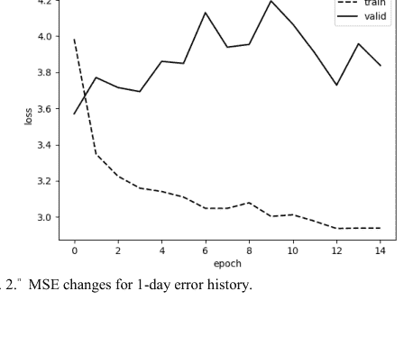
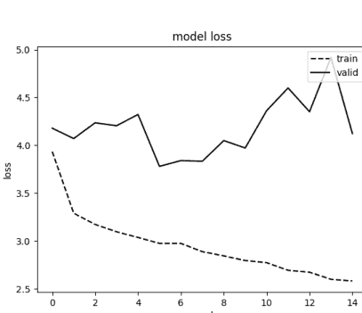
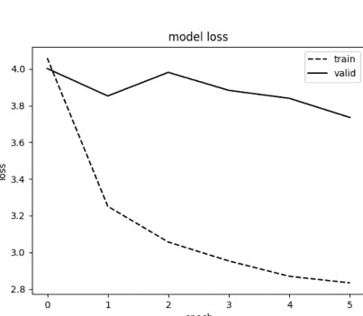
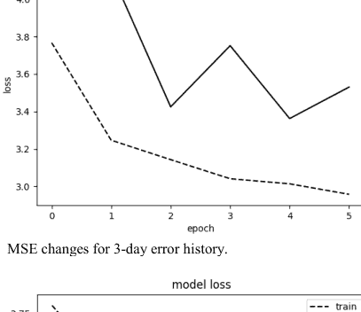
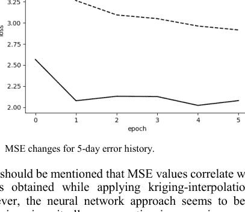

# 2020 IEEE 第二届信息理论先进趋势国际会议 (ATIT) (乌克兰 Kyiv 2020.11.25-2020.11.27) 2020 IEEE 第二届信息理论先进趋势国际会议


Anatoly Doroshenko
乌克兰国家科学院软件研究所
NTUU '伊戈尔·西科尔斯基基辅理工大学' 
基辅，乌克兰
doroshenkanatoli2@gmail.com

Vitalii Shpygy
乌克兰国家应急局（SES of Ukraine）水文气象学院及乌克兰国家科学院
基辅，乌克兰
vitold82@ua.com

Roman Kushnirenko
乌克兰国家科学院软件研究所
基辅，乌克兰
roman.kushirenko@gmail.com

**摘要** 本文回顾了数值天气预报的趋势、误差的性质以及改进方法。提出了一种神经网络来提高 COSMO 区域模型温度预报的准确性。该架构允许通过不同的历史区域误差模型进行进一步的研究，对大气模型的误差进行预测。网络过拟合叠加后的 epoch 数量取决于该架构能够使 2米高度温度预报的精度提高约 50%。

*关键词*—神经网络、模型、COSMO、大气、温度

## I. 引言

在过去的30年里，用于天气预报的数值流体动力学方法的发展应用取得了意想不到的进展。这主要归功于强大计算机的出现、复杂方法的设计以及气象仪的本质改进。

大气的性质基于对流层和对流层复杂热力学过程的研究，这些过程允许我们通过流体力学方程对其进行定义 [1]。在世界范围内，天气预报已根据气象类型、数学实现、预报范围和规模进行分类。

今天，天气预报的质量由两个维度组成：准确性和范围。短效预报取决于大气的初始状态。长效预报不仅需要检测有限的初始场，还需要描述导致系统新平衡状态的因素。长效预报取决于大气的初始状态和建模元素。预报范围的扩大导致了覆盖整个地球表面的需求，计算时间和计算机功率是关键因素。

大气中存在不同类型的过程和现象。某些现象在有限区域内短时间内或长时间发生。目前，所有大气过程可以通过这些类型进行识别 [3]：（从 200m 到 2000km 的尺度）。在每个区域和每个尺度，过程的形成是清晰的。

在此之前，天气服务关注的是半球的天气状况，尽管此类预报的结果几乎保持不变。随着计算资源的发展，新的运行模型在所有现有气象中心（华盛顿、墨斯科、奥芬堡等）被创建。对于大尺度过程，并行计算机系统被用于 300 个。

如果没有高性能计算方法，执行复杂大气处理的数值方法是不可能的。目前的预报面临严格限制，只有通过强大的多处理器系统才能克服。如今，网络技术、操作系统和分布式计算集群是为了实现多处理器处理和并行编程的高性能。

如今，研究和并行预报系统的前景是在代数语言和模型领域构建程序抽象，这允许架构和语言无关的多处理器计算网络的发展。代数方法在构建并行程序模型中的应用提供了高性能性能。

并行气象预报系统的进一步改进不仅通过提高生产力，还通过降低单位能耗来实现。使用非均匀并行计算系统是特定任务以获得最低成本最高性能的方法。近年来，图形处理器（GPU）在这方面表现出色。GPU 特别适用于信息处理以及通用处理器平台（GPGPU）。

本文描述了用于改进数值预报任务的神经网络架构。所提出的神经网络通过不同的历史误差模型对大气模型的误差进行进一步预测。

### A. 数据集

所提出的神经网络通过不同的历史误差模型对大气模型的误差进行进一步预测。网络过拟合叠加后的 epoch 数量取决于该架构能够使 2米温度预报的精度提高约 50%。

本文描述了用于改进数值预报任务的神经网络架构。所提出的神经网络通过不同的历史误差模型对大气模型的误差进行进一步预测。

- 日期
- 温度
- 预报（观测值）

所提出的神经网络对大气模型的误差进行进一步预测。进一步预测。网络过拟合叠加后的 epoch 数量取决于该架构能够使 2米温度预报的精度提高约 50%。

本文描述了用于改进数值预报任务的神经网络架构。所提出的神经网络通过不同的历史误差模型对大气模型的误差进行进一步预测。

本文描述了用于改进数值预报任务的神经网络架构。所提出的神经网络通过不同的历史误差模型对大气模型的误差进行进一步预测。网络过拟合叠加后的 epoch 数量取决于该架构能够使 2米温度预报的精度提高约 50%。

本文描述了用于改进数值预报任务的神经网络架构。所提出的神经网络通过不同的历史误差模型对大气模型的误差进行进一步预测。

本文描述了用于改进数值预报任务的神经网络架构。所提出的神经网络通过不同的历史误差模型对大气模型的误差进行进一步预测。

## II. 神经网络

影响气象值的地球循环过程通过复杂模型描述。为了获得准确的预报，需要高分辨率的大气数据。


处理数值模型区域的技术可以是使用机器学习，即神经网络。神经网络的广泛使用是因为新学习算法的发展和计算机功率的提高。神经网络如此受欢迎的原因是它们允许在关注局部细节的同时寻找共同点 [4]。

观测在此进行三次，即 UTC 时间的 00:00、03:00、06:00、09:00、12:00、15:00 和 18:00。数值预报也针对这些时间进行了计算。每个日期都有八天的数据：数据集涵盖 489 天（从 2012-07-01 到 2013-11-01），由 392 天、392 个时间组成。

为了创建、验证和测试数据集，我们将数据划分为子集。训练集涵盖 365 天（从 2012-07-01 到 2013-06-30），测试集涵盖 116 天（从 2013-07-01 到 2013-10-24），以及验证集


数据集涵盖 8 天（从 2013.10.25 到 2013.11.01）。因此，我们在训练集和测试集之间获得了 75/25 的比例。

所提的神经网络架构第一层为具有 16 个单元的 GRU 层，后续层单元数量较少以减少性能损失。第一层之后是两个全连接（密集型）层。它们的单元数量取决于误差历史。基于 1, 2 天误差历史的模型具有 8 和 16 个单元；基于 3, 5 天误差历史的模型具有 32 和 16 个单元；基于 7 天误差历史的模型具有 8 和 32 个单元。

### B. 输入和输出向量

如上所述，所提方法的核心思想是根据区域模型预测给出的误差来训练神经网络模型，即 Err = Forecast - Obs。如果是这样，我们可以将数值预报计算为 FCNt = Err + forecast。

实验是 1, 2, 3, 5, 7 天误差历史进行的。输出向量维度分别为 1, 2, 3, 5 和 7。我们的日输入向量包含了给定历史下数值预报误差的所有数据。

所提架构的最后一层也是全连接的。它具有 8 个单元，在可能模型处理后获得的结果确保了输出向量的某些多样性。

输出向量维度等于 1×8。这些数据包含了 1 天预测的数值预报误差的所有数据。

所有实验都是使用 Keras（一个为神经网络提供 Python 接口的开源库）学习平台完成的。Tensorflow（一个开源机器学习框架）。代码使用 Python 编程语言编写。

### C. 神经网络架构

数值预报误差具有时间序列特性。我们决定使用循环层作为第一层，因为近期的模型是为处理此类历史而设计的。

在许多循环网络中，我们使用了门控循环单元（GRU）架构 [7]。GRU 是一种流行的长短期记忆网络（LSTM），但它的参数更少，并且在学习长期依赖方面不会遇到很多问题，特别是梯度消失和爆炸问题。

GRU 单元的工作方式如下：在每一步中，它接收来自当前步骤的输入向量 $x_t$ 和来自上一步骤的输出向量 $h_{t-1}$。当前输出向量计算为 $h_{t-1}$ 和当前候选向量 $\tilde{h}_t$ 之间的线性插值。

```
$h_t = (1 - z_t) \odot h_{t-1} + z_t \odot \tilde{h}_t;\;(1)$
```

其中 $z_t$ 是门向量（决定输入向量的哪些部分将使用当前输出）；$\odot$ 是哈达玛积的符号。更新向量计算如下：

```
$z_t = \sigma(W_z x_t + U_z h_{t-1} + b_z);;(2)$
```

当前候选向量 $\tilde{h}_t$ 通过简单循环网络（RNN）计算：

```
$\tilde{h}_t = \sigma(W_h x_t + U_h (r_t \odot h_{t-1}) + b_h);;(3)$
```

其中 $r_t$ 是重置向量。它的计算方式类似于 $W_r, U_r, b_r$ 是参数矩阵，更新门和重置门向量使用 sigmoid 函数激活，而当前候选向量使用双曲正切函数激活。

```
$r_t = \sigma(W_r x_t + U_r h_{t-1} + b_r);;(4)$
```

$W_w, U_w, b_w, W_h, U_h, b_h$ 是参数矩阵。

如上所述，实验是在不同的误差历史（1, 2, 3, 5, 7 天）下进行的。模型以不同的 epoch 数（次数）进行训练：1, 2 天误差历史训练了 15 次，3, 5-7 天误差历史训练了 6 次。更多的 epoch 会导致更好的过拟合模型，结果导致了测试期间使用的均方误差（MSE）发生变化。验证期间的 MSE 变化如图 2-ig 所示。

虚线表示训练数据集上的 MSE，而实线表示验证数据集上的 MSE。实验（如图 2 所示）显示了在 1 天误差历史上获得的 MSE（即与区域神经网络模型同步）。

误差值的增加会减少获得更好预报的案例数量。在 5 天和 7 天误差历史案例中观察到的影响（哪一个）需要更深入的调查。



图 2. 1 天误差历史的 MSE 变化。





图 3. 2 天误差历史的 MSE 变化。

图 6. 7 天误差历史的 MSE 变化。

表 I 获得更好预报的案例百分比

| 误差历史大小（天） | 案例百分比 |
|---|---|
| 1 | 52.05 |
| 2 | 50.98 |
| 3 | 50.44 |
| 5 | 51.67 |
| 7 | 52.04 |



## IV. 结论

图 4. 3 天误差历史的 MSE 变化。

在研究中，我们引入了神经网络架构来修正区域数值模型，以改进温度预报。希望其他连续气象量可以使用这种方法。



我们对不同的误差历史（1, 2, 3, 5, 7 天）进行了实验，并确定了模型过拟合的 epoch 数：1, 2 天误差历史为 15，3, 5-7 天误差历史为 6。

图 5. 5 天误差历史的 MSE 变化。

我们证明了所提架构能够在 50% 的案例中改进温度预报。

# 参考文献

注意的是 MSE 值与使用克金法获得的结果相关 [39]。然而，神经网络方法似乎更有前景，因为它修正了数值模型未考虑的物理过程误差。

[1] Belov, N., Borisenkov, E., 和 Panin B. 数值预测方法（俄语）。Gidrometizdat, Leningrad, 1989.

[2] Vitaly P. 和 Anatoly Dobronsky. 天气计算技术：过程建模。美国宾州，2003. 美国气象学报，96(57)，1925–230.

[3] Okuyama, J. 一种神经网络增强天气模型准确性分析的统计方法。Sensors, 2013，2019–2140.

[4] Domain, S. 非流 COSMO 模型描述：第一部分动力学与确定性。Deutscher Wetterdienst, Offenbach, 2011.

[5] Shiny, Y. 等. 区域数值模型在业务天气预报中的应用。响应21世纪的环境，2013.

[6] Cho, K 等. 使用神经机器翻译学习短语表示。arXiv:1406.10718, 2014.

[7] Hochreiter, S. 和 Schmidhuber, J. 长短期记忆。神经计算，(W8), 1997;1735–1780.

[8] Kadousawa, L. 和 Strom, Y. 天气预报模型克金插值的最佳滞后选择。Hydrology and Water Management, (42), 2016，22–38.
