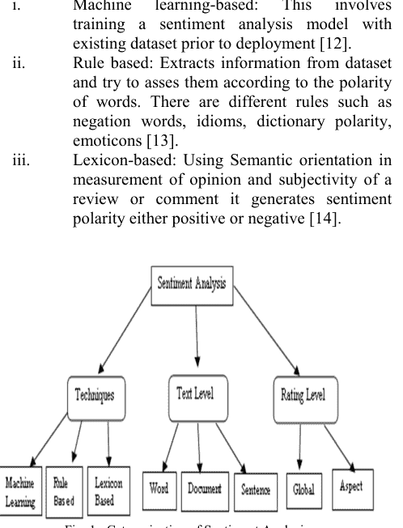
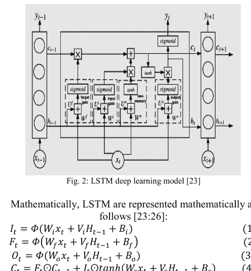
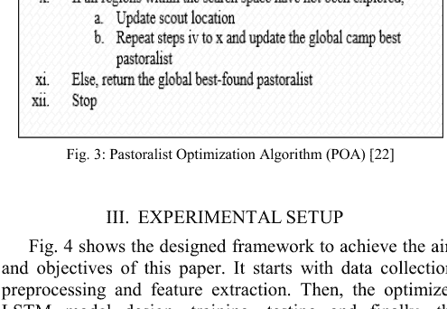
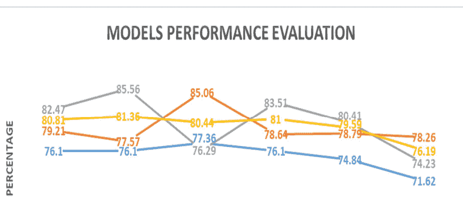

# 2020 IEEE 第二届国际网络空间会议 (CYBER NIGERIA) (尼日利亚阿布贾, 2021.2.23-2021.2.25)

**Safiya A. Shehu**  
计算机科学系  
尼日利亚联邦大学  
Minna  
尼日利亚，米纳  
`salsaf3667@gmail.com`

**Abdulalik D. Mohammed**  
计算机科学系  
尼日利亚联邦大学  
Minna  
尼日利亚，米纳  
`drmalik@futminna.edu.ng`

**Ibrahim M. Abdullah**  
计算机工程系  
尼日利亚联邦大学  
Minna  
尼日利亚，米纳  
`amibrahim@futminna.edu.ng`

## 摘要

用户会在网上对其购买的产品表达情感。对人们对实体的感受和想法进行计算研究被称为情感分析。长短期记忆网络 (`LSTM`) 是解决情感分析问题最常用的深度学习模型之一。然而，它们也存在一些缺点，如训练时间长、内存成本高以及对生成参数的过拟合。因此，需要优化 `LSTM` 参数以增强情感分析。本文提出了一种改进的牧民优化算法 (`POA`) 来增强情感分析。该模型被用于分析从亚马逊产品评论中获取的客户情感。结果显示，与其他模型相比，其最优准确率、精确率、召回率和 F1 分数分别为 77.36%、86.50%、76.29% 和 80.44%。还观察到，20 的牧民种群规模表现优于其他规模为 10、15、25 和 30 的模型。

**关键词**— 情感分析，自然语言处理 (`NLP`)，深度学习，牧民优化算法

## I. 引言

在当今信息量巨大的世界中，数据、价值或意见以原始数据的形式在社交媒体网站或电子服务网站上共享。然而，处理此类原始数据需要专门的方法。本研究描述了人们对产品及其他特征的观点。情感分析系统地识别、量化并提取有效状态和主观信息。它被用于 Web、文本数据以及信息检索 [1]–[2]、计算机、社会科学等。分析情感、对象和特征、观点持有者以及方向是三种常用的方法。情感分析涉及一些挑战，如对象识别、方向分类和特征提取。

深度学习 (`DL`) 作为一种先进的机器学习模型，已经解决了该领域由于词汇资源缺乏和情感分类改进所带来的某些挑战。深度学习在解决人工智能领域的挑战性问题方面取得了成功。尽管取得了成功，但确定合适的层、变量数量、隐藏层以及训练仍然是深度学习面临的最大挑战 [25]。该算法在解决组合问题方面非常成功，因此是情感分析深度学习模型的一个良好候选者。

在本文中，提出了一种使用深度学习 (`LSTM`) 和 `POA` 的优化情感分析模型。该模型将在来自用户社交互动的数据集上进行测试。开发后，该模型将通过改进 `LSTM` 模型来实现情感分析任务，并为从相反的视角分析成员和产品提供机会。这使得情感分析成为扩大产品订单和市场业务分析的理想工具。

本文的其余部分结构如下：第 II 节介绍了与该领域相关的工作，包括情感分析、深度学习综述和 `POA`。第 III 节介绍了方法和研究目标。第 IV 节展示了预期结果，第 V 节给出了结论。

## II. 相关工作

### A. 情感分析

由于情感分析在生活各个领域的重要性，其研究在多年来不断增长。情感分析可以根据某些标准进行分类，包括：技术、使用的数据集结构和评分水平 [12]。图 1 显示了情感分析的若干类别。实现情感分析的各种方式：

i. **基于机器学习的**：这涉及在部署之前使用现有数据集训练情感分析模型 [12]。

ii. **基于规则的**：从数据中提取信息，并尝试根据单词策略对其进行评估。有不同的规则，如否定词、成语、字典和情感 [13]。

### B. 深度学习

深度学习是一种采用多层深度网络的 `ANN`，因为它能够解决比以前更困难的问题。近年来，深度学习获得了广泛认可。大数据的收集和计算能力的提升推动了其发展。深度学习能够处理有监督和无监督问题 [24]。卷积神经网络 (`CNN`)、深层信念网络 (`DBN`) 和循环神经网络 (`RNN`) 都是解决语音识别、自然语言处理 (`NLP`) 和人脸识别等计算机视觉等挑战性问题的常用深度学习模型。尽管取得了成功，但确定模型中的参数和隐藏层数量仍然是深度学习的最大挑战 [25]。

情感分析是一个可以使用深度学习解决的挑战性问题。深度学习的特点包括处理排列在几层中的特征以转换和提取。Wang 等人 [10] 提出了一种耦合与名词 (`DCAN`) 神经模型。该技术的关键在于对情感的形容词和名词描述以及随后的情感分析。[11] 提出了一种基于 `LSTM-CNN` 的深度神经网络模型，它利用 `word2vec` 和语言嵌入来成功分类情感或提取特征。

在 [27] 中，双注意力-双 `LSTM` 改进了情感分析。性能遵循通过离散化从左右上下文获取的注意力来获得的范式。添加了许多方法来帮助合并关注焦点。在 [9] 中，提出了一个 `DNN` 分别用于文档表示和情感分析。Ahmad 等人 [47] 提交了用于微博客和新闻分类的集成方法的分析。在 [8] 中，在分类其情感时提出了用户特征和偏好。





从数学上，`LSTM` 的数学表示如下 [23]：

```
f_t = σ(W_f x_t + U_f h_{t-1} + b_f)
i_t = σ(W_i x_t + U_i h_{t-1} + b_i)
c̃_t = tanh(W_c x_t + U_c h_{t-1} + b_c)
c_t = f_t ⊙ c_{t-1} + i_t ⊙ c̃_t
o_t = σ(W_o x_t + U_o h_{t-1} + b_o)
h_t = o_t ⊙ tanh(c_t)
```

其中 `W` 和 `U` 是参数，`b` 是偏置，`x_t` 和 `h_t` 分别是 `LSTM` 时间的输入和隐藏状态，而 `i_t`、`o_t` 和 `f_t` 分别是激活门输入、输出和遗忘门。最后，`σ` 和 `C_t` 是 sigmoid 函数和记忆单元状态。

### C. 牧民优化算法 (POA)

`POA` 的其他变体已被提出 [21]。图 3 显示了 `POA` 步骤。



**算法 1：牧民优化算法**

**输入**：`POA`；搜索空间  
**输出**：最优解

1.  开始
2.  初始化 `POA` 参数
3.  随机选择牧民并初始化侦察者位置
4.  评估每个侦察者的适应度，更新并归一化搜索空间内的位置，直到达到最大标准
5.  选择最佳群
6.  评估牧民并确定群内的牧民
7.  将牧民划分到群内的不同位置并计算牧民适应度
8.  重复牧民直到达到最大迭代。对于每个项，将当前群除以最佳牧民数量
9.  更新位置
10. 如果搜索空间内的区域未被探索，更新位置
11. 停止

## III. 实验设置

图 4 显示了为实现本文目标和目的设计的框架。它从数据收集、预处理和特征提取开始。然后是 `LSTM` 模型的设计、训练和测试、性能评估。


实验使用的数据集包含三个客户数据集评论，包含 531 条目。所有评论均来自亚马逊，可以通过 `amazon.com` 获取。表 1 显示了从亚马逊获取的聚类数据集示例。数据收集后，需要对用户发布的内容进行预处理，将其从原始格式转换为机器算法能够理解的形式。预处理还提供了去除数据中噪声的机会，从而可以获得更准确的学习。预处理步骤如下：

- 移除 `URL`
- 消除所有换行符
- 对数据集进行分词（将字符串序列转换为具有去标识化含义的标记/单词）。

在数据预处理之后，提取学习算法所需的特征。文本表示有两种不同的方法：词向量表示法，将文档中的每个词表示为 N 维向量。这种方法无法捕捉词语排列方式中的语义信息，它只关注词的出现情况。本文采用的第二种方法是词嵌入。

### A. 提议模型的实现步骤

通过设置 `LSTM` 模型的适当参数（如轮次数、学习率、隐藏节点大小、层数和序列），设计了 `POA-LSTM` 和 `LSTM` 模型。输入模型的隐藏节点和学习率是经 `POA` 优化的两个参数。此外，还研究了 `POA` 参数、后验数量或种群大小。

使用数据集的 70% 训练了六个模型并使用剩余数据进行测试。针对 10、15、20、25 和 30 个隐藏节点优化了 `POA-LSTM`，而第六个模型是 `LSTM` 模型。算法用于适应度估计的适应度函数（`F`）为给定均方误差：

```
F = (TP + TN) / (TP + FN + FP)  (12)
```

其中，`TP`、`FP` 和 `FN` 分别代表正确识别的情感、正确识别的负面情感、错误识别的负面情感。图 5 展示了开发的 `POA-LSTM` 情感分析的实现步骤。

**算法 2：POA-LSTM 情感分析算法**

**输入**：情感数据；`LSTM` 模型  
**输出**：最优情感；最佳模型

1.  数据收集与预处理
2.  特征选择
3.  特征提取
4.  `LSTM` 设计
5.  `POA` 参数初始化和种群生成
6.  随机选择参数并利用侦察者位置
7.  训练 `LSTM` 模型
8.  评估每个侦察者、侦察者位置的适应度并对得分归一化
9.  重复搜索空间直到达到停止标准
10. 在下一次选择最佳侦察位置并后验化
11. 使用新位置训练最佳 `LSTM` 模型
12. 评估适当和最佳后验位置的适应度
13. 重复直到未找到更好的位置
14. 使用新位置训练最佳 `LSTM` 模型
15. 评估适当和最佳后验位置的适应度。对于每个侦察者，将曲线范围除以后验数量
16. 如果搜索空间内的所有区域均未被探索，
17. 选择一个侦察位置
18. 重复步骤 v-xi 并更新全局最佳后验位置
19. 否则，返回全局最佳后验
20. 返回最佳模型
21. 停止

### B. 性能评估

使用了准确率、精确率和 F1 分数指标来评估开发的 `POA-LSTM` 情感分析模型的性能。它们的数学表示如下：

- **准确率 (Accuracy)**  
  这是所有识别样本占所有样本的比例，公式如下：
  ```
  Accuracy = (TP + TN) / (TP + FN + FP) × 100%  (13)
  ```

- **精确率 (Precision)**  
  精确率是正确识别的数据比例，公式如下：
  ```
  Precision = TP / (TP + FP) × 100%  (14)
  ```

- **召回率 (Recall)**  
  这代表数据中所有样本中正确识别的正面情感。公式如下：
  ```
  Recall = TP / (TP + FN) × 100%  (15)
  ```

- **F1 分数 (F1 Score)**  
  公式如下：
  ```
  F1 = 2 × (Precision · Recall) / (Precision + Recall)  (16)
  ```

## IV. 结果与讨论

展示并讨论了所有执行的实验结果。图 6 显示了种群大小为 10、15、20 和 30 时 `POA-LSTM` 的收敛曲线。曲线表示了每个种群大小的最优适应度值和收敛速率。结果显示，当种群大小为 20 时，算法收敛并获得 0.7736 的最优值，与其他种群大小相比，这是最佳值。当种群大小为 10、15 和 25 时，适应度值为 0.761，且当种群数量增加时降低到 0.7484。如表 1 所示，10、15、20 和 30 的最优学习率和隐藏节点数分别为：0.01、0.02、0.18、0.01-37、0.01-5 和 0.02-21。

图 7 显示了五个 `POA-LSTM` 和 `LSTM` 模型的混淆矩阵。该矩阵是实际句子与预测句子的计数。矩阵显示：对于 `POA-LSTM` (10)，`TP`、`TN`、`FP` 和 `FN` 分别为 40, 81, 21, 17；对于 `POA-LSTM` (15)，为 83, 38, 24, 14；`POA-LSTM` (20) 为 74, 49, 13, 24；`POA-LSTM` (25) 为 81, 40, 22, 16；`POA-LSTM` (30) 为 78, 41, 21, 19；`LSTM` (30) 为 83, 38, 24, 14。

图 8 展示了开发的模型在图 7 混淆矩阵中获得的 `TP`、`FP` 和 `FN` 值计算出的性能指标上的结果。开发模型的准确率、精确率、召回率和 F1 分数如下：对于 `POA-LSTM` (10)，值分别为 76.10%、79.21% 和 80.81%；`POA-LSTM` (15) 模型分别为 76.1%、85.57%、77.55% 和 81.37%；`POA-LSTM` (20) 模型值分别为 77.6%、76.29%、85.09% 和 80.44%；`POA-LSTM` (25) 模型分别为 76.10%、76.84%、83.51% 和 81%；`POA-LSTM` (30) 模型为 74.84%、78.79%、80.41% 和 79.59%。

最后，使用 100 个节点训练的 `LSTM` 模型获得的准确率、召回率和 F1 分数分别为 71.62%、78.26%、73.44% 和 76.19%。`POA-LSTM` (20) 在准确率、精确率、召回率和 F1 分数上优于其他模型；而 `POA-LSTM` (15) 在准确率、召回率和 F1 分数方面表现更好。这归功于使用 `POA` 优化器选择的最优参数训练 `LSTM` 模型。



**表 I：POA-LSTM 优化**

| 种群大小 | 最优学习率 | 最优隐藏节点 | 最优适应度值 |
| :--- | :--- | :--- | :--- |
| 10 | 0.01 | - | 0.761 |
| 15 | 0.02 | - | 0.761 |
| 20 | 0.18 | - | 0.7736 |
| 25 | 0.01-37 | 5 | 0.81 |
| 30 | 0.02-21 | 1 | 0.7484 |

## V. 结论与未来方向

本文提出了一种利用种群优化算法 (`POA`) 和 `LSTM` 深度学习模型进行情感分析的方法。对亚马逊产品的客户句子测试了 `LSTM` 的学习率和节点大小。此外，还优化了算法的种群大小。这表明优化后的 `LSTM` 优于未优化的 `LSTM`。此外，`POA` 可作为参数优化器。

未来将探索其他情感数据集以评估开发模型的有效性。还将使用 `PSO`、`GOA` 和 `BA` 等其他优化算法来确定它们对 `LSTM` 模型的优化效果。

## 参考文献

- [1] Liu B. 情感分析：挖掘意见、情感与情绪。剑桥大学出版社, 2019.
- [2] Sega A. 深度注意力机制综述。社交媒体情感分析，2019年10月；接受于：2019年11月19日；发表于：2022。
- [3] Wang J., Zhao X., Lee S., Li J, and Zhou G. 一种用于代码语混合深度情感预测的双语注意力网络。收录于2016年国际计算语言学会议 (COLING) 论文集。
- [4] Rashkin H, Bell E, Choi Y, and Volkov S. 多语言注意力框架：目标情感分析的案例研究。收录于2017年计算语言协会会议 (ACL) 论文集。
- [5] Wang N., Zhou N. N., et al. 一种用于方面级情感分类的深度 LSTM。收录于2017年自然语言处理国际会议 (EMNLP) 论文集。
- [6] Liu J, Zhang Y. 针对目标情感的注意力机制。收录于2016年人工智能学会欧洲分会会议论文集。
- [7] Akhtar MS, Kumar G, Dhingal A, and Bhattachararyya P. 金融新闻的多语言情感分析。收录于2017年自然语言处理经验方法会议 (EMNLP) 论文集。
- [8] Chen H, Sun M, Tu L, Lin Y, and Liu N. 基于用户和产品注意力的神经情感分类。收录于2016年自然语言处理经验方法会议 (EMNLP) 论文集。
- [9] Dou Zy. 使用深度记忆网络捕捉产品级和文档级的情感分析。收录于2017年自然语言处理经验方法会议 (EMNLP, 2017) 论文集。
- [21] I. M. Albani, H. Ma, O. M. Olanvisi and J. Agajo, (2019), 一种基于文化演化的游牧牧民优化算法 (NPOA)：数学模型，第2届 IEEE 尼日利亚计算机会议 (NigeriaConf), 尼日利亚，塞塔, 2019, 第 1–7 页。10.1109/NigeriaComputConf457.2019.8940535
- [22] A. Albani, H. Ma, O. M. Olmani, and J. Agajo, (2018), 牧民优化算法：一种基于自然的元启发优化算法；工业与新兴趋势国际会议 (ICET 2018) 论文集，Base 大学，阿布贾，第 101–105 页。
- [23] Zhang, J., Li, D., and Du, (2018), 情感分析的深度学习综述，跨学科评论：数据挖掘与知识发现，86(4)，第 24–35 页。
- [24] P. Kumar and K. Saxena, (2016), 基于 Twitter 数据使用深度学习技术进行情感分析的研究。
- [25] S. Beng, L. Deng, H. Larochelle, H. Lee, and K. Salakhutdinov, 客座介绍，学习深度架构特辑，IEEE 模式分析与机器智能汇，第 35 卷，第 8 期，第 1431–1450 页，2013。


### 参考文献

- [26] M. Usama, W. Xiao, B. Ahmad, J. Wan, M. Hassan and A. Alecavi (2019). 基于深度学习的情感分析加权融合方法. *IEEE Access*, 7, 140252-140266.

- [27] Yang M, Tu W, Wang J, Xu F, and Chen X. 基于注意力的 LSTM 用于依赖情感分类. 收录于 *AAAI 人工智能会议 (AAAI 2017) 论文集*, 2017.
