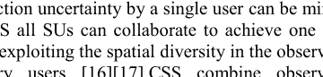
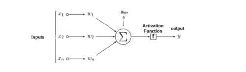
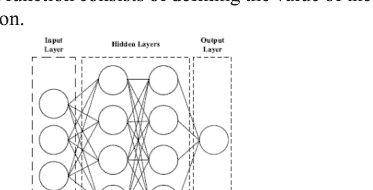
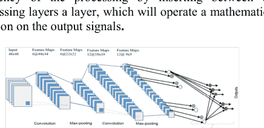
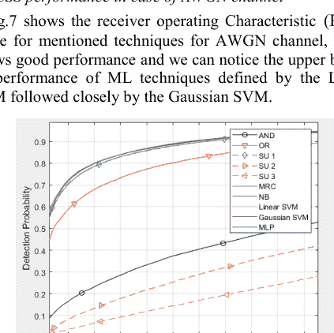
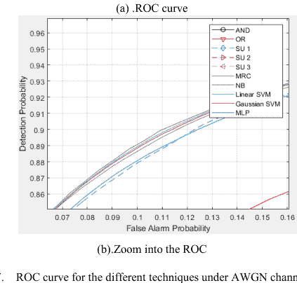
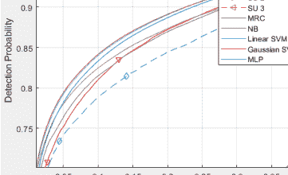
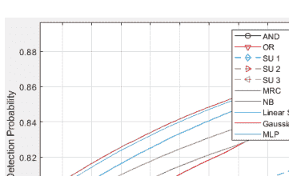

# 2020 IEEE 第二届国际电子、控制、优化与计算机科学会议 (ICECOCS) (摩洛哥肯尼特 2020.12.2-2020.12.3) 2020 IEEE 第二届国际电子


Chaymae GATTAUA
新技术趋势 (NTT)
国立应用科学学院-
Tetuan

Otman CHAKKOR
新技术趋势 (NTT)
国立应用科学学院-
Tetuan

Foudad AYTOUNA
遥感与地理信息系统 (RS-GIS)
国立应用科学学院-
Tetuan

摩洛哥，捷捷
chaymae.gattua@uae.ac.com

摩洛哥，捷捷
otman.chakkor@uae.ac.com

摩洛哥，捷捷
fayoutna@uae.ac.com

**摘要—** 认知无线电是一种从环境中学习的智能通信系统。它允许辅助用户（Secondary Users）复用可用无线资源，而不会对授权用户（Licensed Users）造成有害干扰。频谱感知在认知无线电技术中至关重要。机器学习应用于频谱感知的文献已有大量记载。在本文中，我们介绍了三种机器学习技术（朴素贝叶斯、SVM 和多层感知器）结合协作感知技术（最大比合并和加加斯白噪声）在瑞利衰落道上协作频谱感知的概述。使用 ROC 曲线评估的性能表明，MRC 是瑞利衰落道上机器学习的最优技术。

认知无线电在通信网络中极具吸引力 [1]。要实现认知无线电的功能，必须经过三个阶段：第一阶段是频谱感知（SS），这是启动认知无线电最重要的步骤。它包括检测未使用的频谱（或白空间）以便在不与主用户（PU）产生干扰的情况下进行共享。频谱管理允许辅助用户通过分析决定哪些频段满足其需求，频谱移动允许认知无线电用户通过动态使用频谱来其工作频率 [9]。

**关键词—** 学习、SVM、K-means、朴素贝叶斯、协作频谱感知。

最近，认知无线电在无线网络和物联网（IoT）等各种应用中受到了广泛关注，因为它能够在动态频谱场景中提供宽带服务和稳定运行。下一代通信系统需要高数据速率和低延迟。从这个角度来看，认知无线电需要寻找宽频频谱以找到最佳可用通道。

# I. 引言

随着第五代无线通信（5G）的到来，随着移动用户的数量增加，数据传输和通信设备正日益增长。频率通信（FC）面临频谱资源的稀缺问题 [1]。此外，还有一些频段未被充分利用。认知无线电（CR）技术在满足无线通信服务日益增长的需求方面发挥着重要作用。通过利用无线资源，认知无线电系统可以动态利用可用通道并改变传输参数。认知无线电的核心思想是由无授权用户（辅助用户，US）感知频谱，以使用授权用户（主用户，PU）的频谱，而不对部署产生不利影响，前提是它们不能干扰 PU 通信且不降低服务质量（QoS）[2]。认知无线电的概念由 Joseph Mitola 在 1999 年提出 [3]。Mitilden 提出的工作建议使用软件提供的重构可能性，将静态无线电设备转换为动态无线电设备，该设备能够自适应其参数（如调制、传输功率和频段频率）[4]。认知无线电技术引起了通信界的关注，并持续取得丰硕成果。

在本文中，我们关注认知无线电以及文献中用于频谱感知的许多技术。新型感知检测 PU 的状态（是否存在空闲）。这被称为匹配特征检测 [6]、能量检测 [7] 和循环平稳性特征检测 [8]。能量检测是一种简单的方法，因为它不需要 PU 信号的先验知识。基本思想是计算接收信号，然后将其与阈值进行比较。然而，它对来自信号和噪声的各种因素并不鲁棒 [9]。基于循环平稳性的特征检测利用信号周期性的循环平稳特性以及统计测量（如接收信号的时间平均值和自相关函数）来区分信号和噪声信号 [10]。匹配滤波器需要完美了解 PU 信号；带宽、脉冲顺序、载波频率和相位偏移，以识别 PU 信号的身份 [11]。下一代通信系统需要高数据速率，在这方面，CR SU 必须检测宽频频谱以找到最佳可用通道。频谱感知是设计下一代通信场景面临的挑战之一。文献中存在多种执行宽谱感知的技术。

在 [], 作者将宽带感知技术分为两类：奈奎斯特宽带感知和亚感知，并比较了每类的优缺点。

机器学习（ML）由于能够应用复杂的数学计算来在学习和决策中分析、解释模型和数据结构，其兴趣日益增加并应用于许多领域。在认知无线电网络中，已经发表了关于用于频谱感知的机器学习的相关研究。通过将过程公式化为监督或无监督分类器来检测频率可用性，必须在每个频率的两种状态（空闲或繁忙）之间选择。然后提取数据（如能量统计向量或概率向量），以构建输入以训练分类器并确定认知无线电的可用性。

本文的其余部分组织如下：第二节描述了协作感知的系统模型和结构。第三节讨论了用于频谱感知的机器学习技术，第四节为仿真和结果，第五节总结全文。

# II. 协作频谱感知

认知无线电是一种同时使用多个通道的通信系统，不能一次来自单一通道，因为它能够使用不同的检测技术执行 SU，这保证了与 PU 干扰的概率在接受范围内。协作感知（CSS）被用于解决认知无线电网络中的隐藏终端问题，减少不确定性、衰落和阴影 [13][13]。

## B. 系统模型和结构

第 m 个 SU 的主信号本地模型可以描述为统计模型：

$H_0 : Y_{m}(n) = h_{m}(n) + n_{m}(n) \quad$ (PU 不存在)

$H_1 : Y_{m}(n) = h_{m}(n) + n_{m}(n) \quad$ (PU 存在)

$H_0, H_1$ 表示 PU 的不存在和存在。对于 $Y_{m}(m=1,2)$，$n_{m}(n)$ 是均值为 0、方差为 $\sigma^2$ 的高斯白噪声，表示 SU，$h$ 代表感知增益，表示检测时间。

$P_{fa} = p(H_d|H_0) \quad$ (虚报概率) (3)

$P_d = p(H_d|H_1) \quad$ (检测概率) (4)

## C. 协作感知技术

### 最大比合并

我们假设一个中心化的认知无线电网络和一个 PU。SU 在感知时隙 q 中产生本地感知能量 $x_{q,m}$，接收样本为：

$x_{q,m} = \sum_{m=1}^M w_{m}|Y_{m}(n)|^2 \quad (5)$

最大比技术通过合并在每个 SU 获取并与融合中心（FC）通信的加权能量级来估计通道。

$\hat{H} = \begin{cases} 1, & \sum_{m=1}^M w_{m}x_{q,m} \geq \lambda \\ 0, & \text{否则} \end{cases} \quad (6)$

其中 $w_{m} = \frac{\gamma_{m}}{\sum \gamma_{m}}$ 是第 m 个 SU 的 SNR，$\lambda$ 是反映估计器期望虚报概率的常数。

### 与门规则



## A. 协作感知架构

协作感知架构分为两种方法：中心化方法和分布式方法。

- 中心化方法：每个 SU 自行检测并发送到中心实体或融合中心（FC），FC 所有 SU 的检测结果。FC 本地感知报告分为软软 [48] 和硬合并 [19]。


在 AND 规则中，融合中心（FC）通过共享每个辅助用户（SU）的感知能量并通过阈值 $\lambda$ ，然后对结果应用 AND 操作，来决定信道的占用状态。

```
$\theta = \begin{cases} 1 & \text{if AND.AND}_m > 0 \\ 0 & \text{otherwise} \end{cases}$
```

- OR 规则

OR 规则与 AND 规则类似，它比较来自每个 SU 的能量级，然后对结果应用逻辑操作。

# III. 用于频谱感知的机器学习

### A. 机器学习技术用于 SS 的动机

频谱感知（SS）提供了频谱容量的知识，通过这些知识，认知无线电（CR）应该对传输接收传输做出智能决策，并利用过去的经验不断改进这些决策。在这里，机器学习方法可以用于 SS。

$X^q = (X_{q,1}, X_{q,2}, \dots, X_{q,M})$ (9)
在 Q 个时隙后，CSS 中监督学习情况的训练数据为 $\{(X^1, Y^1), \dots, (X^Q, Y^Q)\}$，其中 $Y$ 是能量向量 $X^q$ 的标签，代表信道可用性。

- 概率向量

如果 SU 的数量较少，$X_{q,m}$ 的分布可以用均值为 $E(X_{q,m})$、方差为 $\sigma^2_{q,m}$ 的高斯分布近似，那么 $X^q$ 服从均值为 $\mu_q$ 协方差为 $\Sigma_q$ 的高斯分布 [22]：

```
$\mu_q = (E[X_{q,1}], E[X_{q,2}], \dots, E[X_{q,M}])$, $\Sigma_q = \text{diag}(\sigma^2_{q,1}, \sigma^2_{q,2}, \dots, \sigma^2_{q,M})$ (11)
```

每个 $X^q$ 被视为相互独立，$Y$ 是对角的。能量向量 $X^q$ 的概率密度函数 (PDF)：

```
$f(Y^q|X^q, \Sigma_q) = \frac{1}{\sqrt{(2\pi)^M|\Sigma_q|}} \exp(-\frac{1}{2}(Y^q-\mu_q)^T\Sigma_q^{-1}(Y^q-\mu_q))$
```

图 2. 学习与认知的关系。

$\mu_q$ 和 $\Sigma_q$ 的值在 $H_0$ 和 $H_1$ 中不同。

```
$P(H_i) = \frac{f(Y^q|X^q, \mu_{q,i}, \Sigma_{q,i})P(H_i)}{f(Y^q|X^q, \mu_{q,0}, \Sigma_{q,0})P(H_0) + f(Y^q|X^q, \mu_{q,1}, \Sigma_{q,1})P(H_1)}$ (13)
```
是两种情况 $H_0, H_1$ 的概率。

### C. 机器学习技术

机器学习是人工智能的一个领域，通过从数据中构建模型来预测未来状态。机器学习技术已用于分类、回归和聚类等任务。监督学习分为两个阶段：训练阶段和测试阶段。方法主要分为几类：监督学习、无监督学习和强化学习。其目标是构建一个学习一组输出值的模型（例如，支持向量机 SVM）。无监督学习指的是数据未标记的情况。

- 支持向量机 SVM

支持向量机（SVM）或岭边界（margin）是基于 Vapnik 和 Chervonenkis 在 1995 年早期工作的一种有监督分类方法。为了对已经分类为两类的数据进行分类

### B. 特征提取

构建有效学习模型最重要的步骤之一是特征提取。在这一组中，SS 语境下用于构建模型的特征数量表示了用于信道可用性的特征向量是否可用或不可用。

如果特征始终保持更新，新数据将替换旧数据，以便学习模型适应环境的变化。一旦模型训练完成，将使用新向量进行测试阶段，以预测感兴趣的信道状态。我们假设了中心化网络和单主用户（PU）的情况。在感知时隙中，带有接收到的样本：

```
$X_{q,m} = \sum_{n=1}^{L} |y(n)|^2$ (8)
```
时隙 q 的能量向量 [22]：


图 3. SVM 分类 [23]。

SVM 的目标是找到由 $w \cdot x + b = 0$ 定义的超平面，使数据线性可分。$w$ 和 $b$ 分别是超平面的定义。通常，SVM 用于解决线性分类问题，通过引入不同的核函数可以用于非线性：

```
$f(x) = \text{sgn}(w \cdot x + b)$ (14)
```
其中 $y_i \in \{-1, +1\}$ 对于 $i=1..N$，

```
$$\|w\|^2 + C \sum_{i=1}^{N} \xi_i \quad (15.1)
```
其中 $C$ 是一个参数，xi_i$ 是数据的松弛变量。

```
$\xi_i \ge 0 \quad (15.2)
```
```
$\xi_i \ge 0 \quad (15.3)
```
对于 $i=1..N$。

由于信噪比（SNR）的脆弱性，实时的自动检测是困难的。在 [25] 中，作者在低信噪比检测中引入了两种新的特征提取方法：接收频谱平滑相关 (CRSS) 和多波差平均 (MVWA)，基于高斯基函数。

时空联合检测在 [26] 中被考虑，这种策略改进了天线网络中单多主用户的 SVM 容量。[27] 中，从数据中提取的三个统计特征将形成 SVM 分类器。

[28] 中，作者使用 SVM 技术解决 SS 数据伪造（SSDF）攻击问题。

[29] 中，基于 SVM 的认知物联网 5G 网络协作 SS 以减少能量消耗和频谱使用。

- K-means

K-means 是无监督机器学习中最常用的算法，用于将数据划分为组，代表中心。k-means 算法的第一步是定义 K。算法开始从数据中选择 k 个类作为这些类的初始中心。这些类也被称为中心。然后，将剩余的对象分配给其当前中心，中心由对象与中心之间的欧式距离定义。分配完成后，算法计算每个类的新值。现在中心已经重新计算，重复该过程直到收敛。所有对象都分配到更新后的类均。聚类算法旨在最小化所有点到其质心的平方距离：

[30] 使用强连接的人处理结构称为人工神经元，其结构受到生物神经元功能的启发。每个神经元接收来自数据流的多个输入。每个输入神经元与权重相关，权重表示两个神经元之间关系的强度。每个神经元都有一个输出，代表后续神经元的输入。输入层和输出层被称为隐藏层。学习过程按顺序修改权重，直到达到预期 [24]。

- 人工神经网络 (ANN)


- * P(B|A) 被称为似然（likelihood）。

贝叶斯学习可以将条件概率和先验概率转换为后验概率，并基于此类后验概率对信道占用进行决策分类 [36]。

在文献 [37] 中，针对大规模异构网络的协作频谱检测，利用了贝叶斯机器学习（ML）并利用多个辅助用户（SU）的协作来收集数据流（SS）。他们开发了一种非参数贝叶斯学习模型，称为处理这种特定的隐藏马尔可可夫模型（BP-SHMM），以捕获所收集数据中的时间相关性；SHMM 模型对每个移动 SU 的时间序列数据建模潜在统计相关性，而 BP 则代表多个 SU 之间的协作。随后，在异构频谱状态上自动进行贝叶斯推理。[33] 聚类是基于贝叶斯学习的。聚类通过类内 CSS 和类间 CSS 完成。通过最小化总代价 $K$ 实现了类内 CSS 的优化的感知阈值。使用 K-means 算法来识别认知无线电（CR）节点并选择簇头。

- * 朴素贝叶斯（Naive Bayes）



# $y = \sum(j) w_j x_j + b$

$[x_1, ..., x_n]$：某些神经元的输入来自前一层神经元，或来自环境。

$w_j$ ：某一层神经元与下一层神经元之间的权重。

$f$：激活函数定义了神经元状态的值。



文献 [33] 的作者提出使用来自能量检测的能量值和来自似然比统计数据的统计量来训练用于频谱检测的人工神经网络（ANN）算法。包括前馈神经网络和 Elman 神经网络。这表明感知器神经网络比其他神经网络更有效。在文献 [35] 中，作者解决了决策支持 ANN 技术计算协作感知所需时间的问题。在噪声底电条件下，SU 使用基于梯度的频谱感知（GBSS）模型，然后通过融合中心（FC）使用算法合并 CR 用户的局部决策，并在测试场景上验证了结果。结果表明，所提模型在检测性能和时间计算方面优于传统的决策融合。

朴素贝叶斯（NB）是一种基于贝叶斯定理应用的分类器，它对 SU 能量电平进行了简化假设，考虑到存在 $q$ 值，且 $x_m$（对于 $m=1$ 到 $M$）是独立的。

```
$f(X^H|H_1) = \prod f(x_m|H_1)j=0-1$
```
概率密度函数

```
$P(H_1|X^H) = \frac{f(X^H|H_1)P(H_1)}{f(X^H|H_1)P(H_1) + f(X^H|H_0)P(H_0)}$
```

```
$U_{NB} = P(H_1|X^H) - 1 - P^*(H_0)$
```
否则

- 目标虚警概率。

$P(H_1), P(H_0)$ 是假设的先验概率。

- * 贝叶斯学习

贝叶斯学习使用贝叶斯定理来确定给定证据或观测值时假设的条件概率。

- * 给定两个事件 A 和 B：

```
贝叶斯定理：$p(A|B) = \frac{p(B|A)p(A)}{p(B)}$
```

- * P(A) 是假设 A 的先验概率。

- * P(B) 是证据 B 的概率。

- * P(A|B) 是后验概率。

其他方法可能将模糊均值（fuzzy c-means）技术应用于文献 [39] 中的频谱感知（SS）。在文献 [40] 中，提出的遗传算法（GA）用于物联网的决策支持。在文献 [41] 中，高效的宽带频谱技术使用了压缩感知来提高性能。

- 深度学习

深度学习（DL）是机器学习（ML）的一个子集，利用分层的人工神经网络执行学习过程。

- • 卷积神经网络（CNN）是一种深度学习方法，由输入层、输出层以及若干隐藏层组成。CNN 的隐藏层通常由卷积层、激活函数、池化层和标准化层组成。

- • 卷积层：由滤波器组成，应用于整个输入向量。每个滤波器由 $k$ 个权重（或值）；每个权重都是待学习模型的参数。

- • 池化层：池化操作是缩小输入数据尺寸的形式，同时保留其重要特征。经过若干层卷积和池化层后，神经网络中的高层特征通过全连接层完成。全连接层中的神经元与上一层的所有输出连接。

- • 修正层：如果在处理层之间插入一个层，可以提高处理效率。基于三个具有一个隐藏层的有监督机器学习模型（多层感知器 MLP）的仿真，使用线性和高斯核的 NB（朴素贝叶斯）对比。

| 参数 | 数值 |
| --- | --- |
| 带宽 | 5 MHz |
| PU 数量 | 3 |
| PU 激活概率 | P(Hu)=0.5 |
| PU 性能 | -53dB/Hz |
| 训练样本 | 1000 |
| SU_PU 概率 | 750m |
| SU_PU 距离 | |

机器学习技术与传统的 AND、OR 规则以及基于能量电的 MRC 方法进行了比较。我们展示了使用 ROC 的通道状态结果。

## A. AWGN 信道中的 CSS 性能

图7 显示了用于 AWGN 信道的接收机工作（ROC）曲线，MRC 显示出良好的性能，我们可以通过线性 SVM 注意到机器学习技术的性能上界。



图 6 CNN 架构 [4]。



在文献 [44] 中提出了基于 CNN 的协作感知，它提高了感知性能并降低了复杂度。作者发现，当样本数较少时，该方法的检测是准确的。文献 [44] CNN 用于低信号模式下的 PU 感知，模型通过平稳特征进行训练。

- 循环神经网络。循环神经网络（RNN）是一种常用于信号识别和自然语言处理的人工神经网络。RNN 设计用于识别数据特征并预测序列中的下一项。长短期记忆（LSTM）块是 RNN 结构的一部分。RNN 设计用于某些类型的人工记忆，可以帮助人工智能。在文献 [47] 中，循环 CNN 用于提高 CSS 的分类性能。该方法用于减少进入 LSTM 层的数据。


(a)。

# IV. 结果与讨论

该应用关注在蒙特卡洛方法下 AWGN 和瑞利衰落信道下的集中化 CSS。

## B. 瑞利信道下的 CSS 性能

另一方面，考虑到瑞利衰落，机器学习技术能够获得比 MRC 更好的性能，如图8所示。图9显示了上述每种机器学习技术取决于训练数据大小的检测概率变化，我们清楚地看到检测概率在500之后开始提高。

# V. 结论

在本文中，我们介绍了协作频谱感知的机器学习技术概述以及在该背景下应用的一些研究。此外，我们对比了 AWGN 信道和瑞利信道下具有线性和高斯核的 SYM 与传统技术的前馈神经网络，通道状态在 ROC 曲线上显示。我们得出结论：在 AWGN 信道下，所有机器学习模型的性能与 MRC 接近。在瑞利衰落信道下，所有机器学习技术都优于辅助用户在感知期间的 SNR 水平变化，高斯核 SYM 是优的机器学习技术。


(a)


(b)

# 

- [1] Shekhar Gupta M., Kumar K., Cognitive无线网络频谱感知进展：调查、分类和融合问题。Journal of Network and Computer Applications 143 (2017) 47-76.
- [2] D. T, A. Benjamin, Darley W., 认知无线网络兴趣感知共享/分配综述。Internet of Electronic Informatics, 2019; doi:10.1016/j.futureie.2019.02223


Ghashemi, A Sousa S E (2005) 环境中机会性接入的协作频谱共享。在：IEEE网络与动态频谱接入国际研讨会，巴的摩，2005年11月，页码 131-136。

[144] Ian Fayland Brandon F Ravikumar Balakrishnan, 认知网络中的协作频谱共享：综述。Computer Surveys, 第43卷，第4期，2011年3月。

[155] Badmar Bennasserian. 认知无线电的性能。2013, 3个周期。doi: 10.1109/fcc.203。

[166] Ghosh S E (2007) 用于认知无线电网络中机会性接入的频谱优化。在：IEEE消费者通信与网络会议，美国内华达州拉斯维加斯，7月。

[172] Aftakiz L, F Ef Balakrishnan R (2001) 认知无线电网络中的协作频谱感知：综述。Phys Commun (Computer Engineering) 12(4), 345-360。

[185] E. Vustikay, S. Perkins, "量子频谱共享中电视传输的协作检测",在：IEEE国际通信会议，2009年。

[199] G. Ganesan, T. Lim, "认知无线电网络中的协作频谱感知",在：IEEE 接入网络研讨会 (ANS)，2008年。

[208] H. Arslan, "认知无线电、软件定义无线电与自适应无线系统",2008。

[219] wu L, Li S, Ma S., Ji Ja, "基于特征选择的协作频谱感知性能提升",在：IEEE认知无线电、无线国际会议，2012年1月。

[224] Y.-C. Liang, 动态频谱与宽带频谱感知的智能检测，在：国际通信技术会议，2020年，doi: 10.1109/ICCT.2020.9198115。

[235] Kumar Varma, A. M., 认知无线电网络中基于特征宽带频谱感知，在：IEEE信号处理国际会议，2010年。

[246] AWE P. O., DELIGIANNIS, A., LAMBOTHARAN S., 使用机器学习算法的认知无线电网络时空感知，在：IEEE计算机网络国际会议，2018年，doi: 10.1109/ACCESS.2018.2825603，第6卷，2018年。

[257] Jan S. U., Yu H. K., 认知无线电网络中基于支持向量机的频谱感知性能分析，2018 IEEE增强分布式计算与知识发现国际会议。

[268] Jithraj, S., Balu, S., Wu J., 基于支持向量机的带ssdd攻击的协作频谱感知。在：IEEE国际通信会议，美国堪萨斯县，2011年5月。

[279] Wang Y., Zhang Y., Pan S., Jiang Y., Wang J., 基于机器学习、分解和K-Means聚类算法的频谱感知方法，在：Hindi，2018年，doi: 10.1109/5645518.6840522

[290] Le-jun, TAN-huang, YAN XI, Wang Han-rui. 基于认知无线电盲多用户频谱感知的k-means聚类，中南方大学报，2018，25(10):

[232] Kumar K., Chen C., Jain J., Gangapathy R., Debbath S., 广义-k频率跳频中的协作感知，第二次全国通信会议。

[233] Y. R. Patel, D. C., López-Bernal, M., 基于神经网络的认知无线电感知，2018 IEEE第23届国际通信会议，doi: 10.1109/IRC.2018.829724

[234] Singh R., R., A., 基于神经网络的认知无线电，IEEE电子计算机协会会议。

[235] V. K., Mitra D.A, 宽带频谱决策的神经网络方法，2018信息技术会议。

[236] Li X., Chen J., Yang L., Zhan Q., 使用贝叶斯学习的高效频谱感知，IEEE Access 5 (2017) 20089-20100。

[237] Xu Y., Cheng P., Chen J., Yi Y., Viet B., 异构网络移动频谱感知：IEEE信号处理汇，第66卷，2018年，doi: 10.1109/TSPSP.2018.2789017。

[238] Lu X., Zhang J., Zhang H., P., 恶意用户的智能频谱感知，Hindawi，2020，10页。

[239] J. P., Feng Y., 基于协作频谱感知的能量检测研究。数字通信与网络，2 (2016) 196–202。

[240] Khalli B., Zaid A., Mahmoud B., 当机器学习遇到协作宽带频谱采样。可用<memore.com>

memore.com，2020。

[241] Md Zahandar Alam, Mark M., Taha A., 基于深度学习架构的频谱感知现状综述，IEEE，2021。

[242] Wang J., Chen J., Guo Y., and Robb S.: 基于卷积神经网络的深度认知频谱感知，IEEE Corr.,2022。

[243] Sarikhan R., Keynia F., 利用循环循环神经网络的深度认知频谱，SquareMay，2022，doi: 10.2139/S0022-23-34441

