# 2020 IEEE 第39 届国际性能计算与通信会议 (IPCCC) (美国德克萨斯州奥斯汀 2020.11.6-2020.11.8)

Morgan Moore¹, William H. Clark IV², R. Michael Buehrer, PhD³, and William C. Headley, PhD⁴

²弗吉尼亚理工大学国家安全与技术 Ted and Karn Hume 归属中心

³弗吉尼亚理工大学 Bradley 电气与计算机工程系

*摘要——此前的工作表明，在处理与时间相关的输入（如通信信号）时，循环网络架构相比其他机器学习架构显示出极具前景的改进。此外，循环神经网络通常对序列处理数据而非单个点。在这项工作中，我们研究了基于有限数量循环信号进行推理的“恰好”决策方法。由于某些应用需要快速做出可靠决策，特别是在电子战和动态频谱等应用中，我们评估了这一概念的有效性。本工作考虑了四种做出“恰好”决策的方法，并评估了它们在无线通信机器学习中的可行性。*

**索引术语**——射频，频谱感知，调制分类，循环神经网络

## I. 引言

尽管在这些应用中使用 `RNN` 已证明其性能优于卷积神经网络（`CNN`）架构，但仍存在权衡。如果输入是按顺序处理而非大批量处理，`RNN` 的训练和评估速度通常很慢 [8]。为了利用两种方法的优点并减少各自的缺点，已经开发了如 `WaveNet` [9] 和 `FastWaveNet` [10] 等混合网络，这些网络使用空洞卷积来最小化 `RNN` 的同时缩短训练和评估时间。其他研究人员还关注于降低资源限制设备的复杂度 [11]。

除了时间之外，`RNN` 还会受到长延迟的影响。在许多频谱应用中，需要尽可能快地做出决策。例如在电子战中，毫秒级可能至关重要。这项工作引入了一种概念，通过使用“恰好”推理动态减少 `RNN` 的推理时间，以做出可靠决策。

## II. 方法论

基于 `RFML` 的网络通常由预定义数量样本或符号的信号进行训练，并在所有输入处理完成后给出输出。为了控制缓慢的训练和评估时间，可以使用较短的信号长度。然而观察到，在区分不同的信号类型（如 `16-QAM` 和 `QPSK`）时，较长的长度是必要的。这在基于 `RFML` 和非 `RFML` 的频谱感知应用中都是如此 [12]。图 1 显示了训练后的 `RNN` 在 `SNR` 为 0 dB 时对四种类型信号的输出示例（细节将在第三节中讨论）。x 轴代表当前输入，y 轴代表预测。虽然信号几乎立即识别，但 `16-QAM` 信号最初被误识别为 `Q4-QAM`，并且直到稍后（即使在置信度较低时）才一致地产生正确答案。

在逐符号的实现中，`RNN` 处理的符号可能多于或少于其训练时的数量。以图 1 为例，网络使用长度为 1024 个符号的信号进行训练，但显然在做出置信输出之前不需要处理整个网络。在 `BPSK` 情况下，在处理少于 10% 的输入符号后就识别出了正确符号。在 `16-QAM` 情况下，在处理了 80% 的输入符号后识别出正确符号。

M 的工作得到了弗吉尼亚理工大学 Bradley 电气与计算机工程系 Bradley Masters 学金的支持。

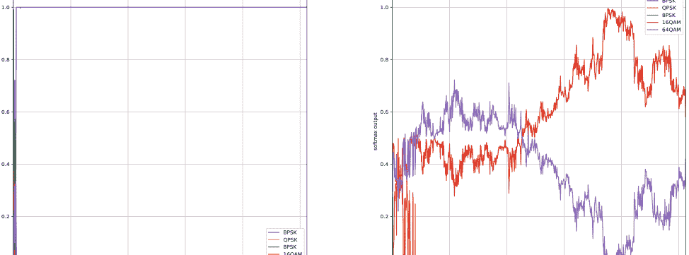

图 1 通过表 II 中的 Model 1 处理的 2 dB 信号的 `softmax` 输出。输出显示未包含任何“恰好”决策。相反，决策是在最后一个接收到的符号被处理后根据最高输出做出的，这里是在 1024 个输入符号之后。在 (a) 中，网络在处理少于 10% 的输入符号后收敛到 `BPSK` 答案。在 (b) 中，网络在处理了 80% 的输入符号后才收敛到 `16-QAM` 答案。

考虑到考虑的 `RNN` 架构性能，本文的目标是开发一种“恰好”决策的概念，允许在处理更复杂的信号时使用更长的信号。此外，本文研究了网络在尽管存在噪声输入的情况下确定其置信点的机制。

本文的范围是基于 `RFML` 的自动分类 (`AMC`)，但可以推广到其他感兴趣类型，如第三节所述。所考虑的 `AMC` 及其代表性 `RNN` 在第四节中给出，“恰好”决策进行了调查并在第五节给出了比较性能。最后在第六节得出结论。

## III. 系统模型

为了推广这项工作中引入的概念，我们训练并评估了五种不同的 `AMC`。基于长短期记忆 (`LSTM`) 和门控循环单元 (`GRU`) 的 `RNN` 被广泛应用于 `RFML` 应用，两种架构均被考虑。

### A. RNN 训练与评估

为了便于训练，为调制方案（`BPSK`、`QPSK`、`16-QAM`）生成了合成符号。使用了固定长度为 1024 个符号的信号，并使用下降率为 0.5 的根升余弦滤波器进行波整形。接收到的符号通过从 0 到 10 变 `SNR` 的 `AWGN` 通道并经过滤波。每个 `RNN` 在 8000 个单独生成的样本上进行训练，并在 100 个单独生成的样本上进行测试。

### B. 模型架构

每个模型的基本架构如表 I 所示。为了泛化这项工作的成果，选择了不同层数的 `RNN` 架构。表 II 显示了在 1024 个符号长度的测试集上评估的每个模型的正确分类概率 (`P`)。注意：图 1 在第一节中讨论。

**表 I 考虑的 RNN 架构**

| 名称 | 层 | 激活函数 | 描述 |
| --- | --- | --- | --- |
| 输入 | | | 输入大小2 |
| 循环 | | | 隐藏大小 |
| Dropout | | | p=0.5 |
| 线性 | | ReLU | 线性大小 |
| 输出 | | | 输出大小5 |

## IV. “恰好”决策技术

“恰好”决策的概念基于这样一个想法：`RNN` 可以通过停止处理新输入来更高效地做出决策。输出的 `softmax` 用户定义的值。例如，如果阈值为 0.9，则分类器在任何类别顺序上操作。

### B. 阈值技术

第二种技术将被称为阈值 (`THR`) 技术，它使用 `softmax` 处理输入。

### C. 超过阈值技术

第三种技术将被称为子集超过-阈值 (`SAT`) 技术，它是前两种技术的结合。更具体地说，该技术要求类别的 `softmax` 超过一个用户定义的值，称为“阈值” (`threshold`)，持续一定数量的输入，称为“持续时间” (`duration`)。例如，如果阈值为 0.9 且持续时间为 100，那么第一个类的 `softmax` 必须在连续 100 步内超过 0.9，否则 `RNN` 将无法确定输出。图 1(a) 显示对于简单的输入 (`BPSK`)，`RNN` 几乎立即做出决策。图 1(b) 显示对于复杂的输入 (`16Q`)，`RNN` 将无法做出正确的决策。从这些可以明显看出，“恰好”决策通过视觉检查是不可行的，需要一种确定现实应用所需的停止条件的技术。在这工作中，研究了候选技术以确定这些停止条件，但尚未为该建议的概念提供详尽解决方案。每个候选技术都是利用 `RNN` `softmax` 的后训练技术。不需要对 `RNN` 的架构或训练进行更改。

### D. 差阈值

第四种技术被称为差阈值 (`DEL`)，旨在锁定 `softmax` 值的稳定性或零斜。差技术允许 `softmax` 在用户定义的值 `DEL` 内持续若干连续步，使网络对该决策具有高置信度，但新信息的处理不会改变网络的决策。它取决于两个用户定义的变量：决定容忍输出之间差值的差阈值，以及变化必须低于差阈值的连续输入数量（持续时间）。变化首先与当前输入和序列中的第一个输入进行比较，即连续输入之间的变化。例如，如果持续时间为 100，且第一个 `softmax` 为 0.9，那么 `RNN` 的输出将会在 100 个符号内保持在 0.8 到 1 之间。在这种情况下，如果输出从 0.9 跳到 0.8，计数器将重置。只有当这两个条件连续 100 步均成立时，网络才会做出决策。

### A. 子集技术

第一种也是简单的技术在这里被称为子集 (`SUB`) 技术。正如名称所示，该技术处理原始信号的用户定义的子集。更具体地说，在做出决策之前处理的输入量由用户定义的持续时间决定。例如，训练信号长度为 1024 个符号且持续时间为 100，网络将始终处理前 9.7% 的信号并停止。虽然这种方法不是现实的技术，但可以作为比较的基准。

对时长进行了评估。具体而言，评估了高于 0.5 的阈值、低于 0.5 的差值阈值以及 100 到 900 之间的时长。作为对比，时长值将以总训练时间的百分比形式显示。

图 2 显示了针对每个所考虑的“足够”决策选择的技术。具体而言，图 2(a) 和 2(b) 代表表 1 和表 II 定义的所有所考虑 `RNN` 模型的 `SUB` 和 `THR` 技术，而图 2(c) 和 2(d) 则仅代表模型 1 的 `SAT` 和 `DL` 技术。（为了清晰起见，省略了其他模型的结果）。

表 III 展示了通过确定所有网络平均 `PC` 的最小值，将每种技术应用于所考虑模型的性能。对于 `DL`，阈值列代表差值阈值而非阈值。虽然表 III 仅了等于原始信号的平均 `PC`，但如果某些性能是可以接受的，那么信号可以进一步减少。接受比 `SAT` 方法表 III 所示结果低 1% 到 16% 的性能，以及 `DL` 方法低 25% 的性能。

接下来，将讨论图 2 和表 III 中提出的关于所考虑的“足够”决策技术的结果。

### A. 子集 (Subset)

如图 2(a) 中的线条所示，`SUB` 技术对输入数量提供了最大的控制。该技术的主要缺点是它没有利用任何关于网络输出的信息，这在本质上是缺乏灵活性的。这导致在时长值较低时性能损失严重， 200 模型在处理 `BPSK` 信号时与原始模型相似。然而，对于 `64-QAM` 信号，性能下降了 11%，对于 `16-QAM`，性能下降了 17%。这些反映了图 1 所示的示例，并显示了对灵活性的需求。`SUB` 技术不等同于对较短信号长度进行处理，后者会导致每种信号类型发送相同数量的样本。未来的工作将集中于减少信号长度，然后使用本文定义的技术对较大的时长进行评估。

### B. 阈值 (Threshold)

`THR` 技术的整体表现很差。虽然它处理的输入样本明显较少（小于 10%），但每个模型的准确率远低于其原始水平。深入理解 `softmax` 层和分类网络有助于理解为什么会这样。`softmax` 层的每个输出值最高为一，类似于 `softmax` 概率分布。因此，`softmax` 值通常被用作衡量网络自身置信度的标准。根据逻辑，当 `RNN` 处理信号的第一个输入时，每个 `softmax` 值应该大致相等（约 0.2）。在实践中，即使在 `RNN` 尚未足够稳定的前几个样本中，人们也会得到一个比其他值高得多的 `softmax` 值。

如果 `softmax` 是网络的真实衡量标准，那么 `THR` 技术将运行得非常好。然而，该技术导致在增加之前先出现下降。图 2(b) 显示 `THR` 技术的平均 `PC` 较低，随着阈值值的增加也是如此，网络处理的信号小于信号的 10%，且平均 `PC` 仅为 0.54。

### C. 阈值之上 (Above Threshold)

作为两种技术的结合，`SAT` 表现非常好。它通过设置至少数量的输入并结合关于 `RNN` 的信息，避免了前两种技术的问题。该技术能够在不损失 20% 到 40% 输入样本的情况下实现两者之间的平衡。每个模型的整体组合如 III 所示。将输入样本减少到约 0.5 左右的时长和 0.3 或 0.9 的较高阈值是产生最佳性能的组合。使用较低和较高值时长的组合也实现了可接受的性能，但信号百分比更大。

### D. 差值阈值 (Delta Threshold)

与 `SAT` 技术类似，`DL` 技术规避了 `SUB` 和 `THR` 技术的陷阱。然而，`DL` 技术的设计目标是在处理平均 35% 到 45% 输入样本的同时达到原始模型的准确率。图 2(d) 显示，较短的时长导致处理的输入百分比更大。然而，不同阈值值之间没有显著差异，但在时长值较低时，`PSP` 存在巨大差距。为了达到原始模型的性能，每个差值阈值都需要 0.4 左右的时长。`DL` 技术整体性能良好，且对用户定义变量的依赖最少。虽然变量的初始选择导致了很大的波动，但 `DEL` 技术的平均 `PCC` 很少低于 80%。由于 `SNR` 引起的变化不那么明显，但仍表现出明显的趋势。`SAT` 技术在 10 dB `SNR` 下处理的输入比例为 23%，在 0 dB `SNR` 下处理的比例更多，而 `DEL` 技术处理了 30%。`SAT` 和 `DEL` 技术在较低 `SNR` 和高阶调制方案下都处理了大部分符号。

### E. 灵活性研究

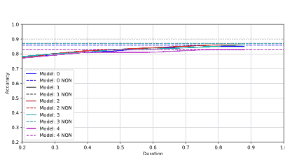
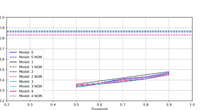
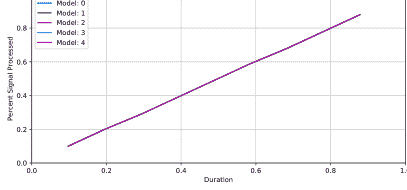
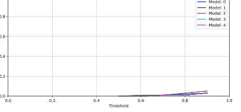
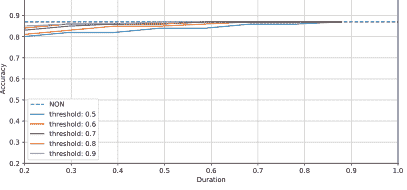
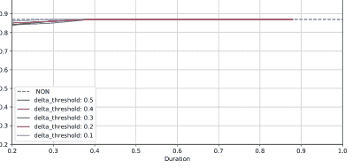
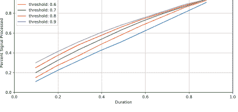
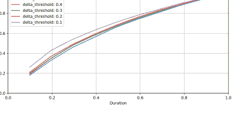

图 2 通过测试多种变量组合进行的每种组合权衡分析。每个图中顶部显示了带有虚线标记的基准准组合的网络性能（`PSP` 为 1）。底部图显示了最大值为 1 的组合输入百分比。在 (a) 和 (b) 中显示了每个模型的结果。在 (c) 和 (d) 中仅显示了模型 1（其他模型趋势相似）。

(a) 子集技术
(b) 阈值技术
(c) 阈值之上技术
(d) 差值阈值技术

为了检查灵活性，进行了分析以检查网络是否针对更简单的信号类型和更高的 `SNR` 做出决策。图 3(a) 显示了每个图中使用 `SAT` 和 `DEL` 技术的平均 `PCC` 和 `PSP`，图 3(b) 显示了每个模型的相同结果。时长、阈值和差值阈值根据表 III 选取。在使用 `SAT` 技术时，`RNN` 处理了 40% 的 `64-QAM` 信号；在使用 `DEL` 技术时，网络处理减少了 50%。

尽管 `RNN` 已知在 `RFML` 任务中表现良好，但由于需要处理每个序列，它们在符号级实现中面临挑战。

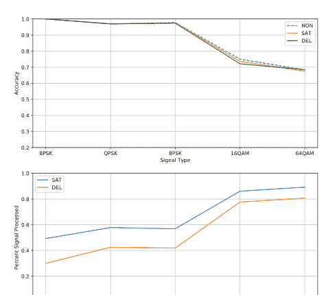
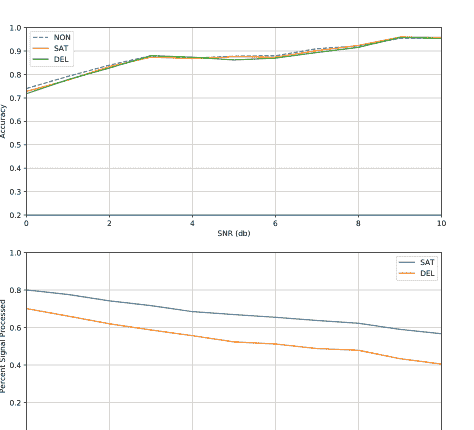

图 3 通过测试 `SAT` 和 `DEL` 技术对 `RNN` 模型 1 进行的细分分析。

本工作中的决策技术仅用于评估阶段。然而，未来的工作可以开发出更复杂的方法，将“不确定”决策整合到 `RNN` 训练过程中。

## 参考文献

- [1] A. Sherstinsky, "Fundamentals of recurrent neural network (rnn) and long short-term memory (lstm) phenomenon," Physica D: Nonlinear Phenomena, vol. 404, p. 132306, Mar 2020. [Online]. Available: http://doi.org/10.1016/j.physd.2019.132306

- [2] D. G. Oliveira, M. Machado, and F. Paulian, "RR transmitter fingerprinting exploiting spatial-temporal properties in raw data," in 2019 IEEE International Conference on Machine Learning and Applications (ICMLAS), 2019, pp. 745–750.

- [3] Siddhartha, Y. H. Lee, J. M. Mosa, J. Farone, P. Blackmore, D. Salmonond, D. Roland, and P. W. Leung, "Long short-term memory for radio: special properties and applications," in MILCOM 2018 - 2018 IEEE Communications Conference (MILCOM), 2018, pp. 1–6.

- [4] A. Ghadari, S. Shah, L. Valentine, M. Alam, C. Xin, and K. M. Ifekharuddin, "Prediction of spectral spectrum in radio radio using cellular simultaneous recurrent networks," in 2018 International Joint Conference on Neural Networks (IJCNN), 2018, pp. 1–7.

- [5] S. Chandok, H. Joshi, S. Daral, and A. V. Subramanyam, "Guided modulation classification and experimental validation for upbeat wideband spectrum sensing," in 2019 11th International Conference on Communication Systems Networks (COMSETS), 2019, pp. 102–107.

- [6] D. Hong, Z. Zhang, and X. Yu, "Automatic modulation classification using recurrent neural networks," in 2017 3rd IEEE International Conference on Communication Systems (ICC), 2017, pp. 692–697.

## 参考文献

- [7] S. Lu, Y. Pei, P. P. Liang, and Y. Liang, "Robust modulation classification under uncertain noise condition using recurrent neural networks," in *2018 Global Communications Conference (GLOBECOM)*, 2018.

- [8] H. Salehajjad, S. Santer, J. Barleti, E. Gola, and S. Valee, "Recent deep neural networks for signal classification,"

- [9] A van den Ord, S. Dielman, H. Zen, K. Simonyan, O. Vinyals, A. Karpathy, A. Aner, and K. Kavukoglu, "Weaver: A generative model for audio,"

- [10] T. Laine, P. Khoramani, S. Chang, Y. Zhang, P. Ramachandran, M. Johnson, N. Johnston, and T. S. Huang, "Waveform generation algorithm," 2016.

- [11] R. Utilla, E. Fonseca, A. Araujo, and I. Da Silva, "Gated recurrent networks for automatic modulation classification with resource-constrained end-devices," *IEEE Access*, vol. 8, pp. 112783–112794, 2020.

- [12] W. Wang and J. M. Mendel, "Maximum-likelihood classification for digital amplitude-phase modulation," *IEEE Transactions on Communications*, vol. 48, no. 2, pp. 189–193, 2000.
