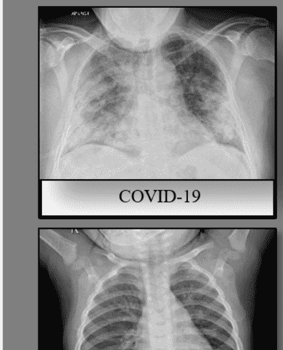

# 2020 IEEE 第三届奥布达电气与电力工程国际会议与研讨会 (CANDO-EPE)(匈牙利布达佩斯 2020.11.18-2020.11.19) 2020 IEEE 第三届国际会议与工作坊


## 摘要
早期研究表明，COVID-19 可能伴随有咳嗽、肌肉酸痛、喉痛和严重呼吸疾病等症状。这些症状表明 COVID-19 对肺部产生了影响。利用 X 射线和 CT 扫描考虑肺部健康状况可以有助于诊断 COVID-19 感染。鉴于大多数提出的方法结果局限，本文旨在回顾和评估基于人工智能（AI）的方法，以检测具有假阳性和假阴性的感染。在社区人群中使用 X 射线或计算机断层扫描（CT）图像进行该疾病诊断的过程，为检测个体提供了一种有效方法。人工智能在让日常生活变得比过去更方便方面发挥着不可否认的关键作用。AI 方法的优势在于其识别和分类对象的灵活性。因此，人工智能领域的许多研究人员已经了从患有 COVID-19 的人体获得的数据。

**关键词：** 基于图像的诊断、人工智能、机器学习、深度学习、计算机断层扫描

## I. 引言
COVID-19 是一场全球性流行病，导致许多国家的医疗系统崩溃。2020 年，全球见证了来自多个国家的数千人死亡。此外，这一事件影响了医疗机构的运行。世界卫生组织（WHO）建议，为了防止传播并提供合理的护理，一些研究人员使用了预训练的深度学习架构（DenseNet）结合迁移学习来开发基于 CT 图像检测感染患者的工具。许多研究将 CT 扫描与机器学习相结合，使用 SVM、随机森林和 MLP 方法等基础学习方法检测 CT 与临床症状之间的交叉点。某研究使用了 ANN 和 MLP 的混合学习方法来预测 COVID-19 患者的死亡率。我们回顾了系列机器学习模型以预测 COVID 的爆发。本研究提供了一系列建议，以展示机器学习在未来研究中的潜力。

简而言之，本文的主要动机是寻找检测 COVID-19 最准确的算法。换句话说，我们使用先进的学习模型，通过采集的 X 射线或 CT 扫描图像对 COVID-19 阴性个人进行分类。

本文其余部分的概述如下：第 2 节回顾了基于学习的模型；第 3 节比较了设计实现的学习模型的性能；第 4 节得出结论并为医学成像的终端用户提供建议。

## II. 基于机器学习的模型回顾
 AI 有提高医学成像能力和设计的潜力。使用 ML、ANN 和集成学习进行医学识别是这一广泛领域视觉的核心组成部分。机器学习方法论工作在不使用传统技术的情况下提高医学智能。机器学习算法的性能通过数学技术实现，并通过经验进行改进 [4]。通常，机器学习使用历史数据来发现和揭示隐藏的见解。基于图像的模型能够从医学记录中学习。这一过程是通过深入挖掘复杂成像中的模式完成的 [6]。以下子节简要描述了基础和现有的基于 AI 的分类器方法。

### A. 单模型
下文中介绍了用于检测 COVID-19 的基础分类器：

- 支持向量机（SVM）是研究和工业中提高机器学习性能的常用算法之一。该算法的主要优势是处理非线性问题。SVM 可以通过核方法转换问题来解决分类问题，从而使高维空间中的 SVC 计算可行。利用统计学习理论（SLT）和结构风险最小化（SRM）来实现这一概念。SVM 可有效应用于分类、回归和非线性函数近似 [9,10]。

- 朴素贝叶斯（NB）是一种著名的分类算法，它在假设分类器（算法）独立的条件下应用贝叶斯定理。在构建分类器的过程中，NB 模型需要少量训练数据来估计关键参数 [11]。换句话说，通过计算条件密度函数和后验概率估计每个类的性能。最后，对后验概率最大的类进行预测。

- 人工神经网络（ANN）是广泛用于医学分类的计算系统。事实上，ANN 的灵感来自生物系统，相互连接的神经网络处理信息。这些模型使用通用程序在分级结构中复制输入数据。在训练阶段，必须测量和调整权重（代表输入数据）。神经元之间的连接数量即 ANN 的架构，用于设计不同层的神经元。

- 多层感知器（MLP）是一种著名的 ANN，其神经元分布在连接层中。网络被分为三层：输入层、输出层和隐藏层。权重通过转换传递。通常使用梯度下降反向传播算法进行训练

- CNN 是一种能够处理大规模图像的神经网络。与其他 ANN 类似，CNN 是一个层与层之间有顺序连接的网络。然而，与全连接网络不同，该网络中的神经元并不连接到下一层的所有神经元。

- 集成模型

- AdaBoost（Boosting）是一种可以与许多类型的学习算法相结合以提高性能的集成算法。AdaBoost 最初是为了增强二分类性能。主要思想是使用迭代方法学习弱分类器的错误，然后通过增加错误分类数据点的权重从这些错误中学习 [18]。

- 梯度提升树（GBT）是一种以弱预测（模型）集成形式产生预测的算法。梯度树从残差误差（树）中学习，而不是更新数据点的权重 [19]。


简而言之，表 I 指明了所有提到的机器学习模型的优缺点。

## 表 I. 机器学习模型的优缺点

| 模型 | 优点 | 缺点 |
|---|---|---|
| SVM | 在高维空间中性能有效 | 在大型数据集上表现不佳（需要较长的训练时间） |
| NB | 在测试数据集上进行分类预测简单且快速 | 需要计算先验概率 |
| 单模型 MLP | 自适应学习，系数可以容易调整 | 比传统的机器学习算法需要更多的训练数据 |
| CNN | 自动检测重要特征（通过图像的特征卷积和滤波器生成不变特征） | 网络工作原理不透明（黑箱），需要具有并行处理能力的处理器 |
| Adaboost | 比大多数学习算法更不易过拟合问题的影响 | 使用两个弱分类器可能会导致低边际和过拟合 |
| 集成模型 GBDT | 具有很高的灵活性（可以优化不同的函数） | 为了最小化所有误差可能会包含离群值并导致过拟合 |



图 1. 正常患者与 COVID-19 患者的 X 射线图像

## III. 实验结果

在本节中，对前节描述的所有模型进行了评估，根据我们包含的数据，我们加入了 980 名 COVID-19 感染患者的图像数据。该实现通过 Scikit-Learn 和 Keras 库完成。实验结果使用配备 Intel i5-2.20 GHz 处理器和16 GB RAM 的 CPU 进行了详细的报告和分析。

### A. 数据描述

本文基于两个数据集评估了前节描述的所有模型。第一组数据包含 430 名感染 COVID-19 的患者的图像数据。此外，还从第二个数据集中随机选取了 550 名健康（正常）个体 [200]。下图展示了这两类别的样本。

### B. 性能评估

在这项研究中，我们将图像数据分为训练集和测试图像集。我们使用 75% 的数据用于模型的训练，剩下的 25% 用于测试。此外，利用知名的性能标准和马特修斯相关系数 (MCC)[21,22] 对所有描述的模型进行了评估。

根据混淆矩阵，这些公式的描述如下：

```
$Accuracy = \frac{T_p}{T_p + F_n} (1)$$
$$Precision = \frac{T_p}{T_p + F_p} (2)$$
$$Recall = \frac{T_p}{T_p + F_n} (3)$$
$$F-score = \frac{2 \times P \times R}{P + R} (4)$$
$$MCC = \frac{\sqrt{T_p \times T_n}}{\sqrt{(T_p + F_n)(T_n + F_p)}} (5)$$
```

其中 $F_n$ 和 $F_p$ 分别代表错误预测的数量。$T_p$ 和 $T_n$ 表示正确预测的质量。

使用了描述的数据集对所实现的机器学习算法进行了评估。表 I 展示了经过训练的模型相对于上述标准性能指标的性能。

### H. Tabricicki 等人. 使用计算机断层扫描深度学习诊断 COVID-19

## IV. 结论

| 表 II. COVID-19 检测模型之间的性能对比 |
| | 人工网络 | 机器学习 | 集成学习 |
| :--- | :--- | :--- | :--- |
| 模型 | MLP | CNN | SVM | N | GBDT | GBDT |
| 准确率 | 0.9400 | 0.9768 | 0.9920 | 0.9460 | 0.9600 | 0.9520 |
| 精确率 | 0.9505 | 0.9724 | 0.9918 | 0.9219 | 0.9435 | 0.9415 |
| 回召率 | 0.8715 | 0.9874 | 1.0000 | 0.9541 | 0.9633 | 0.9816 |
| F-score | 0.9208 | 0.9774 | 0.9920 | 0.9327 | 0.9545 | 0.9469 |
| MCC | 0.8814 | 0.9502 | 0.9873 | 0.9189 | 0.9050 |

快速诊断 COVID-19 至关重要。本文利用六种不同的机器学习算法（如 SVM、BNB、GBDT、AdaBoost、CNN 和 MLP）对 COVID-19 进行检测，这些数据集包含了来自 90 名有严重症状患者的图像。主要目标是向医疗系统的终端用户全面介绍机器学习（ML）方法。我们比较了最先进模型的性能，发现基于机器学习的模型在诊断疾病方面的可靠性非常重要。实验结果和讨论表明，使用 RBF 核的 SVM 性能优于其他方法。

在我们的实验中，每个测试都设置了六种不同的机器学习算法。通过使用混淆矩阵中的值，计算了五个统计量（1–5）来衡量算法的有效性。我们比较了设计为全连接层的 CNN 架构，每层分别有 350、250、150 和 20 个神经元。除了最后一层外，描述的 MLP 方法使用的修正线性单元（ReLU）和最后一层“softmax”激活返回一个包含两个得分的数组（阳性或阴性）。

## 缩写

- AI: 人工网络
- CT: 计算机拓扑结构
- CNN: 卷积神经网络
- EL: 集成学习
- GBDT: 梯度提升决策树
- ML: 机器学习
- MCC: 马特修斯相关系数
- MLP: 多层感知器
- NB: 朴素贝叶斯
- SLT: 统计学习理论
- SRM: 结构风险最小化
- SVM: 支持向量机
- WHO: 世界卫生组织

此外，CNN 的架构设计使用了卷积大小为 7x7 的卷积层来提取特征，每层使用 3x3 平均池化或最大池化来处理特征。每层的卷积数量为 64。每层的最大池化。在表 III 中所示的混淆矩阵。

| 表 III. 混淆矩阵 |
| | 预测 |
| :--- | :--- |
| 实际 | N |
| MLP | |
| CNN | |
| SVM | |
| NB | |
| GBDT | |

## 参考文献

[1] ... (此处省略未翻译的参考文献详细内容，保持格式一致)


<!-- no content -->
