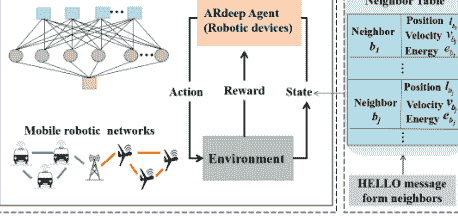
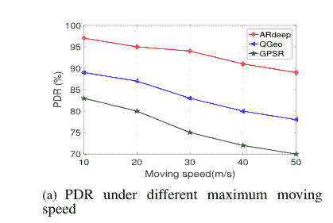
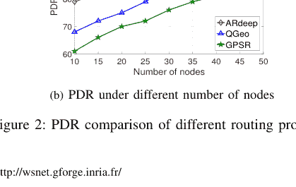
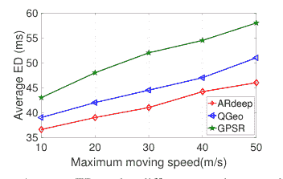
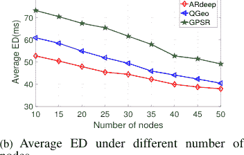

# 2020 IEEE 第45届本地计算机网络会议 (LCN) ｜｜ ARdeep：自适应且可靠的 R

**摘要—连接多个无人机（UAVs）等多个机器人设备的移动机器人网络需要能够处理间歇性连接链路和频繁变化的机器人网络不稳定性的协议。** 本文提出了一种基于深度强化学习的自适应可靠路由协议 ARdeep。我们用马尔可夫决策过程模型对路由决策进行建模以适应网络环境并做出路由决策。结果表明，ARdeep 的性能优于现有的高性能 QGeo 和传统的 GPR。

**索引词—** 路由，深度强化学习，Deep-Q (DQN)，移动机器人网络

能够自适应设计路由决策的自适应且高度自主的路由协议是。

在工作中，我们用马尔可夫决策过程（MDP）模型对路由决策过程进行建模，以自动表征网络变化，并提出了 ARdeep，一种基于深度强化学习（DRL）的移动机器人网络自适应可靠路由协议。ARdeep 是一种分布式且基于地理的路由协议，每个节点根据本地上下文分布式地做出最优路由决策。我们使用一个包含邻居与目的地之间的距离、邻居节点、数据包错误率（PER）以及链路预期连接时间的簇状态向量。在通用强化学习（RL）中，我们使用 DRL 来学习最优策略，因为 RL 能够处理大型状态空间。此外，我们提出了一种先进方法，将深度 Q 网络（DQN）分布在每个机器人节点上，同时将 DQN 训练集中以提高实现稳定性。

## I. 引言

随着传感器、计算技术和如无人机等移动机器人设备的进步，无人机（UAV）为未来的服务提供了机会。移动机器人设备已广泛应用于运输和监控等领域 [4]。移动机器人网络作为一种高速移动机器人网络，允许设备之间在不需要任何固定基础设施的情况下进行通信。它可以控制机器人设备的自主移动并支持机器人之间的通信。然而，由于高速移动节点导致拓扑结构变化以及通信不稳定，网络在移动机器人网络中仍然是一个具有挑战性的问题。

现有的基于拓扑的路由协议和基于地理的路由协议限制了路径选择，由于对动态环境变化的缺乏理解，在这种动态环境中也难以使用。在移动机器人网络中，频繁的拓扑变化可能需要实时更改路由决策以适应网络变化。因此，

## II. 相关工作

基于拓扑的路由协议利用拓扑信息来维护最新表。LTOL[8] 是一种主动路由协议，考虑了流量因素和链路质量，以为飞行自组网络（FANETS）提供高效的通信。Ganghuk 等人 [1] 提出了基于响应式协议 AODV [9] 的鲁棒可靠路由协议（PAR），它使用双向和定向路由机制来满足某些 FANETs 的需求。然而，由于动态网络环境中拓扑结构的频繁变化，基于拓扑的路由协议往往会增加开销。地理路由是减少路由开销的主要解决方案之一。基于位置的路由（LAR）[5] 被提出限制请求路由来控制路由开销。KAR 等人 [3] 仅通过邻居的位置为 GPSR 提出了贪婪周边界状态以减少路由设置延迟。尽管这些地理协议减少了开销，但由于对动态变化特性的缺乏理解，它们限制了路由路径的选择。

为了解决这个问题，机器学习算法被引入到路由协议中。关于基于 RL 的路由协议有值得关注的研究。[Qgrid12] 是一种基于网格的自组网络地理路由，它选择最优的下一跳网格，并选择特定的车辆来携带下一跳网格信息。Pogeo [26] 是一种基于 Q-learning 的无人网络地理路由协议。它在路由中考虑了链路质量和错误率以提高数据包交付率。然而，现有的大多数基于 RL 的协议在转发时忽略了链路状态，这使得它们难以捕捉链路状态的变化，导致对网络变化的适应性较低。

## III. 定义与模型

### A. 问题定义

在本文中，我们考虑了多设备移动机器人网络中从源到目的数据传输的路由优化问题。我们定义了一个向量 $C_{u_i} = (c_{u_i,b_j}, PER_{u_i,b_j})$ 来表征节点 $u_i$ 与其邻居 $b_j$ 之间的链路，其中 $c_{u_i,b_j}$ 代表链路的预期连接时间，$PER_{u_i,b_j}$ 代表邻居 $b_j$ 与目的地之间的数据包错误率（PER）。同时，考虑了两个邻居 $b_i$ 和 $j$ 之间的最小距离 $d_{min}$。

### B. MDP 模型

本文中，我们用马尔可夫决策过程（MDP）对路由决策过程建模以适应网络时间变化。我们假设路由决策是以时间槽为单位执行的，每个时间槽设置为 1，从源到目的地的路由过程的总时间槽为 T。那么，任务目标是选择下一跳并将数据包转发到那里。在 ARDeep 中，MDP 的状态、动作和奖励函数定义如下：

- 1) 状态：我们假设在时间槽 $t \in \{1, 2, ..., T\}$，节点 $u_i$ 有 $m$ 个邻居。为了捕捉链路状态的变化，这些定义的链路由 $u_i$ 及其所有邻居组成一个离散状态 $s$，与之前将节点 $u_i$ 视为状态的研究相比。因此，状态 $s_i \in S$ 定义为向量 $(C_{u_i,b_1}, ..., C_{u_i,b_m})$。

- 2) 动作：在路由过程中，拥有数据包的节点 $u_i$ 需要选择一个邻居作为下一跳来转发数据包。在时间槽 $t$，我们定义动作 $a_i \in A$，其中 $B$ 是邻居集合。

- 3) 奖励：为了实现可靠及时的数据传输，我们引入了可靠奖励的新概念，它不仅基于距离，还基于链路质量。可靠距离 $D_{u_i,j}$ 计算如下：

$D_{u_i,j} = \frac{d_{u_i,j}}{d_{u_i,b_j}} \times (1 - PER_{u_i,b_j}) \quad (1)$

$r_i = \begin{cases} R_{max} - R_{max} & \text{当邻居 } b_j \text{ 是局部最小值时 \\ \omega D_{u_i,j} + (1-\omega) E_{u_i,b_j} & \text{如果 } c_{u_i,b_j} < c_{min} \end{cases} \quad (2)$

其中 $d_{u_i,j}$ 是 $u_i$ 到目的地的距离，$d_{u_i,b_j}$ 是 $u_i$ 与邻居 $b_j$ 之间的距离。PER_{u_i,b_j}$ 是 $u_i$ 与邻居 $b_j$ 之间链路的数据包错误率；$R_{max}$ 是最大奖励值，$c_i$ 和 $E_{u_i,b_j}$ 分别是邻居 $b_j$ 的剩余能量和初始能量。$\omega \in (0, 1)$ 用于调整可靠距离 $D_{u_i,j}$ 对奖励的影响。如果距离是目的地，则使用最大奖励 $R_{max}$；当可靠奖励为负时，以避免在邻居 $b_j$ 为局部最小值时产生环（即 $u_i$ 的所有邻居距离目的地都远时）。

## 基于 DRL 的路由决策

路由决策

| 邻居表 | |
| :--- | --- |
| 位置 $l_i$ | $b_{i,des}$, $E_i$ |
| 位置 $l_j$ | 速度 $v_j$， $E_j$ |

图 1：ARdee 架构

我们使用距离 $d_u$ 和目的地来标准化距离 $db_{i,des}$ 和 $d_{min}$。由于 $d_{ij}$ 可能小于 $db_{i,des}$ 或 $d_{min}$，我们分别将归一化的 $db_{i,des}$ 和 $d$ 限制为1。每个邻居 $b_i$ 的 Q 值通过 DQN 以归一化的 $C_{u,i}$ 作为输入进行计算。获取所有邻居的 Q 值后，选择最大 Q 值作为下一跳来转发数据包。

并提高稳定性。在执行过程中，持有数据包的节点使用 DQN 选择动作来确定下一跳。采取动作后，节点从环境中获得奖励。在训练过程中，中心化训练器从经验内存中运行批处理（mini-batches）以更新 DQN 参数并最小损失。参数更新后，中心化训练器将更新发送到每个节点。当节点更新其 DQN 参数时。

## V. 性能分析

在本次实验中，我们实现了 ARdee，并将其与现有优秀协议 QoGo [2] 和传统 GPR [38] 进行了比较。我们在使用安装了 Python 3.5 的 ThinkPad E2460（配备 i5-6250U CPU）上的网络仿真器评估了性能。DQN 使用三层反传播网络方法构建，隐藏层和输出层使用了 ReLU [7] 和线性激活函数。

仿真设置设置为 1 km，并使用高斯移动性（GMK）模型来捕捉移动节点的真实性。我们采用 IEEE 802.11 作为 MAC 协议，并使用带有范围的全向天线。在仿真中，我们随机选择五个节点作为源，以 100 米/秒的速度向一个站发送 127 字节的数据包。每条链路设置为 [0, 0.2] 范围内的随机值。节点的移动速度变化。我们使用包交付率（PDR）和平均端到端延迟（平均 ED）来评估路由性能。

### A. 路由节点决策

每个路由节点可以通过定位系统（GPS）或其他定位方法获取其位置和速度。HELLO 消息（包括节点的位置、速度和剩余能量）在邻居之间交换。在收到某些邻居的 HELLO 消息后，节点 $b_i$ 维护其邻居表，并将邻居 $b_j$ 的位置、速度和剩余能量信息更新到邻居表中。表中的信息用于路由决策过程。

(a) 不同最大速度下的 PDR

### B. 基于 DRL 的决策

在本文，我们逐步计算每个邻居（即动作）的 Q 值。我们将邻居链路的状态作为 DQN 的输入，邻居的 Q 值作为 DQN 的输出。假设节点 $u$ 拥有 $m$ 个邻居并在时间隙 $t$ 携带数据包。该节点根据其邻居表计算与节点和邻居之间链路相关的 $C_{u,b_i}$。

向量 $C_{u,b_i} = [d_{u,b_i}, PER_{u,b_i}, E_{u,b_i}, d_{min}]$ 在节 III-A 中描述。它用于检查链路并表示链路状态。由于 $C_{u,b_i}$ 具有不同的维度和单位，我们在将其作为 DQN 输入计算 Q 值之前，首先将这些元素归一化到 [0, 1] 范围。值 $C_{u,b_i}$ 的归一化方法如下：

(b) 不同节点数量下的 PDR

$CT_{u,b_i} = \min(d_{u,b_i}/d_{min}, 1)$，其中 $CT_{min}$ 是最大预期时间。由于邻居 $b_i$ 的初始 PER 值在 [0,1] 范围内，我们不需要。

图 2：不同路由协议的快速比较

467

(A) 不同移动速度下的平均 ED

简而言之，在节点移动速度和节点数量不同的动态网络中，ARDeep 优于现有的 Qgeo 和传统 GPS。

## VI. 结论

由于高速移动和拓扑变化，网络路由仍然移动机器人领域的一个具有挑战性的问题。在本文中，我们提出了一种基于强化学习的新自适应可靠路由协议 ARDeep。为了适应动态网络环境，我们在 MDP 模型中制定了路由决策过程，该模型在决策时能够捕捉链路状态、PER、链路的预期连接时间、节点的剩余能量以及节点与目的地之间的距离，从而允许 ARDeep 更好地跨越网络。仿真结果显示，ARDeep 更适用于转发决策，并且优于现有的 Qgeo 和传统 GPS。

(B) 不同节点数量下的平均 ED

图 3：不同路由协议的比较

图 2(a) 和 (b) 显示了路由协议在不同移动速度和不同节点数量下的 PDR。从这两点可以看出，ARDeep 具有最高的 PDR。Qgeo 因为缺乏信息，总是尝试寻找距离目的地最近的邻居来转发数据包，由于路径导致 PDR 下降。虽然 Qgeo 的 PDR 很高，但由于缺乏链路状态 PDR 会下降。ARDeep 考虑了链路质量、链路预期连接、节点剩余能量以及节点与目的地之间的距离，这使得 ARDeep 能够捕捉链路变化并做出更可靠的路由决策。相反选择选择链路来传输数据包，从而获得更高的 PDR。

图 3(a) 和 (b) 显示了路由协议在不同移动速度和不同节点数量下的平均 ED。我们看到由于中继机制绕过区域，GPS 具有最高的平均端到端延迟。随着节点的不断移动，网络拓扑发生变化，解决方案的网络拓扑中可能会产生空隙。简而言之，由于链路状态的增加，ARDeep 频繁采用转发策略而非贪婪转发。虽然 Qgeo 的 ED 较低，但 ARDeep 在计算奖励值未使用 Q-learning 和数据包选择，平均端到端时间仍然很高，因为它无法捕捉链路状态的变化以做出更可靠的路由决策。与 GPS 和 Qgeo 相比，ARDeep 能够捕捉链路状态并预测区域价值，从而导致更低的端到端时间。

此工作由国家科学基金（NSFC）资助，编号 6160247。

## 参考文献

- [1] G. Ghangukh, A. P. Sheresha, and Y. Shao, "Robust and reliable protocol for flying-hoc networks," IEEE Access, 2019, pp. 643-654,
- [2] W. Jung, J. Kim, and Y. Ko, "Q-learning-based dynamic routing for mobile ad-hoc networks," IEEE Communications Letters, 2020, pp. 1225-1229,
- [3] B. Karp and H. T. Kim, "Greedy perimeter routing for wireless networks," in ACM MobiCom, 2003, pp. 2425-2432,
- [4] S. J. Zhao, "A survey of wireless services," Financial Times, Vol. 54, no. 2, 2001,
- [5] Y.-Bo Ko and H. Haathi, "Location-aided routing in mobile ad-hoc networks," IEEE International Conference on Computer Communications, 2021, pp. 1215-1218,
- [6] D. S. Lucas, S. Duan, N. W. Du, and S. Chen, "Routing in flying ad-hoc networks: A comprehensive survey," IEEE Communications Surveys & Tutorials, 2022, vol. 24, no. 4, pp. 2030-2050,
- [7] Y. Li and Y. Chung, "Analysis of two-layer neural networks for wireless ad-hoc networks," 18th IEEE International Conference on Computer and Informatics (ICCI), 2017, pp. 71-76,
- [8] X. Wang, Y. Zhang, and J. Li, "Ad-hoc dynamic routing in wireless networks," IEEE, 2003.
- [9] K. Wang, F. Qi Russo, Y. Liu, J. Zhang, Z. An, and A. Fraboul, "Using deep learning for wireless communications: A comprehensive review and analysis," IEEE Access, vol. 13, no. 2, pp. 877-887, 2021.
- [10] H. Kim, J. Wei, S. Huang, L. Zhou, and Q. Zhang, "Regular topology formation based on artificial for mobile robotic networks," IEEE Transactions on Mobile Computing, vol. 18, no. 10, pp. 2415-2429,

