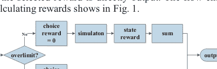
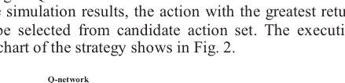
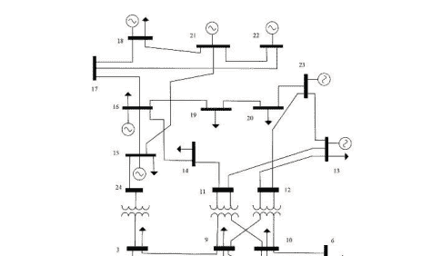
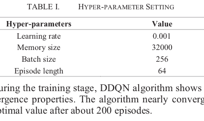
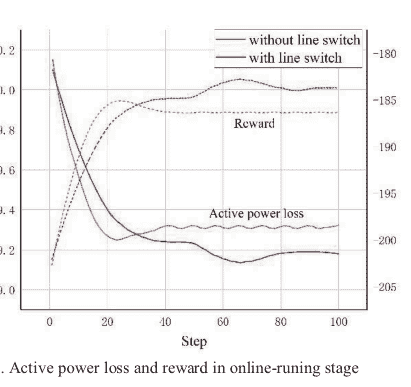
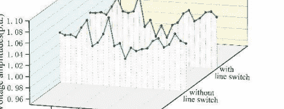

# 2020 IEEE 第四届能源互联网与能源系统集成会议 (EI2)

摘要——对于风电场集群，通过最优网络切换可以提高无功优化的整体性能。该问题可以精确地建模为混合整数非线性（MINP）模型，而该模型是难以求解的。提出了一种深度强化学习（DRL）算法来解决实时性能。该方案包含两个阶段：第一阶段是智能体的离线训练，第二阶段是训练好的智能体MINP模型的部署。考虑到运行约束，采用了具有越行为惩罚的学习框架以及具有对称和非对称收敛策略的模型引导约束，以提高训练效率。结果表明，所提算法可以缩短计算时间，最优网络切换可以进一步提高风电场的安全经济优化水平。

具有高非凸性和非线性的问题，现有方法难以处理。深度强化学习提出的人工智能算法为该问题提供了可能的解决方案。

许多研究揭示了强化学习在智能控制领域的潜力，例如，强化学习和蒙特卡洛树搜索帮助顶级棋手李世石[5]，使用的深度强化学习算法在各种比赛中取得了高于人类选手的得分。然而，将强化学习应用于电力系统优化领域的方法很少。Melavini Galic等人引入了一种基于深度学习的方法来解决问题[7]。Duan Jia等人提出了基于深度强化学习的模块化最优潮流调度方法[8]。此外，Yan Zim等人将强化学习应用于电网频率控制领域，提出了一种低频控制（LFC）方法，可以很好地调节风电引起的频率误差[9]。涉及连续和离散变量的方法（如拓扑与调度综合优化）已得到探索。

关键词——强化学习，无功优化

# I. 引言

针对能源短缺和全球变暖问题[1]，开发可再生能源及其在能源结构中的重要性是中国结构调整的关键方向。

风电是装机容量最大的可再生能源之一。西北地区部署了大量的风电场[2]。由于资源的分布，风电发电具有不确定性，使得无法控制实时风电的输出。风电接入对电力系统的稳定性有严重影响。在某些情况下，必须平衡风电以确保电力系统的安全稳定要求，导致了能量的大量浪费。

传统的无功优化模型没有考虑输电网络切换，导致系统资源利用率并非最优[4]。考虑网络切换的优化是一个混合整数非线性规划——本工作得到了甘肃电力公司维护公司（项目号SGGSJ001WJS2005036）的支持。

本文，我们采用了结合电力系统知识的深度强化学习来满足安全稳定要求。离线训练缩短了在线决策时间，并为风电场集群无功系统优化提供了充分的解决方案。

在本节中考虑物理约束和运行建立了问题的数学模型。引入了深度强化学习的相关概念。

# II. 问题建模

## A. 数学模型与优化

考虑网络切换的无功优化模块基于交流无功优化模型，并添加一组二进制变量来表示输电网的状态。

本文主要考虑输线上的有功损耗，在确保电压不超过限值的情况下使其最小化。目标可以表示为：

$$\sum_{i\in\Omega} p_i \quad (1)$$

其中$p_i$是节点$i$的有功功率注入。

无功优化的约束包括：

- 线路状态约束
$x\in[0,1] \quad (2)$

- 潮流约束
$p_i=(G_iV_i^2-G_{ij}V_j\cos\theta_{ij}) \quad (3)$
$q_i=(-B_iV_i^2+B_{ij}V_j\sin\theta_{ij}) \quad (4)$

- 功率平衡约束
$p_i-p_i^l=G_{ii}V_i^2+\sum_{j\in\Omega}p_j \quad (6)$
$q_i-q_i^l=-\frac{1}{2}\sum_{j\in\Omega}B_{ij}V_iV_j \quad (7)$
其中$p_i^l$和$q_i^l$是节点$i$的有功和无功负载，$B_{ij}$和$G_{ii}$是节点的电纳和电导。

- 发电机运行约束
$p_i^l\le p_i\le p_i^u \quad (8)$
$q_i^l\le q_i\le q_i^u \quad (9)$
其中$p_i^l$和$p_i^u$是节点$i$有功功率输出的上下限。

- 安全约束
$-\theta_i^u\le\theta_i\le\theta_i^u \quad (10)$
$p_i^2+q_i^2\le\theta_i^u \quad (11)$
$V_i^l\le V_i\le V_i^u \quad (12)$

## B. 深度强化学习原理

强化学习模型基于马尔可夫决策过程，包含以下元素：

- 回合（Episode）：指智能体从初始状态到终止状态的历史期间，包含状态、采取的动作以及迭代获得的奖励。
- 环境：与智能体交互的外部对象。环境根据智能体的变化返回奖励。
- 状态：决定决策的信息。状态变量集定义为$S$。环境状态空间包括：a) 风电机的电压和相位；b) 系统的负载；d) 断路器状态（二进制变量）；e) 系统的有功损耗。
- 动作：智能体可以执行的操作。动作集定义为$A$。动作空间分为慢动作和快动作；a) 风电机的无功调节；b) 输线的电压调节。
- 策略$\pi(a|s)$：从状态到动作的映射。智能体评估当前环境状态$s$下每个动作的价值，并根据某些规则（例如贪婪方法）选择动作。
- 状态转移概率$p(s'|s,a)$：智能体在状态执行动作$a$后，环境状态从$s$转移到$s'$的概率。
- 奖励：评估动作质量的标量。智能体在策略指导下执行动作后，环境返回当前状态的报酬以便修改策略。本文，奖励由经济因素和电压安全组成。奖励计算公式如下：

$$\sum_{i\in\Omega}(p_i+\max|V_i|-1/\beta) \quad (13)$$

$\beta$是经济与电压安全的转换因子。

为了估计策略的质量，定义状态动作价值函数$Q^*(s,a)$：

$$Q^*(s,a) = \mathbb{E}_{s' \sim p} [r(s,a') + \gamma V^*(s')] \quad (14)$$

状态动作价值函数是策略优化的基础。通过与环境交互连续估计状态动作价值函数。

Q学习是一种基于价值函数的学习方法，吸收了蒙特卡洛方法和动态规划算法的优点[10]。使用以下公式更新价值函数：

$$Q^*(s,a) = Q^*(s,a) + \alpha(r + \gamma Q^*(s',a') - Q^*(s,a)) \quad (15)$$

我们需要的信息是当前状态$s$，以及下一状态的状态动作价值函数$Q^*(s',a')$。主要思想是在每次迭代中优化价值，以弥补实际奖励$r + \gamma Q^*(s',a')$与估计值$Q^*(s,a)$之间的差距，这类似于人类的学习机制。

Q学习处理有限离散状态的问题非常有效，但对于大量状态或连续状态的问题，显然无法获得每个状态动作价值函数的枚举。为了计算值$Q^*(s,a)$，我们使用函数$Q(s,a)$来近似其值，即价值函数近似：

$$Q(s,a) = Q^*(s,a) \quad (16)$$

$Q(s,a)$通常是一个神经网络，Q网络参数由$\Phi$定义。学习过程是学习一个参数$\phi$，使得网络输出$Q(s,a)$尽可能接近真实的价值函数$r + \gamma Q^*(s',a')$。

然而，存在两个问题。一个是训练过程不稳定；另一个是样本分为目标和评估网络。目标网络一段时间内固定，而评估网络在训练期间变化。

另一种方法是经验回放。不同于直接使用信息，该方法使用经验池存储数据。采用批量处理。这意味着减少了相邻样本之间的相关性。

# 算法 DQN

1. 初始化状态空间$s$，动作空间$a$，折扣因子$\gamma$；
2. 随机初始化经验池容量$N$；
3. 将$\phi$拷贝到目标网络$\Phi$；
4. 当价值函数未收敛时：
5. 初始化状态$s$；
6. 当未终止时：
7. 选择动作$a$；
8. 执行$a$，获得奖励$r$和下一状态$s'$；
9. 将$(s,a,r,s')$放入经验池；
10. 批量采样$s,a,rr'$进行训练数据$y = r + \gamma Q^*(s',a')$（未终止）；
11. 使用损失函数$(y - Q^*(s,a))^2$训练网络；
12. 更新状态$s$；
13. 每隔若干步，将$\phi$拷贝到目标网络；
14. 输出：$Q^*(s,a)$

在计算总奖励时，将优先考虑动作是否导致约束超过界限，以确定该动作的奖励。如果动作未超限，将对功率损耗和节点电压等运行指标进行仿真以计算状态，并将其合并到总奖励中；否则，直接输出奖励。奖励计算的流程图1所示。

图1. 奖励计算过程

由选择奖励引入的超限惩罚可以引导智能体在发电机或节点电压达到下限时避免超限行为，提高训练效率和结果的合理性。

## B. 模型引导的控制

神经网络训练对奖励设置相对敏感，可能会输出完全错误的动作，这可能对电系统产生长期影响。为了确保在真实环境中的性能，本文采取了模型引导的控制策略。训练后的算法输出 Q 网络集中的两个动作。根据仿真结果，将从候选动作集中选择回报较大的动作。该策略的执行流程图如图2所示。

图2. 模型引导的控制

这种方法可以防止智能体依赖 Q 网络的判断，从而增加算法的容错性。

## IV. 案例研究

通过数值研究来验证考虑线路开关的无功优化的有效性。

### A. 测试条件

为了模拟真实的电系统环境，本文使用了基于 Python 的 PYPOWER 平台，PYPOWER 是一个可以求解潮流和最优潮流（OPF）的 Python 库。

本研究使用的 IEEE-238 节点系统包含 33 台发电机、38 条线路和 5 台变压器。发电机安装在 11 个节点上。有功功率发电范围为 10300MW，无功功率范围为 -535MVar 到 1776MVar。系统的总有功负载和无功负载分别为 2850MW 和 580MVar，该负载水平被视为额定负载。

图3. IEEE 22 节点系统

### B. 比较分析

我们将每个节点上的发电机建模为风力发电机，以模拟风场接入电网的情况。为了测试算法在风力发电机输出时控制无功优化的能力，我们将系统的运行水平设置为额定负载的 40%。

| 表 I. 超参数设置 |
| 超参数 | 值 |
| :--- | :--- |
| 学习率 | 0.001 |
| 内存大小 | 32000 |
| 批量大小 | 256 |
| Epoch 长度 | 64 |

在训练阶段，DDQN 算法表现出良好的收敛性。算法在约 200 个回合后几乎收敛到最优值。

图4. 训练中的有功损耗曲线

为了验证算法的有效性，在线路开关处于动作空间时的配置进行了比较分析。两个智能体经过相同时间的训练，分别对输电电网进行无功优化。

图5. 在线运行阶段的有功奖励和损失。

从图5可以看出，深度强化学习算法通过离线训练程序奖励了在线运行期间的决策时间。

## V. 结论

本文提出了一种考虑开关的无功优化方法，以解决随机功率注入对输电电网的影响。DDQN 作为一种具有频率经验方法的算法，有助于求解非线性和非凸模型。考虑到稳定性和安全性要求，算法中增加了基于超限电压控制的惩罚。数值分析表明，考虑开关后的无功优化结果可以得到改进，在线运行时间也在接受范围内。

从图5可以发现，在控制方法中加入线路开关后，算法的奖励和无功优化的效果得到了提高。输电电网切换后的无功优化具有更低的有功功率和更高的奖励。此外，奖励和有功功率的变化趋势基本相反，这表明设计的奖励函数符合实际情况。

图6. 动作阶段有无线路开关的电压优化结果。

为了进一步研究算法的成本，我们将给出不同负载水平下的算法时间。

| 表 II. 不同场景的计算时间 |

| 运行水平 | 训练时间 | 在线运行时间 |
| :--- | :--- | :--- |
| 40% | | 9.5s |
| 50% | | 12.4s |
| 60% | 2491.5s | 13.5s |
| 70% | | 10.7s |

