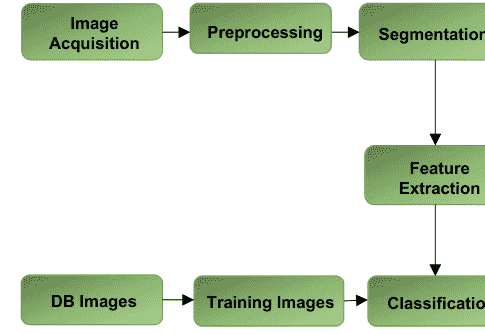
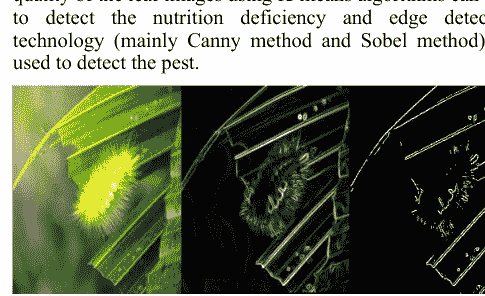

# 2020 IEEE 第四届图像处理、应用与系统国际会议 (IPAS) (意大利热诺亚 2020.12.9-2020.12.11)

## 作者信息

**第一作者** Dhapitha Najarajan  
计算学院  
斯里兰卡信息技术学院  
Malabe, 斯里兰卡  
`dhapitha1996@gmail.com`

**第二作者** Lokini Kumalan  
计算学院  
斯里兰卡信息技术学院  
Malabe, 斯里兰卡  
`lokini2196@gmail.com`

**第三作者** Mithun Logesaran  
计算学院  
斯里兰卡信息技术学院  
Malabe, 斯里兰卡  
`adomithun@gmail.com`

**第四作者** Sanvitha Kausharachchi  
计算学院  
斯里兰卡信息技术学院  
Malabe, 斯里兰卡  
`sanvita.my@skit.com`

**第五作者** Dilani Luhage  
计算学院  
斯里兰卡信息技术学院  
Malabe, 斯里兰卡  
`dilani.lj@skit.com`

## 摘要

椰子生产是斯里兰卡国家最重要的业务，也是主要的收入来源之一。近期观察到，大多数椰子树都受到疾病的影响，这降低了椰子的强度和产量。大多数树木受到害虫侵害和营养缺乏的影响。我们的目标是早期识别病害，以便农民从椰子生产中获得更多收益。本文提出了一种深度学习方法来识别椰子的叶子和叶片。在使用农药和图像处理技术之后，椰子病害监测已经开展。与人工相比，自动识别将是极其有效地识别椰子病害的最快方法。本文提出了一种应用程序，通过椰子树的取食行为、害虫和营养缺乏来识别病害。我们使用了预处理步骤，如将 `RGB` 转换为灰度图、过滤、调整大小、水平翻转和垂直翻转。在文献综述中分析各种算法后，`SVM` 和 `CNN` 是最佳且合适的分类器，准确率分别为 93.54% 和 97.52%。这项研究的结果有助于提高椰子产量，无疑将为农业领域带来革命。

树木，尤其是椰子叶。因此，近年来观察到，这些类型的疾病减少了树木的生长和国家的经济状况。因此，种植者必须找到理想的解决方案来保护它们的生长。营养缺乏、害虫也是多年来威胁生存的主要关注问题。早期识别害虫、病害、减少害虫侵害和使用农药是必须考虑的要素因素。

昆虫和害虫是作物整体生长的主要威胁。害虫会迅速破坏像椰子这样的作物。它们可能会导致收获质量和数量出现重大或轻微缺陷。例如，毛虫和甲虫幼是一些害虫，而椰子叶潜是攻击椰子叶的主要害虫。早期检测和控制这些害虫至关重要，因此应该在早期喷洒农药。这可以保护作物免受严重的害虫侵害，增加椰子产量并获得更高的成本效益（收益）。

种植的另一个基本考虑因素是营养缺乏。通常，营养问题会引发疾病。在椰子树中，可以根据叶片的颜色变化来识别营养缺乏。大多数农民无法识别不同的营养缺乏和一种及多种症状。由于工业中存在含有更多营养的肥料，确定合适的肥料是最重要的事情。

该项目提出了一种 `Android` 应用程序，它将使用深度学习在早期识别害虫和营养缺乏，以确保椰子的顺畅生产。系统通过被咬的形状和叶片的症状识别叶子。根据结果，系统将识别要使用的肥料类型或杀灭害虫。大多数人使用农药来减少受影响的叶子，但有些受影响后农药是无效的。在种植过程中需要一个适当的监测过程。

具有图像处理、机器和深度学习功能的移动应用程序将以有效的方式解决农业问题。这旨在识别农民检测早期害虫病害的特定需求。

## I. 引言

多年来，椰子及其产量显著增加。在茶叶和橡胶之后，椰子在斯里兰卡国家发挥着重要作用。椰子工业是外汇的重要来源。它对斯里兰卡的烹饪、营养和生计来说是基本需求。据此，我们可以确保椰子的质量。近年来，这些椰子树受到许多疾病的影响，降低了椰子的产量。营养缺乏是椰子树的问题之一（主要是幼树）。它导致了疾病和缺乏，在农村地区是急需。该应用程序帮助农民控制。

G. Xu 等通过计算机视觉新思想来识别西红柿缺陷。因此，百分比直方图、百分比强度直方图（`FT`）和小波变换被应用于叶片颜色特征。还使用了遗传算法（`GAs`），它可以为疾病诊断提供理想信息。实验结果显示，该诊断系统的准确性超过 82.2%，需要 6 - 10 天做出专家决策。

## III. 方法

在文献 [12] 中，作者侧重于模式分析以通过 `RGB` 颜色识别营养缺乏。他们测量了叶片中营养缺乏的多种缺陷。此外，在不同水平上进行了图像效果比较，如多颜色比较、颜色和模式的多模式比较以及模式比较。它准确地检测到了缺氮（`NK`）、缺钾（`PK`）和缺氮组合的缺陷。

来自马来西亚大学的研究人员讨论了 `Canny` 和 `Sobel` 边缘检测，以及他们在图像发送到检测器之前如何提取信息。研究表明，`Canny` 边缘检测方法可以产生平滑干净的边缘。但与其他方法一样，`Canny` 和 `Sobel` 也是检测噪声的方法。文献 [13] 开发了一个网站，根据土地面积、作物和 `Lin` 等用户输入建议农药。通过该网站，有功能搜索适用于他们区域的合适斑块。有关农药的相关信息是从印度纳迪乌尔（`Nadiul`）的农民那里收集的 [14]。

椰子病情检测系统由以下主要步骤组成。为了实现这些步骤，应该应用图像处理、机器学习和深度学习技术。

### A. 图像采集

受影响叶片的健康状况通过相机和其他数字设备等数字图像捕捉。作为图像处理技术的初始步骤，将捕捉到的图像上传到系统中。

### B. 图像预处理

将图像上传到系统后，需要将其转换为标准化形式并具有清晰的数据。预处理可以减少数据集的复杂性。虽然将颜色转换为灰度是一种接受的预处理技术，但我们采用了图像标准化。

### C. 图像分割

分割是识别图像中的对象并理解每个像素属于哪个对象的过程。在我们的方法中，分割可以通过 `K-means` 聚类、`Otsu` 方法、山峰聚类、边缘检测方法、`Canny` 边缘检测和拉普拉斯边缘检测完成。`Sobel` 方法具有 `3 x 3` 最大掩码，这将决定边缘质量并影响分割。绿色像素的阈值将通过阈值方程说明。尽管如此，使用 `K-means` 算法的叶片质量可以帮助检测营养缺乏（主要是 `Canny` 方法和 `Sobel` 方法）。

通过对文献进行综合综述，营养缺乏和害虫的早期检测是农民解决这一问题的主要问题。各种分析技术包括黑光追踪和喷雾，它们用于农田的检测和观察。发现某些系统仅能检测害虫和疾病，还需要进一步改进以检测营养缺乏并尊重肥料使用。在之前的工作中，系统可以正确识别问题并做出建议，但没有设施监测植物直到疾病完全治愈。

在过去的方法中，提取了低级特征（如空间、边缘、光照、旋转和形状）以有效检测害虫。许多研究未能关注模式和结构，而这将产生显著更好的结果。在先进技术中，`SVM` 使用超平面对叶片进行二分类以识别和检测昆虫。通常开发卷积神经网络 (`CNN`) 来检测营养缺乏类型，如果有更多资源，则扩大规模以获得更好的准确性。

### 特征提取

在我们的方法中，图像被发送到提取模块。`CNN` 具有自动特征提取功能。卷积操作被用于从图像中提取特征，而且它通过内核保持了特征之间的关系。减少了参数数量。`Softmax` 激活函数被用于分类输出。

### 分类

在提取后，健康的叶片被发送到分类模块。分类技术包括训练和测试。`SVM` 是流行的分类，超平面将空间分为两个部分。

| 模型 | 平均准确率 |
|---|---|
| `EfficientNetB0` | 0.9372 |
| `ResNet50` | 0.8316 |
| `VGG16` | 0.2092 |

### F. 怀疑缺乏和肥料

一旦系统完成分析，它会推荐农药和肥料。对于农药和肥料的推荐，我们与农民进行了多次讨论，以获取更多信息并对疾病给出建议。疾病将建议相应的农药和有机肥料。通过这个过程，椰子叶将从疾病中恢复。

### G. 用于叶片监控的 OpenCV

在使用农药和肥料后，该系统关注监控过程。经常调用监控以使用 `OpenCV` 分析受影响叶片的内容。`SIFT` 获取项目的关键点。系统可以轻松找到受影响叶片的解决方案。

### H. 移动应用

“椰子病情系统”是一个与相应设备连接并向用户显示结果的安卓应用程序。设备从绿色叶片样本中读取，安卓应用程序将显示疾病或异常类型。它还有一个高级功能监测植物直到它被使用。

训练数据集被分为 4 类，分别是缺钾缺乏、缺氮缺乏和健康。使用交叉熵损失函数处理这个多分类问题。然后，我们使用其特征生成器训练了 `CNN`。

## IV. 研究与发现

本章通过代码段和每个函数描述了结果，以演示应用程序的功能。通过使用 `SVM` 和 `CNN` 分类器，该提议的系统可以获得更好的准确率和良好的结果。在准确率方面，经判定，`SVM` 分类器配合上述算法表现更好。根据结果，最准确的分类器也可以应用于提取的特征。用于检测叶片的 `SVM` 算法包括逻辑回归、`KNN` 和 `SVM` 算法，这些算法最初是为了检查获得更好的准确率而开发的。最终选择了 `SVM`，准确率达到 93.54%。`SVM` 是一种监督学习方法，它通过创建一个超平面来分离两个类别。与其他机器学习算法相比，`SVM` 为图像提供了更高的准确率。

### 混淆矩阵 (SVM)

| | 受害虫害影响 | 0 |
|---|---|---|
| | 5 | 0 |
| 健康 | 2 | 24 |

*图 5. SVM 分类器的混淆矩阵*

### 混淆矩阵 (ResNet50)

| | 24 | 0 | 0 |
|---|---|---|---|
| 镁 | 0 | 0 | 80 |
| 氮 | 0 | 96 | 0 |
| 钾 | 0 | 15 | 40 |
| 健康 | 0 | 10 | 40 |

镁 氮 钾 健康

准确率 = 0.83682008368200383

*图 7. ResNet50 的混淆矩阵和整体准确率*

### 混淆矩阵 (VGG16)

| | 0 | 0 | 24 |
|---|---|---|---|
| 镁 | 0 | 0 | 80 |
| 氮 | 0 | 0 | 96 |
| 钾 | 0 | 0 | 59 |
| 健康 | 0 | 0 | 50 |

镁 氮 钾 健康

准确率 = 0.92095020092050208

*图 8. VGG16 的混淆矩阵和整体准确率*

预处理后的数据被用于构建具有 `VGG-16`、`ResNet50` 和 `EfficientNetB0` 架构的模型。这些架构是用于营养缺乏问题的 `CNN` 算法。其中，`EfficientNetB0` 实现了最高准确率，因此被实现在最终版本中。

### 混淆矩阵 (EfficientNetB0)

| | 0 | 0 | 0 |
|---|---|---|---|
| 镁 | 0 | 0 | 40 |
| 氮 | 0 | 95 | 1 |
| 钾 | 0 | 85 | 56 |
| 健康 | 0 | 0 | 50 |

镁 氮 钾 健康

准确率 = 0.9372384937238495

*图 6. EfficientNetB0 的混淆矩阵和整体准确率*

## V. 结论与结果

我们的结果显示，在固定测试集上，`EfficientNetB0`、`ResNet50` 和 `VGG16` 骨网络的整体检测准确率分别为 93.7%、82.9% 和 [未列出数值]。氮、钾和镁缺失类别是问题所在。行表示分类（输出类别），列表示测试结果。

本文研究了椰子叶病害的过程，以及为椰子树农民提供先进农业的方法，以应对害虫侵害，并提供克服这些问题的相应策略。使用了图像处理技术来增强图像质量以检测营养成分，并在分类器之前使用特征提取技术。最初开发了几种算法以检查获得更好的准确率。准确率分别为 93.54% 和 97.32% 的 `SVM` 和 `CNN` 算法分别用于识别害虫病害和营养缺乏。与之前的研究相比，我们在工作中实现的一大突破是，我们的系统具有从集成系统到疾病恢复期间完全监测植物的能力。我们的方法在早期检测疾病方面是有效且准确的。有经验和无经验的农民都能从系统中获得更多益处，该系统通过这种先进技术帮助提高生产力。

## 参考文献

[1] M. Gondal and Y. Khan, 图像检测，FAST-NU Research Journal, vol. 1, pp. 59-68.

[2] P. Fernando, 斯里兰卡主要作物害虫的管理，国际椰 Community, pp. 134-149.

[3] T. Kumara, M. Sivapathaya, S. Kandy and A. Chakravarthy, 热带地区作物的害虫管理和可持续管理，Springer 出版，2015, pp. 359-380.

[4] J. Miranda, B. Gerardo and T. Tangquille, 使用深度神经网络识别害虫，计算机与电子技术国际期刊, pp. 43-48.

[5] P. Rajian and B. Radhakrishnan, 用于害虫识别和植物疾病检测的不同图像处理技术综述，国际计算机与网络, vol. 5, no. 1, pp. 137-146.

[6] S. Huddar, S. Gowri, K. Keerthanas, S. Vasani and R. Rajipunadi, 一种用于分割和自动识别的新型算法.

[7] S. Bashir and N. Sharma, 远程检测，国际电子与工程期刊, vol. 7, pp. 115-120.

[8] K. Krishna and A. Jha, 使用图像处理的农园害虫，国际电子与工程期刊, vol. 6, no. 4, pp. 66-74.

[9] A. Kumar and S. Sharma, 使用图像处理和模糊逻辑检测叶片，信号处理国际会议 (ISP), pp. 500-508.

[10] M. Latte, S. Shidhal and B. Anami, 基于规则确定稻叶营养缺乏，国际农业期刊, vol. 5, no. 2, pp. 115-120.

[11] G. Xia, F. Zhang, S. Zha, Y. Yeh and H. Mao, 利用叶片图像识别缺钾模式，国际通信与信号处理期刊, vol. 11, no. 1, pp. 1-8.

[12] M. Latte and S. Shidhal, 使用颜色和模式分析稻叶多种营养缺乏，通信与信号处理国际会议 (CCSP), pp. 1247-1250.

[13] O. Ziman, H. Haron and M. Kadir, 图像中 Canny 和 Sobel 边缘检测器的对比，马来西亚技术杂志, 2009.

[14] D. Kumaradas, K. Krishna, P. Mangalpuda and K. Santhosh, 使用数据挖掘识别害虫，应用科学与工程国际期刊, vol. 5, no. 5, pp. 403-408.
