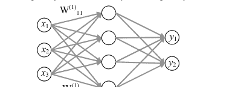
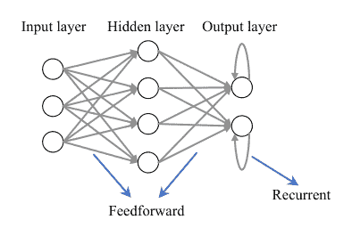
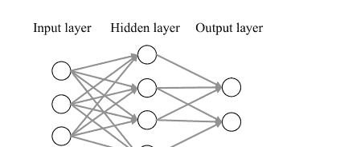
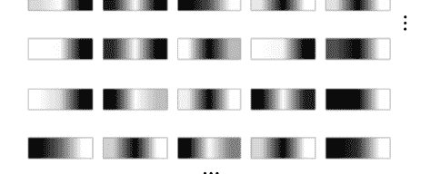
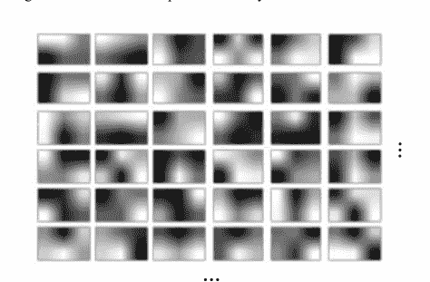
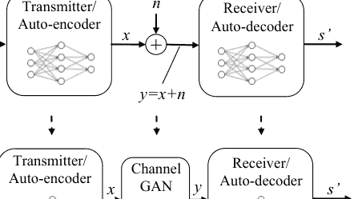

# 2020 IEEE 第五届信号与图像处理国际会议 (ICSIP) (中国南京 2020.10.23-2020.10.25)

**刘岩, 李永琦, 朱勇刚, 牛颖涛**

**彭杰***（通讯作者）**

**北京机电工程学院**
中国，北京
e-mail: jiapeng1018@163.com

**¹国防科技大学**
中国，南京
e-mail: 948805160@qq.com

## 摘要

通信信号处理中深度学习应用的简述。

本文综述了深度学习在通信信号处理中的应用。作为人工智能技术的重要分支，深度学习方案独立于底层模型，能够从观测数据中提取有意义的特征。应用于通信信号处理时，深度学习算法提供了以下主要功能：符号检测、特征提取和信息转换。然而，文中也讨论了深度学习在通信信号处理应用中面临的若干挑战。

第二节介绍了相关的术语和概念。第三节提出了深度学习算法在通信信号处理应用中执行的主要功能。不可避免的是，深度学习技术的应用也面临着若干挑战，这些挑战将在第四节中给出，并提供了未来的研究方向。

**关键词**——符号检测；抗干扰；端到端；信道状态信息

## I. 引言

作为人工智能技术的重要分支，深度学习引起了日益关注，并成功应用于计算机视觉、语音识别、自然语言处理等领域。存在多种类型的深度学习算法，具有不同的架构和特点。`深度神经网络（DNN）`通过多个隐藏层运行，可以对输入输出之间复杂的非线性函数建模。`卷积神经网络（CNN）`利用卷积核连接上下层，这与生物神经网络非常相似。`CNN`架构对平移、缩放等具有不变性。然而，`DNN`或`CNN`都无法对序列数据建模。`循环神经网络（RNN）`是神经网络的一种，其中一步的输出是序列分类中当前步骤的输入。

深度学习方案有两个主要属性 [4]。首先，它们独立于底层模型，适用于模型未知或模型参数无法准确估计的场景。其次，如果模型极其复杂，深度学习算法能够从观测数据中提取有意义的特征，这使用传统的基于模型的方法非常难以实现。

因此，深度学习已广泛应用于通信信号处理，并取得了显著的性能。本文介绍了一种……

## II. 术语与概念

### A. 深度神经网络

深度神经网络将输入向量 $x$ 映射到输出向量 $y$，其中 $y=\sigma^{(L)}(B^{(L)}(...B^{(1)}(x))$，其中 $L$ 是层数。$B^{(i)}$ 是线性或仿函数，$\sigma^{(i)}$ 是非线性函数。线性函数给出为 $B^{(i)}=W^{(i)}x+b^{(i)}$，对于所有 $k$，其中 $W^{(i)}$ 和 $b^{(i)}$ 代表网络权重和偏置。非线性函数是某些可微函数，例如`logistic函数`或`sigmoid函数`。图1显示了一些深度神经网络

(a) 每个输出层的加权求和

(b) 前馈与循环连接

### B. 符号检测

**特征提取**：`卷积神经网络`通常作为作用于输入信号的卷积特征提取器 [5][6][7][8]。众所周知，当用于图像特征提取时，神经网络层越深，卷积核所代表的特征越丰富。同样，如图2所示，在通信信号处理中，浅层的卷积核充当边缘梯度检测器的角色。深层的卷积核可以提取更复杂的特征，作为类似于`Gabor`的滤波器 [6]，如图3所示。

### C. 编码与解码

通信过程基本上依赖于编码和解码。解码意味着以代码的形式从一个系统编码到另一个系统。可以使用符号、字母来表示秘密消息。解码是指解码器根据自身的源和经验解释接收到的消息。

### D. 调制与解调

为了引入数据或语音信息，必须将一个波作为输入叠加在载波上。调制改变载波的形状以编码需要传输的数据。调制有三种：调频、调幅和调相。解调定义为从载波中提取信息。

### E. 信道状态信息

`信道状态信息（CSI）`是用于感知通信链路状态的表示。

## III. 方法论

通过`卷积神经网络`，深度学习框架实现了性能的提升。深度学习的主要应用可以分类为：符号检测、分类。

**分类**：深度学习能够可靠预测调制。在文献[10]中，`深度神经网络`作为分类器。

**端到端解决方案**：基于深度学习的方法为许多问题提供了端到端解决方案。使用`深度神经网络`的端到端系统 [21] 已开发。通过`压缩感知（CS）`方法显著提升了重建质量。`生成对抗网络（GAN）`也被用于建模信道效应。`无线通信` [23]中通过数据驱动的方法建模信道效应。

图4. 基于自动编码器的端到端系统。

### B. 抗干扰

基于深度学习的抗干扰方法取决于干扰的准确估计。研究表明，训练良好的`RNN`架构可以解码序列码，并具有良好的稳定性 [15]。使用`DNN`的干扰消除性能在[16]中给出。

`强化学习` [17] 用于优化抗干扰策略。算法不需要对干扰模式建模，并且具有探索环境的能力。卷积网络如`U-Net` [19]，可用于缓解射频干扰 [20]。

深度学习被用于学习作为分类器的 [01]。一种有效的抗干扰策略是在频谱接入中采取少量动作，并防止干扰器构建可靠的分类器。深度学习或深度强化学习需要大量数据来训练`深度神经网络`。显然，在污染训练的情况下，深度学习估计器可以在没有任何信道和统计特性知识的情况下动态地跟踪状态 [25]。基于深度学习的方案通过完美的信道估计方法有助于构建成本低复杂的信道估计器。

## IV. 讨论与结论

深度学习方案独立于底层模型，能够从观测数据中提取有意义的特征。在面对少样本场景时，存在有效的方法来解决这个问题。`GAN`用于用合成样本增强训练数据集 [10]。`元学习`方法可以在小样本上良好泛化 [27]。

本文综述了深度学习在通信信号处理中的应用。介绍了深度学习相关的术语和概念。讨论了主要方法。然而，深度学习技术在通信场景的应用仍面临若干挑战，这些可以作为未来的研究方向。

**高效神经网络模型**。在设备上运行高质量模型的需求日益增加。小型高效的神经网络 [28][29] 在并发或低功耗通信场景中是必要的。深度学习研究人员正在如何在损失模型能力的情况下缩小模型 [31]。构建小型高效神经网络的方法有：模型剪枝和量化、模型压缩和分解、知识迁移和蒸馏 [32]。新一代专用芯片能够集成更多将计算能力压缩到更小的空间内，以便 `AI` 可以在更低的能量下训练和运行。

研究发现，安全的神经网络对设计良好的输入样本敏感，这些样本被称为`对抗样本` [33]。对对抗样本的脆弱性是将深度学习应用于安全关键型通信环境面临主要风险之一。在威胁模型下，对抗攻击可分为`白盒攻击`或`黑盒攻击`。代表性的防御方法包括`对抗训练`、基于随机化的方法，然而很难平衡防御的效率和复杂性。因此，未来对攻击和深度学习值得进行更深入的研究。

**可解释性**是对其黑盒进行学习。目前已采取多种方法提高深度学习的可解释性。`深度神经网络`通过`信息瓶颈` [35] 进行研究。此外，在许多应用中，端到端的解决方案并非最佳。优化的方案应该由数据处理过程组成，即：数据处理、特征提取和分类。

## 致谢

这项工作由 `Research fund UK-17-03-62` 资助。

## 参考文献

- [1] Y. Lecun, et al. Nature, 521, 436-444, 2015.
- [2] Lecun, Y., Bengio, Y., & Hille Weiss, P., Gradient-based learning applied to document recognition. Journal of Machine Learning Research, 8(1), 2276-2280, 2007.
- [3] An attack on recurrent networks to prevent hello jamming attacks. IEEE Transactions on Neural Networks, 30(5):2909-2915, 2019.
- [4] N. Shisherer, R. Fernandez, Youneda C., et al. VibeNet: A Deep Learning Based Variant Selection for Signal Identification. In IEEE International Conference on Wireless Networks and Communications (SPAWC), Paris, France, 2019.
- [5] C. Zhang, C. Yu, and H. Han. Adversarial Learning for Specification Verification. IEEE Journal of Signal Processing, 11, 6184-6194, 2020.
- [6] T. Ito, and Y. Ogosawa. Radio interference mitigation using deep reinforcement learning. arXiv:1806.041056, 2018.
- [7] M. Schmidt, D. Block, and U. Miller. Deep Learning with convolutional neural networks. 2017. arXiv:1707.00737v1 [cs].
- [8] S. Shininchai, S. Tan. Deep Learning for Wireless Networks and Segmentation and Precision. arXiv:2011.11786, 2020.
- [9] C. Li, Q. Xu, and H. Han. Overlapping communication signal recognition with deep learning. The Journal of the American Society of Africa, 12, 4: 2732-2739, 2018.
- [10] T. Perp, E. Sagduyu, Y. Shi. Deep Learning for Launching and Mitigating Wireless Jamming Attacks. 2018. arXiv:1807.02567v2 [cs.IT].
- [11] Ben Wilbur, Tim O'Shea, Tomaghny R, et al. "DeepSig: Deep Learning for Wireless Communications," 2018. https://docs.arxiv.org/abs/deepsig-deep-learning-wireless-communications/
- [12] C. Hager, H. D. Foster. Nonlinear interference mitigation using deep neural networks. 2017. arXiv:1710.02341v1 [cs.IT].
- [13] H. Ye, L. Liang, G. Li, et al. Deep Learning End-to-End Wireless Communication Systems Using Generative GAN. 2019. arXiv:1902.00251 [cs.IT].
- [14] M.D. Zeller, R. Fergus. Visualizing and Understanding Convolutional Neural Networks. CCV 2019: 13th International Conference on Computer Vision. IEEE, 2019.
- [15] H. Kim, Y. Jiang, J. Ranu, et al. Cooperative algorithms for deep learning. 2018 IEEE International Conference on Communications.
- [16] T. Yu, X. Hu, X. Daver. Deep frequency classification. 2018 IEEE Conference on Electromagnetics.
- [17] N. Tabish, N. Zalsky. Deep learning for learning. SoftNetworks, 12, 2018.
- [18] O. Ronneberger, P. Fischer, T. Bux. End-to-end deep learning for semantic segmentation. Human Computer-Assisted, Springer, 224-241, 2015.
- [19] J. Xu, C. Cao, A. Lu. Radio interference mitigation using deep networks. Acoustics and Astronomy, 35.
- [20] C. Wen, W. Shi, S. Jin. Deep Learning for Massive Channel. IEEE Communications Letters, 7(5):748-751, 2022.
- [21] S. Hochreiter, J. Schmiduber. Long Short-Term Memory. Neural Networks, 9:175-1780, 1997.
- [22] C. Ji, J. Yang, and H. Han. State Information Prediction for 5G Communications: deep learning approach. IEEE Transactions on Neural Networks and Learning, 2020.
- [23] J. Goodfellow, J. Pou-Yabian, M. Mirza, et al. Generative Adversarial Nets. Advances in Neural Information Systems, 26, 2014.
- [24] O. Bao, J. Wang, Y. Shi. Deep Learning based Channel Estimation Using Time Selective Frames. IEEE Transactions on Communications, 2019.
- [25] M. Almirini, M. Hosseikhani, S.A. Salammohini. Deep learning for channel estimation in OSFS system. IEEE Communications Letters, 24:502-505, 2020.
- [26] Chelsea Finn. Deep learning for learning. 2017. https://blog.arxiv.org/blog/1707.0018/deep-learning/
- [27] A.G. Howard, W. Zhu, and H. Lee. Mobile Convolutional Deep Neural Networks for Mobile Applications. 2019.
- [28] G. Hinton, Y. Vinyals, and D. Dean. Distilling Knowledge in a Neural Network. Neural Networks, 2015.
- [29] J. Good, et al. Adversarial examples and Defenses for Deep Learning. arXiv:1712.00730v3 [cs.LG].
- [30] K. Ren, T. Zheng, Z. Qin, et al. Adversarial Attacks and Defenses in Deep Learning, 66(3):346-360, 2020.
- [31] N. Tabish, N. Zalsky. Deep Learning and the Information Bottleneck Principle. 2018. arXiv:1802.06246
