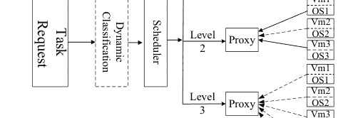
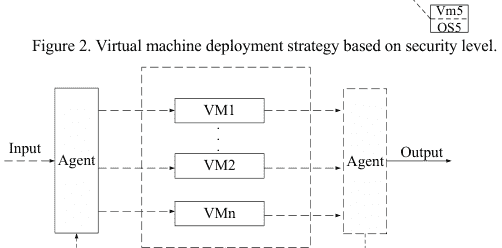
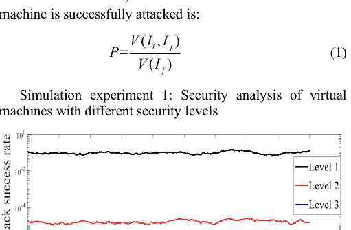

# 2020 IEEE 第六届计算机与通信国际会议 (ICCC) (中国成都 2020.12.11-2020.12.14) 论文集

摘要—静态云计算环境极易成为攻击目标，导致数据被窃取或泄露，给用户带来更大的安全威胁。为了提高云计算环境的安全性，本文基于拟态防御的思想提出了一种针对不同安全等级 SaaS 的异构资源分配算法，并采用了动态异构冗余策略。实验结果表明，在不同的安全等级下，成功率和防御能力存在差异。随着安全性的提升，虚拟机攻击的成功率逐渐降低，而部署开销逐渐增加。

**关键词—**云计算；安全等级；资源分配

# I. 引言

云计算提供了按需付费的资源访问。许多成本是根据使用时长计算的。美国国家标准与技术研究院（NIST）定义了云计算的基本模型：软件即服务（SaaS）、平台即服务（PaaS）和基础设施即服务（IaaS）[1]。此外，SaaS 易于使用，是目前最流行的云交付形式。为了给用户提供高质量的服务，SaaS 服务通常从私有云或公共云供应商处租赁。随着 SaaS 服务的快速扩展，优化 SaaS 云中的资源分配至关重要 [3]。

电子健康中的保护方法包括加密方法和非加密方法。

然而，不同用户对虚拟机的安全性有不同的需求。例如，普通用户只需要虚拟机提供服务，而不担心隐私泄露。但也有用户对虚拟机的安全性支付更高的费用，例如金融、医疗和军事领域。为了解决这一问题，本文引入拟态防御技术 [11]，提出了一种针对不同安全等级 SaaS 的异构资源分配算法。服务提供者可以提供不同的安全服务以满足用户需求。不同安全等级下异构虚拟机的部署方式不同，导致了虚拟机部署成本的差异。这比传统的虚拟机部署更有效，提高了云计算环境的可用性。

# II. 相关工作

静态同质的云计算环境因其管理简单、成本低而被广泛使用。然而，由于系统的异构性，更容易检测信息和窃取数据，从而对云环境带来安全威胁 [13]。虚拟化的隔离使得攻击难以被检测 [14] 且难以提高云计算环境的安全性。在此基础上，通过动态切换目标可以进一步增强虚拟机的安全性。通过不断改变虚拟机及其虚拟机操作系统的位置，防止虚拟机遭受侧信道攻击 [15] 和检测攻击 [16]。已有大量的经验和研究。攻击者利用各种方法攻击云计算的安全问题。网络防御策略包括被动防御和主动防御。被动防御技术主要由防火墙和入侵检测系统代表。被动防御基于已知知识来检测并拦截威胁特征和攻击行为。传统被动防御策略的缺点是无法准确获取先知识，且难以抵抗未知攻击。以移动目标（MTD）和拟态防御技术为代表的主动防御技术改变了网络防御的规则，从根本上改变了计算环境的周期，增加了攻击者的检测难度，并在程度上增强了网络安全。然而，MTD 具有局限性。当攻击者成功进入目标主机时，MTD 无法识别并防御可利用的漏洞信息。(1) 安装后门。攻击者利用从用户处发现的操作系统漏洞信息在用户主机上安装后门。(4) 攻击者与用户主机建立连接，并在用户不知情的情况下远程访问用户主机上的后门。(5) 窃取数据。攻击者与用户主机建立连接，利用内置操作系统命令监视用户内部网络并进行窃取。

拟态防御技术基于动态机制，使环境更加动态化和不确定。同时，引入了攻击机制来创建和轮换攻击行为的虚拟主机，进一步提高了计算环境的安全性 [18]。

在攻击链中，漏洞挖掘是攻击者的关键步骤。攻击者可以成功挖掘出目标主机的操作系统漏洞，根据漏洞对目标主机进行攻击。静态单一的环境将导致失败。攻击者可以根据发现的漏洞在网络上发起大规模攻击，通过开销训练多台机器的直觉。

虚拟防御被设计为异构且冗余。一组拟态虚拟机由多个异构虚拟机组成。异构虚拟机执行相同的服务并将结果输出给代理，由代理对输出进行判断。异构冗余策略可以提高系统的故障能力和数据可靠性。

# III. 攻击链中的威胁

# IV. 算法描述

## A. 虚拟机安全等级分类

当虚拟机丢失机密性、完整性或发生安全违规时即视为违反。根据《联邦和信息系统安全分类》（FIPS PUB 199）[20]，虚拟机的安全等级分为以下三个等级：

| 检测 | 漏洞挖掘 | 控制 | 窃取数据 |
| :--- | :--- | :--- | :--- |
| 发送带有恶意 URL/附件的邮件 | 利用操作系统操作系统漏洞 | 在目标主机上安装后门 | 从...建立连接 | 访问其他计算机获取全部数据 |

图 1 攻击链。

第一级，安全等级为 1，这意味着该虚拟机的内容是开放且透明的，没有隐私或安全担忧。泄露机制无法保护此类虚拟机的价值。此时，用户不要求供应商保护此类机器。即使该虚拟机被攻击者攻击，也不会造成损失的。

第二级，安全等级为 2，这意味着此类虚拟机涉及敏感信息，供应商需要投入资源保护此类虚拟机免受攻击，因为一旦这类机器不安全，攻击者会产生严重的负面影响并带来损失。此类虚拟机的安全性处于 1 级和 3 级之间，具有安全性，但如果这种虚拟机的成本大于机器的价值，用户可以选择放弃这种虚拟机。

如 [19] 所示，图展示了网络链。圆圈表示攻击链的状态，相应的描述说明了每个阶段采取的操作。

攻击发起的过程如下：(1) 检测阶段。攻击者向用户发送恶意 URL 或附件以收集目标虚拟机的信息。(2) 漏洞挖掘，攻击者根据收集的信息利用用户系统并

第三级，虚拟安全等级为三，这意味着此类虚拟机包含的内容非常敏感，可以提供给授权用户以提供服务。这要求供应商花费大量资金来保护虚拟机。一旦这种类型的虚拟机器被成功攻击后，将对用户产生不利影响并造成严重损失。

## B. 基于安全密级的虚拟机部署算法

如图2所示，供应商通过Web界面向用户提供定制化接口，并与用户签署协议以提供不同的安全级别，用户可以通过该接口选择安全级别来创建虚拟机。当请求到达时，调度器根据任务的安全级别调度要部署的虚拟机数量、操作类型、部署位置以及虚拟机的驻留时间。在考虑安全级别时，根据虚拟机的安全需求，从操作系统库中随机选择一个操作系统来创建虚拟机。根据当前负载选择要部署的服务器，并将虚拟机部署到该服务器上。当安全级别为2时，从库中选择三个异构操作系统创建虚拟机并部署在三台不同的物理服务器上，并为这些虚拟机设置驻留时间。当安全级别为3时，从库中选择五个异构操作系统创建虚拟机并部署在五台不同的物理服务器上，并为五台虚拟机设置时间。

一旦攻击者成功攻击虚拟机，攻击者就可以影响目标虚拟机的正常运行，窃取或篡改目标虚拟机的数据；因此，备份关键虚拟机非常重要。为了确保系统的机密性、完整性和可靠性，系统根据安全级别进行虚拟机备份，不同安全密别的虚拟机数量不同。如图3所示，以三冗余异构为例。

虚拟机将输出结果发送给代理（agent），由代理根据多数通过原则进行裁决。如果vm1受到攻击且虚拟机被篡改，但vm2和vm3的输出是正常的，代理仍然可以在部署后输出结果。代理仅具有转发和裁决功能，不能为用户提供使用虚拟机的服务。冗余策略可以提高云计算环境的容错能力。

图2. 基于安全性的虚拟机部署策略。

图3. 异构冗余架构 (DHR)。

| 操作系统常见漏洞数量 |
| :--- |
| OS | OB | NB | FB | W03 | W12 | D | R | Osol | Sol |
|---|---|---|---|---|---|---|---|---|---|---|
| OS | | 149 | 45 | 52 | 2 | 1 | 0 | 3 | 10 | 1 |
| NB | | | 139 | 56 | 1 | 1 | 0 | 4 | 8 | 16 | 0 |
| FB | | | 58 | 284 | 3 | | 0 | 6 | 9 | 22 | 0 |
| W02 | | | | | 3 | 412 | 345 | 85 | 0 | 1 | 7 | 0 |
| W01 | | | | | 2 | 344 | 385 | 0 | 0 | 0 | 0 |
| W12 | | | | | 0 | 85 | 446 | | | | | |
| U | | | | 6 | 0 | 0 | 0 | 840 | 179 | 86 | |
| D | | | | 4 | 9 | 0 | 0 | 303 | 925 | 220 | |
| R | | | | 8 | 22 | 1 | 0 | 86 | 170 | 158 | 69 | 1 |
| Osol | | | | 16 | 22 | 7 | 0 | | 86 | 73 | 69 | 27 |
| Sol | | | | 1 | 0 | 0 | 0 | 0 | 0 | 1 | 27 | 100 |

授权许可使用限制：爱德华王子岛大学。于2021年5月29日 22:32:12 备自 IEEE Xplore。受相关限制。

## V. 实验

在本文中，获取了通用漏洞枚举 (CVE) [21] 发表的2004年至2017年间11个操作系统披露的漏洞数据。这些操作系统分别是：OS (OSBSD)、NB (NetBSD)、FB (FreeBSD)、W03 (Windows 2003)、W08 (Windows 2008)、W12 (Windows 2012)、Ubuntu、D (Debian)、OS (Solaris)。表1显示了上述系统的漏洞数量以及不同操作系统之间的共同漏洞数量。

假设黑客掌握信息 $I_t$，用户机器中的漏洞数量为 $V(I_t)$。用户操作系统的漏洞数量为 $V(I_j)$。已知机器的共同漏洞和操作系统为：$V(I,j)$。虚拟机被成功攻击的概率为

$P=\frac{V(I,j)}{V(I_j)}$

仿真 1：不同安全级别虚拟机的安全性

图4. 不同安全级别虚拟机之间的安全性能对比。如图4所示，我们在攻击中根据虚拟机部署策略部署了具有不同安全密级的虚拟机。为了更直观地展示实验结果，攻击率采用了对数显示。我们模拟了1000次攻击，当安全级别为1时，虚拟机被成功攻击的概率为0.18；当安全级别为2时，概率为0.16；当安全级别为3时，概率为0.13。实验结果表明，安全性越高，虚拟机被攻击的概率越低。

不同安全密级的虚拟机。。如图4所示，我们在攻击中虚拟机部署策略中部署了不同安全密级的虚拟机。(OSBSD)、NB (NetBSD)、FB (FreeBSD)、W03 (Windows 2003)、W08 (Windows 2008)、W12 (Windows 2012)、Ubuntu、D (Debian)、OS (Solaris)。表1中显示了上述系统的漏洞数量以及不同操作系统之间的共同漏洞数量。

假设黑客掌握信息 $I_t$，用户机器中的漏洞数量为 $V(I_。。。漏洞漏洞为 $V(I_j)$。已知机器的共同漏洞和操作系统为：$V(I_j)$。

虚拟机。成功攻击的概率为

。。.。。。。

# VI. 结论

本文分析了云计算中的安全防御，并提出了一种基于虚拟机的

[14] Dayaratna M, Wen Y, Fan R. 数据中心能量消耗建模：综述(J). IEEE Communications Surveys & Tutorials, 2015, 18(1): 732–794.

[15] Carlet C, Li C , Mesnager S. 用于抵抗侧信道攻击和故障注入攻击的最优线性码对的两种构造[J]. 2010; 205–210.

[16] Phan T V, Park M. 基于 SDN 的云环境中高效分布式拒绝服务攻击防御[J]. IEEE Access, 2019, 7: 18701–18714.

[17] Nguyen Q L, Sood A. 基于云的 SCIT-MTD 的扩展性[J]//2017 IEEE International Conference on Software Analysis, Reliability and Security Companion (QRS-C). 2017: 581–582.

[18] Wang Y W , Jiang-Xing W U , Guo F , et al. 云环境下基于模拟防御的科学工作流执行系统[J]. Frontiers of Information and Electronic Engineering, 2018, 018(012):P 1522–1536.

[19] Sexton J, Storlie C, Neil J. 攻击链检测[J]. Statistical Analysis and Data Mining: The ASA Data Journal, 2015, 8(5-6): 353–364.

[20] Li X , AlSowayikh M, Li Z. 提高信息安全投资回报率的安全风险管理方法[M]/数据科学与商业分析最新进展. Springer, Cham, 2018: 209–216.

[21] 常见漏洞枚举。http://www.evidetetails.com/.
