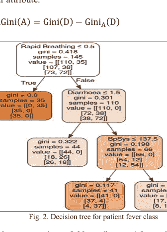
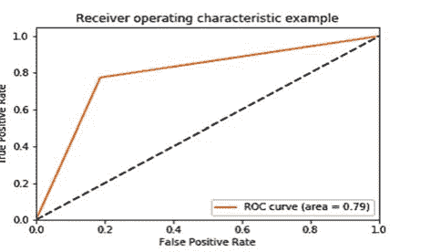
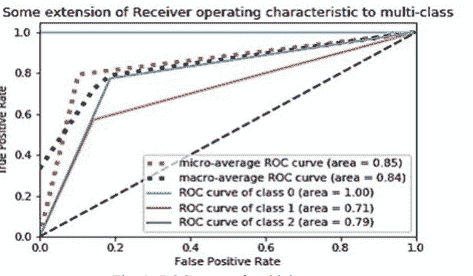

# 2020 IEEE 第8届 R10 人道主义技术会议 (R10-HTC)｜基于机器学习的登革热预测

Dhiman Saha

计算机科学与工程系

Rangampur科学技术大学

Rangampur, 孟加拉

dhiman001@yahoo.com

Sohrab Hossain

计算机科学与工程系

East Delta University

Chittagong, 孟加拉

sohr_haha6@yahoo.com

Tannusi Mitta

计算机科学与工程系

East University

Dhaka, 孟加拉

mitta.ce12@gmail.com

Md. Abdul Mutallah Mobeia

药学院

科学技术大学

Chittagong

Chittagong, 孟加拉

motalab@gmail.com

Ihsak Saha

Chittagong科学技术大学

Chittagong, 孟加拉

isaksaha6@yahoo.com

Ravina Chakma

计算机科学与工程系

East Delta University

Chittagong, 孟加拉

ravinaravi@gmail.com

**摘要** 登革热是由伊蚊病毒引起的。世界卫生组织（WHO）报告显示，2019年每年有1亿至4亿例感染，这是迄为止报告和预测的登革热病例数量最多。它可能演变为危生命的出血性热，且每年都会发生。本文重点关注在疾病进展的早期预测登革热及其亚型，以确保获得合适的支持性护理和治疗。我们利用了2019年向世界卫生组织报告的101,000例病例的数据集。因为这种爆发会给社会造成巨大混乱。由于登革热的成本很高，降低死亡率至关重要。在这项研究中，我们开发了一个预测登革热的模型。患者数据集包含患者的病史和实验室结果信息，包含了来自Chittagong医学院医院的登革热类型原始数据。数据集按70:30的比例划分（70%用于训练，30%用于测试）。我们在提出的分类模型中应用了机器学习森林（RF）。最后，决策树的平均准确率为79%，这对于医学模型来说是一个高水平。

**关键词** 登革热预测；人工智能；机器学习；临床决策支持

## I. 引言

登革热是一种危险的疾病。它通过携带登革病毒的伊蚊幼虫阶段传播。病毒在叮咬人类血液时扩散。在初期阶段，它看起来像典型的流感发热。显著症状在早期并不出现，只有当患者进入关键阶段时才会可见。流行病学研究显示，如果病毒感染任何人，免疫系统就会产生反应，身体进入登革热状态。在登革热患者的实验室中可以检测出各种临床症状和异常。这些与伤寒、鼠疫热或普通发热等正常发热相似。登革热必须在初期阶段进行精确治疗 [2]。

登革热有四种血型，如 (DENV) DENV 1-4。被伊蚊叮咬的患者会遭受皮疹，并伴有发热、肌肉疼痛、头痛和恶心 [1]。此外，人们在被叮咬多次后可能会面临严重症状。登革热出血性热（DHF）病例可能会发生登革热休克综合征（DSS）[4]。通过DHF或DSS的感染 [5]，一旦发生，其流行率可能高达10-40%。

用于预测的标准机器学习算法包括支持向量机 [8]、决策树 [9-11]、k均值 [12]、朴素贝叶斯、序列优化和随机森林 [13, 15, 26]。然而，这些方法的结果是基于分类的优秀数据集和人口统计区域进行的。此外，其中一项研究结合了患者病史、临床和个人数据进行分类。此外，近期对孟加拉的发热预测进行了研究。由于DENV具有流行病模式，识别潜在爆发的高风险地区并从受影响患者那里收集数据非常重要。此外，由于孟加拉报告了101,000例病例，本研究针对了两个人口稠密的城市（达卡和吉塔洪格）。

我们展示了一种机器学习（ML）模型，利用收集的数据来预测登革热。为此，我们在2019年从使用的不同医学院收集了209名患者的数据集。然后我们推导出了属于登革热预测机器学习算法的23个属性的最终数据集。这项研究旨在帮助公众自诊诊断，以减轻医生的负担。如果我们的模型以满意的准确率成功，它将作为患者的治疗指南。Sharef, Nurhafidah Mohd [21] 评估了带有非线性回归和反向传播的神经网络。该研究达到了99%的准确率。

表 I. 登革热相关论文回顾

| 论文 | 领域 | 算法 | 准确率 |
| :--- | :--- | :--- | :--- |
| Marimuto, T., [14] | 登革热序列模型 | 关联规则、支持向量机 | |
| Rao, K., [15] | 登革热的发生 | 决策树 (DT) | |
| Sharma, H., [16] | 不同的状态 | k-均值类 | 94% |
| Shaukat, K., [17] | 不同的实施 | 朴素贝叶斯 (NB) | 88% |
| Batha, R., [18] | 基于环境因素预测 | 支持向量机 (SVM) | 95% |
| Sudom, N., [19] | 识别登革热 | 无监督学习 | 95% |
| Sharef, Nurhafidah Mohd [21] | 评估登革热 | 反向传播 (BPN) | 93% |

图 1. 登革热流程图

### A. 数据收集

由于孟加拉报告了101,000例病例，我们针对两个人口稠密的城市（达卡和吉塔洪格）进行了本研究。表 II 显示了发热病例分类：

| 类别 | 数量 |
| :--- | :--- |
| 男性 | 35 |
| 女性 | 40 |
| 正常 | 35 |
| **总计** | **40** |

### B. 预处理

预处理是许多应用中常见的任务。这种技术用于将原始数据转换为干净、标准化的格式。这样做需要数据进行清洗、去噪。

| 类型 | 频率 |
| :--- | :--- |
| 登革热 | 1 |
| 登革热 | 0 |
| 登革热 | 2 |

### C. 特征选择

特征选择是在开发预测模型时减少输入变量数量的过程。减少输入变量的数量可以降低建模成本，在某些情况下可以提高模型性能。在我们的研究中，我们使用了匹配的数据并使用中位数法来移除这些变量。

| 变量 | 说明 |
| :--- | :--- |
| 年龄 | 频率 |
| 腹泻 | 频率 |
| IgG | 频率 |
| IgM | 频率 |
| NS1 | 频率 |
| 腹痛 | 频率 |
| 疲劳/饥饿 | 频率 |
| 光敏感 | 频率 |
| 呼吸困难 | 频率 |
| 性别 | 频率 |
| 咳嗽 | 频率 |
| 脉搏 | 频率 |
| 发热 | 频率 |
| 肌肉痛 | 频率 |
| 出血 | 频率 |
| 头痛 | 频率 |
| 血血板 | 频率 |
| 疼痛 | 频率 |
| 皮疹 | 频率 |
| 呕吐 | 频率 |

表 IV. 归化数据集

| 年龄 | 腹泻 | IgG | IgM | NS1 | 腹痛 | 疲劳/饥饿 | 光敏感 | 呼吸困难 |
| :--- | :--- | :--- | :--- | :--- | :--- | :--- | :--- | :--- |
| 45 | 1 | 0 | 0 | 0 | 1 | 1 | 1 | 1 |
| 75 | 1 | 0 | 0 | 0 | 1 | 1 | 1 | 1 |
| 50 | 1 | 1 | 1 | 1 | 1 | 1 | 1 | 1 |
| 35 | 1 | 1 | 1 | 1 | 1 | 1 | 1 | 1 |
| 15 | 0 | 0 | 0 | 0 | 0 | 0 | 0 | 0 |
| 42 | 0 | 0 | 0 | 0 | 1 | 1 | 1 | 1 |
| 62 | 0 | 1 | 1 | 0 | 1 | 1 | 1 | 1 |
| 65 | 0 | 0 | 0 | 1 | 1 | 1 | 1 | 1 |
| 70 | 0 | 0 | 0 | 1 | 1 | 1 | 1 | 1 |
| 80 | 0 | 1 | 1 | 1 | 1 | 1 | 1 | 1 |
| 48 | 0 | 0 | 0 | 0 | 0 | 0 | 0 | 0 |

### D. 数据划分

预处理后，我们使用内置函数 `train_test_split()` 将数据集划分为不同比例的训练集和测试集。我们在70%训练和30%测试的比例下获得了最佳性能。

## E. 患者发热分类

使用了决策树和随机森林算法来预测发热。CART（分类与回归）被用于对不完善的发热数据集划分决策树。如果根据集合中标签的分布随机选择一个标签，则选择纯度最低的属性来划分节点。

在图 2 中，需要注意的是呼吸快速的纯度最低，并被选为决策树的根节点。如果一个节点的基尼指数为 0，则它将给出决策且不能被划分。所有叶子节点都给出发热类别。

### a) 基尼不纯度（Gini Impurity）公式

基尼指数是一种衡量不平等的统计指标，范围从 0（绝对）到 1（绝对）。节点的基尼不纯度是指如果按照节点内样本分布进行标记，则节点中随机选择的样本被错误标记的概率。决策树在划分每个节点时试图最小化该不纯度。公式 (1) 公式化了基尼指数，其中 D 是 209 名患者数据集，P 是患者属于发热类的总概率，n 是发热类别的数量。Gini (D) 衡量整个数据集的不纯度。

### b) 随机森林公式

决策树容易过拟合，这意味着它学习了训练集的规则，而这些规则在训练集上的泛化性较差。为了克服这个问题，随机森林（RF）算法通过将许多决策树合并为一个单一集成来工作。结果，它使用自助法（bootstrap）从原始数据集（D-209）生成了不同的数据集，并构建了 n 棵决策树。最终值通过对森林中 m 棵树的所有预测值取平均值计算。

```
Gini(D) = 1 - \sum_{i \in D} n_i^2
```

如果 D 分分为子集 D1 和 D2，则特定属性的基尼指数如 (2) 所示：

```
Gini(D) = \frac{|D1|}{|D|}Gini(D1) + \frac{|D2|}{|D|}Gini(D2)
```

在公式 (3) 中，我们计算特定属性的不纯度减少：

```
\DeltaGini(D) = Gini(D) - Gini(A)
```

```
RF_fi = \frac{\sum_{D \in all trees} norm_{fiID}}{m}
```

其中，rf sub(i) 是从 RF 中所有树计算出的特征 i 的重要性，rf sub(d) 是 D 中特征的归一化重要性，m 是树的总数。每个特征的重要性在公式 (5) 中得出：

```
fr_i = \frac{\sum_{D \in nodes} bn_i(D)}{\sum_{D \in nodes} bn(m)}
```

其中，fr sub(i) 是特征 i 的重要性，bn sub(D) 是节点 D 的重要性。在 RF 中创建节点时，使用基尼不纯度 (6) 计算节点重要性：

```
bn_d = wt(d)Gini(D) - wt(left)Gini(left) - wt(right)Gini(right)
```

其中，bn(d) 是二节点 d 的重要性，wt(d) 是到达节点 d 的权重样本数，left(d) 和 right(d) 是节点 D 划分后的左右子节点。

## F. 实验设置

本研究使用 Python 3.8 作为机器学习语言。在此基础上，`jupyter notebook` 被集成为 Python 的 Web 应用程序。使用了其他库函数：

- Scikit-learn：用于实现机器学习算法库函数，如 k-means、决策树、分类、回归、SVM、XGBoost、CatBoost。



我们的数据集包含 23 个属性。在计算所有属性的基尼不纯度后，生成了发热结果。

- NumPy：用于科学计算，它可以计算多维对象。

- Pandas：作为 Python 数据分析工具。

- Matplotlib：用于 Jupyter notebook 和 Python 脚本，提供交互式图表。

ROC 曲线下面积（AUC）在图中显示了最高阈值。

## IV. 结果与讨论

接收曲线或 ROC 曲线是一种图形表示形式，展示了基于阈值的二分类器的能力 [22-24]。它是一个概率曲线，面积（ROC）代表分离程度；通过 y 轴上的正性率（TPR）相对于 x 轴上的负性率（FPR）进行绘制。敏感度、召回率或概率检测过程。

混淆矩阵用于描述分类模型的性能。表 V 显示了来自 DT 和 RF 的混淆矩阵训练和测试结果。

| 算法 | 精确 (Precision) | 召回率 (Recall) | F值 (F-Measure) |
|---|---|---|---|
| DT 训练 | 0.82 | 0.82 | 0.82 |
| DT 测试 | 0.79 | 0.79 | 0.79 |
| RF 训练 | 1.00 | 1.00 | 1.00 |
| RF 测试 | 0.67 | 0.67 | 0.74 |

表 V. 比较结果

 图 3. 测试数据的 ROC 曲线

 图 4. 多分类 ROC 曲线

根据分类参数（表 V）得出的结果值如下：

- TPR = Recall/(TP+FN)
- FPR = TN/(TN+FP)
- Precision = TP/(TP+FP)
- F-measure = Precision*Recall/(Precision+Recall)
- Accuracy = (TP+TN)/(Total)

评估显示，随机训练准确率从 70% 下降到 68%，而决策树准确率从 71% 增加到 79%。最后，决策树预测具有更好的准确率，其中真性（TP）、假性（FP）、假性（FN）和真负性（TN） [31-33]。

## V. 结论

图 3 显示测试数据的 ROC 曲线。图 4 描述了 TPR 和 FPR 之间的比较分析。粉色线代表 0.85 的微平均；蓝色线代表 0.83 的宏平均。其他线条单独显示。本文提出了一种基于机器学习的模型来预测发热。从达卡和奇塔洪医院收集了 209 名患者的数据。最后，使用决策树实现了 79% 的准确率，该模型将有助于医疗人员快速诊断患者。未来，我们将寻求额外的风险因素和位置数据。

## 参考文献

[1] S. Hosain, S. R. Kaiser, V. Alam, M. Hoque, and H. Sarker, "基于规则的不确定性专家系统," in Computing Science, 2020, p. 143–159.

[2] J. Lee, T. Ma, and N. Kim, "巴西登热预测：气候状况分析," IEEE Access, no. 14, p. 8–19, 2020. doi:10.2229/22116.

[3] S. Kim and Y. Park, "用于阶段检测的模型," Journal of Computer Engineering and Applications, vol. 1, no. 1, p. 11–20, 2021.

[4] J. Xu, "基于机器学习方法的2020年登革病例预测," International Journal of Environmental Research and Public Health, no. 17, p. 12, 2020.

[5] C. Davi, et al., "利用人类遗传数据和机器学习预测登热," Transactions on Medical and Biology, vol. 39, p. 755–760, 2019.

[6] A. Alyssa, J. Lee, F. R. Santana, and P. Gambia, "预测登热发病的多阶段机器学习方法：案例研究," IEEE Access, no. 8, p. 52173–52185, 2020.

[7] S. Chen, et al., "利用气候模式预测登热爆发的自动机器学习方法," Landscape Ecology, no. 34, p. 96, 2021.

[8] X. L. Zheng, Z. B. Zhang, Y. He, and F. Gu, "基于气候和环境因素的登热爆发季节性分析和建模," Diseases of Poverty, vol. 8, no. 1, p. 9–18, 2019.

[9] S. Kim, T. Lee, and J. H. Lee, "使用集成聚类算法从时空数据中检测登热模式," Parasites and Vectors, vol. 14, no. 1, p. 10–20, 2020.

[10] M. G. Ma, F. H. Noble, and P. Shabari, "使用无监督机器学习方法表征登热患者模式," IEEE Access, vol. 8, p. 43583–43590, 2020.

[11] A. Martimurali, V. J. I. Oliveira, E. C. Bahramanian, and "预测登热序列的神经网络模型," Journal of Computer Engineering and Applications, vol. 11, no. 2, p. 45–52, 2020.

[12] N. K. Rao, S. V. Rao, N. P. Ji, I. R. Lee, and C. Chen, "利用数据挖掘技术自动检测和表征登热爆发," International Journal of Research Research in Communication Technology, vol. 3, no. 3, p. 340–343, 2016.

[13] K. Siddhalat, N. Massood, A. B. Shafiat, K. Jabbar, H. Shabir, and S. J. p. Shabari, "撒哈拉以南非洲儿童的登热," 2017 IEEE 控制优化与信号处理技术会议, p. 1–5.


[14] A. N. Hasan and N. Salim, "马来西亚登热爆发建模：神经网络与非线性回归模型的比较," 2008 信息技术国际研讨会, Springer.
