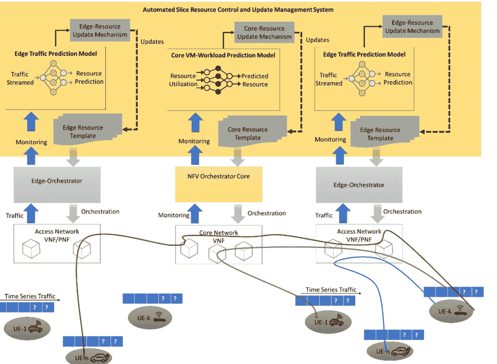
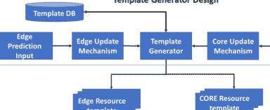

# 2020 IEEE 第92届车载技术会议 (VTC2020-Fall) (加拿大维多利亚省维多利亚 2020.11.18-2020.12.16) 一种端到端智能网络

Afaq Muhammad, Tahla Ahmed Khan, Khizar Abbass 和 Wang-Cheol Song *
韩国济州立大学计算机工程系，济州
phloio@jejunu.ac.kr * 通讯作者

**摘要—** 每年联网车辆数量的增加为车联网网（IoV）的高效资源分配带来了变化。此外，车辆还新增了许多新服务，每种服务都需要一套独特的资源。这些服务包括视频流媒体、导航以及用于驾驶的安全关键型服务。因此，车辆技术正快速向电气和绿色能源转型。此外，由于 IoV 中服务需求的复杂性，一个高效智能的资源分配系统至关重要。为此，本文提出了一种基于深度学习的资源编排解决方案，同时考虑了边缘计算基础设施。机器学习（ML）已用于管理边缘流量，而 IoV 资源分配是一个核心挑战。

- **关键词—** 网络资源分配、机器学习、编排、边缘、核心网。

## I. 引言

近年来，在 5G 伞下，IoV 领域取得了许多进展。它不仅限于提供服务质量（QoS），还包括为包括车辆通信内的各种服务提供支持。由于车辆和 IoV 设备数量的增加，流量量正在显著增长。此外，流量、设备和服务高度依赖于时间和位置 [1]–3。同样，网络应用也遵循使用模式，因此必须设计确保优化和高效编排的网络。然而，我们必须高效地处理每种服务，并根据位置提供优先级需求。网络切片的引入是为了满足这种动态环境的需求，并为每种类型的服务提供优化的资源分配 [1]。

SDN（软件定义网络）和 NFV（网络功能虚拟化）被用于实现网络编排。首先引入了虚拟化，随后云计算的出现导致了 NFV。SDN 实现了网络编程，而 NFV 则通过运行 VNF（虚拟功能）技术允许网络服务的部署。因此，利用这些进展可以使用软件平台进行编排，以控制和管理网络资源 [8]。

本文第二节介绍了网络领域的相关工作以及机器学习的应用。第三节描述了系统设计。第四节介绍了组件，第五节总结了所提出的工作。

## II. 文献综述

本工作涵盖了从物理层到网络框架的方面。在下一代网络时代，由于编排引擎设计的需求和各种方法，引发了新的网络。网络自动化是一个热门话题，已为此提出了许多方法。本节详细阐述了关于 SDN、NFV 在下一代中实现自动化和优化资源编排的相关工作。还将讨论如何有效利用机器学习通过 SDN 和 NFV 优化网络中的资源分配。此外，用于提供服务的网络切片是在单个/通用物理基础设施上管理多个虚拟资源最显著的方法。同时，由于 随着网络技术的进步，能源效率和资源优化成为可能 [12]。

包括 ETSI、ONF、3GPP 在内的许多标准一直在提出用于优化网络服务架构的架构和平台。ETSI-MANO 提出了一种架构，为 NFV-网络编排提供了一种基本方法，而 OSM 编排器提供了一个开放的解决方案。同样，ONF 与许多公司合作开发了核心编排器（Core Orchestrator——如 ETSI GS NFV 012 v1.1.1 所示）。两个平台都利用了 SDN 和 NFV 的优势，并为网络编排提供了解决方案。ONF 是另一种类型，包含了端到端网络自动化和编排 [1]。因此，此类 NFV 编排器被用作所有数据的边缘或核心编排器。显然，数据是关键的，且 NFV 网络无法为机器学习应用提供数据集。因此，一些研究者克服了这个问题并如下所示。对于资源优化和高效的资源配置，某些方面是强制要求的。首先，一个资源利用率矩阵，可以在其中我们决定何时需要多少资源。其次，用户使用模式各异。因此需要确定资源需求何时以及何地，并可以自动缩放。参考文献 [18] 手稿涉及昂贵的记录生成，通过深度学习来解释机器学习（ML）和统计学的多种用途，用于预测流量并主动决定资源配置。其次，基于网络的方法 [16] 使用机器学习进行虚拟机资源编排的服务的资源配置，并解释了如何主动执行资源缩放。

即将到来的是一个启用网络资源配置的平台。网络提供者为编排器提供配置，上述平台中的编排器则用于运行物理系统。此外，编排器控制提供商的边缘 SDN 和控制器（例如 ONS，网络操作系统）的生命周期。网络切片编排器用于实例化（虚拟化）网络资源和服务链 [15]。因此，此类平台允许操作员通过可编程配置 [21] 控制服务流程。

IBN（基于意图的网络）被认为是网络运行的重要部分。如前所述，平台和编排器需要提供策略配置以控制网络。IBN 消消了配置网络和资源的需求。IBN 系统是一个闭环系统，它考虑了资源管理和系统配置的自动更新。IBN 保证了服务的提供和扩展性。通过与许多大学合作，ASTRA、Cisco 等开发了 IBN 平台基础设施设计的定义标准。然而，IBN（端到端驱动网络）在某些场景下被使用，使用智能和人工智能进行网络编排。我们的工作在 [1] 领域也取得了良好的成绩。

此外，ETSI ZSM（零接触管理）已启动，并设计一个完全自动化且不需要任何操作辅助的平台。ZSM 考虑从许多方面将机器学习应用于网络。包括 NFV 自动伸缩、RAN 资源控制 [32]、资源翻译和分配 [11]。

已发表了许多关于机器学习应用于网络自动化的研究文章 [14]。在这一领域应用机器学习是困难的，因为它需要网络切片选择和切片管理，这是一个热门话题。我们提出了使用 NSMF（网络切片管理功能）和 NSSMF（网络切片选择管理功能）进行切片选择和编排。通常，其他研究工作使用 NSSF（网络切片选择功能） [23]。总之，虽然 3GPP 管理网络切片配置的方法尚未领先，但在本文中，我们将应用扩展到机器学习以实现切片编排和管理。我们还将探索机器学习如何以优化和节能的方式管理切片和编排。此外，机器学习将在运行时自动更新其状态 [20]。因此，手稿旨在提供一种基于用户流量驱动和核心虚拟机负载的资源管理系统。该系统能够根据 IoVT 的服务需求主动管理和利用服务的切片资源配置、创建和删除。

## III. 系统架构与工作原理

基于 SDN 和 NFV 的平台开发使得网络配置成为可能。提出的系统充分利用 SDN 和 NFV 平台并实现了资源编排。图1 所示的系统展示了 IoV 流量中边缘和核心网络基于机器学习的架构和资源分配。顶层的自动切片控制和资源管理系统（AS-CURMS）通过模板生成控制端到端的资源配置 [25]。

该系统考虑了边缘资源预测的管理与更新部分，以及核心网络资源的预测与更新部分。它采用三层架构，顶层 AS-CUMS 负责跨域资源编排。由于它集成了机器学习（ML），因此具有许多优势，包括主动资源分配、自动扩缩容和动态更新管理。

第二层由边缘编排器与核心编排器之间的编排机制组成。第三层是物理层，包含了硬件资源 VNFs（虚拟网络函数）和 PNFs（物理网络函数）。

系统的工作原理如下：AS-CUMS 是一个中央管理系统，可以自动生成端到端的资源预测。系统使用了三个机器学习模型：第一个模型用于根据用户流流量对边缘进行未来预测；在中央边缘，第二个模型决定在任何物理资源位置应该启动资源；此外，第三个模型用于预测随时间变化的资源需求。

该机器学习模型基于 VMF 的资源利用率，并预测未来需求以决定特定类型 VNF 的扩展规模，并回答服务可用性问题 [25]。

虚拟机（VM）负载预测数据集用于此目的。资源配置被提供给两个模型，在 AS-CUMS 更新边缘和核心编排器的资源模板后，它们定义了未来的状态。可以使用预测结果创建、删除或更新新的切片。

所提出的系统通过引入机器学习增强了现有基础设施。通过应用该系统，可以更有效地应对动态波动的资源需求。此外，资源仅在需要时才安装，这避免了大量的过度配置，从而实现了能源效率。此外，机器学习模型部分跟踪流量并检测所使用的应用程序类型。在 NFV 环境中，网络切片特别需要一种能够动态优化编排网络服务模板的机制。这种机制意味着通过自动化实现网络服务的动态编排和扩缩容 [25][28][33]。

## IV. 系统组件

### A. AS-CUMS

图 1 展示了 AS-CUMS 的架构，它包含三个主要部分：用于边缘和核心的机器学习模型、架构和资源模板。

图 1：抽象视图下的架构。

由于存在不同的 NFV 编排器，每个编排器都需要其模板来提供和更新资源定义。在我们的系统中，我们必须创建并更新负责这些要求的模板。图 2 显示了模板生成器的内部机制、存储模板设计和需要模板资源的模板数据库 [25]。其次，我们有两个基于预测的边缘模块和一个边缘模块，它们请求模板生成器更新系统。

首先，我们对预处理的数据应用平均窗口，窗口大小为 30，以最小化减少冗余。

## V. 结果与讨论

许多机器学习工作涉及虚拟机负载预测，每个工作都有其优点和要求。ARIMA 是最著名的模型，但在情况下，我们发现关于机器学习方法及其对虚拟机预测有效性的综述见 [16:17]。在这种情况下，RNN（递归神经网络）和 ARIMA 的比较如下：

图 2：它说明了模板生成器的设计。

| 模型 | 训练准确率 | 测试准确率 |
|---|---|---|
| RNN | 0.891 | 0.876 |
| ARIMA | 0.71 | 0.60 |

## VI. 结论与未来工作

ASR-CUMS 包含两个机器学习模型：第一个模型是基于用户流量预测的边缘模型，它可以识别未来是否有任何类型的流量可以缓存，从而提高服务质量。第二个模型用于云端，展示了该模型的设计及其工作。该模型将流量作为输入并预测未来的流量利用率。它还利用来自每个边缘的流量流量样本输入，由于边缘位置服务的不可靠性，预测在边缘网络中开启的未来流量 [18]–20]。

核心的第二个模型基于 RNN 工作，预测负载预测和未来利用率。由于数据可用，我们使用开源云数据，目标是预测资源利用率。表 1 描述了来自名为 Materna 的运行环境的数据集，该环境包含了三个月的三个轨迹 [25]。本文提出了一种基于边缘和云的 IoT 自动化资源管理机制。ASR-CUMS 使用机器学习模型的结果决定服务的部署。因此，由于架构和流量的性质，未来工作包括建立实时测试平台，并演示通过提议实现的优化。

## 致谢

本研究由 MSIT（科学技术信息通信部）和 ITR（信息技术研究）项目（ITP-2019）支持，该项目通过韩国国家研究基金由 IITP（信息技术规划局）支持。

表 1：Materna 数据集

| 索引 | 名称 | 数值 |
|---|---|---|
| 0 | Timestamp | 分钟数 |
| 1 | CPU | 产生的核心数 |
| 2 | CPU Capacity | 核心数 |
| 3 | cpu usage | MHz |
| 4 | CPU usage | 百比率 (%) |
| 5 | Memory | 虚拟机的总内存 |
| 6 | Memory Usage | 活跃内存 (KB) |
| 7 | User | Usage |
| 8 | Disk | GB |
| 9 | Disk Size | GB |
| 10 | Network | KB/s |
| 11 | Network out | KB/s |

[1] B. Blanco, et al., “Technology in 5G mobile networks, MEC, and Cloud,” IEEE Int.., pp. 216–228.
[2] M. A. Hussain, R. N. Khan, A. Y. Azhar, “Comprehensive Survey of Machine Learning approaches for VM prediction,” IEEE Access, 2020, doi:10.1109/ACCESS.299468.
[3] “Refined requirements and constraints, METIS v1.0., no.2, 2020.
[4] White paper, March 14
[5] “Impact of SDN and NFV on OSS/BSS,” Solution Brief, OSM, https://download.osm.org/source/02-scope.pdf (accessed: 6/12/2020).
[6] Clemmens, E., et al., Lavaglia, G. and Song, J. "Internet-Based Networks - Concepts and design,” IEEE IoT. 2019.
[7] ZebraCloudFast, Agile Business Internet Networks; Huawei White paper. May 2018.
[8] "Internet-Based: The New Vision for the Next Generation Application", IEEE 2018.
[9] "Internet-Based Building the bridge between IT and Cisco white paper. 2018.
[10] ETSI GS 102 875 v3.0 (2016), "Zero touch service and Network Management (ZSM) Proof of Concept". Networking.
[11] Kentis, M. A., Alvira, E., & Song, J. (2018), "Policy Framework for the Next Generation Application", Proceedings of 27th International Conference on Communications (pp. 125-129). IEEE. DOI: 10.1109/ICC.2018.8443260.
[12] White Paper, "View on 5G Architecture" 5GPP Architecture Group (2016).
[13] "THE EUROPEAN 5G ANNUAL JOURNAL/2018", 5GPP, Grant Agreement No. 76039.
[14] "Introduction to a SDN network architecture for Service Instantiation", ONF, White paper. March 2017.
[15] Aneen Alaskhei, Hongwei Liu, Dengchun Zhou and Basheer "Cloud Computing of Real-Time Monitoring for Big Data Analysis Using Spark", IoTC. Journal of Services: Cloud Computing, 923 (2018).
[16] Gulzar S., "Efficient Dynamic Virtual Machine Allocation with CPU Usage Prediction In Cloud Data Centers", thesis submitted to the graduate school of engineering and science, 2018.
[17] Ahmed A., "Towards Prediction for Proactive Resource Management: Learning-Based Approaches" arXiv:1906.00991 (2019).
[18] Rashid R., "Towards Optimal Resource Management: Learning-Based Approaches" arXiv:1906.00991 (2019).
[19] Ahmed A., "Towards Prediction for Proactive Resource Management: Learning-Based Approaches" arXiv:1906.00991 (2019).
[20] Rashid R., "Towards Optimal Resource Management: Learning-Based Approaches" arXiv:1906.00991 (2019).

