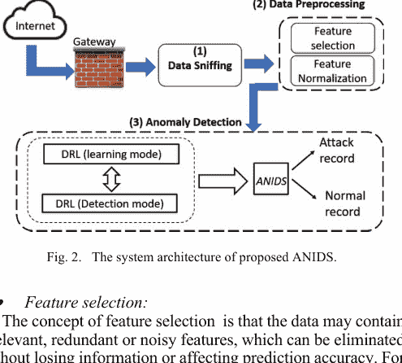
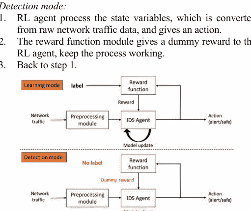
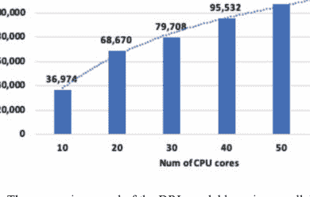

# 2020 IEEE 第9届国际云网络会议 (CloudNet) ｜｜ 深度强化学习

**摘要**— 入侵检测系统（IDS）对于组织确保通信的安全与防护至关重要。在本文中，我们提出了一种基于深度强化学习（DRL）的异常入侵检测系统。我们的系统具有适应新类型网络流量行为的能力。我们通过三个著名的基准数据集：NSL-KDD、UNSW-NB15 和校园网络日志研究了我们工作的有效性。为了证明我们方法的有效性，我们将我们的方法与其他三种方法以及两个已发表的结果进行了比较。此外，我们的系统能够实时处理大规模的网络流量。

在本文中，我们提出了一种基于深度强化学习（DRL）的异常入侵检测系统（AIDS）。我们的 DRL 异常引擎有两个模式，即检测模式和学习模式，可以自由切换。在检测模式优于阈值时的任何时候，系统都可以学习新的网络流量模式。我们在广泛使用的网络入侵模拟数据集 NSL-KDD 和 UNSW-NB15 上评估了我们的方法。此外，我们还将该方法应用于校园网络环境，该环境包含约 3 亿条日流量记录，规模是合成数据集的 100 倍左右。为了进一步评估所提工作的性能，我们包含了三种经典方法并比较了结果。

**关键词**— 入侵检测系统；IDS；深度强化学习；深度学习；随机森林；支持向量机

# I. 引言

据估计，全球 IP 流量在 2017 年每月约为 120 EB（指数字节），到 2022 年将达到每月 400 EB。由于网络攻击的规模和复杂性增加，需要有效的技术和工具来处理敏感信息泄露、中断和匿名等威胁。网络入侵检测系统（IDS）已成为许多组织必不可少的工具。此类系统通过监控网络流量是否存在恶意活动或循环，来确保其通信和信息的安全与防护。

通常，IDS 分为两类：NDS（基于特征的网络入侵检测系统）和 AIDS（基于异常的网络入侵检测系统）。如今，主流防护依赖于特征，它使用模式匹配算法，通过将预测攻击与入侵日志内部的特征数据库进行对比，从网络中识别并检测威胁。NDS 对已知攻击的检测能力可以避免误报。然而，基于特征的系统无法检测未知的流量模式。对于具有流量保护功能的 NDS，需要频繁的维护和例行更新。相比之下，AIDS 侧重于流量模式的偏差，并使用这些技术评估接入流量，即使是未知攻击。

本文的其余部分组织如下：在第二节中，我们调查了基于强化学习的网络入侵检测系统相关方法；在第三节中，我们讨论了所提工作的背景并描述了方法；在第四节中，我们描述了所提工作的系统架构和性能，并在第五节中提供了全面的评估。我们在第六节中总结了本文并讨论了未来的研究方向。

# II. 相关工作

各种机器学习检测或分类技术已获得某种程度的关注，如 [2]、[3] 和 [4]。由于基于强化学习方法的方法较少，我们在本节中对相关工作进行了详细的总结。该工作侧重于结合学习、强化学习和关联规则方法进行网络入侵检测。结果显示，强化学习通过激励奖励活动有助于检测攻击。提出了一种基于上下文的方法，使用分布在网络中的深度强化学习智能体。所提工作通过 NSL-KDD、UNSW-NB15 和 AWID 数据集进行了评估，证明了其实现高准确度和优于其他先进解决方案的能力。一种对抗强化学习方法 [4] 通过其 AWID 和 NSL-KDD 数据集的实验结果结合了环境学习过程，该方法通过调整学习率（LR）解决监督的 IDS 分类问题，具有加权准确率（>0.8）和 F1 指标（>0.7）。定义可靠函数对于基于强化学习的 IDS 来说最具挑战性。正如 [5] 所述，该方法通过用网络函数替换 CTRL 深度行检测。另一项工作 [6] 提出了一种使用 Q-learning 算法优化数据属性切分值的算法。所提算法能够在无预测的情况下实现 98% 的高分类准确率。此外，多项工作为网络基础设施提出了强化学习检测系统（IDS-RL）。例如，[7] 使用了带有简单探索策略的强化学习。每个网络智能体学习本地状态并发送到中心。通过收集来自本地的所有信号，中心智能体学习入侵告警。同样，[8] 提出了 IDS-RL IDS 引擎来分析和监控网络流量。我们使用对比测试将 IDS-RL 与自适应机器学习型 IDS（AML-IDS）和聚类混合 IDS（ASCH-IDS）进行比较。实验结果显示，IDS-RL 优于其他方法。

# III. 背景

在本研究中，我们使用了三个基准数据集：NSL-KDD、UNSW-NB15 和 Palo Alto 网络日志。此外，我们还将该方法应用于校园网络环境，该环境包含约 3 亿条日流量记录，规模是合成数据集的 100 倍左右。所提工作的可行性通过三个网络入侵检测系统进行了评估。

### A. NSL-KDD 数据集

NSL-KDD 数据集 [9] 最初取自 Kdd99 数据集用于数据科学。该数据集包含 125,973 条连接记录，测试集包含 22,544 条记录。具有 91 个特征，包括单个 TCP 特征、6 个内容特征、两秒内的连续时间特征以及 10 个网络统计特征。在训练中有正常类型和 22 种攻击类型，但在测试集中有 37 种攻击类型（训练集中未出现的 15 种）；该模型设计用于处理未知攻击。

### B. UNSW-NB15 数据集

UNSW-NB15 数据集由澳大利亚网络安全中心（ACS）的网络范围创建。与 NSL-KDD 数据集类似，这一个基于模拟的网络流量数据集。有 10 类流量：正常、分析、后门、DoS、...

### C. Palo Alto Networks (PANW) 系统日志

Palo Alto 网络 [11] 日志获取自基于防火墙的部署，为中大型网络提供防护。Palo Alto 系统日志包含 66 个特征，如协议、类型、服务、字节、持续、源端口、目的端口和标志。三种威胁类别：图 1 显示了工作日的网络流量统计。

### D. 数据感知

数据感知模块设计用于收集网络流量数据包，例如 `tcpdump`。在我们的案例中，我们使用 Palo Alto Panorama 来收集网络流量日志。关于我们流量日志的大小，它包含约 300 万条记录，假期和周末期间减少 30% 到 40%。单周流量日志的总大小约为 120 GB；威胁日志约为 200 MB 到 5 GB；即，超过 98.5% 的数据被视为正常流量。

接收到的数据包（Packets Received）转换为 10 进制对数并除以其最大值，如公式 (1) 所示：

```
$$\tilde{a} = \frac{\log(a+1)}{\log(a+1)_{max}} (1)
```

其中 `a` 是原始值。

## (2) 数据预处理

时间序列通常包含一定程度的差异，在大规模和高维数据集中（如本研究所示）。我们对常见差异（如离群值）进行预处理，以确保预测模型的质量。使用了三个网络事件数据集（NSL-KDD、UNSW-NB15 和 Palo Alto 流量日志）来开发我们的系统。除了修复数据差异问题，我们的流程还包含了许多相关的预处理函数，例如归一化。

对于低标准差相关的特征，我们通过最大值对其进行归一化，如公式 (2) 所示：

```
$$\hat{a} = \frac{a}{a_{max}} (2)
```

其中 `a` 是原始值。

## (3) 深度强化学习 (DRL) 模型

我们 ANIDS 的核心是强化学习异常检测引擎。它的设计旨在实现攻击的自检测，以自动学习网络流量行为，特别是针对特定类型的攻击。与主要基于模拟数据集的其他 IDS 不同，我们提出的模型设计用于在网络中实时运行。因此，我们的系统将网络流量数据转换为强化学习（RL）中的环境变量，RL 智能体等同于入侵检测引擎，奖励取决于识别是否正确。图 3 显示了该过程。为了增强自更新功能，强化学习有两种模式：学习模式和检测模式。这两种模式的流程组织如下：

#### 学习模式：

1. RL 智能体输出由网络流量数据转换来的变量，并给出动作。
2. 奖励函数根据 RL 智能体反馈的动作和标签计算奖励。
3. RL 智能体根据奖励和统计数据更新其策略（入侵检测模型）。
4. 回到步骤 1。

#### 检测模式：

1. RL 智能体处理由网络流量数据转换来的状态变量，并给出动作。
2. 奖励函数给 RL 智能体提供一个虚拟奖励（dummy reward），以保持过程运行。
3. 回到步骤 1。



图 2. ANIDS 的系统架构。

- **特征选择**：

  特征选择的概念是数据可能包含无关的或噪声特征，这些特征不包含信息或会影响预测准确性。例如，只有一个唯一值的特征应该在后续处理中被删除。从机密性和安全角度考虑，从选定的特征中排除了个人识别信息，例如 IP 地址和用户信息。原始特征集被分为威胁日志（仅包含无关记录）和流量（包含所有记录）。两个流量数据日志可以通过会话 ID 连接。我们使用了来自 NSL-KDD 和 UNSW-NB15 特征中相似且特别重要的特征，例如“发送字节”（Bytes Sent）、“接收字节”（Bytes Received）。

- **归一化**：

  网络流量日志具有不同尺度和单位的异构性。在我们的过程中，我们在机器学习处理之前应用数据归一化 [12]。例如，我们首先通过独热编码对 IP 地址等特征进行标准化。对于数值值，我们使用归一化函数 (1) 和 (2) 对原始值进行重缩放。对于发送数据包（Packets Sent）等...



图 3. 所提强化学习的两种运行模式

此外，我们测量了两种模式的处理速度。我们首先测试了单个 CPU 核心 i7 7700 的处理速度，结果显示两种模式的处理速度约为 494 logs/sec 和 452 logs/sec。检测模式的处理速度远快于学习模式。我们在一台配备 Intel Xeon E-2697 v4（56 核心，76 GB 内存）的 HPC 服务器上进行了此评估。图显示了结果的速度。通过多 CPU 并行处理，检测模式的处理速度远超我们的网络流量（如图 1 所示，每秒最大和平均流量分别为 5520/sec 和 3921/sec）。它也适用于大规模网络流量环境。

## 参考文献

[1] C. Whitepaper, "Cisco Visual Networking Index: Forecast and Trends, 2017–2022," Cisco. （中文白皮书，“思科视觉网络指数：2017–2022 年的预测与趋势”，思科。）

[2] B. Deokar and A. Hazmi, "Intrusion Detection System Using Logs and Reinforcement Learning," International Journal of Computer, no. 19, 2012. （B. Deokar 和 A. Hazmi，“基于日志和强化学习的入侵检测系统”，“国际计算机期刊”，第19期，2012年。）

[3] K. Sethi, R. S Kumar, P. Berry and Y. V. Madhav, "A context-aware robust intrusion detection system: a reinforcement learning-based approach," International Journal of Information Security, 2019. （K. Sethi, R. S Kumar, P. Berry 和 Y. V. Madhav，“一种上下文感知的鲁棒入侵检测系统：一种基于强化学习的方法”，“国际信息安全期刊”，2019年。）

[4] Q. G. Lopez-Martínez and C. Garcia, "Advancing reinforcement learning for intrusion detection," Computer Networks, 2019. （Q. G. Lopez-Martínez 和 C. Garcia，“推进入侵检测的强化学习进展”，《计算机网络》，2019年。）

[5] M. Lopez-Martin, G. Ruiz and A. Sanchez-Evangilla, "Application of deep learning for intrusion detection with supervised problems," Experts Systems With Applications, vol. 140, 2021. （M. Lopez-Martin, G. Ruiz 和 A. Sanchez-Evangilla，“深度学习在监督问题入侵检测中的应用”，《专家系统与应用》，第140卷，2021年。）

[6] N. Sengupta, J. Sen, J. Sil and M. Saha, "Design of online intrusion detection system using deep neural network and reinforcement learning," Neurocomputing, vol. 413, 2021. （N. Sengupta, J. Sen, J. Sil 和 M. Saha，“使用深度神经网络和强化学习的在线入侵检测系统设计”，《神经计算》，第413卷，2021年。）

[7] A. Servin and D. Kudenko, "Multi-agent Reinforcement Learning for Intrusion Detection, in Proceedings of Adaptive Agents and Multi-Agent Systems, 2017. （A. Servin 和 D. Kudenko，“用于入侵检测的多智能体强化学习”，《自适应代理与多智能体系统论文集》，2017年。）

[8] S. Otoum, B. Kamantari and H. Houmfah, "Empowering Reinforcement Learning using Signature Data, for Intrusion Detection," in IEEE International Conference on Information and Communications (CIC), 2018. （S. Otoum, B. Kamantari 和 H. Houmfah，“利用签名数据增强强化学习用于入侵检测”，《IEEE 信息与通信国际会议 (CIC)》，2018年。）

## HPC 上的 DRL 模型检测速度



图 8. 使用并行计算的 DRL 模型处理速度。

# VI. 结论

NIDS 网络流量通过检测异常活动或网络攻击，以确保通信的安全与可靠性。在本文中，我们提出了一种基于深度强化学习（DRL）的异常检测系统。我们的方法包括在不同环境下的数据收集和处理步骤。强化学习方法可以在两种模式运行：学习模式旨在适应模型，以便在持续处理网络流量时保持高准确性，而检测模式则保持高处理速度模式。为了证明我们方法的可行性，我们进一步将模型应用于从校园网络环境中获取的亿级 Palo Alto 系统日志。我们将提出的 DRL 与三种不同的机器学习模型进行了比较。我们提出的方法均显示出最高的检测准确率、处理速度性能以及持续模型更新的有效性。

[9] N. Moustafa and J. Say, "The effectiveness of Anomaly Detection Statistics: Statistical analysis of the UNSW-NB15 data set and comparison with the KDD Cup99 data set," Information Security Journal: vol. 24, no. 25, 2015. （N. Moustafa 和 J. Say，“异常检测统计的有效性：UNSW-NB15 数据集的统计分析以及与 KDD Cup99 数据集的比较”，《信息安全期刊》，第24卷，第25期，2015年。）

[10] P. A. Networks, "TechDoc Palo Alto," (Online): paloalonetworks.com. （P. A. Networks，“Palo Alto 技术文档”，在线：paloalonetworks.com。）

[11] W. J. Syed, E. France and M. A. Hall, "Practical Machine Learning and Techniques (fourth edition)," Wiley. （W. J. Syed, E. France 和 M. A. Hall，“实用机器学习与技术（第四版）”，Wiley 出版。）

[12] N. Moustafa, J. Say and G. Crook, "Green: Network Anomaly Detection Technique for Intrusion Detection using Tree Area Estimation Approach," IEEE International Conference on Computer and Technology (ICCT), 2017. （N. Moustafa, J. Say 和 G. Crook，“绿色：使用树面积估计方法的入侵检测网络异常检测技术”，《IEEE 计算机与技术国际会议 (ICCT)》，2017年。）

[13] Y. Yan, Q. Sun, and A. Alam, "Deep Learning for Intrusion Detection System," in IEEE International Conference on Future Computing and Technology (ICFFT), 2018. （Y. Yan, Q. Sun 和 A. Alam，“入侵检测系统的深度学习”，《IEEE 未来计算与技术国际会议 (ICFFT)》，2018年。）


[14] T. M. Baek, S. M. Swan and E-S. M. El-Adi, "A multicast of artificial neural network for network intrusion detection," *Journal of Intelligent & Fuzzy Systems*, vol. 32, 2875–2883, 2017. （T. M. Baek, S. M. Swan 和 E-S. M. El-Adi，“用于网络入侵检测的人工神经网络多播”，《智能与模糊系统期刊》，第32卷，2875–2883，2017年。）
