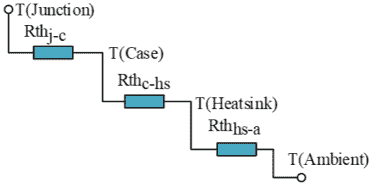
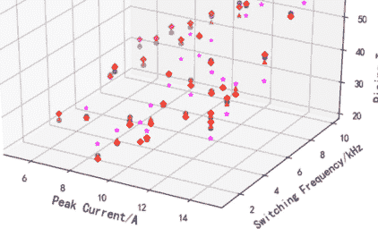
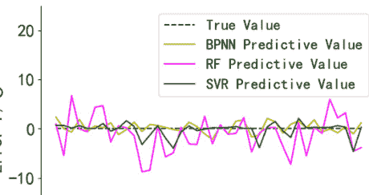

# 2020 IEEE 第9届国际电力电子与运动控制会议 (IPEMC2020-ECCE Asia)(中国南京 2020.11.29-2020.12.2) 2020 IEEE 第9届国际电力电子与运动控制


**摘要—** 可靠性下降近 55% 是由结温升高引起的。IGBT 结温估计是一个需要最小化的关键因素。在本文中构建了包括支持向量回归（SVR）、森林和贝叶斯神经网络（BPN）在内的多种机器学习模型。仿真结果证实并证明了该方法可用，并具有良好的工业应用前景。

*关键词—IGBT 结节温度估计，机器学习，性能评估*

# I. 引言

在功率器件制造技术中，能量转换与传输器件的器件成本以及 IGBT 的优化一直是双方的研究重点。在结温估计领域，基于电路或传感器的传统方法易受环境影响。机器学习的目的是通过数据驱动的方法提高其性能，实现工程自动化并推理现有的知识系统。

在许多功率变流器设计中，工程师经常利用有限元法（FEM）来估计 IGBT 结温。建立机器学习模型的方法与有限元法（FEM）不同。该方法主要基于物理模型，而机器学习是基于我们提出的场景中的数据。当使用机器学习模型时，不需要在器件中建立复杂的数学模型并定义结构参数。机器学习将数据转化为模型，因此具有计算速度快、精度高以及自适应和自学习的能力。在大数据情况下，机器学习学习模型在动态特性和准确性方面比仅使用 FEM 方法更具优势。

基于 ISODATA 的多分类学习模型 [1] 针对 IGBT 动作多个特征参数的内部相关性比使用单一参数的方法具有更好的分类性能。在 [2] 中，提出了一种基于 BPN 和森林的虚拟传感（VS）方法用于 IGBT 电流估计。

机器学习方法分为三步：第一步是特征提取主成分分析（PCA），最后一步是使用交叉验证（CV）方法进行评估 [3]。PCA 也应用于 Park 矢量以解决 q-d 空间的不确定性 [4]，且第一主成分与故障相关。

电力电子系统中使用了许多非线性学习算法，如 [4]–6]。在 RF 中用于将数据分类到输入阶段以发生在哪一阶段。在 [5] 中，使用基于 SVM 的方法预测锂电池的健康状况。在 [6] 中，采用 BPN 方法检测异常模式识别系统以识别缺陷传感器，以确定结中的缺陷类型。

本文的其余部分如下：第二部分描述了仿真模型的建立和三种机器学习算法。第三部分详细分析了仿真结果。最后部分是结论和未来工作。

# II. 估计准备

IGBT 结温估计的过程如图 1 所示。在 ANSYS Icepak 上建立了逆变器的热仿真模型。对整个区域的温度场执行了热仿真分析。

此工作由广东省重点研发计划资助（资助号：2019B0011027007）。

根据上述分析，IGBT 模块的温度由功率损、热阻和环境温度决定。功率损可以简单地计算，但热阻的分析非常困难。因此，本文使用 ANSYS 分析传递模式。根据逆变器的物理结构和数据参数构建了 3D 热模型，如图 3 所示。根据逆变器的实际运行环境，在模型上进行了流固耦合仿真。仿真结果如图 4 所示。


图 1. IGBT 结估计过程

## A. ANSYS Ipecak 仿真

温度 $T_j$ 由公式 (1) 给出，功率半导体器件的热阻如图 2 所示。

```
$T_j = P(R_{th,j} + R_{th,hs} + R_{hs-a}) + T_a \quad (1)$
```


模块功率损



图 3. 逆变器的 3D 热模型


图 2. 瞬态热模型

为了建立热模型，根据逆变器的实际运行环境，在模型上进行了流固耦合仿真。仿真结果如图 4 所示。功率损可以简单计算：

```
$T_j = P(R_{th,j} + R_{th,hs} + R_{hs-a}) + T_a \quad (1)$
```

```
$T_j = P(R_{th,j} + R_{th,hs} + R_{hs-a}) + T_a \quad (2)$
```

```
$T_j = P(R_{th,j} + R_{th,hs} + R_{hs-a}) + T_a \quad (3)$
```

```
$T_j = P(R_{th,j} + R_{th,hs} + R_{hs-a}) + T_a \quad (4)$
```

```
$T_j = P(R_{th,j} + R_{th,hs} + R_{hs-a}) + T_a \quad (5)$
```

```
$T_j = P(R_{th,j} + R_{th,hs} + R_{hs-a}) + T_a \quad (6)$
```

```
$T_j = P(R_{th,j} + R_{th,hs} + R_{hs-a}) + T_a \quad (7)$
```
*(注：由于原文中公式编号存在重复且分布混乱，此处翻译保持了原文逻辑，但在实际工程中建议根据上下文重新核对编号)*

图 1. IGBT 结估计过程

## A. ANSYS Ipecak 仿真

温度 $T_j$ 由 (1) 给出，功率半导体器件的热阻如图 2 所示。

```
$T_j = P(R_{th,j} + R_{th,hs} + R_{hs-a}) + T_a \quad (1)$
```


模块功率损


图 3. 逆变器的 3D 热模型


图 2. 瞬态热模型

为了建立热模型，根据逆变器的实际运行环境，在模型上进行了流固耦合仿真。仿真结果如图 4 所示。功率损可以简单计算：

```
$T_j = P(R_{th,j} + R_{th,hs} + R_{hs-a}) + T_a \quad (1)$
```

```
$T_j = P(R_{th,j} + R_{th,hs} + R_{hs-a}) + T_a \quad (2)$
```

```
$T_j = P(R_{th,j} + R_{th,hs} + R_{hs-a}) + T_a \quad (3)$
```

```
$T_j = P(R_{th,j} + R_{th,hs} + R_{hs-a}) + T_a \quad (4)$
```

```
$T_j = P(R_{th,j} + R_{th,hs} + R_{hs-a}) + T_a \quad (5)$
```

```
$T_j = P(R_{th,j} + R_{th,hs} + R_{hs-a}) + T_a \quad (6)$
```

```
$T_j = P(R_{th,j} + R_{th,hs} + R_{hs-a}) + T_a \quad (7)$
```

## B. 数据采集与预处理

特征选择：电压、电流、环境温度范围分别为 100-400V、1-10kHz、25-50 摄氏度。数据清洗：发现样本异常。数据预处理：归一化这些特征。IGBT 组数据按 8:2 的比例划分为训练集和测试集。训练集用于训练，测试集用于模型性能预测。数据分布如图 5 所示。


## 表 III 优化算法训练结果对比

## 表 IV 预测模型性能对比

| 优化算法 | 激活函数 | RMSE |
|--- |--- |--- |
| SGD | Sigmoid | 14.98 |
| Adam | Relu | 6.78 |
| 拟牛顿法 | Relu | 1.22 |

| 参数 | MAPE | MAE | MSE | RMSE |
|--- |--- |--- |--- |--- |
| SVR | 1.21% | 0.93 | | 2.16 |
| RF | 3.88% | 2.86 | 13.24 | 3.64 |
| BPNN | | 0.97 | 1.39 | 1.18 |

## D. 仿真结果与性能评估

在训练阶段，使用了 10 折交叉验证来来训练这三个模型。三种不同算法的预测结果和误差分别如图 6 和图 7 所示。

- 真值
- BPNN 预测值
- RF 预测值
- SVR 预测值



图 8. 估计结果

可以发现，SVR 和 BP 模型均优于 RF 模型。SVR 的 MAPE 和 MAE 值略小于 BPNN，而其 MSE 和 RMSE 则较大。

结果表明，基于 SVR 或 BPNN 算法的提出的模型适用于 IGBT 结温预测的工业应用。

## IV. 结论与未来工作

温度循环是导致 IGBT 设备疲劳和失效的主要原因，因此有必要保证热设计和设备的优化使用，延长设备寿命并提高可靠性。本研究揭示了 SVR、RF 和 BPNN 算法对 lecap 仿真模型中 IGBT 结温的影响以及上述模型的通用性能。本文获得的结果显示，SVR 和 BP 模型性能优于 RF，SVR 的大多数估计值比 BP 模型更接近真值，但存在几点显著差异；前者优于后者，但稳定性不如后者。通过仿真，SVR 和 BP 模型可用于研究模块运行期间结温的变化。

未来的工作将开展进一步研究，通过实验评估这些模型的可性。此外，进一步的研究将提高这些模型的准确性并获得更好的估计结果。物理实验将在后续论文中给出。

## 致谢

这项工作受广东研发基金支持（No.2019B001171001）。

## 参考文献

- [1] R. Quan, H. Li, Y. Hu, and P. Gao, "An IoT health evaluation method based on multi-label classification," IEEE Access, vol. 7, p. 47924–47932, 2020.
- [2] Z. Chen, J. Li, Q. Guo, M. Chen, Z. Li, and B. Zhang, "Novel visual sensing with neural networks and clustering for cluster improvement," IEEE Transactions on Electronics, vol. 65, no. 6, p–7352, 2019.
- [3] J. Sun, L. Liu, A. Ma, and S. Gong, "Fault diagnosis in electric driving using machine learning," in 2013 IEEE International Electric and Drives Conference (IEMC). IEEE, 2013, pp. 1–6.
- [4] T. dos Santos, F. J. Ferreira, J. P. Gomes, and D. Can-Assis, "Statistical de fault diagnosis in wind turbines using random forest," in 2017 IEEE International Electric and Drives Conference (IEMC). IEEE, 2017, pp. 1–8.
- [5] M. Vasqueira, J. Silva, and P. Xu, "Health prediction of lithium batteries using internal capacity analysis and support regression," in 2019 IEEE Milan PowerTech., IEEE, 2019, pp. 1–6.



图 9. 估计曲线

表 IV 所示了用于评估预测结果的包含绝对百分比误差（MAPE）、平均绝对误差（MAE）、均方根误差（RMSE）的四个模型属性。

- [6] S.-C. Lin and Y. Huang, “Application of bpsn algorithm to learning high dimensional features for solving induction motor defect problems,” in 2017 International Conference on System Science and Engineering (ICSSE). IEEE, 2017, pp. 460–464.

