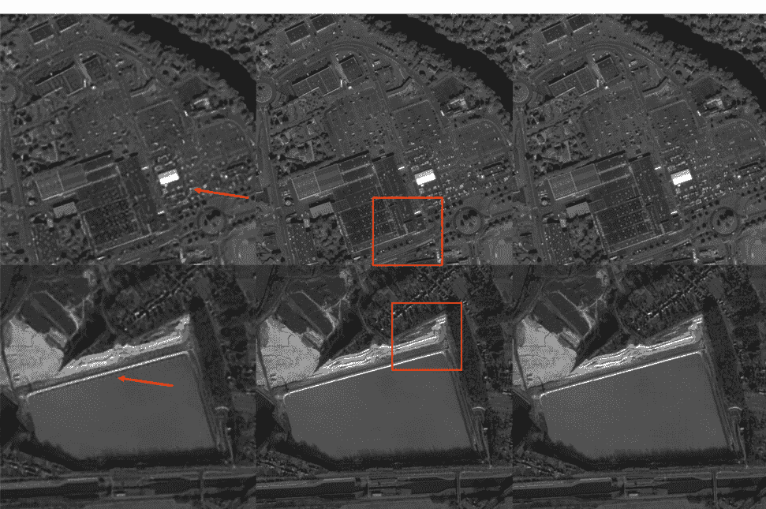
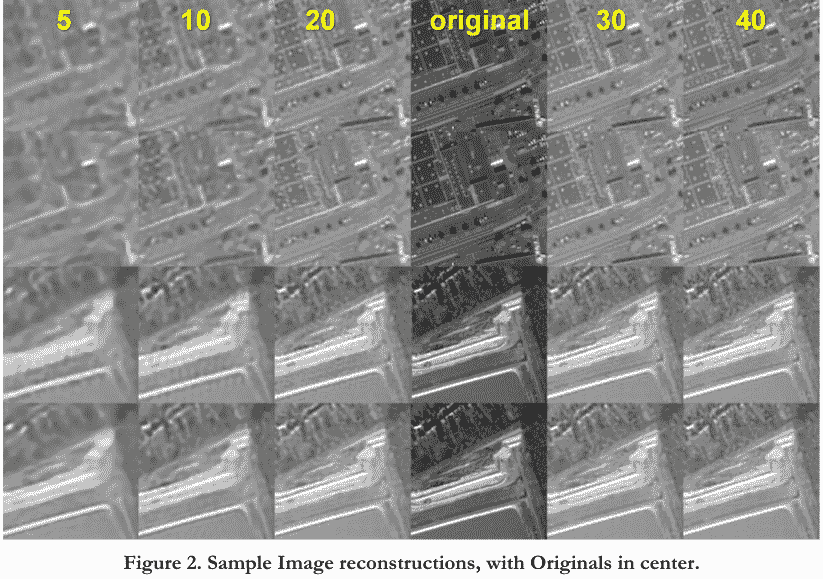

# 2020 IEEE 应用图像模式识别研讨会 (AIPR) (美国华盛顿特区 2020.10.13-2020.10.15) | 机器学习，压缩

**a** The Charles Stark Draper Laboratory, Inc., 1943 Newton Square East, Reston, VA, 20190

**b** The MITRE, 2021lington Road, Bedford, MA 01730-1420

**c** The Charles Stark Draper Laboratory, Inc., 555 Technology Square, Cambridge, MA 02139

## 摘要

将机器学习（ML）模型整合到闭环工作流中的当前趋势，使图像压缩和重构的现有问题再次出现；特别是与生成环系统操作的匹配问题。我们的论文回顾了在重构过程中评估内容的方法，以维持对闭环工作流的信任。我们将常见的 ML 架构结构化为自编码器（Autoencoders）的形式。自编码器常用于研究图像重建。例如，图像的可解释性是提高分辨率的原因——分辨率越高，人类执行任务的能力就越强。从历史上看，国家图像解释性评级（NIIRS）一直是人类观察者量化情报潜力的标准。实验研究表明，空间分辨率是图像 NIIRS 的主要预测因子，而压缩到每像素 1 位可以保持 NIIRS 水平。然而，随着 ML 对图像进行数字化处理而非提取，那么维持 NIIRS 水平所需的相应图像大小是多少？为了解决这个问题，我们需要在 `480x480` 的中等尺寸上进行操作，以便对针对小精灵尺寸图像（`< 100x100` 像素）的实验提供更真实的估计。

在 20 世纪 90 年代，NIIRS 需要扩展热红外以及反射区域获取的多光谱图像。此外，NIIRS 是被查看的标准 [30]。

图像采集已经演变。先进传感器面临来自多个光谱区域和运动图像的海量数据。自动初级处理提示操作员在经过确认后根据需要采取行动。学习算法已经发展为数字化图像而非提取特征，目标是提高跨过程的表征和一致性。因此，需要重新思考 NIIRS 人类感知范式以进行有效探索。为了应对这一挑战，我们探索了开发学习标准方法的可行性。此外，我们寻求一种能够涵盖各种成像材料和类型的新标准。这里提出的初步调查表明，任何新标准除了目标表征外，还必须适应模型架构。

# 1. 引言

图像质量是军事和安全任务潜在情报价值的关键。质量差的图像将为分析和决策提供必要的信息。人类分析图像时，国家图像解释性评级（NIIRS）是量化图像情报潜力的标准 [1]。原始 NIIRS 使用图像分析由人类查看静态图像组成 [2]。因此，图像可解释性的首要决定因素是数据的情报价值。

## 2.1 假设

我们探索了卷积自编码器（CAE）作为表征图像质量工具的作用。其中一个假设是建立：与相同规模的网络相比，在每一层使用较大窗口（`7x7`）训练的 CAE 比使用较小窗口（`3x3`）训练的 CAE 保留了更多的信息。预期是 `7x7` 窗口为特征捕获了更多可用空间，从而获得更高质量的结果。调查的第二个方向是捕捉图像数据库中包含信息的最小空间大小。

## 2.2 图像数据库

目前的许多自编码器研究 [4] [5] 集中于小格式图像，通常为 `100x100` 像素或更小。许多目标模型是使用较大的片段训练的。¹ 此外，由于属性有限，小图像无法进行信息内容评估。特别是，手写数字的美国国立标准与技术研究院（MNIST）数据库 [6] 包含约 30% 的未使用变化像素。²

我们的数据库由灰度 `480x480` 像素组成（图 1）。

## 2.3 网络架构

| 层层 | 1 | 2 | 3 | 4 | 5 | 6 | 7 | 8 |
| --- | --- | --- | --- | --- | --- | --- | --- | --- |
| 窗口 (x,y) | (480,480) | (240,240) | (80,80) | (40,40) | (40,40) | (80,80) | (240,240) | (480,480) |
| 滤波器 | 1 | 20 | 32 | 64 | [1,600-64,000] | 204,000 | 31,360 | 20 | 1 |
| 特属性 | 230,400 | 1,152,000 | 204,000 | 102,400 | 125,440 | | 1,152,000 | 230,400 |
| 训练参数 | 180, 980 | 5,760, 31,360 | 18,432, 100,352 | 2,880, 125,440 | 5,760, 62,720 | 3,600, 19,600 | 181, 981 |
| 卷积窗口 | 3x3, 7x7 | 3x3, 7x7 | 3x3, 7x7 | 3x3, 7x7 | 3x3, 7x7 | 3x3, 7x7 | 3x3, 7x7 | 3x3, 7x7 |
| 步长 | 卷积 2x2 | 卷积 3x3 | 卷积 2x2 | 卷积 1x1 | 上采样 2x2 | 上采样 3x3 | 上采样 2x2 | 1x1 |
| 批归一化 | 是 | 是 | | | 是 | | | 否 |

# 3. 结果

分析侧重于对“父”图像到自编码衍生数据所诱发的各种表示进行实证表征，我们使用 `SSIM` 和 `MSE` 量化图像质量损失。线性模型表明，`SSIM` 为质量损失提供了更清晰的指示，但两个指标与自编码器处理均显示出明显的关系（表 3 和 4）。在两种情况下，潜空间的大小和父图像的 NIIRS 都是预测处理图像指标的显著因素。然而，滤波器尺寸显示出较弱的关系。转而分析，我们对处理图像的 NIIRS 进行了建模，发现 `SSIM` 一同父图像的 NIIRS 为处理图像的 NIIRS 水平提供了极佳的预测（表 5）。

## 表 3. SSIM 的线性模型

| 因子 | 系数 | t 统计量 | P 值 |
|---|---|---|---|
| 截距 | 0.6443 | 91.97 | < 0.0001 |
| 潜空间大小 | 0.006567 | 47.52 | < 0.0001 |
| 滤波器尺寸 | 0.001484 | 1.6 | < 0.0001 |
| 父图像的 NIIRS | 0.01324 | 12.52 | < 0.0001 |
| R方: 0.487 | | | |

## 表 5. 处理图像 NIIRS 的线性模型

| 因子 | 系数 | t 统计量 | P 值 |
|---|---|---|---|
| 截距 | -0.116 | -4.74 | < 0.0001 |
| SSIM | 0.259 | 6.13 | < 0.0001 |
| 父图像的 NIIRS | 0.995 | 42.11 | < 0.0001 |
| R方: 0.997 | | | |

对图像的视觉检查表明，自编码器对图像有实质影响，当潜空间清晰时，锐度的损失显而易见。实证分析证实了这一发现。对基线和处理后的图像应用检测器证明了这一现象（图 3）。忠实重建取决于潜空间的大小，边缘的保留是一个关键指标。同样，`SSIM` 是衡量随潜空间大小丢失信息的有用标准（表 6）。

## 表 4. MSE 的线性模型

| 因子 | 系数 | t 统计量 | P 值 |
|---|---|---|---|
| 截距 | 28.29 | 44.99 | < 0.0001 |
| 潜空间大小 | -0.402 | -32.42 | < 0.0001 |
| 滤波器尺寸 | -0.149 | -1.87 | |
| 父图像的 NIIRS | -0.636 | -6.70 | |
| R方: 0.302 | | | |

## 表 6. SSIM 与潜空间的关系

| 潜空间大小 (尺寸) | 5 (3x3) | 10 (3x3) | 20 (3x3) | 30 (3x3) | 40 (3x3) | 5 (7x7) | 10 (7x7) | 30 (7x7) | 40 (7x7) |
|---|---|---|---|---|---|---|---|---|---|
| 平均 SSIM | 0.94 | 0.92 | 0.88 | 0.80 | 0.69 | 0.93 | 0.92 | 0.89 | 0.71 |
| SSIM 标准差 | 0.04 | 0.05 | 0.08 | 0.13 | 0.05 | 0.05 | 0.07 | 0.10 | |

图 3. 基线与处理后图像的边缘

图 4. 潜空间大小的关系

# 4. 结论与未来方向

CAE 对图像有显著影响，当潜空间清晰时，锐度的损失显而易见。我们提出的方法可以根据潜空间的大小灵活表示图像。未来的研究将寻求对（RGB）图像、热红外图像进行细化，并建立带宽需求。

# 5. 致谢

# 6. 参考文献

- [1] J. Leachaauer and R. Dirgers, *Surveillance and Reconnaissance Imaging Systems: Modeling and Performance*, Boston: Artech House, Inc., 2001.
- [2] J. Irvine, "National Interpretability Scale," in *Encyclopedia of Optical Engineering*, New York: Marcel Dekker, 2003, pp. 1442-1456.
- [3] J. Irvine, A. Aviles, D. Cannon, C. Fenimore, D. Haver, S. Israel, G. O’Brien and J. Roberts, "Developing an Interpretability Scale for Motion Imagery," *Optical Engineering*, vol. 46, no. 11-11740, 2007.
- [4] A. Dosovitsky and T. Broks, "Generating Images with Perceptual Similarity Metrics based on Deep Networks," [arXiv:1602.02644](https://example.org/abs), 2016.
- [5] A. Makhzani, J. Shlens, N. Jaitly, I. Goodfellow and B. Frey, "Adversarial Autoencoders," [arXiv:1511.05644](https://example.org/abs), 2016.
- [6] Y. LeCun, L. Boutvou, Y. Bengio and P. Haffner, "Gradient-based learning applied to document recognition," in *Proceedings of the IEEE*, 86, 1998.
- [7] G. O’Brien, S. Israel, J. Irvine, C. Fenimore, J. Roberts, M. Brennan, D. Cannon and J. Miller, "Metrics to Estimate Quality in Compressed Video Sequences," in *SPIE Defense and Security Symposium*, 6546, Orlando, 2007.
- [9] J. Irvine and S. Israel, "Chapter 3: How Much to Compress: Interpretability Loss from Compression," in *Video Compression*, ISBN: 778-953-51-0422-3, InTech Open Science, 2012.
