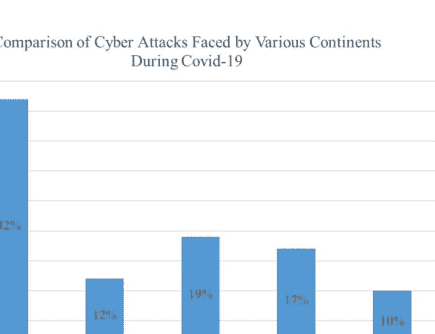
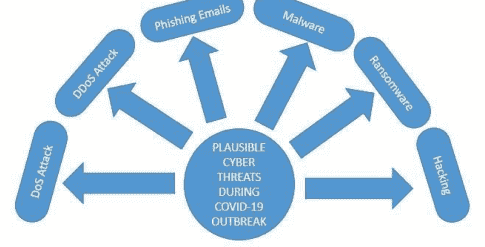
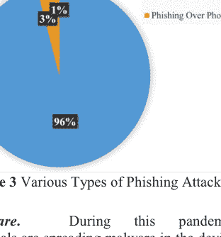

# 2020 IEEE 亚太计算机科学与数据工程会议 (CSDE) (澳大利亚黄金海岸 2020.12.16-2020.12.18)

Jabmer Ahmed

Quddus Tushar

墨尔本理工大学（RMIT University）工程学院

PO Box 2476, Melbourne VIC 3001, Australia

电子邮箱：quddus.tushar@rmit.edu

孟加拉陆军，信号基地工作坊

达卡军营, 达卡, 孟加拉

电子邮箱：jas7040@gmail.com

**摘要—** 在本文中，我们讨论了当前 COVID-19 疫情下全球面临的网络安全威胁。为了阻止冠状病毒的传播，全球几乎所有国家都宣布了封锁。人们远程在办公室、学校和公司工作。因此，计算机和互联网的使用量大幅增加，使网络犯罪分子变得更加活跃。近期，攻击数量有所增加，每个人都成了网络犯罪分子的目标。在访问互联网时缺乏个人预防措施，对每个人都造成了重大威胁。COVID-19 让网络犯罪分子能够入侵银行部门，政府非政府组织在此期间面临了多次网络攻击。本文重点关注某些安全防护措施，以保护个人和组织数据免受网络攻击。

**索引术—** COVID-19、网络攻击、网络钓鱼、恶意软件、DDoS 攻击、勒索软件。

## I. 引言

COVID-19 的传播实际上定义了 2020 年，世界正遭受其扩散之苦。几乎所有国家都处于封锁状态，政府要求国民在家里继续日常工作。为了阻止传播，大多数机场和边境已经关闭。这场 COVID-19 大流行迫使人们包括业务在内的所有部门实施“新常态”，以便在家办公并远程参加办公室课程。在这种情况下，信息和通信技术在满足需求 [1] 方面发挥着至关重要的作用。这种在线业务模式交付和他们所需的日常物品互联网和移动应用程序成为每个人的首选，使他们容易受到网络攻击者的侵害。近期几乎所有国家都面临着网络威胁。图 1 显示了 2020 年因大疫情引起的网络攻击研究。

图 1 各大洲面临的网络攻击

网络犯罪分子正利用这一局面来利用其恶意动机，网络威胁日益增加。如此，网络安全正在发展，并成为全球社区关注的重要关注点 [2]，而世界各地的人们受到了各种网络威胁。图 2 显示了大流行期间可能的网络威胁。

图 2 COVID-19 大流行期间可能的网络威胁

本研究论文的其余部分结构安排如下：第二节描述了过去的相关工作，其中概述了过去对疫情部门可能面临的网络攻击的研究；第三节简要解释了可能面临网络攻击的疫情网络威胁，以及在大流行期间可能遇到的可信网络威胁。第四节展示了克服网络安全威胁的全面方法。作者得出的结论可在第五节中发现。

暗网上的账户正受黑客控制。同样，`Google Duo`、`Microsoft Team` 在流行期间也容易受到网络攻击。在这次 COVID-19 大流行期间，安全部门受网络攻击/网络威胁的影响最为严重。

## II. 相关工作

Khan 等人提出通过加密和钓鱼来拒绝网络威胁，并发现了隐私关注问题 [1]。它还识别出少数在流行期间似乎受到网络攻击影响的部门。Krály 等人发现，信息和通信技术（ICT）有助于减轻大流行期间的心理压力。该论文侧重于使用 ICT 与家人交流，并将 ICT 称为“救救星”。另一方面，除 ICT 之外，游戏也帮助人员利用网络威胁以用户为目标。Lillie 等人通过案例研究展示了 COVID-19 爆发期间的网络攻击，并在其中描述了网络犯罪分子是如何设计其计划的。Williams 等人证明，在 COVID-19 大流行之后，网络安全成本将在 2021 年前增加三倍 [5]。它强调了医疗保健部门，该部门的网络威胁产生了巨大的长远影响。Akbari 等人为居家办公提议了一些安全协议，以确保恰妥的网络安全 [6]。这些协议可能帮助用户在流行期间免受网络攻击的侵扰。

### A. 受影响的部门

在这次 COVID-19 大流行期间，几乎所有部门都面临着持续的网络安全威胁。本部分描述了受影响最严重的部门。

1.  **医疗与卫生部门**。黑客和入侵者知道，在大流行期间，世界的医疗系统是一团乱麻。由于许多人为了财务利益而使用远程护理，黑客在访问全球医疗系统方面变得活跃。英国国家网络安全中心（NSC）和美国安全和基础设施安全局（CISA）可能会因患者个人数据而受到攻击，并发送了钓鱼邮件。在大流行期间，医疗系统更容易受到网络攻击者的侵扰。世界卫生组织（WHO）在这一期间面临了多次网络攻击。COVID-19 大流行期间医疗系统受到严重影响，以确保恰妥的网络安全。这些协议可能帮助用户在流行期间免受网络攻击的侵害。

2.  **金融部门**。在这次 COVID-19 大流行期间，几乎所有部门都面临着持续的网络安全威胁。本部分描述了受影响最严重的部门。这种在线业务模式交付和他们所需的日常物品互联网和移动应用程序成为每个人的首选，使他们容易受到网络攻击者的侵害。

## III. 受影响的部门与威胁

在这次 COVID-19 大流行期间，几乎所有部门都面临着持续的网络安全威胁。本部分描述了受影响最严重的部门。

1.  **医疗与卫生部门**。黑客和入侵者知道，在大流行期间，世界的医疗系统是一团乱麻。由于许多人为了财务利益而使用远程护理，黑客在访问全球医疗系统方面变得活跃。英国国家网络安全中心（NSC）和美国安全和基础设施安全局（CISA）可能会因患者个人数据而受到攻击，并发送了钓鱼邮件。在大流行期间，医疗系统更容易受到网络攻击者的侵扰。世界卫生组织（WHO）在这一期间面临了多次网络攻击。COVID-19 大流行期间医疗系统受到严重影响，以确保恰妥的网络安全。这些协议可能帮助用户在流行期间免受网络攻击的侵害。

2.  **金融部门**。在这次 COVID-19 大流行期间，几乎所有部门都面临着持续的网络安全威胁。本部分描述了受影响最严重的部门。这种在线业务模式交付和他们所需的日常物品互联网和移动应用程序成为每个人的首选，使他们容易受到网络攻击者的侵害。

## IV. 受影响的部门与威胁

在这次 COVID-19 大流行期间，几乎所有部门都面临着持续的网络安全威胁。本部分描述了受影响最严重的部门。这种在线业务模式交付和他们所需的日常物品互联网和移动应用程序成为每个人的首选，使他们容易受到网络攻击者的侵害。

## V. 克服网络威胁的全面方法

我们的生活现在因为 COVID-19 大流行而处于危险之中。人们由于待在家里而感到心理压力，并试图通过在线活动减轻压力。另一方面，网络犯罪分子也更多……

### B. 预防网络攻击

1.  **预防 DDoS 攻击**。为了防止 DDoS 攻击，组织必须维护防火墙。入站/出站过滤有助于检测 IP 地址范围以控制流量。

2.  **恶意软件**。在大流行期间，网络犯罪分子正向设备中传播恶意软件。这种 导致导致了勒索软件。网络犯罪分子通过这种方式获取个人数据。

#### A. 预防网络攻击的初始步骤

1.  **Step1** 设备必须安装最新的防病毒软件。
2.  **Step2** 维护防火墙。
3.  **Step3** 不要使用盗版软件。
4.  **Step4** 避免使用未知的网站。
5.  **Step5** 在浏览器中维护你的用户名和密码。
6.  **Step6** 不要点击邮件链接。
7.  **Step7** 使用以 `https://` 开头的网站是安全的。
8.  **Step8** 永远不要在浏览器中保存信用卡。
9.  **Step9** 在完成支付前检查地址。
10. **Step11** 密码必须足够强大，不应匹配日期或数字（如你的生日）。
11. **Step12** 使用操作系统（OS）。
12. **Step13** 更新你的操作系统。

图 3 各种类型的网络钓鱼

转向新路径，且防火墙应保持开启 [18] 待在家里。网络犯罪分子有机会利用人们对互联网的大量使用来从中获利。由于对网络安全知识的匮乏，这场疫情导致网络威胁的增加。

3.  **预防勒索软件**。勒索软件是一种恶意软件，仅为了财务利益而劫持设备中的数据。更新的病毒杀毒软件是面向终端用户的。你可以为勒索软件提供更新的补丁文件。

我们必须对网络威胁和可能的网络攻击有最基本的了解。不同的政府和组织都受到了网络攻击的影响。因此，为每位员工教授基本的网络安全知识已成为首要要求，以防止持久性的后果。

4.  **预防黑客攻击**。为了防止黑客攻击，可以采取以下措施：

- 不要向任何人透露你的用户名和密码。
- 密码应该足够强，无法被轻易破解。
- 不要共享账户详情。

COVID-19 仅仅是一个开始。未来世界可能会面临更多病毒。因此，现在是时候为未来规划了。我们应该从 COVID-19 大疫情中吸取教训，并为未来做好准备。网络安全可能不会为世界带来更多东西。

### C. 传授足够的网络威胁的知识

在当前的情况下，每个人都必须具备足够的网络安全知识。遗憾的是，大多数人对这一主题一无所知，许多即使面临明显的网络威胁也是如此。这造成了一个真空，使得网络攻击和犯罪能够通过这种方式完全实现其动机。进行了一项调查，以评估百名大众对网络威胁的了解程度。结果如表所示。

## 参考文献

- [1] N.A. Khan, S. Rohni, N. Zaman, Ten Deadly Cyber Threats Amid COVID-19 Pandemic (2020).
- [2] C.I. Lian, L. Yang, M.Y.X, L.Y. Hi, Z. Fatima, Cyber Attacks in the Era of COVID-19 and Possible Solutions, Donkvin (2020).
- [3] O. Karaly, N.M. Potenza, D.J. Stein, L.C. Ding, D.D. Hopkins, J.A.B. Sanders, G. Pribmatic, J. Billeaux, M. Brand, imparting adequate internet security using the COVID-19 pandemic Guidance Comprehensive Psychiatry (2020) 152180.
- [4] H.S. Sallie, L.A. Sheppard, J.R. Arula, E. Gola, iphan, C. Maple, K. Belkek, Cyber security in the age of COVID-19: a timeline and analysis of cyber and cyber-crime attacks during the pandemic, arxiv:2020.11929 (2020).
- [5] C.M. Kumar, R. Raturvee, K. Chakravarthy, Cybersecurity Risks in a Pandemic, Journal of Medical Internet Research 22(9) (2020).
- [6] A.M. Abukari, E.K. Banks, Some cyber security protocols for workers in COVID-19 pandemic and operational, International Journal of Scientific & Engineering Research 18(4) (2020) 1401-1407.
- [7] W. Zakaria, Worst policies for security issues and frames fixes, [Online] Available at: https://www.com/news/technology-52133349- [Accessed May 2020].
- [8] H. II, WHO who reports fever outbreak in cyber attacks, surges virus, people. (2020).
- [9] J. Malali, A. Landon, W. Gordon, Telemedicine, privacy, and information security in the age of COVID-19, Available at SSRN 3653230 (2020).
- [10] F. Baker, A. Harris, J. Hyat, K.K. Seek, J.S. Ju, COVID-19 & Cyber Security Challenges, USA, & Korea.
- [11] A. Wu, Y. Chen, M. Li, X. Luo, Z. Liu, L. Liu, Survive and

| 表 1 基于少量问卷的调查报告 | | |
|---|---|---|
| 问题 | 错误答案 | 正确答案 |
|---|---|---|
| 什么是网络钓鱼？ | 27% | 73% |
| 什么是 Dos 和 DDoS 攻击？ | 21% | 79% |
| 什么是恶意软件？ | 18% | 82% |
| 什么是勒索软件？ | 22% | 78% |
| 什么是黑客攻击？ | 36% | 64% |

## VI. 结论

本研究试图关注 COVID-19 疫情期间的网络威胁。这场疫情期间互联网的使用率达到了最高峰。全球范围内所有人通过互联网继续交流、工作和教育。这场疫情也测试了每个人的压力水平。互联网帮助减少了他们的安全威胁。这场疫情让人们能够居家办公、继续课程以及进行所有其他活动

- [12] Thrive: A Stochastic Game for DDoS Attacks in Bitcoin Mining Pools, IEEE/ACM Transactions on Networking 28(2) (2020) 874-887.
- [13] S. Mansfield-Devine, The growth and evolution of DDoS, Network Security 2015(10) (2015) 13-20.
- [14] R. Naidooo, A multi-level influence model of COVID-19 themed cybercrime, European Journal of Information Systems (2020) 1-16.
- [15] S. Hakak, Z. Khan, M. Imran, K.-K.R. Choo, M. Shoaib, Have you been a victim of COVID-19-related cyber incidents? Survey taxonomy, and mitigation strategies, IEEE Access 8 (2020) 124134-124144.
- [16] J.P. UPATHAM, J. Treinen, Amid covid-19, global orgs see a 148% spike in ransomware attacks; finance industry heavily targeted, 2020.
- [17] V.E. Bakas, R. Kumar, R. Srivastava, Recent Trends and Advances in Artificial Intelligence and Internet of Things, Springer2020.
- [18] M.P. Grounder, M. Farik, New Ways To Fight Malware.
