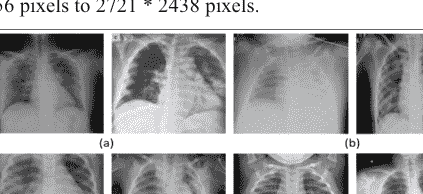
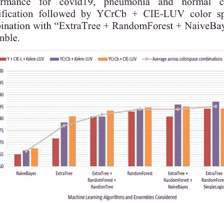

# 2020 IEEE 孟买分区签名会议 (IBSSC) ｜｜基于机器学习分类的 Covid19 识别


**摘要** 新冠病毒的爆发对整个全球经济造成了灾难性的后果，导致了健康和财富的巨大损失。在这场疫情期间，数百万人遭受了巨大痛苦，特别是 Covid-19。随着传播速度呈指数级增长，许多机构寻求快速检测疑似病例。可以通过个人的胸部 X 光图像判断新冠病毒感染。本文了一种基于特定色彩空间的全局特征提取方法来识别 covid19 感染病例。特征从 YCrCb、KeVC-LU 和 CIE-UV 色彩空间中提取。这些特征用于训练机器学习模型。10 帧卷积的结果显示其优于单一的机器学习（ML）分类器。通过考虑准确率（Accuracy）、正预测值（PPV）、灵敏度（Recall）、F 分和马修斯相关系数（Matthew correlation），所提方法的性能提升了 19%。

新冠病毒导致医疗机构在检测 Covid19 感染方面面临严重困难。通常，使用胸部 X 光是诊断肺肺炎的最优方法。即使是胸部 X 光也能更容易区分由球菌性肺炎或病毒性肺炎引起的肺部。

**关键词** X 光、颜色、色彩空间、特征提取、机器学习、新冠病毒、集成学习

在本研究中，论文尝试通过机器学习和集成模型利用直方图计算来识别新冠病毒和正常病例。文章结构如下：第 1 节介绍了 covid19；第 2 节包含目前的相关工作，即文献综述；第 3 节涵盖了所提的方法；第 4 节提供了实验和环境信息；第 5 节讨论了结果；第 6 节总结全文。

# I. 引言

2019 年左右，革命之武汉武汉发现了世界上第一例 covid19（新冠病毒）病例。它也被称为新型严重急性呼吸系统综合病毒（SARS-CoV-2）。中国疫情的新冠病毒传播导致了全球大流行。现在，已有数百万人死于新冠病毒，而全球经济因提供即时医疗治疗、隔离或检疫感染病例、保持社交距离以及关注感染期间出现的早期轻微症状而陷入了衰退。

世界卫生组织（WHO）近期发布了在新冠病毒感染轻微阶段应被观察的症状列表。相比之下，发热、呼吸困难、咳嗽或病毒性流感肺炎等一般症状也与之对应。全球大流行导致了出血、寒战、肺部肺炎等急性肺炎。肺部感染区域充满了脓液，导致咳嗽和呼吸困难的形成。由于，在识别 covid19 时症状各不相同。通过使用胸部 X 光，肺炎的主要困难在于肺部感染和肺炎之间的相似性。主要的困难在于判断一个病例是病毒性肺炎还是细菌性肺炎。这包括对用于 covid19 识别的所提方法的综述。

# II. 文献综述

作者提出了一种通过 Haralick 特征提取对正常感染和肺炎进行分类与识别的新方法。特征从总共 22 张胸部 X 光图像中提取，其中 11 张被检测为正常（健康）肺部，11 张图像为肺炎感染。在 X 光图像上使用了 Haralick 特征提取方法，判断这些值之间的差异，并认为在计算出的 14 个特征中，3 个特征（方差、总平均和总和）最受关注，其余 11 个特征彼此几乎相似。

作者在 [2] 中提出了一种新的层次方法来识别 covid19。他们发现了一个名为 RYLDS 的数据集，包含总共七类 X 光（层次框架）。从开始，使用不同的纹理结构用于分类器（层次框架）。多类分类取得了更好的结果。

# III. 所提方法：使用具有亮度色度特征的直方图通过机器学习分类器进行 Covid19 识别

另一种方法使用了名为 COVID19 的深度卷积网络，通过直方图识别（CVR）来识别感染病例。作者使用了一个名为 COVIDAX 的数据集，包含 13,975 张 X 光。所提网络架构通过结合设计原理和机器学习驱动原理，covid19 的灵敏度为 80%，正常病例为 95%。通过图 1 形象地展示了所提方法。

色彩空间计算 covid19 特征的详细解释在本节中描述。

最先进的深度技术在 [4] 中提出，用于识别细菌性肺炎。X 光图像中的肺炎云使用直方图均衡化（CLAHE）和其他保护肺部边缘的双侧滤波进行识别。灰度激活和显著性映射已用于交叉验证，准确率达到 98.3%。所提数据集用于 Mendeley Data，并分为两类：细菌性肺炎感染和正常。


为了识别感染病例，作者在 [5] 中实现了预训练卷积神经网络（InceptionV3、ResNet 和 Inception）的迁移学习方法。X 光辐射使用 5 折交叉验证进行分析。根据结果，Res50 提供了最佳性能，准确率达 98%。所提方法基于数据集 [6]，该数据集包含 50 张正常和 50 张感染病例的 X 光图像。

图 1 所提分类技术的框图，由使用机器学习算法集成的响应色彩组合的直方图计算组成

作者在 [7] 中尝试使用 OTSU 阈值法和直方图计算自动诊断肺炎感染。日本放射线学会（JRT）数据集用于所提方法的分析，总共 40 张胸部 X 光图像。胸部 X 光图像进行缩放，并在感兴趣区域（ROI）计算直方图。在该 ROI 中，使用 OTSU 阈值法检测肺炎云，然后计算无云区域与总肺部区域的比例。[7] 中的所提方法包括比例计算和肺炎感染识别的特征计算。

该方法分为两个阶段：训练阶段和测试阶段。在训练阶段，将 covid19 数据集的三通道 X 光图像转换为单个色彩空间 YCB [8]、keV-KUV [9-11] 和 CIE-UE [12]。转换后，通过不同的色彩空间组合计算三种不同的特征。通过计算特征直方图进行变换：keV-KUV、然后每个 YCB 的特征向量长度，以及 CIE-LUV 色彩空间。

这三个特征用于训练机器学习分类器，并产生训练良好的模型。评估的单一机器学习分类算法为：
 ExtraTree
- 来自森林家族的 RandomForest
- 集成学习：
    - ExtraTree + RandomForest + SimpleLogistic
    - ExtraTree + RandomForest + NaBayes
    - ExtraTree + RandomForest + RandomTree


在测试过程中，样本胸部 X光的计算特征被提供给已训练的机器学习分类器或集成模型，用于 covid19 的识别。

Waikato 知识分析环境（WEKA）[14] 是一种机器学习工具，用于对所提出的从输入 X 光检测 covid19 的方法进行实验（训练和测试阶段）。WEKA 是一个提供了多种机器学习算法和数据预处理工具的工具。使用 Python 3 编程语言从图像中提取特征。

Covid19 数据集 [6] 由 4 类标记的胸部 X 光图像组成。该数据集总包含 50 名患者的 240 张三通道胸部 X 光图像。数据集由 covid 类（60 张）、正常类（60 张）、肺炎类（60 张）和细菌性肺炎类 pneumonia_bac（60 张）组成。所有图像的大小并不相同，尺寸范围从 456 到 2721 * 2438 像素。

## IV. 实验

本节讨论了所提出的胸部 X 光检测 covid19 方法的效能，总体通过关键性能指标：测试准确率、预测值（精确率）、灵敏度（召回率）、F 值和 MCC。图表展示了在整体机器学习算法和颜色空间组合下，单独考虑各个指标的性能。

| 类别 | 分类器或集成模型 | 准确率 | PPV | F 值 | MCC |
|---|---|---|---|---|---|
| normal | 集成 | 87.2 | 80.4 | 75.9 | 69.3 |
| covid19 | Extreme+RandomForest+Naive | 91.7 | 89.4 | 87.9 | 81.4 |
| pneumonia | 集成 | 94.2 | 89.7 | 78.6 | 73.1 |
| pneumonia_bac | Extreme+RandomForest+Simple | 96.4 | 92.2 | 90.3 | 85.1 |
| covid19_bac | 集成 | 97.8 | 94.6 | 92.2 | 88.6 |

### 表 1 分类结果



图 2 来自 covid19 数据集的 X 光图像样本 (f)，由以下四组组成：(a) 代表 covid19，(b) 包含肺炎，(c) 代表 pneumonia_bac 以及 (d) 包含正常胸部 X 光图像。

表 1 展示了性能最佳机器学习分类器或集成模型的三个颜色组合。可以清楚地识别出，YCrB+Kek-LUV 颜色空间结合“Extreme+Random+SimpleLogistic”在 covid19、肺炎和正常类分类中表现最佳，而 YCrB+CIE-LUV 颜色空间组合次之。

在实验时，属于 pneumonia_bac 的 X 光图像被分类并重新标记为肺炎。使用 10 折交叉验证对所提方法进行评估。Dr. Joseph Cohen 在 GitHub 上展示了每个类的少量代表性示例，链接可在 [6] 中找到。



用于识别 covid 所提方法的性能指标包括准确率、预测值（精确率）、灵敏度（召回率）、F 值和相关系数（MCC）。计算识别性能的数学公式如下：

```
Accuracy (%) = \frac{TP}{TP + TN} * 100
PPV (%) = \frac{TP}{TP + FP} * 100
Sensitivity (%) = \frac{TP}{TP + FN} * 100
MCC (%) = \frac{TP * TN}{(TP + FP) + (TN + FN)} * 100
F Measure (%) = \frac{2 * TP}{2 * TP + FP + FN} * 100
```

图 3 表示了上述各个机器学习算法和集成模型在三种颜色空间组合下的准确率百分比柱状图。在这里，集成模型 Extreme+Random+SimpleLogistic 在所考虑的集成和机器学习算法中表现最好。表 2 概述了所有颜色空间计算出的平均性能准确率。


### 表 2
不同颜色组合在相应机器学习算法和集成模型下跨越三个类别的平均性能准确率 (%)

| 机器学习算法与集成模型 | Y+CIE-Lek-LUV | YCrCb + Kek-LUV | YCrCb + CIE-LUV |
|---|---|---|---|
| NaiveBayes | 65 | 66.67 | 67.5 |
| ExtraTree | 71.667 | 78.833 | 80.6 |
| ExtraTree + RandomForest | 80.833 | 80.833 | 83.1 |
| RandomForest | 82.917 | 84.167 | 84.5 |
| ExtraTree + RandomForest + NaiveBayes | 80.833 | 85.833 | 85.1 |
| ExtraTree + RandomForest + SimpleLogistic | 84.167 | 85.833 | 85.1 |
| 平均值 | 77.57 | 80.486 | 82.093 |

上述机器学习算法和集成模型。YCrB+Kek-LUV 颜色空间组合对 covid19 的识别准确率最高，紧随其后的是 YCrCb 颜色空间。RandomForest+SimpleLogistic 超过了其他考虑的算法。同样，YCrCb 颜色空间组合组合了最高的预测值 (PPV)。


## 表 6
马特克斯斯相关系数 (%)
不同颜色空间组合针对三类别的机器学习算法与集成方法的表现

| 机器学习算法与集成方法 | Y+CIE-L+CIE-LUV | YCr+CIE-LUV | YCrCh+CIE-LUV |
| :--- | :--- | :--- | :--- |
| 朴素贝叶斯 (NaiveBayes) | 50.8 | 52.4 | 54.1 |
| 额外随机树 (ExtraTree) | 54.6 | 65.9 | |
| ExtraTree+随机森林+随机森林 | 68.9 | 65 | 73 |
| 随机森林 | 72.5 | 74.7 | 75.4 |
| ExtraTree+随机森林+朴素贝叶斯 | 69.9 | 77.5 | 75.6 |
| ExtraTree+随机森林+简单逻辑回归 | | 75 | 74.4 |
| 所考虑分类器的平均值 | 65.283 | 69.917 | 70.25 |

所提方法在冠病毒感染的早期检测非常有帮助，因为其计算需求轻量且极小，耗费的时间非常短。

# 参考文献

- [1] Deepa, N., Krishna, S., Kumar, G.: Feature Extraction and Classification of X-Ray Images Using Hierarchical Texture Features, in: Smart Innovations and New Technologies in Computing, pp. 989-997 (2018).
- [2] Pereira, P., Deitera, L., Silva, C., Costa, Y.: Identification of coronavirus cases in X-ray images on flat and hierarchical classification methods. In: Computer Vision and Pattern Recognition, 35532 (2020).
- [3] Wang, L., Wong, C.: COVID-Net: A needed deep convolutional neural network for detection of COVID-19 cases from chest radiology images. arXiv:2002.10990 (2020).
- [4] Sarkar, R., Hazra, A., Sadhu, K., Ghosh, P.: A Novel Method for Pneumonia diagnosis from Chest-X Images Using Deep Residual Learning with Convolutional Neural Networks, in: 2017 IEEE International Conference on Emerging Technologies, pp. 1-4 (2017).
- [5] Naria, A., Kamal, P., Zamani, A.: Detection of Coronavirus Infection Using Deep Convolutional Neural Networks. arXiv:2003.10849 (2020).
- [6] Cole, J., Morgan, P., Dao, L.: COVID-19 Image Data Collection. In: 2020 15th IEEE International Conference on Computer Vision, pp. 1-6 (2020).
- [7] Sharma, A., Rai, D., Ranjan, S.: Detection of pneumonia cases in chest X-ray images using deep learning, in: University International Conference on Emerging Technologies, pp. 1-5 (2021).
- [8] Ballister, F.: Color science: methods and quantitative data analysis. The turn of the century: sees and new year 1982. In: Color Research & Application, pp. 262-263.
- [9] Kehne, H.B., Thepade, S.D.: Image Binding in Vision Creation using Convolutional Neural Networks, in: Intelligent Systems and Computing and 99.2, pp. 359. Springer, Springer (2019).
- [10] Thepade, S.D.: Color Transfer to Grayscale Images. In: First International Conference on Emerging Technologies and Regions (2020).
- [11] ITU-R Recommendation 601 5-1: 标准 4:3 和宽屏 16:9 宽高比的数字电视标准视频编码参数。
- [12] Thepade, S.D., Jha, H.K.: Boosting Performance of Machine Learning based Melanoma Detection using GLCM Features extracted from Limited Histogram Color Space. Journal of Advanced Science and Technology, 29, 6467-6477 (2020).
- [13] Mark Hall, Elie Graf, Geoffrey Johnmes, Bernhard Phlinger, et al.: The WEKA data mining software: An update. ACM SIGKDD Explorations, pp. 1-14 (2009).

# 六. 结论

由于 COVID-19 属于病毒性肺炎分类，其症状表现出极大的相似性，给世界带来了挑战。通常观察到 COVID-19 的症状在 14-15 天后才发现。因此，需要建立一种短时间内识别冠病毒感染的方法。通过使用 YCrCh，我们提出的方法提取了局部颜色纹理特征来识别感染病例。根据结果，“YCrCh+ CIE-LUV”颜色空间显示了跨三类别的高平均值（80.93%），而“ExtraTree+随机森林+简单逻辑回归”集成分类表现更好。特别是对于 COVID-19 类别，YCrCh+ Kekre 颜色空间结合“ExtraTree+随机森林+简单逻辑回归”集成在所有考虑的性能指标上均显示出最佳结果。

