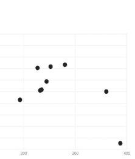
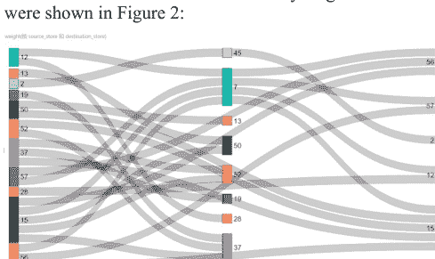

# 2020 IEEE 通信、光学与计算机科学会议 (TOCS)（中国沈阳 2020.12.11-2020.12.13） 2020 IEEE 通信、光学与计算机科学会议 (TOCS) 


— 自“人工智能”概念在1956年达特茅斯会议上被首次提出以来，人工智能这一学科就进入了深度稀疏的时代。最近，大数据、云计算和物联网等新技术的出现，促使了以深度神经网络为代表的人工智能技术的快速发展。

关键词——消费关联、分析关联、人工智能

近年来，随着大数据、云计算、物联网等技术的快速发展，人工智能的应用变得越来越广泛，特别是在自然语言处理、计算机视觉和数据挖掘等领域。例如，在计算机视觉领域，可以使用目标检测来构建人脸识别系统。

由于商圈各不相同，每家商店的人均消费和客户需求日期可以作为关键性能指标。最后，根据这些关键指标对商圈内的商店进行聚类。

## 2) 商店的聚类过程

### (1) 关键性能指标提取

为了获得区内每家商店的人均消费金额，应根据商店ID对数据进行分组，然后根据每家商店的消费日期和人数计算每家商店的人均消费量。通过计算，可以在商圈聚类过程中区分高消费商店和低消费商店。

为了计算商圈内每家商店的消费时间，应根据消费分布将原始数据细分为工作日和休息日进行处理，以区分商店的类型。工作日消费记录较多的是日间商店，周末消费记录较多的是周末型商店。因此，有必要将数据中的客户消费替换为工作日和休息日。所有人的消费记录应按商店ID分组，然后分别统计每家商店工作日和休息日的消费情况。最后，可以获得包含三个关键性能指标的数据。

## I. 项目目标

现在我们拥有一组商圈内一段时间的客户消费数据。数据包含商店ID、消费日期、客户需求、消费金额和银行卡号。该数据集将使用机器学习模型进行分析。在本项目中，列出了两个项目目标：

- 1) 根据客户消费记录对商圈内的商店进行分类。
- 2) 根据客户消费记录，分析商圈内每家商店的消费情况，以提供更好的相关指标。

### (2) 降维

这三维数据按商店ID划分，包括每家商店的人均消费金额、工作日和休息日的消费表现。直接对三维数据集进行聚类，得到的结果是三维的，难以实现结果可视化。因此，在聚类之前需要将三维数组的维度降低到二维。然后，聚类后的结果就可以在二维平面上显示。

## B. 方法

### (1) 商店分类

项目的第一个目标是完成商圈内所有商店的分类。观察数据集可以发现，数据只包含商店的ID，而没有商店的具体分类，因此任务是建立一个无监督学习模型。聚类模型可以解决无监督学习的分类问题。

商圈客户消费数据集包含日期

为了尽可能保留原始数据的特征特性，可以使用主成分分析（PCA）对数据集进行降维。

主成分分析的降维如下：

- b) 输入训练集，
- c) 计算样本的协方差矩阵 $XX^T$。
- d) 对协方差矩阵 $XX^T$ 进行特征值分解。
- e) 取对应于最大 $k$ 个特征值的特征向量：$w_1, w_2, \dots, w_k$。
- f) 原始数据集乘以投影矩阵
- g) 得到包含三个关键性能指标的数据（此处原文逻辑略有重复，按技术流程意译）

### (c) 数据聚类

将三维数组降维到二维后再进行聚类。然后聚类后的结果就可以在二维平面上显示。

当数据降维到二维后，可以直接进行聚类。由于数据集包含多个点，可以使用 K-means 算法进行聚类。

K-means 聚类的过程如下：

- a) 随机选择聚中心。
- b) 根据距离将点分配到最近的类。
- c) 计算每个类的质心。
- d) 重复上述步骤直到聚中心不再变化。

在确定所有人的聚类时，可以计算平方误差和：

```
SSE = \sum_{i=1}^{k} |p_i - m_i|^2
```

$C_i$ 代表第 $i$ 个类，$p_i$ 是类中的点，$m_i$ 是类中心。

随着聚类中心数量 $k$ 的增加，平方误差和会逐渐下降。然而，当 $k$ 超过真实值时，误差和将保持平稳。也就是说，我们需要找到使平方误差下降趋势最明显的 $k$ 值。这就是通过 K-means 聚类得到的最佳值。

聚类完成后，可以输出结果。

### (2) 商店聚合

商店关联的思路

项目的第二个目标是分析商圈内每家商店的消费关联。原始数据集包含了商店ID、客户号以及其他消费信息。由于客户号是唯一的，可以认为同一位客户在不同的商店进行消费。

因此，需要根据客户号对原始数据进行聚合，生成每个客户消费的商店列表。生成的数据集可以使用 Apriori 算法寻找频繁项集，从而发现商店之间的关联规则。

## 2) 关联分析过程

Apriori 算法流程如下：

- a) 生成所有候选频繁项集。
- b) 挖掘频繁项集。


(i) 扫描数据以计算候选频繁 k 项的支持度

(ii) 移除支持度低于阈值 α 的候选集，并获得频繁 k 项。如果频繁 k 项为空，则返回算法作为结果，算法结束。如果频繁 4 项为空，则将获得的频繁 4 项集作为结果返回，算法结束。

(iii) 根据频繁 k 项集生成候选频繁 k 项。

c) 设置 k=k+1，并回到第 2 步。

最后，将对二值集进行可视化，并得出结论。

## C. 商店分类的可视化

### (1) 商店分类结果
在通过主成分分析将包含关键性能指标的三维数据降维到二维后，使用 K-means 方法对新的二维数据进行分类。

通过改变聚类数 k 值，我们可以计算出：

k=2, SSE= 25788。 k=3, SSE= 17304。 k=4, SSE= 135430。 k=5, SSE= 100466。

根据误差平方和的变化，当我们发现 k=3 时，误差平方和下降变缓。该方法显示 k 值的下降趋势突然变放缓。因此，k=3 是 K-means 聚类的最佳聚类数。将 k=3 时得到的聚类结果导入 Power BI 软件，结果如图 1 所示：



图 1：聚类结果

商店的消费频率。纵轴反映了每个商店客户的单价。纵轴数值越高，客户的单价越高。

点被分为白色、灰色和黑色簇。其中，白色点代表的商店消费频率、红点代表的、以及黑色点代表的。纵轴反映了每个商店客户的单价。横轴数值越高，商店客户的价格越高。例如，黑点代表的商店单价较高但消费频率较低，而白色点可以增加消费频率并获得更多利润。白色点代表的商店显示这类商店的单价较低，客户忠诚度更高，因此我们可以增加高价商品的比例，从而提高客户单价并获得更多利润。

### (2) 关联集结果
将原始关联集按消费者卡号聚合并分组后，我们可以获得每个消费者消费的所有商店列表。使用关联规则方法分析必要集列表。使用 Apri 算法发现频繁频繁项集。将获得的数据导入 Power BI 软件，结果如图 2 所示：



图 2：关联规则结果

图 2 显示了桑基图中不同商店之间消费的相关性。分支的宽度代表该商店与其他商店之间的消费情况。该商店与其他商店之间的相关性越强。根据 IDS 为 7、15、37 和 56 的分支，这意味着这四家商店与其他商店有更强的相关性。

因此，IDS 为 7、15、37 和 56 的商店可以增加经营活动，以提高这些商店的客户水平和盈利能力。根据图 1，发现业务区内的 60 家商店被聚类为 3 类，K-means 聚类如图 1 所示，白色、灰色和黑色分别代表不同的簇。同簇内点之间的距离较近，相似性较高，而不同簇之间点之间的距离较远，相似性较低。因此，聚类效果为：

横轴反映了商店的消费频率。横轴数值越小，商店的频率越高。

结论：基于业务区的原始数据集，通过消费者卡号对数据集进行聚合分组，获得了每个消费者消费的所有商店列表。
