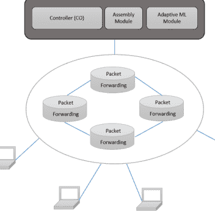
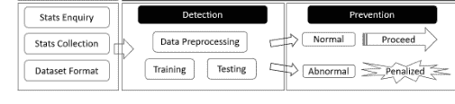
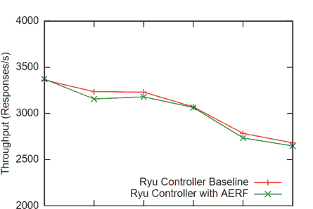
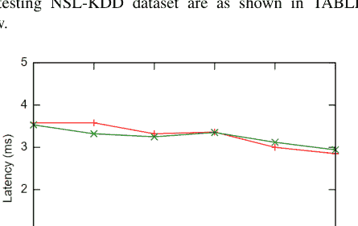

# 2020 IEEE 第八届国际通信与网络会议 (ComNet)（突尼斯哈马梅特 2020.10.27-2020.10.30）


**摘要**—安全仍然是通信网络面临的主要挑战。网络技术的最新进展，特别是软件定义网络（SDN）的出现，为提供高安全性的通信网络带来了巨大潜力。SDN 将数据面和控制面解耦，维持了整个网络的集中和全局视图。这使得主动、健壮和安全的网络成为可能。特别是将 SDN 能力映射到深度学习方法，近期引起了广泛的研究兴趣。大多数工作仅仅是在纯原生的 SDN 环境中，将早期的解决方案简单映射到基于深度学习的 SDN 安全，其中为 SDN 定身定制了开销最小的深度学习入侵检测模块。我们提出了一种新型基于深度学习的 SDN 入侵检测方法。实验结果表明，所提模型在特征选择最少的情况下实现了高准确率、低延迟以及对 SDN 控制器性能的影响最小，同时产生了满意的检测效果。

可以监控并伪造网络管理信息，实施攻击，成为中间人攻击的实施者等。因此，通过漏洞分析采用防御机制来保护 SDN，并提高对流量处理的信任至关重要。

检测此类入侵的建议解决方案之一是入侵检测系统（IDS）。IDS 有两种类型：基于特征和基于异常检测。第一种 IDS 依赖于预先定义的入侵特征，而第二种 IDS 则观察偏离正的流量并检测异常行为。异常检测在控制、身份验证、恶意爆发检测等领域提供了高水平的安全性，并通过调整深度学习能力进行流量分类（正常流量），或通过朴素贝叶斯分类器、支持向量机、K-近邻、循环网络、循环神经网络、深度神经网络等进行检测 [3] [4]。强化学习特别是在存在未标记数据的情况下也被嵌入其中。随着 SDN 架构的快速发展和提供的额外能力，机器学习的研究已成为改进网络入侵检测的关键。

## I. 引言

近年来，SDN 变得广泛流行并应用于网络管理，特别是针对新演变的网络安全挑战。SDN 解耦了控制面和数据面，维持了整个网络的泛化和全局视图。然而，控制面和数据面的分离使得 SDN 容易受到安全攻击。几个主要挑战直接基于未经授权的访问、数据泄露、数据修改、应用程序受损、拒绝服务（DoS）、配置和系统级 SDN 安全。一个令人关注的问题示例是分布式拒绝服务（DDoS），DDoS 攻击已成为网络、数字和网络基础设施的真实威胁。中断的规模受多种攻击方法驱动，而 DDoS 攻击的主要目标是通过向目标服务器、网络链路或设备投射大量非法流量来瘫痪网络 [1]。另一个例子是

研究人员还接受了自编码器方法作为网络入侵检测环境的替代方案，如 [5] [6] 的工作。自编码器是无监督学习，利用神经网络进行表示学习。网络中施加了瓶颈层以强制从原始输入中提取压缩的知识。通过平衡输入对准确重建的敏感性可以实现自编码器模型，并避免内容过拟合。对于大多数情况，构建良好的损失函数应包含鼓励输入敏感性的项，并抑制对输入数据的记忆，例如添加正则化

这些工作在入侵检测中给出了具有前景的解决方案。在准确率水平上，减少率和执行时间仍需改进，特别是要嵌入到高速运行的 SDN 中。这种进一步的改进激励了我们对研究的概述。总之，本文的贡献如下：

- 我们在 SDN 环境中引入了自编码器（AE）和随机森林（RF）算法的混合组合。
- 我们的 AEF 在使用最少特征的情况下实现了 98.4% 的检测率。
- 我们还评估了所提方法在 SDN 中的网络性能。测试结果表明，我们的方法在实时检测方面具有巨大潜力，对控制器的影响极小，且处理时间具有新颖性。



图 1. 基于 SDN 的入侵架构

本文的其余部分结构如下：第二节讨论了相关工作。在第三节中，我们介绍了所使用的方法论。第四节描述了网络性能。最后，第五节总结了结果并展示了未来展望。

## II. 相关工作

[4] 的作者提出了一种用于 SDN 环境下流异常检测的深度学习。引入了一个具有 3 层的深度神经网络，从 NS-KOD 数据集中通过基本特征选择执行二分类。准确率为 75.75%。[5] 提出了一种非对称深度自编码器（NSDAE）模型用于入侵检测，在 NS-KOD 上实现了 5 类分类准确率 85.42%，而 [7] 采用了大数据可视化和统计分析方法，结合自编码器进行威胁检测。该方法报告的准确率达到了 87%。

专注于通过机器学习的益处来增强攻击。主要组件的功能展示如下：

- a) 组装模块：收集 SDN 网络的流量信息。数据将被组装为控制器的输入，以执行包操作。利用 Openflow 协议定期向所有连接的 Open 交换机发送 Openflow 请求消息。管理交换机将返回包含流量统计的消息。

- b) 自适应模块：部署使用 AEF 的入侵检测，控制器将利用 SDN 环境中的学习来检测攻击流量。所提解决方案将

类似深度学习方法的检测准确率取得了良好的成就，但仍有改进空间。高拥塞时间、多层复杂处理、性能不一致是可以改进的缺陷示例。通过与训练过程、损失控制和函数激活控制相关的模型优化仍然需要且可以改进，特别是在入侵检测机制中。本文提出的工作重点在于进一步分析优化过程，这可以对入侵检测现有知识做出贡献。



图 2. 入侵架构

## III. 基于 SDN 的入侵架构

所提架构如图1 所示。两个主要功能是用于统计的组装模块和自适应 ML 模块，后者将采用深度学习对接收到的流量进行入侵检测并执行策略能力。


## B. 数据集

机器学习中的大多数方法在测试之前都需要一个训练数据集对算法进行分类，分类攻击的数据集已在 [5] 中有所报道，报告的研究中共有 63% 使用 KDD 数据集进行训练和测试。在这项工作中，使用了一个新版本的 KDD+ 即 NS-KDD 数据集。该数据集已经针对导致评估偏置的重复数据和事实进行了修正。NS-KDD 数据集具有 41 个特征，其中两个特征是对称的，而其他不是。我们的模型使用 KDD+ 数据集进行训练，并使用 KDDTest 数据集进行测试。此外，KDDTest 包含了 17 种攻击，最多对应 KDD 中的 22 种。因此，KDDTest 是模型在零日攻击和所有类型攻击性能的可靠指标。两个数据集根据流量类型的分布所示表 1。

KDDtrain 包含 125,973 条记录，KDDTest 数据集包含 23,554 条记录。数据处理用于为训练和测试准备数据集。我们使用了带有过拟合滤波器的自动编码器对 NS-KDD 进行训练和测试，并仅从第三部分中选择了 6 个特征。选定的特征是 `frac`、`src_bytes`、`dst_bytes`、`logged` 和 `server rate`。

| 数据集 | 正常 | Dos | 探测 | R2L | U2R | 总计 |
| :--- | :--- | :--- | :--- | :--- | :--- | :--- |
| 训练 | 67,343 | 45,927 | 11,656 | 995 | 21 | 125,973 |
| 测试 | 9,711 | 7,558 | 2,457 | 22 | 5 | 23,554 |

表 1
KDDTRAIN 和 KDDTEST 流量类型的攻击分布

## C. AERF 模型

深度学习方法具有实现有效表示以改进解决方案的潜力。为了使该方法能够在环境中环境中，它必须结合快速、简单的方法以保证性能。因此，在提议中，使用通过微调特征的自动编码器来避免过拟合，但引入了问题。一种使用随机森林的混合组合用于从初步自动编码器计算过程中进行进一步分类。使用 NS-KDD 数据集进行初步测试，以目标检测准确率但最小处理时间对该方法进行排序。

AE（自动编码器）有两个阶段：编码和解码。在编码过程中，输入数据被压缩为低维表示，然后解码器从该低维表示重构输入。

```
$h = f(Wx + b)$
ny = f(W'h + b')$
```

其中 $f$ 是非线性激活函数，$W$ 和 $W'$ 是权重矩阵，$b$ 是偏置，$y$ 是输出。训练过程中，最小化输入与输出 $y$ 之间的差异是主要目标。使用如下方式计算值之间的平均平方差：

```
$L(x, y) = ||x - y||^2$
```

在训练过程中，没有使用训练数据集中的正常流量。攻击数据集由于类型不平衡且不明确未被使用，因为无法良好表示。在这种方法中，提出了带有丢弃（dropout）的自动编码器，它包含一个具有 85 个神经元的输入层，特征数量均为 85。在选择 6 个特征后，85 个神经元的输入层被用于训练和测试过程。我们的 85 个神经元由 70（隐藏）、11（输入）、`src_bytes` (1)、`dbytes` (1)、`dst_bytes` (1)、`logged` 和 `server rate` 组成。

输入层有 125,973 层，输出层有 23,554 层用于训练和测试。通过丢弃层，提出了一个具有 8 个神经元的层，其隐藏表示为自动编码器的 8/10 用于学习特征之间的模式和关系。85 个神经元的输出层使用最流行的整流单元（ReLU）激活函数作为输出，除非 $x$ 为正，否则为零。

```
$x_i = \frac{x_i - Min}{Max - Min}$
```

`frac` 和 flag 等离散特征使用独热编码（one-hot encoding）处理。处理过程允许该层比任何其他编码器运行得更快。这两个值都将作为模型的训练和测试输入。

```
$A(x) = max(0, x)$
```

在重构过程中，自动编码器仅使用数据集中标记为“Normal”的样本进行训练。我们提议模型学习的编码表示被作为 RF 分类器分类正常或异常流量。

# IV. 性能分析

### 评估指标

为了评估，使用了精确率 (P)、召回率 (R)、F 值 (F) 和准确率 (AC)。

| 指标 | 公式 | |
| :--- | :--- | :--- |
| 精确率 | TP / (TP + FP) | (6) |
| 召回率 | TP / (TP + FN) | (7) |
| F 值 | 2 * (Precision * Recall) / (Precision + Recall) | (8) |
| 准确率 | TP / (TP + FN) | (9) |

这是为了捕捉正常流量的性质并最小化输入和输出之间的误差。强制执行过拟合正则化。模型细节如图 4 和表 II 所示。

这些指标使用不同的公式计算：真正 (TP)、真负 (TN)、假正 (FP) 和 假负 (FN)：

- TP：正确分类的异常数量。
- TN：正确分类的正常记录数量。
- FP：错误分类的正常记录数量。
- FN：错误分类的异常数量。

### 实验结果

模型使用 Adam 优化器以 100 的批处理大小训练 10 个轮次（epochs），如图 5 所示。共 60,608 个样本用于训练，10% 的正常流量 6735 个样本用于验证。使用 Tensorflow 运行并实现所提模型。

## 表 II
AERF 架构

| 输入层 | 丢弃 | 隐藏层 | 输出层 | 激活函数 |
| :--- | :--- | :--- | :--- | :--- |
| S5 | 0.5 | Dense | S5 | ReLU |

模型的隐藏层用于第二层分类算法。随机森林在数据集的不同子样本上遵循集成方法，并使用平均值提高预测准确率并控制过拟合。使用 RF 进行入侵检测的研究结果见 [8] 和 [9]。关于 RF 作为最佳选择之一的研究由 [10] 和 [11] 得出。训练和测试的重复具有稳定的结果。从测试中收集的结果平均准确率为 90.19%；如表 III 所示通过自动编码过程获得。

## 表 III
自动编码器在测试集上的性能

| 方法 | 准确率 | 精确率 | 召回率 | F1 |
| :--- | :--- | :--- | :--- | :--- |
| 自动编码器 | 90.19 | 88.78 | 94.70 | 91.64 |

RF 分类器的输入通过了 98.4% 的准确率，之前使用相同 NS-KDD 数据集进行入侵检测的工作见表 IV。所提模型实现了准确率的提升，并允许进一步改进。

## 表 IV
使用 KDT+KDD+ 数据集进行二分类的性能对比


| 方法 | 准确率 |
| :--- | :--- |
| 朴素贝叶斯 [12] | 75.59% |
| MLP [12] | 77.41% |
| 随机森林 [12] | 80.67% |
| RNN [13] | 83.28% |
| 模糊方法 [14] | 84.12% |
| AE + 高斯 [15] | 84.35% |
| STI-IDS [14] | 85.42% |
| S-NDAE [15] | 86.96% |
| SAE-SMR [6] | 88.39% |
| GRU-LSTM [17] | 89.00% |
| AERF | 98.40% |

图 6. 自动编码器混淆矩阵

重构过程中自动编码器训练数据集的混淆示例如图 6 所示。

图 7. 测试集上检测的分布

# V. SDN 控制器性能

在本中，我们评估 AERF 对 SDN 网络性能的影响。评估测试在第一部分描述，然后展示网络性能评估。

## A. 实验设置

AERF 是作为 Python 语言的 Ryu 控制器应用程序实现的。Bbench 是一种用于评估 SDN 控制器性能的标准工具，在两种运行节点下：吞吐量和延迟。吞吐量模式计算控制器处理的最大数据包数，延迟模式计算控制器处理单个流的时间。我们在一个具有 5 核心和 8GB 内存的 Intel(R) Xeon(R) E3-1235.v3 虚拟机上运行实验。操作性能通过 Bbench 计算的不同数量的 OpenFlow 机进行测试。独立的 Ryu 控制器被视为我们评估的基准。

基准和 AERF 评估的控制器的响应率均如图 7 所示。当开关数量增加时，自动编码器实现了轻微下降。尽管有所下降，但与基准 Ryu 控制器的对比没有太大区别，仍然可以接受。

关于 Ryu 控制器的有趣观察是，它对延迟性能的影响微乎其微，如图 9 所示。当我们增加连接的开关数量时，所达延迟在 3 到 4 毫秒之间，并没有太大变化。


## VI. 结论与未来工作

极短的处理时间是该方法在真实 SDN 环境中适用性的良好迹象。

在本文中，我们提出了一种结合自动编码器和随机森林的混合模型，用于原生 SDN 环境下的入侵检测。我们证明了所提出的 AERF 模型性能优于之前的工作，在减少训练和执行时间的同时实现了 98.4% 的准确率。结果表明，该模型在入侵检测方面具有理想的效率。此外，实验显示的吞吐量和延迟表明，我们提出的方法不会显著影响 SDN 控制器的性能。它具有实现潜力，并将被纳到基于 SDN 的入侵缓解架构中以进一步改进流程。



图 8. SDN 环境吞吐量评估

引入的开销。关于所实现的控制器性能延迟，这与 [16] 的观点相似。下表 V 展示了使用 NSL-KDD 数据集训练和测试所需的时间对比。



图 9. SDN 环境延迟评估

## TABLE V
使用 KDTRAIN 和测试集进行二分类的性能对比

| 方法 | 训练时间 | 测试时间 |
|---|---|---|
| STD-IDS | 673.31 | 4.468 |
| S-NDE | 644.84 | - |
| AERF | 18.32 | 2.63 |

该方法的特点在于重点简单。推理神经元的单隐藏层使得训练和测试过程非常快，适用于 SDN 环境。我们实现了高检测能力和实时实现。模型内部阈值的自适应避免了人工干预管理设置的需求。阈值的值也可以手动调整，以适应灵敏度和特异性之间的需求。所实现的准确率

## 参考文献

- [1] N. Z. Bousary, A. Jahanvi, and K. Shahab, "DDoS Attack Detection and Management Using SDN Methods, Techniques, and Solutions," Journal of Computer Science and Engineering, vol. 7, pp. 425–441, 2017.
- [2] S. Das, Y. Liu, and M. Chambandar, "Machine learning based online attack detection: Towards real-time protection against malware," IEEE International Conference on Information Security and Privacy, vol. 11, no. 2, pp. 289–302, 2016.
- [3] L. Barki, A. Shibli, N. Meti, D. G. Naryan and F. M. Milla, "Detection of distributed denial of service attack networks," 2016 IEEE International Conference on Advances in Communications and Informatics, ICCAU 2016, pp. 2576–2581, 2016.
- [4] T. A. Tran, R. Khosravi, M. Lee, "Deep Recurrent Neural Network for Intrusion Detection in SDN-based Networks," 2018 IEEE International Conference on Network Science and Security, pp. 143–148, 2018.
- [5] S. Tone, T. N Ng, V. D. Choi, and Y. Shah, "Deep Learning Approach to Network Intrusion Detection," IEEE Transactions on Emerging Technologies in Artificial Intelligence, 2019.
- [6] Q. Nizam, S. W. Y. A. Javad, and M. Alam, "A deep learning approach for network intrusion detection in International Conference on Computer Science and Security, 2018.
- [7] C. Graciano, A. Adel, M. Mohamed, K. Eshtab, F. C. Martorato, H. Larjati, A. Rasha, and A. Sun, "Statistical Analysis of Optimized Deep Learning System for Intrusion Detection,"ing Notes in Computer Science including security and applications in biometrics, vol. 10891, pp. 759–768, 2020.
- [8] Y. Wang, Y. Ge, and Y. Zhang, "Network intrusion detection based on random forest and support vector machine," Proceedings - 2017 IEEE International Conference on Computer Science and Engineering (ICSE) and 2017 IEEE International Conference on Big Data, vol. 1, pp. 635–638, 2017.
- [9] Y. Y. Y. and M. M. Ali, "An analysis of random forest algorithm for intrusion detection in SDN," 2013 IEEE/IACS International Conference on Information Security, Privacy/Distributed Computing, pp. 127–132, 2013.
- [10] M. Ansar, R. Abdullah, H. Hussain, Y. Chow, and O. E. El-Qader, "Deep Learning Based Approach with SVM for Intrusion Detection," 2016 14th International Conference on Computer Security and Trust, FIST, pp. 282–288, 2016.
- [12] M. Al-Qaf, Y. Lasher, M. Al-Habbi, and K. Al-Subahi, "Deep Learning Using Approach with SVM for Intrusion Detection," IEEE Access, vol. 6, pp. 52245–52258, 2018.
- [13] C. Yin, Y. Zhou, J. J. Fei, and X. He, "A Deep Learning Approach for Intrusion Detection Using Recurrent Neural Networks," IEEE Access, vol. 5, pp. 25204–25219, 2017.
- [14] R. Li, S. Amini, X. Wang, J. Z. Huang, H. Abbas, and Y. L. He, "Fuzziness based semi-supervised learning approach for intrusion detection systems," Information Sciences, vol. 57, pp. 486–497, 2017.
- [15] M. Yousef-Azar, V. Varadarajan, L. Hamey, and U. Tupakala, "Autoencoder-based feature learning for cyber security applications," Proceedings of the International Joint Conference on Neural Networks, vol. 2017-May, pp. 3854–3861, 2017.
- [16] L. Zhu, M. M. Karim, K. Sharif, F. Li, X. Du, and M. Guizani, "SDN Controllers: Benchmarking & Performance Evaluation," pp. 1–14, 2019.

