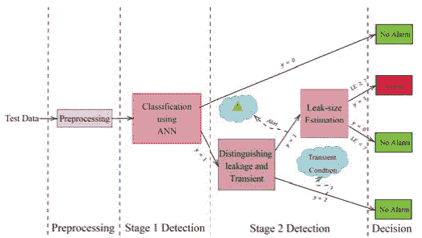
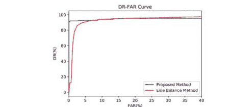
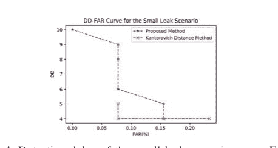
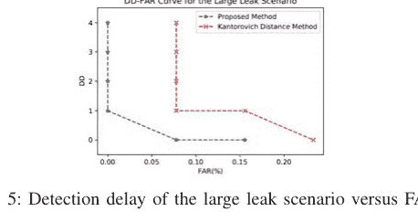

# 2020 IEEE 电力与能源会议 (EPEC) | 基于两阶段深度学习的泄漏检测方法

Iman Anmani, Yindi Jing, Tongwen Chen, Amin Colin, and Gordon Meyerer

阿尔伯塔大学电气与计算机工程系，加拿大埃德蒙顿，AB T6G 2V4

Suncor Energy Logistics Corporation

由于管道是运输碳烃气体和流体的媒介，泄漏检测至关重要。本文介绍了一种新型双阶段方法来处理多种泄漏和瞬态工况。在该方法中，第一阶段使用改进的微分神经网络对流量和压力泄漏估计器的双曲特性进行归一化，以提取特征向量的特征。第二阶段，使用机器学习对正常和异常时间窗口进行分类。此外，使用预泄漏尺寸容差来触发报警，以检测泄漏窗口。实验结果表明，与基准方法和 Kandovich 检测方法相比，该方法具有更高的检测性能和更少的误报。

点分析法显示了泄漏前后工况的统计学特性 [7]。该方法的缺点是在瞬态工况下会触发误报。文献 [4] 提出了一种基于 Kandovich 检测 (KD) 的新方法，结果证明该方法对压力和流量的变化非常敏感；管道建模也可以通过预测值与测量值之间的差异来检测泄漏。然而，该方法计算量大，且缺乏灵活性。

索引词——泄漏检测，数据分析，信号处理，深度机器学习

# I. 引言

管道在输送如燃料、气体和其他化学品等碳烃产品中至关重要；然而，泄漏是由老化、腐蚀和第三方损坏引起的，这些问题非常严峻。泄漏对环境构成了严重风险，人员安全也至关重要。目前已经提出了许多用于监控管道的方法，通常可分为四类：非技术方法、基于硬件的方法、基于软件的方法。在这类方法中，非技术方法和基于硬件的方法通常不作为管道监控成本效益解决方案的主要策略。

基于软件的方法利用流量、压力、温度等参数的流量测量值来监控在线数据的差异 [5]。线路报警基于进出口流量的差。这种方法易于实现；然而，阈值的调节在误报和检测之间取得平衡可能具有挑战性。

近年来，还提出了一些利用先进处理工具的方法。它们考虑提取压力和流量中的泄漏数据，以区分正常和泄漏工况。这些方法使用了基于马尔可夫的方法、小波和统计特征 [9] 以及相关系数来提取特征，并使用长短期记忆 (LSTM)。由于操作（瞬态）或噪声数据，泄漏检测容易产生高误报。这些误报在监控期间可能会让操作员应接不暇。

本文中，针对消除准确泄漏检测等条件引起的误报，我们提出了一种双阶段深度学习检测方法，用于处理流量法管道中的正常（状态）、瞬态和泄漏工况。该方法利用流量差和压力变化来提取特征。改进的神经网络对微小变化敏感，且每个特征的效果被用于对特征向量进行归一化。在第一阶段，使用训练过的基于深度学习的分类器对正常和异常（或瞬态）状态进行分类。第二阶段，使用简单逻辑分离泄漏和瞬态。此外，使用泄漏尺寸和限制来消除由噪声和干扰引起的误报。所提方法使用真实工业数据进行了测试，具有较高的 F1 分数和较低的报警率。结果表明，与文献中的两种方法相比，所提方法具有更好的性能。本文的其余部分结构如下：第二部分描述了问题描述和泄漏特征。第三部分提出了包括预处理、使用人工神经网络 (ANN) 进行分类在内的方案。

这项工作得到了加拿大自然科学工程基金 (NSERC) 的支持。

## II. 管道模型与特征提取

### A. 系统描述与问题描述

本文使用了 Suncor Energy 的数据集来训练和测试通过监控控制与数据采集 (SCADA) 系统获得的数据。当泄漏时，管道内部的流量和压力发生变化，导致进出口流量不平衡。泄漏检测容易由于操作（瞬态）或噪声数据产生高误报。这些误报在监控期间可能会让操作员应接不暇。在该方法中，利用流量和压力变化提取特征。改进的神经网络对微小变化敏感，且每个特征的效果被用于对特征向量进行归一化。在第一阶段，使用训练过的基于深度学习的分类器对正常和异常（或瞬态）状态进行分类。第二阶段，使用简单逻辑分离泄漏和瞬态。此外，使用泄漏尺寸和限制来消除由噪声和干扰引起的误报。所提方法使用真实工业数据进行了测试，具有较高的 F1 分数和较低的报警率。结果表明，与文献中的两种方法相比，所提方法具有更好的性能。本文的其余部分结构如下：第二部分描述了问题描述和泄漏特征。第三部分提出了包括预处理、使用人工神经网络 (ANN) 进行分类在内的方案。

点分析法显示了泄漏前后工况的统计学特性 [7]。该方法的缺点是在瞬态工况下会触发误报。文献 [4] 提出了一种基于 Kandovich 检测 (KD) 的新方法，结果证明该方法对压力和流量的变化非常敏感；管道建模也可以通过预测值与测量值之间的差异来检测泄漏。然而，该方法计算量大，且缺乏灵活性。

当泄漏时，管道内部的流量和压力发生变化，导致进出口流量不平衡。泄漏检测容易由于操作（瞬态）或噪声数据产生高误报。这些误报在监控期间可能会让操作员应接不暇。

为了应用机器学习算法，将时间序列数据转换为特征向量。设置时间窗口长度 $L$ 来定义窗口之间的间隔：

$$TW(i) = [x(i-L+1), \dots, x(i)]$$

其中 $TW(i)$ 是包含第 $i$ 个时间窗口索引的向量，$s$ 是时间窗口移动到下一个窗口的移动样本数。这可以通过以下函数建模：

$$y(i) = f(TW(i))$$

其中 $y(i)$ 是 $TW(i)$ 的预测标签。

### B. 泄漏特征

管道泄漏在具有流体流失的管道中具有显著的“泄漏特征”，即压力和流量的平衡率。第一种特征是所有测量节点的压力下降。这种行为基于质量守恒定律，即流体在从端节点退出之前一直留在管道内 [5]。在稳态下，只要流体密度和管道截面积沿管道保持不变，管道内部进出口流量就是平衡的。

## III. 所提算法

在本节中，介绍了一种基于数据的方法用于从压力和流量信号中检测并分类瞬态状态。检测方案如图 2 所示，包含三个主要阶段：预处理、第一阶段检测和第二阶段。在预处理期间，将数据划分为时间窗口。从这些时间窗口的数据中提取特征并进行归一化。在该方法中，使用人工神经网络将正常类 ($y = 0$) 与泄漏事件和瞬态状态区分来。在检测阶段，该方法通过流量与压力变化之间的小差异以及泄漏限制来检测瞬态状态。该阶段有助于消除瞬态和噪声时间窗口引起的误报。在接下来的小节中，我们将详细说明这三个组件：



图 2：两阶段检测算法。

### A. 数据预处理

在检测阶段之前，流量差和压力数据通过了几个步骤进行预处理。首先，对大小为 L 且长度为 s 的滑动时间窗口进行处理，并将数据分组为一系列序列以提高鲁棒性。然后，对于每个时间窗口获取一个特征向量。为了使这些特征具有共同的尺度，我们对特征向量进行了归一化。

#### 1) 特征

如第二节所述，第一个节点和最后一个节点之间流量差的下降和增加是管道泄漏的关键特征。本工作使用了以下两个特征：

- **流量差均值**，记为 $X(i)$：对于第 k 个窗口，入口和出口节点之间流量差的均值基于：

$$X_i(k) = \frac{1}{L} \sum (V_i(k) - \hat{V}_i(k))$$

其中 $k_j$ 是第 k 个时间窗口，$L$ 是时间窗口的长度。

- **压力差均值**，记为 $Y(i)$：第 k 个时间窗口的压力差均值获取如下：

$$Y_i(k) = \frac{1}{L} \sum (P(k) - P(k))$$

其中 $P(k)$ 是第 k 个窗口上游传感器的测量压力。

#### 2) 改进双曲正切估计

用于神经网络分类的改进双曲正切估计。该方法的主要优势是对离群值具有鲁棒性。对于 $i = 1, 2$ 的归一化特征向量 $X^{(i)}$，该估计器产生如下表达式的归一化数据：

$$X^{(i)}(k) = \tanh(\frac{0.01(X(k) - \mu_i)}{\sigma_i})$$

其中 $X^{(i)}(k)$ 是 $X(k)$ 的归一化值，$\mu_i$ 和 $\sigma_i$ 分别是变量得分的均值和标准差 [11]。在该方法中，我们通过稳态样本分别计算均值和标准差，并将它们用于归一化，从而增强了鲁棒性。

### B. 第一阶段检测

第一阶段检测是区分正常和异常（泄漏或瞬态）情况。在此阶段，使用预处理过的训练数据训练人工神经网络（ANN），并以对管道进行分类。ANN 由归一化特征组成，正常（状态条件）标记为“异常”，如果瞬态和泄漏情况均被视为异常并标记为“1” 。

在我们的设计中，各层使用 `relu` 函数，最后一层使用时间窗口差异的概率。因此，输出产生第 k 个时间窗口的概率 $y_i(k)$。为了进行分类，使用 $y_i(k)$ 设置阈值函数 $\alpha$ 来标记每个时间窗口。分类随 $\alpha$ 的不同值而变化。

### C. 第二阶段检测

在第二阶段检测中，我们将瞬态和泄漏情况隔离开。此外，我们使用预设尺寸来减少误报。这里我们使用两种策略通过操作变化（瞬态情况）消除误报。

#### 1) 利用流量变化和压力变化的符号区分情况

根据我们在第二节的讨论，流量差的增加和压力下降是泄漏情况的主要特征。然而，泄漏结构也将压力变化归一化为稳态。相反，压力在管道关闭等瞬态期间会变化。因此，使用以下基于流量变化和压力变化符号的逻辑来区分泄漏和瞬态情况。

#### 算法 1 检测

```
对于时间窗口 k 标记为 y(k) = 1
  if X1(k) < 0 则
    y(k) = 2; 下降
  else
    if X1(k) >= 0 and X2(k) > lambda 则
      y(k) = 2; 上升
    else
      报警 = 1;
      if LE(k) >= gamma 则
        y(k) = 1;
      else
        y(k) = 0; 正常
  end
end
```



图 3：所提方法和第一阶段的 DR-FAR 曲线。

表 I：第一阶段机器学习工具的比较

| 机器学习方法 | FAR (%) | DR (%) | F1 |
|---|---|---|---|
| 线性回归 | 0.08% | 90.6% | 0.9444 |
| SVM | 0.25% | 92.1% | 0.9482 |
| ANN | 0.16% | 91.39% | 0.9485 |

对于第 k 个时间窗口，当平均流量为负时（$X_1(k) < 0$），异常标记为下降（瞬态）$y(k) = 2$。在正流量的情况下，可能是正常（上升）。如果 $X_2(k)$ 超过预设阈值 $\lambda > 0$，时间窗口标记为稳定（$y(k) = 2$）。如果流量连续增加三次，则报警。阈值 $\lambda$ 可以设置为正常情况下 $X_k$ 的标准差。如果压力比正常增加三倍，则视为过程恢复。

#### 2) 基于泄漏尺寸

当时间窗口被标记为泄漏时，触发报警。由于值的波动，此数据可能标记为 $LE(k) = 1$，泄漏尺寸估计受噪声影响。第 k 个时间窗口的泄漏尺寸使用从 $k_0$ 开始的报警流量差获得：

$$LE(k) = \frac{1}{j-i_0} \sum(V(j) - V(i_0))$$

其中 $i_0$ 是第 k 个时间窗口的起始索引，$j$ 是最后一个时间窗口的索引并触发报警。在此步骤中，如果时间窗口的泄漏尺寸超过指定的容差 $\gamma$，则报警；否则拒绝报警。第二阶段检测的整体方案总结在算法 1 中。

## IV. 性能验证

### A. 真实工业数据设置

在本节中，使用三汇公司的真实工业数据对所提检测进行测试。为了比较第一阶段机器学习工具的性能，表 I 显示了 ANN 和两种流行的机器学习方法的 FAR、DR 和 F1 分，这些参数通过 k 折交叉验证调整。所有方法的泄漏尺寸检测均设置为零，$\alpha$ 设为 0.5。可以观察到 ANN 具有最佳整体性能。线性回归的误报较少。然而，其 DR 低于其他方法。ANN 分类器具有最高的 F1 分。

### B. 所提方法的泄漏尺寸容差敏感性

表 II：所提方法的泄漏尺寸容差敏感性

| $\lambda (m^3)$ | FAR (%) | DR (%) | F1 |
|---|---|---|---|
| 0 | 0.16% | 91.30% | 0.9484 |
| 1 | 0.16% | 90.73% | 0.9448 |
| 2 | 0.08% | 88.74% | 0.9371 |
| 3 | 0.05% | 86.75% | 0.91 |

表 II 显示，随着泄漏尺寸的增加，算法变得更加保守。因此，它无法检测某些泄漏，检测率也会下降。如表 II 所示，当 $\lambda = 0$ 时，算法实现了最高的 DR 和 FAR。通过增加 $\lambda$，误报率降低，当 $\lambda = 0.3$ 时获得 DR，检测率为合理的 75.1 F1 分。

图 4 显示了所提方法与使用各种方法的线性方法的 DR 比较。从图 3 可以看出，低 FAR 下，所提方法的 DR 显著高于线性方法。对于 FAR $\ge 10\%$ 的情况，线性方法的 DR 略高。



图 4：小泄漏场景下检测延迟对比 FAR 的。



图 5：小泄漏场景下检测延迟对比 FAR 的。

## V. 结论

在本文中我们提出了一种使用深度特征的方法。结果显示 ANN 具有最佳性能。随着泄漏尺寸的增加，算法变得更加保守。该方法在工业应用中是有效的。
