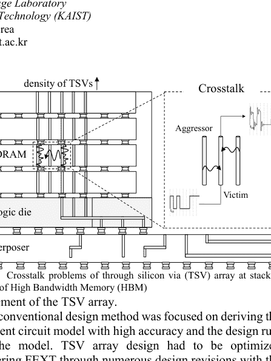
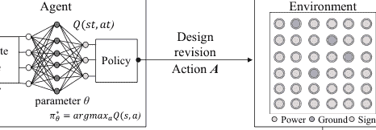
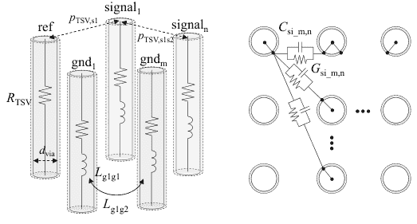

# 2020 IEEE 高级封装与系统电气设计 (EDAPS) ｜｜ 深度强化学习

**摘要—** 在本文中，我们提出了一种基于深度强化学习（DRL）的硅通孔（TSV）阵列设计优化方法。通过所提方法训练的智能体单步提供最小串扰（NEXT）的最优 TSV 阵列。我们定义了状态、动作和奖励以确定目标 NEXT、优化 TSV 阵列串扰的马尔可夫决策过程（MDP）以及深度Q网络（DNN）。为了验证，我们将该方法应用于堆叠高带宽内存（HBM）中的3层通孔阵列。

**关键词—** 强化学习（DRL）、深度Q网络（DNN）、近端串扰（NEXT）、高带宽内存（HBM）、硅通孔（TSV）

最近，由于计算机视觉和人工智能（AI）的发展，对高性能计算的需求日益增加。然而，由于二维（2-D）互连的局限性，带宽和互连存在限制。2.5D和3D技术已成为克服当前限制的有望解决方案。具体而言，高带宽内存（HBM）通过堆叠内存实现带宽和密度，正受到市场的极大关注[2]。对HBM贡献的技术是通过硅通孔（TSV），它允许芯片进行堆叠。通过在HBM中使用TSV阵列，由于长度缩短和互连干扰减少，实现了显著的电气性能。

然而，TSV 容易受到串扰的影响，尤其是远端串扰（此处原文为NEXT）。这是因为 TSV 结构中作为传统水平互连保护的元件非常少[4]。只有电源/地线TSV 和网格形式的电源分配网络（PDN）起起到屏蔽作用。因此，如图1所示，由于相邻 TSV 之间的串扰会导致设计问题。由于 HBM 的密度已经很高，无法增加额外的屏蔽结构。因此，减少串扰的唯一方法是改变

## I. 引言

传统设计方法侧重于开发高精度的等效电路模型，以及通过大量带有设计规则的设计来优化 TSV 阵列的设计规则[5]。然而，简单的公式无法捕捉频率和尺寸上的故障。此外，由于无法进行一步优化，这需要大量时间。

强化学习（RL）被用于在无监督的情况下使用简单算法解决复杂问题。此外，一旦通过适当的马尔可夫决策过程（MDP）进行训练，智能体就可以单步产生最优设计。最近，我们看到了使用 RL 进行硬件设计优化的尝试，以解决互连问题引起的信号完整性（SI）和电源完整性（PI）密度问题。

在本文中，我们提出了用于优化 NEXT TSV 阵列串扰的马尔可夫决策过程（MDP）强化学习方法，并训练了智能体。训练后，我们将所提方法应用于 HBM 堆叠 DRAM 的 3x TSV 阵列进行验证。

## II. TSV 阵列优化方法

所提方法使用 DRL 优化 TSV 之间的 TSV 阵列设计串扰。图2显示了所提方法的示意设计。使用 DNN 训练

图2. 考虑 TSV 奖励中 FEXT 的最优 TSV 设计的强化学习示意图。设计策略通过重复设计和 SI 性能进行训练。当训练完成后，通过使用初始设计的训练策略顺贯执行设计过程获得最优设计。

图 3. (a) 使用多传输线（MTL) 建模对多信号、多组 TSV 的电阻和电感，以及 (b) 多信号、多组 TSV 的电导和电容建模。

要用 RL 框架解决问题，MDP 的组件应该清晰定义。取决于根据目标如何定义 MDP，训练效率和最终性能会发生显著变化。在本文中，我们使用 MDP：

- **状态：S** 由 TSV 矩阵表示。矩阵的每个值表示为使用 TSV 类型（空、信号、地）的索引 0-3，因此状态可以表示为向量。
- **动作：A** 以两种方式定义：TSV 位置的选择和设计。
- **智能体：$\pi$**：通过重复设计和 SI 性能进行训练。训练完成后，通过使用初始设计的训练策略顺贯执行设计过程获得最优设计。
- **奖励：R**：定义为目标 NEXT。由于 HBM 的密度已经很高，无法增加额外的屏蔽结构。因此，减少串扰的唯一方法是改变。由于 HBM 的密度已经很高，无法增加额外的屏蔽结构。因此，减少串扰的唯一方法是改变。由于 HBM 的密度已经很高，无法增加额外的屏蔽结构。通过等效电路模型计算 TSV 的自感（$L_i$）和互感感（$L_{ij}$）：

$$L_{ii} = \frac{\mu}{\pi} \ln\left(\frac{2d_{TSV}}{d_{TSV}}\right)$$

通过多传输线（MTL) 建模可以获得 TSV 的电感。通过这种方法，TSV 的电容可以大幅降低。通过 DQN 训练智能体 如下：

$$\nabla(\theta) = E_{s,a}[r + \gamma \max_{a'} Q(s',\theta) - Q(s,a)]$$

其中 $L$ 是损失函数。

## III. 所提方法的验证

使用 16 层 TSV 验证所提方法。图4 显示了 TSV 的物理尺寸。奖励由每层传输器/接收器的电容定义。可用的动作数量为 45。为了防止训练时间无限增加，超过20 步的回合将停止并产生负奖励。图5 显示了训练。

| 参数 | 值 |
| :--- | :--- |
| TSV 间距 (pTSV) | 50 um |
| TSV 高 (hTSV) | 50 um |
| TSV 直径 (dTSV) | 5 um |
| 凸点直径 (dbump) | 20 um |
| 凸点高度 (hbump) | 20 um |
| REDL 厚度 (t_REDL) | 10 um |
| 氧化层厚度 (t_oxide) | 0.5 um |
| 堆叠 DRAM 数 | 16 |

图 (4) HBM 堆叠 DRAM 的 TSV 物理尺寸（TSV 设计初始尺寸）

图 (6) 使用所提方法对 HBM 的 TSV 阵列进行优化过程

## 致谢

感谢 ANSYS 的技术支持。这项工作部分获得了韩国研究基金会（NRF）通过韩国政府的支持（NRF-2019-M3FA3A10307961 和 NRF-2020M3FA3A202188）。

