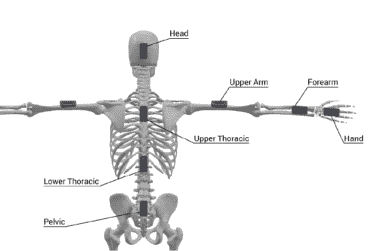
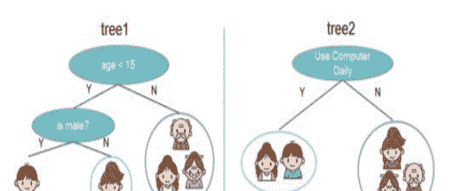
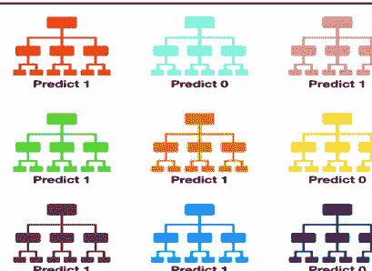
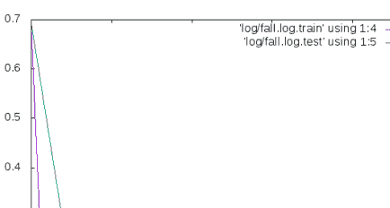

# 2020 IEEE 全球人道主义技术会议 (GHTC)(华盛顿州西雅图 2020.10.29-2020.11.1)｜基于 FPGA 的跌倒检测边缘推理

**摘要—** 在人群中，在硬表面上意外跌倒造成的身体伤害是可避免的运动能力障碍和死亡的主要原因。65 岁以上成年人中 30% 至 65% 每年跌倒一次，报告显示有 290 万次跌倒，导致 33,000 人死亡。所有老年人在一生中的某个一点都会发生骨折。在没有立即提供医疗护理的情况下的情况下，会导致骨折、脑震、颅内或外伤性脑损伤的情况。某些跌倒会导致死亡。最近，许多研究提出了可穿戴设备。这些设备在市场上尚未作为紧凑、无线和低功耗的设备上市。本文讨论的发现是人体上的跌倒检测传感器位于脊骨前方。这是基于放置在 16 个人体上的 IMU 传感器收集的跌倒数据集，并使用卷积神经网络 (CNN) 进行识别训练和测试。目标是开发一种可穿戴医疗设备，该设备使用小型 Lattice 现场可门阵列 (FPGA) 集成陀螺仪和加速度计，用于检测人是否跌倒。该 FPGA 能够在本地运行神经网络。这使其能够在在不需要任何发射器或接收器的情况下提供实时分类。**索引**—跌倒检测、边缘推理、机器学习、神经网络、FPGA

在像泰国、越南、印度尼西亚、柬埔寨、马来西亚和其他东南亚国家等低收入或中等收入国家，只有有限的研究报告了跌倒。因此，事实百分比范围在 14-34% 之间，导致与跌倒预防相关的研究质量有限 [6]。在撒哈拉以南非洲国家，跌倒未被视为一种风险。

图 1. 美国跌倒导致的死亡人数 [33]

# I. 引言

跌倒的主要原因始终与人的年龄和身体状况成正比。其后果是严重的创伤、残疾和头晕被认为是 [1]。在经济成本方面，跌倒仅次于汽车或摩托车事故 [2]。如图 1 所示，在美国 65 岁以上年龄的人口中，平均每年 10 万人中有 36.8 人仅死于跌倒 [3]。研究显示，近 40% 的老年人需要医疗护理或活动受限或健康状况恶化。与居住在养老院的人员相比，年长者的跌倒频率更高 [4]。根据这些报告，需要提供即时援助以防止跌倒。在这种情况下，需要跌倒检测传感器 (FDS) 或等效设备来警示护理人员或...

这些跌倒检测传感器 (FDS) 通常很小，作为吊坠挂在脖子上，或戴在手表上，或作为配备加速度计的手机，以检测和识别跌倒。市场建议附带免责声明，称“它们可能无法感知 100% 的跌倒。当他/她陷入无意识状态导致致命性跌倒时，设备很难或无法工作 [5]”。市上有多种类型和变种的跌倒检测器，尚不清楚哪种是用于人体并检测跌倒的最佳或最优方案。

在这项研究中，16 个惯性测量单元 (IMU) 传感器被放置在人体的不同位置，捕捉了多 183 个特征。记录的值使用不同的机器学习模型进行训练和测试，将事件分类为跌倒或非跌倒。根据这些结果，显然小腿骨（膝盖）是放置传感器的下一个位置，以获得最大的跌倒检测准确性。适用于 Caffe 框架在 Lattice 板上实现。该板的 FPGA 提供了灵活的知识产权 (IP) 核心，实现卷积神经网络 (CNN)，实时计算跌倒分类数据。脊柱、盆骨、上臂和手如图 3 所示。下半身包括大腿、小腿和脚，如图 4 所示。

# II. 方法与数据集

在不同的研究任务中对人体进行了实验以检测跌倒。尽管所有实验都提供了关于跌倒数据实现的细节，但记录跌倒或非跌倒的方法并未明确说明 [5]。虽然在少数研究工作中未公开受者的细节，但跌倒的原因或恢复跌倒的采取的措施仍然是一个谜 [9]。有些研究使用摄像头记录跌倒视频，并将其作为输入数据训练神经网络。在这种情况下，受者的隐私受到了影响。

图 3. 上肢 IMU 放置 [11]

在我们的研究中，实验是在圣地亚哥大学运动营养科学系 (ENS) 的神经力学和神经塑性实验室进行的。实验室配备了无线 3D 运动捕捉摄像头记录人体运动，如图 2 所示，即 Noraxon 测量单元 (IMU)。

脊柱、盆骨、上臂和手如图 3 所示。下半身包括大腿、小腿和脚，如图 4 所示。

平均为 7s，部分为 13s。总体而言，所有观测类型的总平均值为 5s。

## A. 长短期记忆循环神经网络 (LSTM-RNN) 模型

循环神经网络由于其架构中的特性，能够表征信号随时间变化的行为。这些网络会遇到梯度问题。LSTM-RNN 由用于克服该问题的单元组成，并在其状态中使用门控函数 [14]。在该中，在 TensorFlow 之上使用 RNN Keras 框架训练了一个预测失败的时间段模型。TensorFlow 是为了深度学习而创建的，而 Keras 是一种更高层次的 API，用于计算更快的 RNN 网络。

LSTM-RNN 模型由两层 LSTM 后跟一个全连接层（Dense layer）组成。LSTM 层的维度为 13x25 和 25x20，而 Dense 层维度为 20x1。Dense 层对数据执行以下操作：`output = activation(dot(input,kernel) + bias)`，其中 `kernel` 代表权重，`data` 代表所有数据及其对应权重的乘积 [16]。该模型中使用 Sigmoid 作为激活函数。

如前所述，该模型在非均匀时间段数据上进行训练，这些时间段包括前导和包含的内容。用于训练目标的可变时间数据输入模型，每次迭代包含每个批次的一次前向传播和一次反向传播。LSTM RNN 模型的训练和测试被绘制为每个平均值的接收者工作特征 (ROC) 曲线。

## B. 梯度提升树 (GBT) 模型

梯度提升树算法由多个迭代决策树组成，是一种加法算法 [17]。所有树的结果相加，获得最终输出作为最终分类结果。这是一组使用 `xgboost` 软件在记录的失败数据上训练的 GBT，这是一种可扩展树形框架 [18]。例如，给定示例的最终预测是图 6 所示“树示例”中每棵树预测值之和。

GBT 背后的共同概念是划分分支，从而产生一组预测值 $y[i]$，然后计算误差 $y[i]-y'[i]$；作为二分类分类器，GBT 被认为是此类场景均值等非二分类数据分类的前沿技术。使用逻辑函数 $L(x)$ 将预测值 $y'[i]$ 映射到 $[0,1]$，用于将输入分类为失败或非失败的二分类分类器。均方误差 (MSE) 函数 $J = (y[i]-y'[i])^2$ 以及

图. 6. 梯度提升树 - 树示例模型 [18]

需要一个函数 $f[i] = J$ 来最小化 $y'[i] = y[i] - \alpha$（对于某些 $\alpha$）。然后重复该算法以提高精度。GBT 模型中，“损失”是其重复周期（epoch cycles）的函数 [15]。Epoch 定义为整个数据通过模型的次数。

树森林的平均值产生分类（失败或非失败）。ROC 下的面积 (AUC) 是分类的评估指标。最佳截断点是假阳性率 (FPR)，此时灵敏度 = Sensitivity - J，其中 $I$ 是 Youden 统计量：

## C. 随机森林模型

随机森林决策由许多作为一个整体运行的个体决策树（集成学习）组成。森林中每棵树的个体分类预测被集体收集，并根据每个类别的最高票数得出模型的最终预测结果，作为模型分类的结果 [19]。这是一个个体树森林通过多数投票值输出类别并泛化为模型输出的示例。在这种情况下，有 3 个 $i$，输出结果为 1。

在这种方法中，使用了 Scikit-Learn 的 `RandomForest` [15]。梯度提升树模型在每次迭代中最小化均方函数 $J$。我们应用 10 棵独立树（`n_estimators=10`）的方法，每棵树并行训练，并通过树的集成获得统一的分类结果。

# IV. CAFFE 模型与实现

从上述机器学习模型结果观察到，传感器提供了最佳曲线 (AUC)，这意味着如果传感器放置在人体骨骼上，其预测精度远高于其他位置。BNN：梯度提升随机森林在考虑时间段时表现更好，尽管在硬件实现中，RNN 优于其他模型并显示出更高的精度。卷积神经网络 (CNN) 是 BNN 的一种计算高效的结构，可以在 Lattice FPGA 上实现 [22]。

总计：6 个 1 和 3 个 0
预测：1

图. 7. 随机森林模型预测的可视化 [19]
“树”通过 Gini 纯度进行评估。树的每个节点的 Gini 纯度提供了从选定数据集进行错误分类的概率，该数据集被标记为失败或非失败 [20]。

## D. 二值神经网络模型

考虑到这些因素，小因子 FPGA 现在已市售，且此类 FPGA 位于 Lattice E40-Plus Breakout [23]。FPGA 支持实现卷积神经网络以进行分析和仿真，结果是可以实时检测非失败事件。该模型在本地计算机上实现，该系统由 8 张 NVIDIA V100 (16GB) GeForce 组成，并在 Supercomputer-402-GRTR 上执行 [24]。由 Berkeley AI (BAIR) 创建的深度学习框架与其他流行的深度学习框架相似。由于速度和便于开发的代码等特性，caffe 适用于研究部署 [25]。

该模型中的第四个模型是在运行时具有二值权重和激活值的二值神经网络模型。这些被设计用于评估参数梯度。在前向过程中，卷积神经网络 (CNN) 模型大幅减少了内存大小和速度，其中梯度在过程中不进行二值化。权重和激活值被限制在 +1 或 -1。

图 11: 卷积神经网络中腿部传感器随迭代次数变化的损失曲线

由易发生跌倒的老年人收集。

许多欧洲大学已发布了关于日常生活活动（ADL）及所有事件的数据集，受试者在胸部和大腿部等不同部位佩戴传感器或跌倒检测系统（FDS），例如将手机放入口袋作为追踪器、佩戴在腕部或沿腰部，但在每种情况下的准确率都相对较低。这些设备只能记录线性加速度，但在现实中，身体还有其他位置和取向，是这些基础设施无法记录的。此外，边缘计算资源紧张，并使用外部内存进行计算。从结果显而易见，本研究中的所有机器学习模型对于所放置传感器的分类准确率均超过 80%。最终结果显示，卷积神经网络在 Caffe 实现的模型中达到了 80% 的准确率，在 TensorFlow 实现的模型中平均准确率为 85%。TensorFlow 框架在处理时间序列输入数据时提供更高的准确率；然而，Caffe 框架更具易用性和简洁 [30]。我们研究最有影响的启示是：任何跌倒检测传感器都应该设计为放置在胫骨上。此外，这些传感器应设计具有边缘接口能力，以便可以在板上（如 Lattice FPGA）进行计算，且对数据和功耗的需求降至最低。

图中 1-特异性（假阳性率 = 1 - 真阴性率）对第 III 节中讨论的所有四个机器学习模型进行了绘图。我们使用了 Caffe 和 TensorFlow 框架。对于 LSTM-RNN 模型，放置在胫骨上的腿部传感器实现了最高的 AUC（AUC=0.92），而左右手腕的 AUC 值分别为 0.91 和 0.86 [15]。梯度提升树模型在假阳性率上表现出 0.90 的 AUC。尽管如此，左胫骨上的模型在随机森林模型中显示出 0.85 的最高 AUC，而由二进制神经网络（BN）模型构建的随机森林模型在左腿部传感器上也显示出 0.82 的 AUC。

为左腿部传感器设计的卷积神经网络使用 63 两个数据输入进行训练。图 10 显示了 Caffe 模型生成的接收者工作特征（ROC）曲线，其曲线下面积（AUC）值为0.79。此外，图 11 显示了左传感器损失随迭代次数变化的 0.18 损失（训练和测试）。

# V. 结论

技术进步现在使我们能够利用机器学习方法在实时医疗设备中进行预测和分类。当跌倒发生时，获得护理人员的关注需要时间，这会加剧伤性脑损伤、骨折、脑震和出血的情况 [21]。老年人的死亡原因之一是不幸的受伤，其中两种是跌倒导致的。大多数跌倒发生在生活中，而非居住社区，因此，跌倒检测系统（FDS）应该是……

本文提出的机器学习模型能够在短时间内（分钟级）对大量跌倒数据执行预测和分类。用于实施的 FDS 功耗极低，可在 1 mW 左右执行分类算法。FDS 的因子足够小，可以嵌入可穿戴设备中。边缘接口元件限制了维护云基础设施的成本，同时减少了数据传输到云端的延迟。我们在本文提出的解决方案是……

未来，FDS 设备应配备陀螺仪和加速度计以记录数据并预测跌倒发生的情况。除了功能外，FDS 还具有 GPS（或惯性导航系统），以告知护理人员所有设施中跌倒发生的精确物理位置。由于 RNN 在所有其他模型中具有最高的 AUC，观察到单个实例实施在实时中的时间段，因此需要评估在低功耗需求的小设备上支持 RNN 的需求。随后，我们继续使用配备加速度计和陀螺仪的 FPGA 在带有室内跟踪（GPS 跟踪）的单一设备上构建该项目，并对 100 多名不同的受试者进行实验。

# 致谢

这项工作得到了 HealthLink Center 的 1 个试点项目和“边缘全检测”的支持，并受到国家卫生部、国立卫生研究院以及州立大学集团（UGC）的支持。实验在工程与营养科学学院（ENS）Bawe 博士的“神经力学与塑性”实验室进行。我们感谢 Bawe 博士及其学生的支持。

