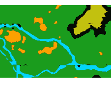
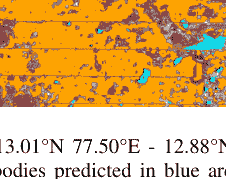

# 2020 IEEE 印度地科学与遥感研讨会 (InGARSS) ｜｜ 多类深度学习

# 摘要

通常，采用视觉解释技术利用时间序列卫星数据进行土地利用/覆盖（LUC）制图。尽管该过程非常准确，但其过程枯燥、耗时，且需要大量的领域专业知识。这种局限性为自动化提供了空间，以减少解释过程中涉及的人工工作。本研究探索了使用深度学习（DL）模型进行多分类训练，以生成主要的 LUC 类。使用了涵盖印度卡纳塔克邦曼德亚（Mandya）地区的卫星五个波段，即蓝、绿、红、近红外（NIR）和短波红外（SWIR）来训练该方法。该地区现有的 LUC 地图用作自动生成标签任务的输入。对四类 LUC——水体、森林、草地、建成区进行了分类，平均 F1 分数为 0.8。训练后的模型应用于对象后显示出令人鼓舞的结果，这使其成为生成 LUC 地图的有效方法。

**索引术**

- `Sentinel-2`、卫星图像、多光谱图像、遥感、土地利用覆盖、深度学习（DL）、分割、分类、`SegNet`

# 1. 引言

遥感是一门通过测量发射或反射的辐射（通常来自航空或空间平台）来获取有关区域物理特征信息的科学。这门学科的出现部分归功于数据可用性的日益提高，通过访问诸如 `Landsat` [1] 和 `Sentinel` [2] 等多个卫星数据集，提供了对大量遥感数据的免费访问。

遥感面临的主要挑战是图像解释和模式识别，这些并不是简单的测量方法；分析过程是枯燥的。深度学习（DL）[3, 4] 的最新进展展示了其在遥感分类和目标检测方面的潜力。

卫星数据的主要方面之一是生成土地利用/土地覆盖（LUC）地图。LUC 指地面的自然覆盖——森林、水体、裸土。土地类别的识别为主题制图和变化检测分析建立了基础信息。土地利用是指用途，如农业、建筑、恢复栖息地。这些特征可以在……

本研究的目标是创建一个“概念验证”，利用现有的 LUC 地图实现多光谱数据自动制图的能力，为印度卡纳塔克邦曼德亚地区生成主要地图。农田、森林、建成区和水体是本研究关注的主要类别。

## 1.1. 先前方法

各种研究人员已经探索了多种方法从多光谱卫星图像生成 LUC 地图，结果不异。其中，一种流行技术是使用如归一化植被指数（NDVI）[5] 和改进归一化水体指数（MNDWI）[6] 等定量指数，这些是波段组合中物理信息的数学表示。这些指数捕获的值一致显示出光谱特征的变化，有助于以合理的准确率进行卫星图像的分类和分割。

对光谱特征使用的进一步探索引导我们识别卫星图像中的同质区域 [7]。这种基于相似性的分组消除了大量的中间类别，生成了一组数量较少但稳健的类别。最近的研究探索了使用离散变换来改进 LULC 分类 [8]。这些技术虽然相当充分，但创建 LULC 地图仍需要大量的人工工作。此外，此类技术只考虑了光谱值，忽略了上下文、纹理和几何特征。DL 模型能够理解位置、形状和比例，这使其成为自动化的极佳选择。

**图 1.** 自然类别的地图：(a) 建成区、(b) 森林；(c) 农田；(d) 水体

# 2. 数据集

选择 `Sentinel-2` 卫星图像作为本研究的数据集。该卫星的目的是监测地表变化。`Sentinel-2` 获取 13 个波段，空间分辨率分别为 10m、20m 和 60m。由于分辨率问题，未考虑 60m 的波段。

**图 2.** 数据集生成 - 分割固定大小的矢量文件

研究目标区域是曼德亚，它是卡纳塔克邦一个农业密集的地区。曼德亚位于北纬 12.52 度，平均海拔 67 米。对于本研究，使用了 2018 年 12 月至 2019 年 1 月的卫星图像。

随后这些这些掩码并分配了相应的属性值。属性包含特定图层或掩码的信息，每个属性捕捉一个单元区域。在 LULC 的背景下，可以将 50 个类别合并为水体、农田、森林和建成区的掩码，如……

# 3. 方法论

本研究采用三层方法以准确分割卫星图像并生成 LULC 地图。它从处理卫星图像以生成 LULC 地图开始。

## 3.1. 数据集

本研究采用三层方法以准确分割卫星图像并生成 LULC 地图。它从处理卫星图像以生成 LULC 地图开始。

## 3.2. 预处理

本研究采用三层方法以准确分割卫星图像并生成 LULC 地图。它从处理卫星图像以生成 LULC 地图开始。

## 3.3. 训练

本研究采用三层方法以准确分割卫星图像并生成 LULC 地图。它从处理卫星图像以生成 LULC 地图开始。

**图 6.** 曼迪亚地区：12.44'N 76.67'E - 12.40'N 76.74'E，遵循 FCC 并显示了土地（黄色）、建筑区（橙色）、水体（蓝色）和农田（绿色）的测试结果。

**图 7.** 班加罗尔地区：13.01'N 77.50'E - 12.88'N 77.69'E（蓝色标出的两个主要水体是 Bellandur 和 BTM 湖），显示了建筑区（橙色）、水体（蓝色）和农田（绿色）类别的 FCC 和测试结果。

其中包含许多感兴趣的类别。经过多类别训练的 `SegNet` 能够准确地映射这些类别的边界。

表 1 概述了模型性能。在训练过程中，大部分数据样本属于一个类别（农田），因此在训练期间对准确率指定了权重。支持像素（support pixels）的数量提供了每个类别覆盖范围的估计。相对于于较低的召回率，水体和建筑区域的覆盖率低且缺乏追踪像素，导致这两个类别的 F1 分数较低。

在将图 7 所示的卡尔纳塔克邦班加罗尔市的一个小子集输入模型后，其输出的可视化解释非常有前景。该模型成功识别了大部分建筑区，并识别出河流中的两个水体。

# 5. 结论

本研究提出了一种通过单一模型进行图像多类别分割的土地利用与覆盖（LULC）分类的深度学习方法。遥感领域面临的一个大挑战是训练类别的标注，本研究利用现有的比例为 1:150 的 LULC 地图解决了这个问题。结果非常令人满意，森林和农田类别的平均 F1 分数准确率为 0.84。虽然水体和建筑区的准确率较低，但支持像素较少解释了这一差异。这些结果证明 `SegNet` 模型是生成 LULC 地图的快速可行解决方案。在研究中，使用了单日期 `Sentinel-2A` 多光谱数据来制作广泛的 LULC 地图。机器学习，特别是深度学习等快速发展的子学科，具有卫星图像分析的潜力，更具扩展性，并有利于光谱数据分析的全自动化或部分自动化。

# 6. 参考文献

[1] D. Roy et al., "`Landsat-8`: for terrestrial global change research," Remote Sensing of Environment, 2014, pp. 154–172, 0013.

[2] F. Bertini et al., "`Sentinel-2`'s optical high-resolution mission for geosciences operations," ESA bulletin. Bulletin European Space Agency, SP-1322, 03 2012.

[3] Y. LeCun, Y. Bengio, and G. Hinton, "Deep learning," Nature, 521, pp. 436–44, 2015.

[4] X. Xu et al., "Deep learning in remote sensing: a comprehensive review and list of resources," IEEE Geos and Remote Sensing Magazine, 5, pp. 8–12, 2019.

[5] N. Robinson et al., "A dynamic longterm normalized vegetation index (ndvi) product for the continued united states," Remote Sensing, 9: 008 (2017).

[6] H. Xu, "Modification of normalised water index (ndvi) to enhance open water features in remote sensing imagery," International Journal of Remote Sensing, 27, pp. 3025–3033, 2016.

[7] R. T. Kettle and D. A. Graflade, "Classification of multispectral image data extraction and classification of homogeneous objects," IEEE Transactions on Geoscience Electronics, 14, no. 1, pp. 19–26, 1996.

[8] J. Sharma, R. Prasad, M. Mishra, Y. Yadav, and R. Bala, "Land and cover classification of multispectral satellite-8 image using discrete wavelet transforms," XL-VII, 11 (2018).

[9] V. Badinarayan, A. Kendall, and R. Cipolla, "`SegNet`: a deep convolutional encoder-decoder architecture for image segmentation," IEEE Transactions on Pattern Analysis and Machine Intelligence, 39, no. 12, pp. 2481–2495, 2017.

[10] S. Ioffe and C. Szegedy, "Batch normalization: Accelerating deep network training by reducing covariate shift," 02 2015.
