# 2020 IEEE工业应用协会年会 ｜｜ 超短期光伏发电预测模型


**摘要—** 超短短期光伏（PV）功率预测可以实现光伏发电的高效调度和优化投资。然而，受多种因素影响，光伏发电存在波动。为了提高光伏超短期预测，本文提出了一种基于频域分解和深度学习的方法。首先，通过快速傅里叶变换（Fast Fourier）识别每个频率波的幅值和相位。分析频率分解分量与原始数据。通过最小化高频分量与原始数据之间相关性的差异，获得分解生成的频率分解需求。最后，本文给出了1、2、3和4小时的预测结果。结果充分表明，所提方法提高了预测准确性。

**关键词—** 光伏功率预测，超短短期，频谱分析，频域分解

# I. 引言

## 1.1 背景与方法论

由于各种因素的影响，光伏发电具有较大的波动性 [9]。传统的预测方法难以获得满意的结果。近年来，光伏功率分析已成为一个研究课题。然而，频域分解方法是从频域提取并分析光伏特性。文献 [12] 使用经验模态分解（EMD）分解不同分量的时间序列，并通过小波分解预测光伏发电量。文献 [14] 了一种基于希尔伯特-黄变换（HHT）和集成经验模态分解（IEMD）的新型预测方法，以提高预测引擎的准确性。使用IEMD分析数据。在上述文献中，数据仅使用现有方法进行分解，无法通过有效方法支持分解结果的可靠性。

## 1.3 挑战

尽管存在缺乏有效方法来支持频域分解结果可靠性的担忧，本文提出了一种基于最优频率分解点选择的光伏功率超短期预测方法。每个频率波的幅值和相位由快速傅里叶分解定义。由于频率分解点不同，因此分析了分解分量与原始数据之间的相关性。通过分析分解分量的结果，获得分解低频分量和高频分量的最优频率分界点。然后使用卷积神经网络预测低频分量和高频分量，并通过数据重构获得最终预测结果。

本文的主要贡献如下：

- (1) 通过最小化低频分量与原始数据相关性与高频分量与原始数据相关性之间的差异大小，获得了最优的频域分解点，支持了频域分解的合理性。
- (2) 本文方法通过中国宁夏光伏电站的数据进行了验证。结果显示所提方法提高了准确性。

本文其余部分的结构如下：第2节介绍了FFT理论和深度学习。第3节介绍了如何选择频域分解的最优频率点。第4节介绍了模型参数和测试结果。第6节得结论。

# II. 方法论

### 2.1 快速傅里叶变换

离散傅里叶变换（DFT）可以将有限长度的频域进行离散化，但其计算复杂度太大，无法实时处理问题。通过使用快速傅里叶变换（FFT）[15]，将长度为N的序列分解为两个长度为N/2的序列。一个是偶序列，另一个是奇序列。对原始序列重复分解直到达到两个点。FFT利用周期性和对称性大大减少了计算量。与DFT相比，FFT是复杂的且快速的。它代表了时域中由各种频率和幅值组成的正弦波信号。在本文中我们考虑使用FFT在频域分解光伏功率。离散化序列的频率所示公式(1)。根据公式(1)，相同频率的正弦和余弦被视为系数。我们考虑所有波形的正弦波。通过FFT在频域得到的模代表余弦波系数，复数的幅值代表频谱和相位。实际(2) 第k点的频率 $f_k$ 定义在公式(1)。

$$f(n) = a_0 + \sum_{k=1}^{N} [a_k \cos(2\pi f_k n) + b_k \sin(2\pi f_k n)]$$

$$c_k = \frac{2}{N} \sum_{n=1}^{N} c(n) \cos(2\pi f_k n + \theta_n)$$

$$a_k = \frac{2}{N} \sum_{n=1}^{N} c(n) \cos(2\pi f_k n)$$

$$b_k = \frac{2}{N} \sum_{n=1}^{N} c(n) \sin(2\pi f_k n)$$

通过FFT在频域得到的模代表余弦波系数，复数的幅值代表频谱和相位。实际(2) 第k点的频率 $f_k$ 定义在公式(1)。

$$f(n) = a_0 + \sum_{k=1}^{N} [a_k \cos(2\pi f_k n) + b_k \sin(2\pi f_k n)]$$

$$c_k = \frac{2}{N} \sum_{n=1}^{N} c(n) \cos(2\pi f_k n + \theta_n)$$

$$a_k = \frac{2}{N} \sum_{n=1}^{N} c(n) \cos(2\pi f_k n)$$

$$b_k = \frac{2}{N} \sum_{n=1}^{N} c(n) \sin(2\pi f_k n)$$

离散化序列的频率所示公式(1)。根据公式(1)，相同频率的正弦和余弦被视为系数。我们考虑所有波形的正弦波。通过FFT在频域得到的模代表余弦波系数，复数的幅值代表频谱和相位。实际

### 2.2 皮尔逊系数

由于各种因素的影响，光伏发电具有较大的波动性 [9]。传统的预测方法难以获得满意的结果。近年来，光伏功率分析已成为一个研究课题。然而，频域分解方法是从频域提取并分析光伏特性。文献 [12] 使用经验模态分解（EMD）分解不同分量的时间序列，并通过小波分解预测光伏发电量。文献 [14] 了一种基于希尔伯特-黄变换（HHT）和集成经验模态分解（IEMD）的新型预测方法，以提高预测引擎的准确性。使用IEMD分析数据。在上述文献中，数据仅使用现有方法进行分解，无法通过有效方法支持分解结果的可靠性。

### 2.3 卷积神经网络

尽管存在缺乏有效方法来支持频域分解结果可靠性的担忧，本文提出了一种基于最优频率分解点选择的光伏功率超短期预测方法。每个频率波的幅值和相位由快速傅里叶分解定义。由于频率分解点不同，因此分析了分解分量与原始数据之间的相关性。通过分析分解分量的结果，获得分解低频分量和高频分量的最优频率分界点。然后使用卷积神经网络预测低频分量和高频分量，并通过数据重构获得最终预测结果。

#### 2.3.1 卷积层

卷积层的作用是从输入中提取特征。卷积层通常由多个内核组成，每个内核用于计算特征图。

#### 2.3.2 池化层

池化层的作用是缩小卷积层生成的特征图的大小，并有效提取特征信息。

#### 2.3.3 全连接层

全连接层的功能是将前层学习的分布式特征表示总结到同一个空间中，以便后续应用。

#### 2.3.4 一维卷积神经网络描述

一维（ID）CNN是CNN的一个分支[2]。CNN1D的卷积核窗口沿一个方向（即时间步）滑动。由于光伏功率是


获得了分解分量的特征点。然后使用卷积神经网络预测低频分量和高频分量，通过加法修正得到最终结果。

频率，选取，低频分量与原始数据的相关性越强，高频分量与原始数据的相关性越弱，

# III. 频谱分析

本文选取了宁夏光伏电站从2017年12月31日23:45至2018年1月1日00:00的光伏发电数据进行模型训练，并利用快速傅里叶变换（FFT）进行频域分解，得到频谱和部分相位谱，分别如图5和图6所示。

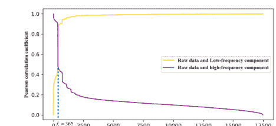

图7. 加权前分解分量与原始数据的相关性

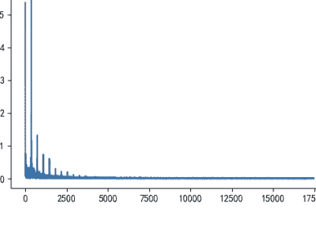

为了说明分解分量与原始数据相关性对预测结果的影响，本文使用CNN模型预测2017年1月1日00:00至2017年12月31日23:45的低频和高频分量。表I对比了不同高频分量下的预测结果。表II对比了不同频率下高频分量的预测结果。表III显示了图5所示的大幅波动下的预测结果。随着低频分量与原始数据相关性的增加，曲线拟合变得更好。随着高频分量与原始数据相关性的增加，曲线拟合变得更好。所选频率与分解分量原始数据相关性之间的关系表明，随着频率数量的增加，低频分量结果的准确性和高频分量预测结果的准确性之间是矛盾的。低频分量代表光伏功率中相对稳定的规律部分，易预测；高频分量是随机的，难以预测。如果原始数据中低频分量的比例增加，通过对低频分量的准确预测来平衡高频分量的预测误差，可以有效提高整体精度。本文最优频率分解点点的训练思想是：低频分量选择最高频率分解点，并涵盖大部分低频分量，该频率选择不宜过高，否则很难获得一定水平的数据。

图5. 光伏功率的频谱分解

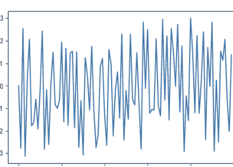

图6. 光伏功率的频率分解

## 3. 最优频率点的选择

通过FFT分析，可以将光伏功率分解为低频分量和高频分量。低频分量代表光伏功率的规律部分，指示其趋势；而高频分量代表光伏功率的随机性，指示由天气等因素引起的波动。如何准确地分解低频和高频分量是一个难题。在本文研究中，从分解数据与原始数据的相关性角度选择最优频率划分。对光伏功率进行频域分解时，数据所示：从图7可以看出，当频率达到某值时，随着频率增加，低频分量与原始数据的相关性不再增加，高频分量与原始数据的相关性下降。这种最优频率划分既确保了低频分量的提取，又不会因过度提取低频分量导致高频分量的预测达到不可接受的水平。本文通过最小化低频分量与原始数据之间的平方差来求解最优频率，这被视为一个优化问题。具体公式见式(7)，新的目标函数如下所示。本文选取 $\alpha=0.173$，$\beta=0.827$，得到频率划分点 $f_*=1825$。

```
$min F(f) = [L(f)-H(f)]^2\ns1. \quad f \in [0, \frac{N}{2}]$
其中，$F(f)$为目标函数。当目标函数达到最小值时，低频分量与原始数据的相关性与高频分量与原始数据的相关性达到平衡。$L(f)$为低频分量与原始数据的相关性，$H(f)$为高频分量与原始数据的相关性，$N$为频率总数。

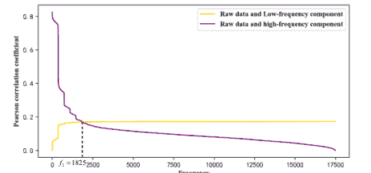

图9. 加权后分解分量与原始数据的相关性

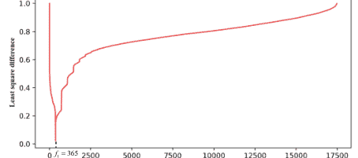

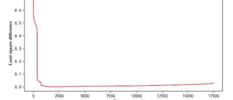

图10. 加权后的平方差图

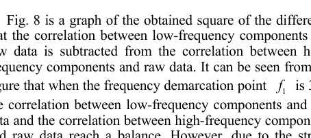

图8. 加权前的平方差图

图是高频分量相关性减去低频分量相关性的差值图。图中所示，当频率划分点 $f_*=365$ 时，低频分量与原始数据的相关性与高频分量与原始数据的相关性达到平衡。通过加权低频分量的规律性和高精度，首先显示低频分量的比例较高。当频率值增加时，低频分量与原始数据的相关性可以降低。然而，当低频分量与原始数据的相关性基本不变时，低频分量的精度达到最大值。此时，精度主要取决于高频分量。因此，在优先考虑低频分量时，通常增加频率。这种方法在式(7)的目标函数中引入权重，通过赋予低频分量与原始数据相关性低权重，高频分量与原始数据相关性高权重。在此值上，优先低频分量的设计思想是：在 $f_*$ 之后，低频分量与原始数据的相关性不再显著增加，而高频分量的相关性仍保持下降趋势。因此，$f_*$ 是最优频率点。

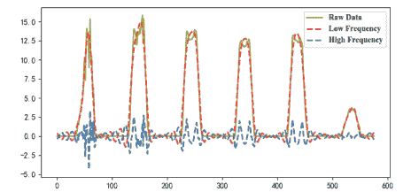

图11. 频率点 $f_*$ 处的最优分解结果。

```
$min F(f) = [\alpha L(f)-\beta H(f)]^2\ns1. \quad f \in [0, \frac{N}{2}]$
```

其中，$\alpha$ 是低频分量与原始数据的相关性权重，$\beta$ 是高频分量与原始数据的相关性权重。

# 表 I. 不同频率下低频分量 R 的对比

| 预测时间尺度 | 365 | 730 | 1092 | 1458 | 1825 | 2185 |
|---|---|---|---|---|---|---|
| 1h | 0.9243 | 0.9654 | 0.9792 | 0.9994 | | |
| 2h | | | 0.9067 | 0.9654 | 0.9947 | 0.998 |
| 3h | | | | 0.8286 | 0.9438 | 0.9132 |
| 4h | | | | 0.7395 | 0.7627 | 0.8021

# 表 II. 不同频率下高频分量结果对比

| 预测时间尺度 | 365 | 730 | 1092 | 1458 | 1825 | 2185 |
|---|---|---|---|---|---|---|
| 1h | 0.6722 | 0.6584 | 0.4783 | 0.2947 | -0.1446 | -0.1876 |
| 2h | 0.6612 | 0.6457 | 0.4378 | 0.2653 | -0.3992 | -0.5743 |
| 3h | 0.6576 | 0.6369 | 0.3989 | 0.2375 | -0.7690 | -1.0467 |
| 4h | 0.6318 | 0.6128 | 0.3648 | 0.2014 | -1.3688 | -1.5674 |

# 表 III. 不同时间尺度下低频预测误差指数

| 模型 | MAE | RMSE | R |
|---|---|---|---|
| 1h | 0.0683 | 0.0860 | 0.9997 |
| 2h | 0.0352 | 0.0450 | 0.9980 |
| 3h | 0.1509 | 0.1302 | 0.9232 |
| 4h | 0.1487 | 0.2012 | 0.8060 |

# 表 VI. 2 小时误差

| 模型 | MAE | RMSE | R |
|---|---|---|---|
| 无频率分解 | 1.6755 | 2.8731 | 0.5864 |
| 频率分解 | 0.4875 | 0.9297 | 0.9610 |

# V. 案例研究

本文使用的数据是中国宁夏光伏电站从2017年1月1日00:00至2018年1月31日23:45的15分钟分辨率的历史天气数据和每小时数据。本文选取2017年1月1日00:00至2017年12月31日23:45的数据作为训练集，2018年1月1日至2018年1月31日23:45的数据作为测试集。输出数据的时间尺度为1小时、2小时、6小时和24小时。

我们使用Python 3.6配合TensorFlow和scikit-learn进行模拟。

## 4.2 数据处理

在训练期间，为了消除每个样本之间的幅度误差，将所有样本转换为[0, 1]，这避免了样本幅度差异大导致后期网络预测误差。其公式所示：

```
$M' = \frac{M - M_{min}}{M_{max} - M_{min}}$
```


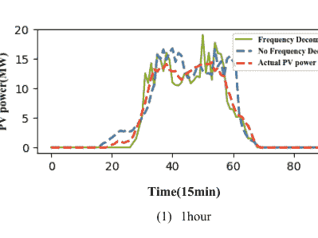

## 4.4 结果

### 4.4.1 分量分解预测结果

表 III 和 IV 显示了不同尺度下低频和高频分的预测误差。从结果可以看出，随着小时数的增加，MAE 和 RMSE 也会增加，预测精度下降。这表明随着时间尺度的增加，预测难度之增大。

### 4.4.2 最终预测结果

图 12 显示了不同尺度下的最终结果，表 V-VIII 显示了无频率分解模型的对比。随着小时数的增加，不含频率分解模型的 MAE 减少。所提模型的精度分别提升了 63.54%、70.90%、23.32% 和 39.51%。所提模型的 MAPE 精度提升了 61.81% 和 49.61%，而所提模型的 RMSE 精度提升了 83.56% 和 78.47%。可以看出频率分解提高了预测精度。高频成分在吸收低频成分后波动更加剧，这可能导致对高频成分预测的减少。然而，通过选择最优频率分解方法，本文不仅提高了原始数据中低频成分的比例，还在一定程度上平衡了高频成分预测的难度。在添加并重构低、高频成分后，最终结果的精度通常得到了提高。

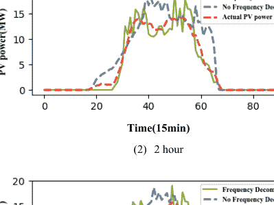

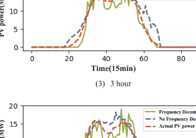

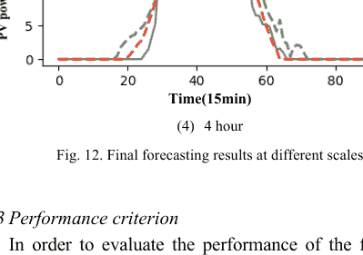

图 12 不同尺度的最终结果预测

## 4.3 性能指标

为了评估预测模型的性能，我们采用了两个有效指标：平均绝对误差 (MAE) 和均方根误差 (RMSE)。在同一组训练数据下，MAE 和 RMSE 越小，预测效果越好。这两个误差指标的数学公式如 (10) 和 (11) 所示：

```
MAE = \frac{1}{N} \sum |y_i - \hat{y}_i|
```

# VI. 结论

为了克服缺乏有效支持频域分解结果方法的缺点，我们证明了一种基于最优频域分解和深度学习的光伏（PV）功率超短期预测。每个频率波的振幅和相位通过快速傅里叶分解获得。由于频率分解的不同，低频成分与原始数据之间的相关性降至最低。将低频成分与原始数据相关性的平方从高频成分中减去，得到了分量的最优频域分解点。使用卷积神经网络预测低频成分和高频成分。最终预测结果为

未来将利用此提出的超短期太阳能光伏功率预测模型电动汽车充电管理 [21, 22]、需求响应 [23-25]、储能管理 [26, 27]、负载模式 [28-30]、聚合器容量预测以及 [31-34] 中的能量交易将

# 致谢

这项工作得到了国家重点研发计划（促进可再生能源发电的风太阳太阳光伏功率预测技术与应用，2018YFB094020）和国家电网公司科学计划（SLGKDOUJ1800256）的支持。Joa. S. 还受到 COMPETE 2020 以及 F (02/SAICSIT/2017) 下 Portitude 基金的支持。

# 参考文献

- [1] W. Wang, J. Panahi, "Grid-Connected Wind Power Forecasting: A Survey on the Implementation Methods in Modern Grid," IEEE Trans. Indr. Appl., vol. 55, no. 5, 5584–5593, Nov. 2006.
- [2] Y. Wang, J. Lin, and H. Shadden, "Wind and Solar Forecasting: Review," IEEE Trans. Indr. Appl., vol. 53, no. 4, 3205–3216, Jul. 2006.
- [3] Y. Wang, T. Wang, and M. Hasan, "Probabilistic Wind Power Forecasting Using Ensemble Methods," IEEE Trans. Power Energy, vol. 26, no. 4, 1083–1090, Oct. 2011.
- [4] F. Wang, X. Zhang, Z. Li, T. Wang, and M. Shi, "A day-ahead wind power forecasting using LSTM-RNN model with attention mechanism for renewable energy," Energy Convers., vol. 212, 1276, 2021.
- [5] K. F. Wang, Z. Yi, M. Frizadeh, N. Daie, and T. Wang, "Capacity and power output of distributed-based renewable energy systems," Energy Convers., vol. 223, 1988, 2021.
- [6] Z. Zhou, J. Li, Z. Zhang, F. Chai, L. Wang, and Y. Lin, "Deep learning-based surface method for solar power using data," IEEE Access, vol. 9, 45535–45546, 2021.
- [7] F. Wang, Z. Xuan, L. Li, M. Sha, and Y. P. Casato, "A multi-output irradiation method based on deep learning," Energy, vol. 220, 1907, 2021.
- [8] H. Wang, J. Li, and C. Su, "Impact of Fluctuating Generation on the Stability of Power System under High Penetration of Renewable," IEEE Trans. Indr. Appl., vol. 58, no. 2, 2245–2254, Mar. 2019.
- [9] H. Wang, C. Huang, and Y. Pai, "A weather-based hybrid model for wind power," IEEE Trans. Sustain. Energy, vol. 5, no. 2, 917–926, 2014.
- [10] J. Shi, W. Lee, and Y. Wang, "Short-term forecasting for solar power plants using artificial neural networks and support machines," IEEE Trans. Indr. Appl., vol. 48, no. 4, 1064–1069, 2012.
- [11] H. Ma, L. Li, S. Cheng, and Z. Lu, "Short-term solar forecasting for photovoltaic power plants using hybrid artificial network with meteorological factors and historical data," Energy Convers., vol. 117, 700–717, Dec. 2018.
- [12] H. Chen, Y. Wang, X. Zhang, Z. Lu, Z. Wei, and G. Sun, "Hybrid method for short-term power forecasting based on deep convolutional neural network," IEEE J. Trans. Data Eng., 35, 1485–1496, 2020.
- [13] V. Kushwaha, N. Pradhan, "A SARIMA-RFVL hybrid model for assisted wind power forecasting with uncertain generation," Renewable Energy, vol. 14, 124–139, 2019.
- [14] W. Zhang, H. Rios, and S. Lin, "A new solar power plant forecasting based on extreme engine and design method," I4S Systems, vol. 81, 105–120, 2018.
- [15] M. Alam, S. Rehman, L. Al-Hadhari, and J. Meyer, "The inherent nature of wind speed using wavelets and FFT," Sustainable Development, vol. 22, 37–44, 2017.
- [16] M. Wang, X. Huang, "Ultra-short forecasting of photovoltaic power based on periodic extraction of V and LSTM algorithm," Neural Network, vol. 115, 10333–10342, 2019.
- [17] M. Wang, X. Huang, "An evaluation of the photovoltaic power forecasting capability," Mathematical Problems in Engineering, 2018.
- [18] T. Kim, S. Cho, "Predicting residual energy generation using convolutional neural networks," IEEE Trans. Smart Grid, vol. 12, no. 6, 7221–7229, 2021.
- [19] F. Wang, Y. Yu, Z. Zhang, J. Li, Z. Khan, and J. Li, "Weighted ensemble forecasting using LSTM with attention based deep learning for solar power forecasting," Applied Soft, vol. 7.
- [20] M. Wang, C. Huang, Y. Liu, and S. Park, "Deep learning-based classification of consumption patterns," Energy, vol. 233, 1185, 2021.
- [21] L. Wang, B. Xiang, K. Li, H. Li, J. Lu, and P. Dehan, "A game-based bidding strategy for electric vehicle charging," IEEE Trans. Indr. Appl., vol. 10, 2099, 2020.
- [22] Y. Wang, J. Lin, and H. Shadden, "Attention mechanism for financial price forecasting," IEEE Trans. Smart Grid, vol. 11, no. 4, 3438–3446, Jul. 2020.
- [23] F. Wang, Z. Xuan, L. Li, M. Sha, and Y. P. Casato, "Demand response-based method based on deep learning," Energy, vol. 220, 1907, 2021.
- [24] K. F. Wang, Z. Yi, M. Frizadeh, N. Daie, and T. Wang, "Capacity and power output of distributed-based energy systems," Energy, vol. 223, 1988, 2021.
- [25] H. Wang, J. Li, and C. Su, "Impact of fluctuating generation on the stability of power system under high penetration of renewable," IEEE Trans. Indr. Appl., vol. 58, no. 2, 2245–2254, Mar. 2019.
- [26] H. Wang, C. Huang, and Y. Pai, "A weather-based hybrid model for wind power," IEEE Trans. Sustain. Energy, vol. 5, no. 2, 917–926, 2014.
- [27] H. Ma, L. Li, S. Cheng, and Z. Lu, "Short-term solar forecasting for photovoltaic power plants using hybrid artificial network with meteorological factors and historical data," Energy Convers., vol. 117, 700–717, Dec. 2018.
- [28] J. Sun, Y. Wang, and W. Lee, "The impact of Time-of-Use (TOU) Rate sensitivity on consumption patterns," IEEE Trans. Smart Grid, vol. 11, no. 6, 4889–4898, Nov. 2017.
- [29] Y. Wang, X. Ge, X. Li, M. Li, and J. Chen, "Feature selection and classification-based method for short-term load forecasting," IEEE Trans. Indr. Appl., vol. 55, no. 3, 2251–2262, Mar. 2019.
- [30] F. Wang, B. Xiang, K. Li, H. Li, J. Lu, and P. Dehan, "Distributed energy capacity forecasting under demand response programs," IEEE Trans. Indr. Appl., vol..56, no. 2, 1086–1097, Mar. 2020.
- [31] L. Zhang, Y. Wang, Q. Huang, and J. Sun, "A game-based bidding strategy for peer-to-peer energy trading of nodes," IEEE Access, vol. 8, 20691–20700, 2020.

