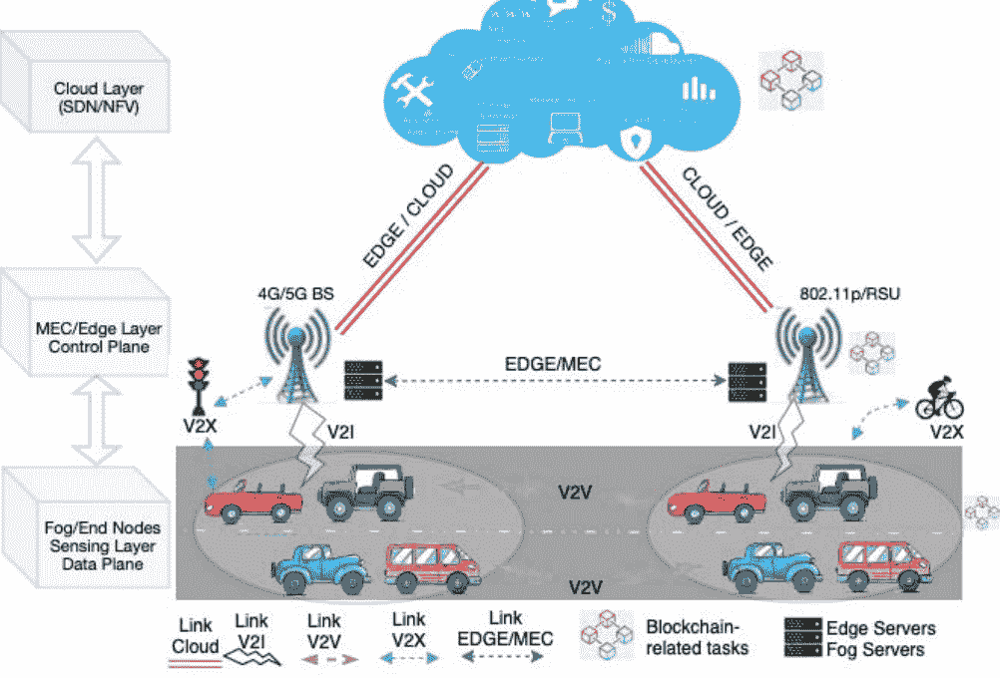
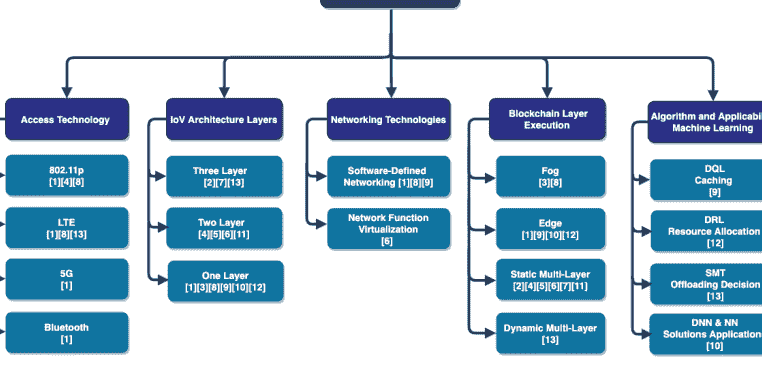

# 2020 IEEE 高级网络与电信系统国际会议 (ANTS)(印度新德里 2020.12.14-2020.12.17) 2020 IEEE 高级网络与电信国际会议

## 引言

**摘要—** 随着智能交通系统（ITS）的出现，嵌入车辆或智能基础设施的传感器数据至关重要。本综述探索了联网边缘计算（IoV）中信息交换的最新机制。为了实现这些需求，边缘计算近期被用于支持联网（IoV）。本综述介绍了基于区块链的车辆边缘计算（IoV）解决方案，并提供了其特征、优势和局限性的分类，为未来的研究提供指导。

***索引术—* 联网（IoV）、雾计算、边缘计算与云计算。*

车载自组织网络（VANETs）是支持城市道路安全、舒适度以及乘客市民信息娱乐支付的关键技术。VANETs依赖于以下通信模式：车对车（V2V）、车对边缘（V2E）和车对基础设施（V2I），以与城市中智能交通系统（ITS）的任何组件提供通信，例如公路、车站、行人、交通灯以及该生态系统的其他参与成员。VANETs使用位于道路上的车载单元（OBU）、路侧单元（RSU）以及具有各种通信标准的基站（BS），如802.11p、DSRC/LTE和5G，它们的计算能力优于车辆边缘计算。

数据可以由基站、云端或车辆进行处理和交付。图1显示了本文背景下IoV环境中呈现的各种架构、技术和通信方面。我们将说明为什么VANETs需要有效的安全和隐私机制，以尽可能减少车辆之间虚假和恶意的信息交换。此类事件可能导致不同类型的事故，威胁驾驶员、乘客和行人的生命 [2]。考虑到尽管VANET上携带交易的设备数量在增加，但通过区块链提供的特性（不可篡改性、加密、注册、分布式以及数据和交易的加入验证）来实现安全性。

访问远程云可能会由于延迟而降低VANET服务。然而，通过使用边缘车辆计算（Edge），处理和存储现在已接近车辆，即位于网络边缘。最近，研究人员提出了针对联网（IoV）的更接近用户的雾计算、边缘计算的解决方案，例如软件定义网络（SDN）和网络函数虚拟化（NFV），以及用于汽车服务编排和车辆基础设施管理的人工智能支持。

提出的解决方案在车辆架构方面具有共同特征，并且具有必须阐明的设计特征，以理解它们在未来发展场景中的优缺点。近年来，不同的边缘计算技术和应用、区块链以及用于交换信息和数据的其他安全机制已引入学术界和各国。本研究总结了这些不同的研究，联系了相关建议，有助于理解每项技术以及它们模式如何处理每个生态系统中的环境 [3]-[8]。

本文研究了应用于IoV的边缘计算和区块链的关键解决方案，提供了分类和比较性总结、其主要提议、技术、架构以及为他人提供参考的观点。第二节展示了所研究元素的背景和分类、解决方案的总结，以及对每种方法的优势和局限性的讨论。第四节给出了文章结论。

> *本文中的“雾”指的是节点，即，*

图1. 一种基于区块链的车辆边缘计算通用框架

## II. 基础

### A. 区块链

正如Jianbin在[1]中所说：“区块链是一种去中心化的基础设施和分布式计算范式，它使用加密的区块来存储和验证数据共识算法以生成和更新数据，并使用智能合约进行管理和自动化”。这些区块由交易组成，交易在分布式网络中记录和验证，不需要中央机构。该实体由Satoshi Nakamoto [2] 提出，用于定义比特币加密货币执行的交易。

区块链管理由多个参与者实现，与通常由单一组织管理的传统中心化数据库不同。此外，区块链的透明性易于跟踪和验证数据 [1]。

目前，在网络上实现区块链有三种方式：公链、私有链或联盟链。加密货币最常用的是公链，任何人都可以参与管理过程的某些活动。私有化实现的特点是由于单一组织对节点和规则进行中心化控制。最后是联盟链，由一组具有相同目标的公司对节点和规则进行控制和管理。这种实现方式用于IoT环境，因为其特性与当前车辆网络的状态相似，如[1]所示。

我们还需要记住两个概念：共识算法和智能合约。共识算法确保网络上更高的信任和安全性。此外，它验证交易的真实性并验证区块。然而，要发生这种事情，必须存在共识。换句话说，共识算法是节点之间达成协议的手段。每个用户都有一个唯一的地址。这种智能合约在区块链中自动执行，因为它无法被更改，并且基于合约或共识中预定义的规则，根据这些规则在车辆之间执行交易，而不需要中介。

> 比特币：一种点对点的ATM系统，Satoshi Nakamoto https://bitcoin.org/bitcoin.pdf

> 什么是区块链，SAP https://www.sap.com/insights/what-is-blockchain.html

图2. 用于IoV的区块链与边缘计算分类

## III. 应用于IoV的区块链分类

所提出的系统如图2所示。该分类包含了调查架构的构建模块，这些架构集成了用于IoV环境的区块链和车辆边缘计算。它分为五类：接入层；IoV架构层；网络技术；区块链任务的执行（包括挖矿、池化、共识以及所有算法和机器学习技术的管理）。考虑到在IoV环境中加入区块链以提高网络安全性。[2] 提出了一种在车辆中恰当使用区块链的解决方案，将活动和服务在IoV三层内所需的平衡中进行划分。区块链层被描绘在网络层，与安全相关的区块链任务由边缘层处理，而云层具有区块链存储的备份。另一方面，一些文章带来了非传统的方法，如[3]。为了解决VANET中的数据一致性和完整性攻击问题，所提出的网络由无环图驱动，其中每个块都有一条单链。

研究建议 [7] 创建了一个认证机构方案，应用会话密钥来识别每辆车。他们将区块链用于V2V分组、共享和管理组内的所有现有车辆。

部分论文利用了软件定义网络（SDN）或软件定义车辆（SDV）。[1] 将区块链和SDN技术结合作为改进运行5G和边缘计算的车辆网络操作和管理的方法。其主要责任在SDN和区块链之间共享。为了创建一个安全、可靠且连接的网络，[8] 提出了一种使用SDVN的结构以及一种区块链范式，允许对交易进行认证以保证完全分布式网络中节点的匿名性。区块链使用基于集群的分布式矿工（D-MS），动态选择运行的矿工。

考虑到电动汽车云和边缘（EVCE）范式 [4] 在分布式共识活动中使用较少区块链（这些活动基于系统内数据和能量的频率和贡献），[5] 联盟链，作者通过三重权重主观投票（TWSL）模型制定了一种共识机制，以确保车辆之间的共识和共享。

作者在[9] 中使用基于优化的解决方案在虚拟边缘计算环境中扩展资源。所提出的服务器对于请求请求是最好的。为了请求，他们利用了区块链。

论文 [6] 提出了一种多级缓存方案和一种使用区块链的可信访问认证方案。该认证方案是一种用于实现实时监控和促进车辆协作共享的机制。区块链是分布式的，作为联网和自动驾驶车辆（CAVs）的认证范式，[11] 是为了去中心化机器学习学习，创建全局模型以相互共享数据，并同时确保网络中的隐私和安全。为了做到，他们使用了基于区块链的学习（BCL）技术。机器学习算法用于改进IoV网络各层执行的决策过程，而区块链用于保护用户免受安全和隐私威胁。

研究工作 [11] 正在使用安全性和动态性

在信息交换中。因此，他们研究了区块链背景下的自动驾驶车辆社会网络（AVNs）。此外，它们的特点是采用了一种基于信誉的共识算法，即信誉证明（PoR）。

为了缓解交通并降低延迟，[12] 提出了一种无主区块链来创建缓存方案。由于车辆具有高移动性，决定何时以及何处进行缓存是一项挑战。因此，他们试图探索深度学习用于识别任务的设计。在这种设计中，提出了一种新的区块检查者选择方法，即效用证明（UP）。

研究 [13] 试图解决物联网（IoT）中资源竞争有限的问题，提出了一种中介机制来协助现场或边缘的决策过程。使用智能市场理论（SMT）方法，区块链的挖掘可以在网络中的任何地方发生，存储位于参与者节点中。

综述论文大多采用学习算法作为决策策略，并使用启发式算法进行共识协议。值得注意的是，许多论文关注强化学习和深度学习。尽管这些方法被用于不同的原因，但在在物联网背景下工作时，大多数具有不同的技术方案。这将是对各种决策算法的比较研究，以分析哪种在联网汽车（IoV）背景下更合适。值得注意的是，每篇文章使用区块链都有不同的目的，例如卸载 [13]、资源分配 [9] 以及其应用 [10]。

应该只进行通信而不进行任何计算。通过将计算移动到边缘，消息之间的延迟更短，同时保持了比车辆 BOU 更好的处理能力。单层（雾网 Fog）和这种场景在所有处理场景的资源分配上都存在一个大问题。

静态多层。在这种情况下，与区块链相关的任务也位于边缘/MEC 层 [2], [4]-[7], [11]。然而，在这种场景下，雾网层和云层可能会处理任务，其中某些任务可能是相互相关的。每个任务都被具体地分配，在这种场景下，存在 MEC 层重叠的问题，但通过将资源发送到云层来解决。某些问题例如由于网络拥堵导致任务永远无法完成。通过从不将任务发送到云端，MEC 可能会像以前一样被接管。

动态多层。这种场景处理混合物联网中的平衡 [13]。在前一种场景中，与区块链相关的任务可能在任何层被处理。然而，在这种情况下，每一层的资源和用户的上下文是动态协调的。但是，决策机制可能会导致不适当的层执行某项任务，它可能会导致之前场景中提到的某些任务

### A. 场景定义

我们定义了四种场景来对所述网络的架构进行分类。设计这些场景时考虑了三个方面：

- *网络层用于与区块链相关的任务：*
在这种场景下，边缘的作用是什么？
- 单层（雾网 Fog）。在这种场景下，与区块链相关的任务也是雾网层之一（在车辆的 BOU 中）[8]。边缘/MEC 层专门从车载自组织交通网络（VANETs）传输数据，并将数据发送到雾网和云。云层可能会为车辆提供一些服务，但那些服务与区块链无关。通过在最终层分发区块链，消息之间的延迟更短，与区块链相关的通信在 V 中进行。
- 单层（MEC）。在这种背景下，与区块链相关的任务位于边缘/MEC 层 [9], [10], [11]。这一层可以为用户提供必要的服务。云层在这种场景中没有发挥重要作用。至于雾网层，它

### B. IoV 中区块链解决方案的维度

- 我们从以下方面进行分类：
- 类型（公有、私有或联盟）——有趣的是，大多数引用的区块链优于其他类型。公有区块链的可扩展性较低，例如去中心化节点，每个节点都处理交易。有改进可扩展性的策略，因为其架构是基于 [3] 设计的。私有区块链具有优势，因为它没有许多公共节点，权威机构决定哪些节点可以作为矿工，这些节点是必须执行所有交易的节点。但它是中心化的，因为单家公司管理整个区块链。联盟链通常是私有的，几家公司共享区块链的所有权。
- * 区块层*，即挖掘和共识主要发生的地方。这一列对于读者了解在静态或动态分层架构中使用了哪些层非常重要。
- 架构方法，使用之前定义的架构模型。将区块链更靠近用户减少并增加了服务质量，因为信息到达了用户 [3], [8]。但每辆车辆都装备良好，可以完成所有的存储和消费。人员决定将这些区块链任务委托给边缘或云层。然而，大多数乘客必须在边缘或创建混合雾-云架构之间做出选择。这是为了避免车辆在处理和一致性上的过载

- * **共识** —— 在这里我们指定每项调查使用了哪种共识算法
1) PoW — 工作证明，最为人知的共识算法之一。
2) PoS — 权益证明，在某些区块链中很常见。
3) PoU — 效用证明。
4) PoS — 权益证明（重复项）。
5) PBFT — 实用拜庭容错，消息密集型。

### 解决方案总结：区块链特征。

| 论文 | 区块链类型 | 区块层 | 共识算法 | 架构方法 |
| :--- | :--- | :--- | :--- | :--- |
| Jian Gao (2019) | 联盟 | 边缘 | PBFT | 边缘层 |
| Shaobin Ge (2019) | 联盟 | 边缘/云 | PoW | 静态层 |
| Wang Jian (2019) | 联盟 | 雾网 | PoW | 静态层 |
| Yuejie Dai (2019) | 私有/许可 | 雾网 | PBFT | 边缘层 |
| Heixin Chen (2019) | - | 雾网 | PoW | 雾网层 |
| Youcai Yatiba (2018) | 公有&私有 | - | Tang6CV | 作者创建了 DM-CS |
| Xiaodong Zhang (2016) | 私有/许可 | 雾网/边缘/云 | PBFT | 静态层 |
| Chun Ou (2018) | 联盟 | 雾网/边缘/云 | PoS+PoW | 动态层 |
| Hawen Tan (2019) | - | 雾网/边缘 | PoW+PoF+PoS | 静态层 |
| Hong Liu (2014) | 联盟 | 雾网/边缘 | BFT-DFS | 边缘层 |
| Yuchao Tian (2019) | 联盟 | 边缘 | - | - |
| Y.-Wang Mao (2020) | 联盟 | 边缘 | PoR | 静态层 |

然而，在联盟区块链中是可能的，每个组织选举一个节点参与共识。论文 [1] 未提到这种方法。

智能交通系统（ITS）集成技术使用中的安全性保障。本研究旨在识别区块链类型、共识算法以及它们的用户、场景和在环境（云、边缘和雾节点）中的运行情况。我们考虑到每种方法的各种特征和方面，对不同的使用场景进行了分类。通信、安全和决策的所有内容均如图 2 所示。随后我们讨论了表 1 中的方法，对区块链在各种场景中的使用情况进行了比较研究，使用了哪些算法和技术，并强调了它们的优缺点。总而言之，本综述

- 6) BFT-PoS - 拜占庭容错权益证明。该算法结合在一起，选择在质押后实现共识的节点。这 21 个节点将产生 12 个区块，对于每个区块它们应用共识，由 BFT 算法确保。这是一种可扩展且快速的生成区块的方法。由于用户有机会确保结果，在现实场景中，用户可能会为了在区块链交易所获得投票而质押他们的资金。因此，在 Dmos 中可以看到中心化共识。

- 7) tangleCV - 要使用 tangle，必须解释 tangle 架构。它基于区块链，但采用了不同的方法。区块可能以无环图的形式链联，其中每个区块有一个交易，且每个新交易都需要对先前的交易进行 PoW 验证。验证后，交易将根据验证该交易所需的工作获得权重，权重是其可信度。tangleCV 指出，权重高于其他交易的可能会获得更快的验证奖励。

在 tangle 架构中，这种方法有很多优点，例如减少带宽拥塞和消除延迟。但在 [3] 中未进行安全测试。此外，它未能比较不同的共识算法，因为架构略有不同。

- 8) DM-CDS - 分布式矿工连接算法基于另一种算法 DSP-CDS 或分布式单相主导集。DSP-CDS 用于定义给定节点何时进入主导集；它适应网络拓扑结构。DM-CDS 使用矿评分函数，该函数考虑了多个参数（如树模型、连接度、链路质量），以决定哪个节点可以验证交易。该算法类似于 PoS 而非质押，这是决定矿工评分的因素。由于矿工随时间变化，进行 PKI 请求验证。在 tangle 架构中，这种方法有很多优点，例如减少带宽拥塞和消除延迟。但在 [3] 中未进行安全测试。

# 参考文献

- [1] Guo, X. et al. Blockchain-based includes types of environment for computing and 5g networks. 5 vol. 7, 4278–4289 (2020). DOI: 10.1109/JIOT.2020.2995241
- [2] Wang, J. and Xu, C. B. A. Security analysis of web based on blockchain and model agree. *In Proc. IEEE Conf. Hot Int. Conet.* 288–293 (2018).
- [3] Kim, S. et al. A blockchain-based technique for secure data sharing in connected vehicles. *ACM*, (2019). DOI: 10.1145/3330711/3370817
- [4] Zhang, Y. et al. A decentralized blockchain-based key management for vehicular communication networks. *IEEE Trans. on Veh. Technol.*, 68, 4660–4670 (2019). DOI: 10.1109/TVT.2019.2916774
- [5] Guo, S. et al. Trust authentication and key management in vehicular network based on blockchain. *IEEE*, p. 2488–2496 (2019).
- [6] Yahiene, Y. et al. A blockchain-based framework for secure vehicular networks. *IEEE Trans. on Veh. Technol.*, 67, 5818–5828 (2019).
- [7] Li, J. et al. A blockchain-based software framework for decentralized vehicle networks via peer-to-peer communication. *In Proc. ICCNet.* (2018). DOI: 10.1109/8860350
- [8] Tian, P. et al. Vehicular blockchain and deep reinforcement learning for connected autonomous vehicles. *IEEE IoT J.*, 7:3115 (2019). DOI: 10.1109/JIOT.2019.2928099
- [9] Wang, Y. et al. Algorithms and strategies in autonomous driving: *IEEE Network* 34, 218–228 (2020). DOI: 10.1109/MWN.2020.19010054

## IV. 结论
联网汽车（IoV）将在未来的智能城市发挥重要作用，提供道路安全、便利和其他利益。然而，需要寻找智能交通系统（ITS）集成技术使用中的安全性保障。本研究旨在识别区块链类型、共识算法以及它们的用户、场景和在环境（云、边缘和雾节点）中的运行情况。我们考虑到每种方法的各种特征和方面，对不同的使用场景进行了分类。通信、安全和决策的所有内容均如图 2 所示。随后我们讨论了表 1 中的方法，对区块链在各种场景中的使用情况进行了比较研究，使用了哪些算法和技术，并强调了它们的优缺点。总而言之，本综述

