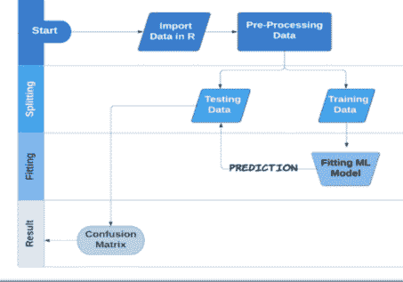

# 2020 IEEE 电子电气工程进展与发展国际会议 (ICADEE)(印度哥印培尔 2020.12.10-2020.12.11)

Shivam Sharma
计算机科学与工程系
ASET, 阿提大学马哈普拉什邦
印度格瓦尔
shi982@gmail.com

Dr. Hemant Kumar Somi*
计算机科学与工程系
ASET, 阿提大学马哈普拉什邦
印度格瓦尔
*hemantkumar@gmail.com

摘要—— 人工智能（AI）是一项迷人的技术，随着它将在多个维度的数据上运行。人工智能通过捕捉客户来模拟人类智能。机器学习是人工智能的实现。机器学习（ML）是一种从自身先验经验中学习的自解释机制。机器不需要显式提示即可进行学习。如今，公司可以探索和分析客户数据。客户的数据模式和趋势对公司具有巨大的价值。通过在客户身上应用人工智能技术，对所提议的工作进行分类。作者实施了多种机器学习算法，如支持向量机（SVM）、随机森林、逻辑回归、K-近邻算法，根据客户是否购买了产品进行分类，并对这些机器学习算法的分类准确率进行了比较。本文指出，随机森林的分类效果优于其他算法。

这些技术足以处理现实世界的问题而无需人工协助。机器学习算法在模式识别等关键算法中起着重要作用。公司在查看特定页面、提及光标或点击链接时会管理客户数据。这些数据通过人工智能技术进行分析，以探索隐藏的购买行为。机器学习、深度学习等人工智能技术为全球大量公司识别潜在客户提供了保障。

关键词—— 机器学习、监督学习、支持向量机、随机森林、混淆矩阵、客户分类、潜在买家、购买者。

## I. 引言

在数据驱动的时代，客户数据已成为一种产生潜力聚落的资源。所有主要公司正在向数据驱动型公司转型。公司可以探索所有可能的维度来检索客户产生的数据。一旦数据经过分析，就会被预处理并转换为标准格式。公司可以通过应用多种技术处理数据，以理解客户洞察。这些洞察反映了客户的行为。对这些购买模式的分析允许公司根据产品对客户进行分类。数据挖掘技术 [1]；关联规则学习 [2][3] 以及人工智能旨在生成智能且复杂的解决问题的机器。这些人工智能提供的机器是足够的。

本文提出了对特定移动网络市场客户的预测 [5]。本文实现了用于客户预测的神经网络模型。数据收集自在线零售商店。该模型的实现是为了向他人隐藏隐藏的趋势和模式。本文探讨了建模在购买行为中的应用，并声称了对数据的判别以及市场特征选择对市场的影响。

## II. 相关工作

本文利用机器学习技术 [6] 对潜在客户进行分类。分类是基于零售超级市场记录的购买行为进行的。作者实施了如“逻辑回归”、“决策树”、“随机森林”和“多层感知器”等机器学习算法进行分类。该工作声称，多层感知器提供了最高的准确率。其他算法提供了与多层感知器相似的准确率。

### A. 支持向量机

支持向量机 [11] 是最优秀的非线性可监督机器学习算法。SVM 通过超平面对类别进行分类。在这里，超平面是“n”维空间中具有 (n-1) 维度的平坦子空间。对于线 d 中的点 d-1，线 d-2 和平面 d-3 用作超平面将空间划分为两部分。SVM 选择使超平面周围间隔最大化的超平面。因此，它被称为“最大分类器”。在这里，“支持向量”是位于超平线附近的数据类型。支持向量决定了选择哪种超平面，SVM 中的决策由支持向量决定。支持向量位置的任何变化都会相应地改变边界。SVM 在检测离群值时对异常具有鲁棒性。对于非线性分类，SVM 将数据转换到高维空间，并确定高维支持向量分类器以有效分类观测值。

作者在这项工作中使用监督机器学习算法 [7] 为银行客户进行了分类。研究人员实施了如“朴素贝叶斯”、“K-近邻”和支持向量机等分类算法。在实施这些机器学习算法后，朴素贝叶斯提供的分类器结果最佳结果，而支持向量机提供的结果最差。本文还展示了使用高准确率和低错误率的混合方法的未来场景。

在所提工作 [8] 中，使用监督机器学习分类对银行券进行鉴别。该工作利用了两种机器学习算法，即反向传播神经网络（BNN）和支持向量机（SVM）。作者声称 BNN 优于 SVM 分类器。还实现了 ROC 和用于衡量模型性能的不同指标。

除了上述文献，为了理解购买模式和市场分析，还进行了一些相关分析 [9] 和多目标关联规则挖掘 [10] 的其他工作。

## III. 方法论

机器学习技术分为三类，即“监督学习”、“无监督学习”和“强化学习”。“监督学习”是机器学习的一种类型，其中响应变量在数据集中已经标记。这些数据被分为两个集合：“训练集”和“测试集”。在这里，包含响应变量的“训练集”用于训练模型。然后使用该模型预测“测试集”中的响应变量，而测试中的响应变量没有标记。对预测的响应变量进行审查以确保准确性。监督机器学习算法同时用于“分类”和“回归”。本文中使用的四种监督机器学习算法如下：

### B. 随机森林

随机森林 [12] 是一种集成监督机器学习技术。它被同时用于“回归”和“分类”。在集成中，会生成多个模型，进而产生多个分类器来解决复杂问题。这是可用最佳分类算法之一。在这里，会产生大量的个体决策树，每棵树代表一个特定的“类别”。在这里，获得票数最多的分类器被选为最终结果。这也被称为弱学习者技术，因为所有个体结果共同工作以产生良好的结果。

### C. 逻辑回归 (LR) [13]， 当响应数据是二分时时适用。它是一种用于分类的算法。逻辑回归方法寻找分类因变量的概率。由于线性回归无法应用，它会产生响应大于“1”（即 p(x)>1）和小于“0”（即）

对于某些 $x$ 的值，$p(x)=0$。为了通过回归实现响应变量在 0-1 之间的概率，逻辑回归在逻辑回归中使用了逻辑函数（Logistic Function）。逻辑函数能够提供在“0”到“1”之间的输出。逻辑回归采用了基本形式的建模，用于分类为“二分类”（Binary）的因变量。

使用 10 折交叉验证对数据进行了充分打乱。

K 折交叉验证。这是一种用于重塑数据样本的程序。这里“K”意味着数据样本中要划分的 K 个等份数量。当 $k=10$ 时，数据样本被分为 10 份等大的部分，因此被称为 10 折交叉验证。该过程有助于随机打乱数据，并使用 10 个不同的测试数据集估计结果。

# D.-最近邻

K-近邻算法 [14] 采用贝叶斯分类器作为定性变量分类的方法。这里 $K$ 是正整数，令“x1”为测试观测值，KNN 识别训练数据中与“x1”接近的 $K$ 个点。KNN 对测试观测值“x1”应用贝叶斯分类器，以分类出具有最高概率的“类别”。

## IV. 提出的方法

在这项工作中，研究人员实现了来自 UCI 存储库的 Shoppers 购买数据集 [15]。该数据集包含 1233 条观测值和 188 列。为了消除数据集中的任何偏差，12330 条观测中的每一个都是从用户在 1 年跨度内生成的。17 个属性如访问、访问月份、使用的操作系统、客户类型（回头或新客户）等作为预测变量，第 18 个属性是响应变量，用于分类客户是否购买了产品。图 1 展示了分类步骤。本工作中的分类步骤描述如下：

### A. 分类步骤

- 步骤 1. 将数据集从 UCI 存储库导入环境。
- 步骤 2. 导入的数据在探索后进行预处理。逻辑变量通过 R 语言的结果被转换为因子（factors）。由于数据集中的大多数属性具有不同的范围，它们被简化以进行标准化。这是通过使用 R 语言中 `caret` 包的 `preprocess()` 函数实现的。该标准化后的数据集将进行中心化和缩放，均值接近 0，标准差为 1。最后，

- 步骤 3. 预处理后，数据集被分为两组：“训练集”和“测试集”，分别占 75% 和 25%。
- 步骤 4. 使用不同的机器学习算法拟合以以模型。它被应用于-
- 步骤 5. 将拟合模型应用于测试集以预测响应变量。
- 步骤 6. 在最后一步使用来自测试数据的混淆矩阵来确定模型的准确率。

### B. 混淆矩阵

在机器学习中，混淆矩阵（confusion matrix）[16]被称为“误差矩阵”，是一种用于阐明机器学习模型性能的矩阵。它用于监督机器学习算法。在表 1 中，第一个和最后一个单元格表示被模型正确分类的负样本（Negative）和正样本（Positive）。这里，第二和第三单元格是被错误分类的负样本和正样本。

| 表 I | 混淆矩阵的表示 |
| 实际负 | 实际正 |
| 预测负 | 真负 (TN) | 假负 (FN) |
| 预测正 | 假正 (FP) | 真正 (TP) |

### C. 准确率

模型的准确率通过应用公式 (i) 中详细说明公式 [16] 计算。该公式将定义机器学习模型的准确率百分比。它是混淆矩阵中真正值和真负值之和除以总值数。

通过 10 折交叉验证获得的随机森林模型准确率为 89.71%。

### C. 逻辑回归

逻辑回归的混淆矩阵如表 4 所示：

### 表 IV. 逻辑回归的混淆矩阵

| 负 | 正 |
|---|---|
| 2538 | 305 |
| 67 | 172 |

通过 10 折交叉验证获得的逻辑回归模型准确率为 89.73%。

## V. 实现与性分析

在所提出的工作中，作者使用了在线购买数据。这是客户所有在线活动的集合。csv 数据跨越一年时间收集，每个数据从单个客户处收集。数据收集期一年是为了避免由于特殊日期、月份或条件导致的偏差。所有机器学习算法均在 MacBookPro 7.2 上使用具有 Intel Core i7 @ 1.8 GHz 速度和 MacOS Sierra 的 R 3.6 版本及 x64-darwin-5.6 实现。机器学习算法的实现结果如下：Sierra。以下机器学习算法的实现结果如下：

### D. K-近邻

K-近邻的混淆矩阵如表 5 所示：

### 表 V. K-近邻的混淆矩阵

| 负 | 正 |
|---|---|
| 2539 | 336 |
| 66 | 141 |

通过 10 折交叉验证获得的 K-近邻模型准确率为 86.96%。

# VI. 性比较

所有提出的算法的性比较详见表 6。表 6 表明，随机森林在所有算法中表现最好。“随机森林”、“支持向量机”和“逻辑回归”提供的准确率差异非常小。K-近邻提供的准确率在所有算法中最低。此比较得出，随机森林在给定的分类中表现最好。

### A. 支持向量机

使用支持向量机（径向内核）生成的混淆矩阵详见表 2：

### 表 II. 支持向量机的混淆矩阵

| 负 | 正 |
|---|---|
| 2531 | 270 |
| 72 | 207 |

通过 10 折验证获得的支持向量机模型准确率为 88.9%。

### B. 随机森林

获得的随机森林混淆矩阵如表 3 所示：

### 表 III. 随机森林的混淆矩阵

| 负 | 正 |
|---|---|
| 2512 | 224 |
| 93 | 253 |

# 表 VI. 实现的性比较

| 算法 | 测试方法 | 准确率 |
|---|---|---|
| 支持向量机 | 10 折交叉验证 | 88.9% |
| 随机森林 | 10 折交叉验证 | 89.71% |
| 逻辑回归 | 10 折交叉验证 | 89.73% |
| K-近邻 | 10 折交叉验证 | 86.96% |

## VII. 结论

本文探讨了机器学习的能力。在工作中，作者实施了支持向量机 (SVM)、随机森林和逻辑回归。在分析后发现，随机森林在表现上最好。未来将...

## 参考文献

