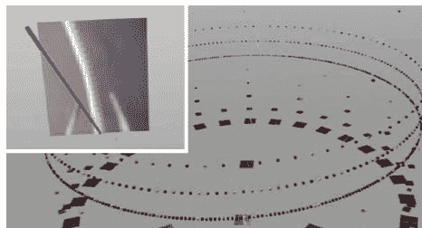
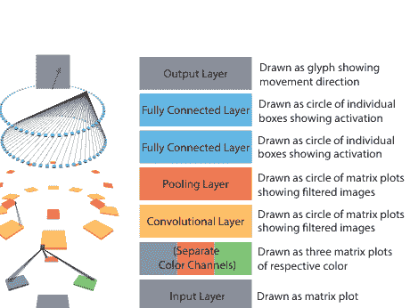

# 2020 IEEE 人工智能与虚拟现实国际会议 (AIVR) (荷兰乌特勒支 2020.12.14-2020.12.18)

**Martin Bellgard**  
视觉计算研究所  
德国亚琛工业大学 (RWTH Aachen University)

**Christian Schneider**  
机械工程信息管理学院  
德国亚琛工业大学 (RWTH Aachen University)

**Torsten R. Kuhlen**  
视觉计算研究所  
德国亚琛工业大学

**摘要—** 人工神经网络（`ANN`）的黑箱问题仍然是一个备受关注的问题。在交流 `ANN` 概念时，它们通常被描绘为节点-链接图。尽管采用了这种策略，但它仍局限于教育背景。我们假设全尺寸 `ANN` 的大规模节点-链接图对机器学习实验可能有用。我们开发了一种工具，利用虚拟现实（`VR`）将 `ANN` 描绘为节点-链接图。将其应用于机器学习研究领域，并针对特定挑战进行了调整。最后，我们通过专家评审以评估该可视化的有用性。事实证明，`ANN` 的节点-链接可视化在专业背景下是有帮助的。

**索引词—** 人工神经网络，分析，节点-链接图

# I. 引言

在过去的十年里，`ANN` 已经成为人工智能领域的标准工具。它们是许多先进方法（例如图像分类、目标检测或语义图像分割）中不可或缺的一部分。这些方法仍然是不透明的；理解其内部机制是一项挑战，通常被称为**黑箱问题** [3]。`ANN` 的行为和可解释性未能被简化到在敏感应用中被接受的程度。因此，可解释人工智能（`XAI`）领域近期受到了广泛关注 [4]，出现了许多解决黑箱问题的方法。我们建议读者参阅 [5–7] 中关于解释黑箱模型方法的综述。

描绘神经网络的常用方法是节点-链接图 [7]。在节点-链接图中，神经元和突触的概念分别由节点和链接表示。然而，`ANN` 外观的表示变得非常复杂。尽管如此，复杂 `ANN` 的可视化很少使用节点-链接图来制作。它们主要用于说明小规模网络，如 [11] 或 [12] 中的许多图所示。还有使用节点-链接图的交互式可视化，例如 `TensorFlow Playground`。其交互式网站允许用户设置小型神经网络的超参数，并观察它们在二维数据集上的行为。虽然无法向初学者教授 `ANN` 的层，但所描绘的网络仅仅是微小且具有示例性的。据我们所知，本文首次尝试将一个大型 `ANN` 以节点-链接图的形式描绘，且该论文正处于活跃评审状态。

节点-链接图用于描绘 `ANN` 的另一种方法是在计算图中，如 [8] 所示。在计算图中，边所描绘的不是单个神经元，而是计算过程以及这些计算之间流动的数据。在这种情况下，表示权重、偏置和梯度通常是非常方便的。因此，节点-链接图表示的不是网络本身，而是涉及的计算。尽管 `ANN` 工具箱 [5] 使用这种节点-链接图处理大型网络。

人们可能想强调，这不仅是可视化接近现实而且是相对的。[6] 中描述的基于 Web 的可视化描绘了一个三维节点-链接图。用户能够看到自己在网络中的操作，并立即观察任何神经元的响应，因为其颜色被映射到激活状态。所有突触的权重也用彩色线条描绘，并可以显示过滤后的卷积核。虽然他们的方法描绘了一个工作中的全尺寸 `ANN`，但作者表示其目标是教育用例。在这项工作中，我们的目标是将他们的想法更进一步，并评估类似的 `ANN` 描绘是否也能用于机器学习实验。

一个主要挑战（可能也是大规模可视化未被更多尝试的原因）是 `ANN` 日益增长的规模和复杂度。`ANN` 包含数百个神经元和数百万个突触。在二维平面上简单地描绘这些会导致视觉混乱且难以解释。三维可视化要好得多，但如果显示在二维屏幕上仍然受限。这就是为什么对于我们的可视化，我们决定利用虚拟现实（`VR`）技术。由于技术的进展，`VR` 现在在日常工作中是可行的 [11]。对于我们的任务，由于在三维中显示我们的可视化需要更高的自由度 [9], [13]。

为了证明我们的系统可以用于机器学习示例，我们使用了 `MNIST`，但并不是。我们需要将系统应用于一个有帮助的用例中。在生产技术领域，机器学习是一个日益受到关注的领域。因此，我们决定将可视化应用于该领域的用例。接下来的章节将详细描述该用例。

# II. 用例

我们通过控制机械臂的卷积神经网络（`CNN`）来演示我们的方法。本节对项目进行了简要概述。更详细的描述见 [10]。

本质上，该项目描述了如何通过强化学习（`RL`）生成机械臂的运动。机器人被赋予了跟踪一个环形线的任务，必须沿着线定义的路径移动而不触碰它。简单来说，过程如下：首先，在部件旁边拍摄图像。然后，`ANN` 根据此图像计算轨迹。最后，机器人沿着轨迹移动并重复该过程。如果机器人碰到线，它必须重置位置并在训练过程中获得负奖励。该训练过程的细节与本文工作无关，予以省略。

**图 2。** 我们的方法架构示意图。

# III. 概念

图 1 是我们用例的概述。如所述，它深受 [6] 中系统的启发。与他们一样，我们将 `ANN` 可视化为节点-链接图，其中节点表示激活，边表示它们之间的权重。然而，我们只显示连接节点的边。这是由于在我们的情况下神经元数量巨大，使用线性布局并在二维屏幕上显示可视化（如 [6] 所示）是不可行的。这就是为什么我们使用 `VR`，因为它允许使用第三维度。关于我们 `VR` 实现的决策见第 III-A 节。第 III-C 节描述了为了适应我们的用例而在应用中需要解决的额外方面。

## A. 沉浸式虚拟现实

我们的目标是设计一种机器学习专家可以将其集成到工作流中的应用程序。在设计用于日常工作的沉浸式 `VR` 应用时，第一个决定是使用场景 [1]。神经网络（`ANN`）是物理世界中不存在的抽象，因此用户的身体感知可能会影响他们的沉浸感；对于此应用程序，坐式场景是可能的。然而，我们用例中的专家在机器人面前站立并走动。机器人在车间内的位置足够他们走动。因此，我们决定将应用程序设计为站立模式，并允许用户根据意愿走动。此外，我们还包含了一个虚拟旅行模式（飞行），以给用户移动的自由。

自然地，我们追求可视化的可用性尽可能高，并决定使用头戴显示器（`HMD`）作为目标设备。这些设备价格低廉，且不需要复杂的设置。为了实现虚拟旅行和可视化的所有交互元素，我们使用了 `HMD` 自带的标准输入设备。导航是直观的，但可能需要重新设计控制方案，因为我们 `VR` 控制器上的按钮尚未标准化。

**图 3.** 指向任何激活点均显示与其连接。对于卷积层，过滤器被称为过滤器。尽管如此，它仍然保留了线性布局的良好特性，因为用户可以查看网络的部分而不会感到杂乱。为了减少用户需要的工作量并让他们提供相邻层，图 2 所示的布局在紧凑性和简单性之间取得了很好的折中。其他布局可以使用神经元的空间排列。我们计划在未来的工作中研究这一点。

## B. 空间布局

我们可视化中节点空间布局的基准是 [6] 中使用的线性方法。在这种情况下，第三维度被用于显示神经网络的激活，而所有神经元都沿着一条直线排列。这种布局对于较小的网络非常好，特别是当平台仅为 2D 时。另一个积极方面是用户可以孤立地查看任何部分。然而，我们的布局是一条非常长的线，跨维度的信息难以处理。我们想要保留链接结构的想法。通过将它们放置在规则网格上，我们留出了两个维度。遗憾的是，这导致许多节点被遮挡。最后，我们决定将神经元排列成圆。

## C. 使用特性

为了使我们的可视化对研究中的专家可行，我们必须解决一些挑战。为了测试我们的即“完整网络的节点-链接可视化对机器学习专家有帮助”的假设，我们进行了专家评审。总而言，我们访谈了四位以前使用过我们可视化的专家。另外两位没有直接参与，并且从未见过我们的可视化。我们访谈的每一个人都对我们的可视化进行了详尽的参观和解释。首先，我们控制的输出无法像 [6] 那样解释。相反，层编码了机器人将遵循的路径。这条路径还包含了输入图像和机器人将采取的动作。我们还添加了保持可视化状态的功能。这是因为我们经常接收新输入，这些输入可能会以无向的方式更改参数。之后，他们有机会根据自己的需要自由地环顾四周，结束后，我们对他们进行了结构化访谈以获取定性反馈。我们访谈的所有专家都发现我们的工具很有帮助。甚至有人建议说他们开发了自己的可视化，但我们的比他们所有的工具都更有帮助。我们还询问了他们的工作中哪些部分可以从我们的特征图中获益。虽然他们没有详细说明如何做到，但我们怀疑是因为超参数的原因。

# V. 结论

我们展示了一种基于沉浸式现实的神经网络交互式节点-链接可视化。与之前的工作不同，我们的系统针对机器学习专家。我们进行了专家评审，以测试我们的“节点-链接可视化可以帮助他们进行实验”的假设。我们认为专家的反馈是我们的假设成立的证据。还需要更多的评估来证明节点-链接可视化确实可以改进机器学习专家的工作流。然而，我们乐观认为，我们可视化的未来版本可以在专家中更大范围内使用。

# VI. 致谢

# 参考文献

- [1] M. Müller, A. Peck, and C. Zaklas, J. Beyers, W. Yates, and T. Kling. Immersive Reality in Reality. In VR Workshop on Immersive Reality. WeVR, 2017.
- [2] C. Rudin. The Black Box Problem of Explainable Artificial Intelligence (XAI). IEEE Access, 6:5218–5236, 2018.
- [3] C. Lund. Can we open the black box of AI? Nature, 355(6338):297–298, 2018.
- [4] D. Doran, S. Sukh, and T. R. Boyd. What does explainable AI mean? A survey of methods, applications, and future directions, 2017.
- [5] E. Arrinzo, A. Molnar, F. Dujini, and P. Garario. A Survey of Methods for Explaining Black Box Models. CoRR, 2019.
- [6] A. W. Harvey. Interactive Node-Link Visualization of Convolutional Neural Networks. International Symposium on Vision Computing, 2018.
- [7] F. Hoffman, M. Kingler, J. Pierre, and D. Hu. Visual Analysis in Deep Learning: A Survey of Recent Techniques. CoRR, 2019.
- [8] Y. Wang, M. J. Castro, A. Harkler, and D. Hu. Active Visualization: Exploration of Neural Networks. arXiv preprint abs/1810.02362, 2018.
- [9] L. Bakas, K. Sengirthala, J. D. Schifferbauer, and D. Bakman. Evaluation of Immersive Reality for Analysis of Visual Data. IEEE TV, 29(4):597–604, 2020.
- [10] O. Chang and S. King. Attention and Augmented Recurrent Neural Networks. Deep, 2017.
- [11] J. Smith, J. Lucas, and C. North. Exploring the Benefits of Immersion in Abstract Information Visualization. In: Proceedings of the 2012 IEEE International Conference on Human Science and Technology, 2012.
- [12] D. Molnarov, S. Carter, D. F. Beagle, V. Viegas, and M. Wattenberg. Manipulation of Deep Networks. CoRR, abs/1708.03118, 2017.
- [13] K. Wongsuprasert, D. Smilkov, J. Wexler, J. Wilson, D. Mané, D. Pinto, D. Krinsky, and M. Wattenberg. Visualizing Data Graphs of Deep Learning Models in TensorFlow. TVCG, 24, 2017.
