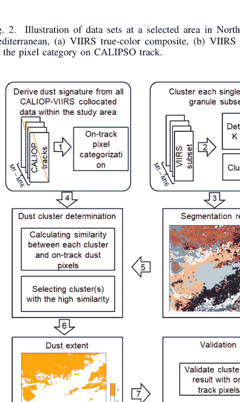
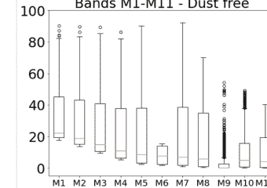
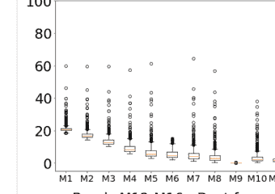
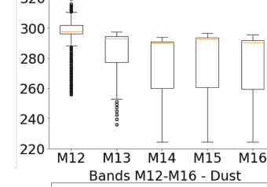
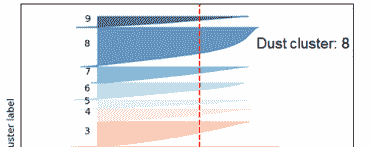
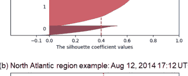
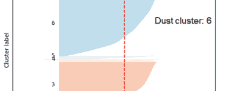
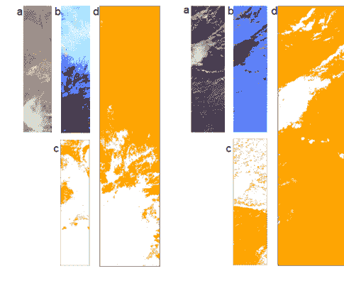
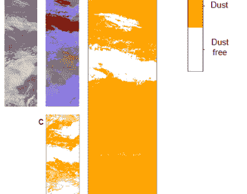

# 2020 IEEE 大数据国际会议 (Big Data) ｜ 用于粉尘检测的图像分割

**Manzhu Yu**  
地理系  
宾夕法尼亚州立大学  
大学公园市，宾夕法尼亚州，美国  
mq5198@psu.edu

**Julie Bessac**  
数学与计算机科学学部  
阿格贡国家实验室  
莱蒙特，伊利诺伊州，美国  
bessac@an.gov

**Ling Xu**  
数学系  
北卡罗来纳州科技州立大学  
格林斯堡，北卡罗来纳州，美国  
lxu@ncat.edu

**Aryya Gangopadhaya**  
信息系统系  
马里兰大学  
巴尔摩，马里兰州，美国  
ngangop@umbc.edu

**Yxi Shi**  
地球系统技术联合中心  
马里兰大学  
巴尔摩，马里兰州，美国  
ysh22@umbc.edu

**Jianwu Wang**  
信息系统系  
马里兰大学  
巴尔摩，马里兰州，美国  
jianwu2@umbc.edu

**摘要**——源自干旱和半干旱地区的沙尘云会显著影响气候系统和人类健康。目前已开发出许多从卫星图像中识别沙尘像素的方法，但这些方法受限于光谱规则，因此难以检测探测阈值之上或以下的沙尘。监督机器学习方法也被应用于检测沙尘，但由于缺乏地面真值数据，它们在训练数据之外会失效。在这项工作中，我们提出了一种自动分割框架，该框架基于利用可见红外辐射计套件（`VIIRS`）和云气溶胶激光路径器观测（`CALIPSO`）从分配的数据集中学习的光谱特征。我们对 `VIIRS` 图像进行分割，并利用 `CALIPSO` 沙尘产品提供的沙尘标签引导，将沙尘簇检测为主要和次要沙尘簇。实验结果表明，该框架的精度优于现有文献，该方法在北大西洋、东亚和北非三个不同区域均表现良好。

**索引术语**——沙尘检测，半监督机器学习，多传感器遥感，图像分割

# I. 引言

沙尘事件是干旱和半干旱地区的常见现象，通常在强风吹起来自地球表面的细颗粒时发生。大气沙尘对空气质量、水形成、辐射平衡、生物地球化学循环和气候有影响。另一方面，沙尘暴通常具有破坏性。由于气候的影响，局部尺度的沙尘暴随着气候的变化发生了剧烈变化……

为了解决这个问题，研究人员一直在使用监督学习方法来学习沙尘发生情况与卫星图像像素级光谱辐射之间的关系 [8]。训练后的模型随后被用于确定观测到的像素是否为沙尘。然而，监督学习方法存在若干缺点。坦率地说，它们需要一组标记了沙尘像素的训练示例，对图像进行像素级标记是极其耗时的人力。`CALIPSO` 垂直特征和气溶胶剖面产品被用于分类气溶胶，但 `CALIPSO` 是空间标记的，且可能无法覆盖整个几何区域 [11]。现有的沙尘检测监督学习方法 [8] 利用 `CALIPSO` 沙尘作为地面真值，使用训练好的 `CALIPSO` 离轨模型。即使离轨测试是准确的，离轨检测性能也可能较低，因为模型处理受到离轨沙尘带的数量。其次，很难从卫星图像中检测沙尘，因为将沙尘与其他挑战区分开来具有挑战性。标记沙尘图像也很困难。第三，现有的监督学习方法使用来自 `CALIPSO` 的数据训练，没有考虑到沙尘的变率。众所周知沙尘暴出现在单个像素中——而不是随时间演变；因此，跟踪沙尘暴的卫星内容更有用。

为了解决这个问题，……学习方法；然后它一步到位确定识别出的一个或多个沙尘簇。沙尘聚类基于簇与来自相同时空位置样本之间的相似性。

## 2. 据我们所知，这是首次将半监督学习方法用于从卫星图像检测沙尘。

半监督学习方法适用于这项任务，因为它将利用来自 `CALIPSO` 的有限沙尘带，并产生具有一定精度的分割。然而，这种半监督学习方法是新颖，与现有的图像分割方法（见 II.C 节）不同，且使用了有限的沙尘带。

## 3. 所提方法的沙尘检测验证结合了监督和无监督学习方法的精度指标。仅通过一种学习方法的传统精度不足以评估结果。本研究利用分类、精确率和召回率在像素位于轨道内 `CALIPSO` 时评估结果，然后利用轮廓系数评估聚类质量。结果涵盖轨道内和离轨。

另一方面，无监督学习可以在没有预标记的情况下提取模式，适用于标签稀缺卫星图像沙尘检测。无监督学习无法利用 `CALIPSO` 的沙尘带，因为无监督方法的结果很难与物理意义联系起来。

本文旨在开发一种利用半监督学习的自动框架，结合无监督学习和 `CALIPSO` 从 `VIIRS` 图像检测沙尘。首先应用 `K` 聚类生成 `VIIRS` 图像簇，然后根据与 `CALIPSO` 沙尘特征的相似性选择一个或多个簇作为沙尘簇。沙尘特征展示了不同波段观测值的密集值。这种方法解决了固定阈值和参数的局限性并确保了可重复性。

本研究的创新性来自三个领域：

- 1) 方法论。如上述，监督和无监督学习方法都有局限性。本研究提出了一种新的半监督学习方法来解决这些局限性。该方法首先使用无监督方法对卫星图像进行聚类

# II. 相关工作

### A. 传统沙尘检测方法

现有的云团遥感沙尘检测方法使用热红外在 1 微米和 12 微米波附近的亮度温度差（`BDT`）检测沙尘 [12]。该方法分配具有沙尘 `BDT` 值的像素，当观测到 `BDT` 值通常下降到零以下时存在沙尘 [14]。后来，一组带有相应启发式规则的 `BDT` 被用于从气象云中检测沙尘。Ackerman [13] 使用两个传感器，即 `BT11-BT12` 和 `BT08-BT11`（分析 8.5 微米和 11 微米波长的信号）检测气溶胶和沙尘层。Wald [15] 使用两个 `BDT` 识别沙漠地区的沙尘，Miller [16] 增强了对水陆地上白天气溶胶沙尘的调查。然而，`BDT` 已根据各种土地和尘埃属性进行修正，如粒径分布、化学成分和尘埃层 [17], [19]。这些基于阈值的方法对沙尘事件、研究区域或不同季节之间的差异非常敏感 [19], [20]。深蓝（`Deep Blue`）已被用于计算 412 nm 波段的气溶胶光学深度（`AOD`），其中气溶胶与沙漠等明亮表面之间的对比使其更容易从尘埃中检测出沙尘 [6]。也可以使用深蓝算法。最近的沙尘检测方法依赖于每个像素的云边界（`BED`）[24]。此外，这些方法采用了多个波段来消除云影响 [21]，其中包括在计算出的索引上应用固定阈值 [5], [22]。然而，这些改进未能充分处理明亮表面（例如沙漠地区）上的某些沙尘识别问题、`BDT` 对表面特征变异（例如烟团高度）的敏感性，以及卷云对云层掩码的影响 [1], [24]。

地中海地区沙尘暴发期间的 `AOD` 值。这些现有方法使用监督机器学习，容易产生引言部分提到的缺点。在某些研究之后，无监督和监督机器学习尚未在遥感图像的沙尘检测中得到研究。

### C. 用于图像分割的半监督机器学习

虽然尚未探索用于沙尘检测的监督机器学习，但近期使用监督机器学习进行各种类型语义分割任务的研究已经存在。

语义图像分割通常使用监督机器学习。其中一种有效的方法是深度卷积神经网络（`DCNN`），它可以使用像素级标签来执行语义分割 [26]。获取像素级标注非常耗时，因此研究人员正在探索使用弱标注（如边界框或图像标签）来训练模型的方法。Papadrou 等人 [27] 使用期望最大化（`EM`）方法，利用边界框或弱标签的混合进行语义图像分割。对于沙尘检测，`CALIOP` 标签是基于像素的，但这些像素位于 `CALIPOP` 轨道上。这些标签不足以形成边界框，也不足以为每幅图像生成一个。

另一个方向是使用无监督学习进行语义分割 [28]。这种类型的语义分割使用完全标记和未标记的图像来执行分割。例如，Huang 等人 [29] 提出了一种用于半监督语义分割的对抗学习，并使用图像来增强结果。训练一个全卷积网络将输入图像映射到分割图。对于沙尘检测，轨道上的 `CALIOP` 标签无法形成完全标记的标签，因此需要探索用于沙尘检测任务的半监督机器学习方法。

### B. 用于沙尘检测的监督机器学习

为了解决固定阈值或参数的局限性可以使用机器学习（包括深度学习）来学习卫星图像之间的复杂关系，从而能够执行统计分析派生结果。一些研究人员已经证明了机器学习（以及深度学习）在沙尘检测中的有效性。许多研究探索了常见的分类方法，包括支持向量机、随机森林、神经网络和卷积网络 [9]。发现机器学习算法优于从统计分析得出的算法 [10]。例如，Smith 等人 [25] 使用人工神经网络（`ANN`）研究了 `SEVI` 和 `CALIOP` 上的云和气溶胶特征。Shi 等人 [8] 执行了监督机器学习方法（包括 `SVM`、随机森林、逻辑回归），利用中分辨率成像仪（`MODIS`）的光谱信息对 `CALIPOP` 轨道上的沙尘或无沙尘像素进行分类。他们还开发了一种结合物理输入与机器学习方法的混合模型。Can 等人 [9] 利用 `VIIRS` 的光谱信息，对 `CALIPOP` 轨道上的沙尘或无沙尘像素分类能力使用了逻辑回归、`K` 近邻、随机森林、前馈神经网络和卷积网络。Kolos 和 Hassan [10] 使用 `ANN` 对在 `AERONET` 站获取的气溶胶光学深度（`AOD`）值与 `SEVI` 亮度之间的关系进行建模。

# III. 区域与数据准备

### A. 区域

在本研究中，我们选择了三个区域（见图 1）：大西洋（74W-30W, 13N-20N），春季（119E-91E, 28N-43N），夏季（30E-60E, 14N-44N），秋季（21E-28E, 30N-60N），冬季（12E-15E, 15N-75N）。这些区域具有不同的 `SEVI` 特性。研究区域包括中比沙漠，该区域覆盖了撒哈拉沙漠的某些沙尘类型 [30]。`CALIPOP` 提供了 532 nm 处的反散射系数以及该区域的沙尘。

### B. VIIRS

可见红外成像仪套件（`VIIRS`）收集跨越 0.41 µm 到 12.1 µm 的观测。其十二通道包括可见光、近红外、中波红外和长波红外，提供了海洋、大气信息。本研究使用了这些这些波段（`M1`、`M2`、`M3`、`M4`、`M5`、`M6`、`M7`、`M8`、`M9`、`M10`、`M11`、`M12`、`M13`、`M14`、`M15`、`M16`）。

### C. CALIPSO

云气胶激光雷达红外路径大气（`CALIPSO`）使用发射极化光在 532 nm 和 1064 nm 处进行弹性散射，配备接收器测量 532 nm 处的平行和正交分量。`CALIPSO` 二级数据（`L2`）提供了气溶胶的垂直分布和反散射

### D. VIIRS 数据下载与处理

本研究基于 Cal 等人 [99] 的协同 `VIIRS` 数据集。`VIIRS` 仅跟踪 `CALIPOP` 观测以减小误差。然而，数据也位于（跨轨道方向 333 km）。为了检测沙尘，我们使用了从 NASA Earthdata 下载的 `VIIRS` 产品（`VNPM002` 和 `VNPM003`）。`VNPM002` 是 `VIIRS/App` 中等分辨率 750 m，`VNPM003` 是 `VIIRS/App` 地形校正 750 m。

划分为 $K$ 个 $(k \le n)$ 子组类 ($C_1, \dots, C_K$)。每个聚类 $C_k$ 由其 $m_k$ 值和通常的任意标签 $k$ 标识。数据集中的观测值被分配给距离其 $m_k$ 最近的聚类，其中欧几里距离被用于衡量聚类中心。K-means 聚类的底层原理是创建一个划分 $(C_1, \dots, C_K)$，使得类内方差之和最小。类内平方和（`WSS`，也称为惯性）以及它们的均值是根据随机猜测聚类中心 $m_1, \dots, m_K$ 推导出的，并通过交替执行这两个步骤直到达到停止准则。第一步是将观测值分配到欧几里距离最近的 $m_k$ 所在的类。第二步是更新，在过程中计算每个聚类中观测值的 $m_k$。使用了多种停止准则，例如均值在容差范围内没有变化、迭代次数以及聚类方差没有改进。

文献中提出了许多 K-means 聚类的变体，这些基于基于初始化方法、距离或不同的聚类表示。例如，K-medians 使用每个聚类的位数代替平均值。然而，这些方法与当前的 K-means 相似，且其结果未包含在本文中。

### B. 尘埃类的确定

在基于 K-means 对聚类进行聚类后，确定哪个类（或可能的多个类）代表什么是至关重要的。我们对光谱波段进行了初步数据分析。图 4 显示了在北大西洋地区 `CALIPSO` 轨道上每个波段在尘或非尘类别下的概率分布。在图中，x 轴标记波段，y 轴显示光谱段的值。观察到波段 `M1-M11`（两个子集），尘和非尘显示出均值（橙色线）；然而，尘埃类的分布具有广泛多样性。在波段 `M12-M16`（两个子图）中也看到了类似的特征。两个研究区域显示出不同的分布，尘与非尘类别之间的差异显著。尘与非尘类别之间的显著差异启发了我们在光谱上寻找与尘类别最相似的类，并将它们考虑为尘埃类。

# IV. 方法论

### A. K-Means 聚类

使用 K-means 聚类将 `VIIRS` 图像分割成不同的类。K-means 聚类 [34] 是一种划分观测值数据集 $(x_1, \dots, x_n)$ 的方法。

此处使用的相似性函数是欧几里距离。与尘埃特征相似性最高的类被认为是尘埃类。此外，k-means 聚类可能包含信息，特别是由于几种类型的尘埃（纯净、污染的等）。如果其他类与尘埃特征的相似值在一个很大范围内，且相似值也足够高，那么这些类被视为潜在尘埃类。当聚类数 (`K`) 较大时，潜在尘埃类可以完成较小的尘埃区域。

# V. 实验与结果

在本节中，我们展示了所提方法生成的尘范围，并与同位的 `CALIPSO` 轨道进行精度指标比较，同时使用轮廓系数评估尘结果的质量。我们比较了所提方法在不同区域的性能。我们还计算了所提方法和物理推断方法产生的准确率值。在实验中，通过观察大量数据集的聚类质量，将聚类数设置为 `K=10`。

实验在 UMBC 性能计算设施 (`HPCF`) 的服务器上进行。我们提出的方法用 Python 实现，并使用了多个库，如 `Satpy`（用于卫星图像）、`scikit-learn`（用于 K-means 聚类）和 `matplotlib`（用于绘图）。

### A. 使用所提方法的尘范围

展示了三个不同区域的结果。为了量化尘检测的准确性，使用了沿 `CALIPSO` 轨道的像素来验证结果。这可以被视为沿 `CALIPSO` 轨道验证尘与非尘的分类。如果 `CALIPSO` 轨道上的尘类别检测成功，则检测到的非尘像素不在 `CALIPSO` 轨道的尘类别中，那么该特定对象的检测也是成功的。其他情况被视为失败的。

由于原文中部分段落存在重复或表述序乱，翻译已尽可能遵循原文结构。

#### (a) 北非洲示例：2014年7月3日 12:54 UTC

#### (b) 北大西洋地区示例：2014年8月12日 17:12 UTC

#### (c) 亚洲春尘示例：2014年5月5日 06:18 UTC

受限于 `CALIPSO` 窄幅的范围。通过整合多个粉埃像素，`CALIPSO` 数据可能会提高粉埃像素的代表性。所提方法对聚类数量（`K`）敏感。每幅独立的图像可能会揭示不同的初始 `K` 值，而我们在实验中将聚类数量指定为 `K = 10`。

与红外方法 [3] 相比，所提方法实现了更高的平均总体精度（0.64 对比 0.52）。对于粉埃类别，所提方法获得了更高的平均精确率（0.52 对比 0.68 对比 0.99）。这表明，所提方法检测到的粉埃中，属于 `CALIPSO` 观测到但类别较低的粉埃比例更高；然而，所提方法的平均精确率较低（0.82 对比 0.88），但召回率较高（0.60 对比 0.23）。这表明，所提方法检测到的 `CALIPSO` 观测到的非粉埃的比例较低，但在 `CALIPSO` 观测到的非粉埃中，真正被检测到的比例较高。

图 9 显示了从物理红外中提取的粉埃，其中提取的粉埃多于通过所提方法生成的。对比真彩色和粉埃分量，可以观察到物理红外方法在撒哈拉地区提取了更多的粉埃。对于 2014 年 5 月 5 日的情况，物理红外方法将图像的整个南部区域视为粉埃，而真彩色图像显示为厚厚的云。物理红外方法可能检测到了云（图 9 中的白色区域），但有时也会未能检测到云。

### C. 三个研究区域使用所提方法的准确性比较

表 II 测量了使用所提方法在三个不同区域的精度指标平均值和标准差。所提方法在检测亚洲春尘区域表现最好，准确率为0.71，但在检测北大西洋地区粉埃方面表现最差（0.060）。

对于粉埃类别，三个研究区域的平均精确率范围在 0.55 到 0.63 之间，50% 的粉埃是被 CALIPSO 观测到的；但平均召回率在三个区域之间存在显著差异。北北极地区的平均召回率很高（0.99），最低的（0.42），表明不足一半的 CALIPSO 观测粉埃像素被检测到。对北北极地区高召回值的假设是有效的，因为该地区主要是海洋或冰。这比在另外两个研究区域检测粉埃相对容易。北非洲春季地区包含干旱地区或沙漠，这使得很难

图 8. 图 5-7 中三个示例的粉埃系数。(a) 北非洲地区，平均值：0.40；(b) 北北极地区，平均：0.42；(c) 亚洲春尘地区，平均：0.36。

## 表 I

所提方法与红外方法之间轨道上精度的比较。

| | 所提方法 | Ackerman (1997) | |
|---|---|---|---|
| 总体准确率 | 平均值 | 平均值 | |
| 精确率 (粉埃) | 0.64 | 0.52 | 0.13 |
| 召回率 (粉埃) | 0.68 | 0.32 | 0.03 |
| 精确率 (非粉埃) | 0.83 | 0.88 | 0.27 |
| 召回率 (非粉埃) | 0.60 | 0.24 | 0.17 |

### (I) 2014年7月3日 12:54 UTC

### (II) 2014年8月12日 17:12 UTC

复杂的表面类型混合，包括灌木、森林和沙漠。

对于非粉埃类别，平均精确率范围在 0.68–0.96 之间，大西洋地区精度最高，北非洲地区最低。这表明在大西洋地区，几乎所有 CALIPSO 观测到的非粉埃都被检测到，但在北非洲地区，小于 70% 的非粉埃被检测。大西洋和亚洲研究的平均值为 0.78 和 0.70，而大西洋研究的平均值较低（0.33）。这表明在大西洋地区只有 33% 的 CALIPSO 观测非粉埃像素被检测到。这是由于 CALIPSO 观测到的非粉埃包含了云以及大陆气溶胶或烟雾等类型。大西洋研究包含的像素多于其他区域，因此平均值最低。

### (III) 2014年5月5日 06:18 UTC

# VI. 结论与展望

在本文中，我们使用半监督学习方法从卫星图像中识别粉埃。我们设计了一种工作流，从 CALIPSO 识别像素中提取时空范围，并使用这些数据选择 K 均类作为最终结果。我们在不同实验中检查了方法的效率，包括：

- 在不同区域检测粉埃的能力
- 比较不同方法的平均准确率
- 使用常用分类对所有像素验证我们的结果
- 使用轮廓系数评估聚类性能

图 9. 物理方法得到的图 5-7 真实示例的粉埃结果。(a) 真彩色，(b) 粉埃复合图，(c) 所提方法的生成是 Ackerman [3] 生成的粉埃结果副本。

对于未来的工作，我们将从以下方向改进这项研究。首先，我们将通过与现有气溶胶和粉埃产品对比来验证粉埃结果。我们将使用的产品之一是可见光辐射计数据套环境数据 (VIIRS Aerosol EDD) 产品 [35]，但该产品未检测到它。我们将寻找替代产品。此外，我们将使用 CALIPSO 数据引导聚类，但 CALIPSO 数据仅沿轨道可用；因此无法用于全监督方法的空间聚类。第三，我们将探索半监督方法作为使用少量 CALIPSO 派生层分割粉埃的替代方案。

## 表 II

三个粉埃区域使用所提方法的轨道上精度比较

| | 北非洲 | | 大西洋 | | 亚洲 | |
|---|---|---|---|---|---|---|
| | 平均值 | 标准差 | 平均值 | 标准差 | 平均值 | 标准差 |
| 总体准确率 | 0.56 | 0.15 | 0.51 | 0.60 | 0.72 | 0.07 |
| 精确率 (粉埃) | | | | | | |
| 召回率 (粉埃) | 0.42 | 0.19 | 0.99 | 0.01 | 0.67 | 0.33 |
| 召回率 (非粉埃) | 0.78 | 0.12 | 0.33 | 0.13 | 0.70 | 0.15 |

亚洲区域包含更多粉埃，因为用于粉埃检测的半监督学习方法很容易采用其他卫星产品，例如 `MODIS` 的 Level 1 产品、`地止卫星服务器 (GOES)` 和 `增强可见红外传感器 (SEVIRI)`。此外，可以使用可用地面真值标签的签名矩阵程序添加到其他类型事件的检测中，例如野火、热带气候、沙尘暴。

这项工作由国家科学基金的“网络培训：利用增强计算基础设施对计算、应用数学和大气科学研究人员进行交叉培训”资助（号 `OAC-1703250`）。计算使用的硬件是 `UH` 高性能计算 (`HPC`) 设施。国家科学基金通过资助（号 `NSF-1233334`, `NSF-1293116`）和 `SCMS` 计划（号 `DMS-082131`）资助这项工作，并得到了马里兰大学巴尔摩分校 (`UMBC`) 的额外支持。有关 `HPC` 及其使用的项目的更多信息，请参阅 `hpc.umd.edu`。Julie Bass 受到美国能源部科学办公室大气研究计划的资助，基金号 `DE-AC02-06CH1157`。

# 致谢

# 参考文献

[13] McLean, P. E., 1998. Global surface temperature and cloud coverage for aerial optical estimates. International Journal of Remote Sensing, 19(6), 960–966.

[14] Pratt, A. J., 1989. Infrared transfer calculations for dust research.

[15] Wilde, A., 2003. Detection of dust events using infrared wavelengths. Journal of Geophysical Research, 108(D4), 3205–3218.

[16] Sokolov, S., 2006. Detection of dust events.

[17] Shenk, W. E. and Curran, R. J. 1974. The detection of dust storms over land and water with satellite infrared and visible sensors. Monthly Weather Review, 102(12), 836–837.

[18] Lloyd, S., 1982. Least squares projection in PCCC. IEEE Transactions on information theory, 28(2), 199–213.
