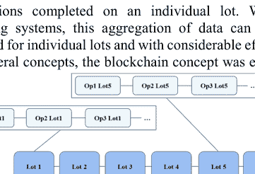
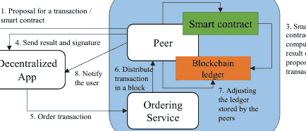

# 2020 IEEE 工业工程与工程管理国际会议 (IEEM) (新加坡 2020.12.14-2020.12.17)

## 摘要

区块链技术为运营管理提供了多项优势，但大多数被报道的概念和应用仍然很少见。本研究指出了一项案例研究的结果，该研究分析了区块链技术在行业 300 毫米晶圆制造前线制造中的适用性。在此，使用了多种不同的集成数字解决方案来访问具有不同视图和限制的中心化数据库。我们通过设计科学法评估了是否以及如何设计区块链解决方案来增强制造的分析能力，并通过层次分析评估了所设计应用的经济价值。

与晶圆厂的制造过程相关（包括易变性、高产品品种、复杂的工艺流程以及昂贵设备的容量限制）。为了分析区块链在半导体制造中的适用性，我们对位于德国德累斯顿的英飞凌科技公司 300 毫米晶圆厂进行了案例研究。在过去的几年里，各个部门实施了不同的数字工具，所有工具都访问具有不同视图和限制的中心化数据库。我们利用 Heverner 等人 [9] 的设计科学研究方法，探索了在半导体生产中将区块链作为去中心化手段的想法，并通过层次分析法评估了所设计应用的经济价值。

**关键词** `区块链技术`，`半导体制造`，`案例研究`

## I. 引言

在工业 4.0 行业中，运营管理（OM）可能会使用多种技术 [1]。具有对运营管理、制造和供应链管理（SCM）产生重大变革潜力的技术之一是区块链技术，它基于去中心化、透明性和可见性 [2–4]。区块链可以被视为一个无赖系统，因为没有任何实体可以控制任何特定组件。该技术通过不可篡改的交易记录和去中心化治理来验证网络信任 [2]；在行业内首次考虑在供应链管理中使用区块链后，运营管理和制造领域至今尚未得到深入考虑 [5]。尽管整个行业都认可了其发展潜力，但关于该技术成功应用的出版或报告较少 [6]。

特别是制造业，在当前的投资革命中需要调整其战略目标和任务。超越围绕技术的炒作，并在工业 4.0 背景下识别真实潜力至关重要。在本文中，我们关注最复杂和集成的领域之一：半导体制造。为了遵循超越摩尔（More-than-Moore）的方法，半导体制造商在自动化以及生产力提高方面投入巨大，并处于使用传感器和物联网技术的虚拟生产控制的前沿 [7]。然而，本研究回答了关于区块链技术应用于运营管理的两个问题，特别是在半导体行业并考虑到本案例的具体情况：

> **RQ1:** 区块链制造如何从生产数据存储、分析和可视化的新技术中获益？区块链解决方案是否适用？
>
> **RQ2:** 对于半导体制造的适用案例，区块链应用应如何构建？它与现有技术相比表现如何？

本文的其余部分结构如下：在第 2 节中，我们介绍了研究方法，随后在第 3 节收集了该案例的结果。第 4 节展示并讨论了发现，第 5 节将得出结论。

## II. 方法论

为了分析区块链技术是否可以成为半导体行业的解决方案，我们对德国德累斯顿英飞凌的 300 毫米晶圆厂进行了案例研究。案例研究采用了 Heverner 等人 [9] 的设计科学研究（DSR）。这种方法源于信息系统研究，旨在提高研究中心组织的效率。

## III. 结果

通过分析我们案例研究中的制造过程和支持性 IT 系统，识别出了三个问题：高产品品种、复杂的工艺流程以及客户订单对有限容量的竞争。这三个问题导致了脆弱的流程、过载期间，甚至是单个工艺流程的剧烈波动，以及在生产、人员和维护规划方面存在大量不安全因素。波动导致维护利用率增加。根据来自批次上游处理步骤的实时数据进行组装，可以在本案例研究的关注下更好地调度下游组装。300 毫米预组装区域高度依赖上游区域，通常在非常短的时间内收到入站制品（WIP）信息，如果数据安全是一项重要问题，因为某些批次在供应链中不同的工厂之间交换，必须为此一致地传输数据。此外，不同部门在某种程度上可以被认为是独立的，数据库中的值可能会频繁变化并导致调度不一致。

所有分析系统都供规划人员和工程师使用，以应对这种情况并为未来的过载做准备。然而，所有这些系统（例如，工艺流程可视化、KPI 报告）都可以访问中心化数据库，该数据库包含生产数据的当前状态，因此起到了整体效率管理（OEE）的作用。目前的分析工具仅基于静态基础，并实时提供所有数据。对于半导体行业管理（OCM）方法比 OEE 更合适。OCM 考虑了动态信息和数据，以考虑生产过程中的变量。实施这一 OCM 的重要步骤是提供具有优化可靠性的高可用性。

### B. 知识库 – 区块链技术

区块链被确定为实现这一目标的可能技术。区块链是一种分布式账本，以块的形式作为地理记录数据中心化存储。通信通过加密网络跨地理分布的节点进行，在网络中所有参与者之间形成不可篡改的账本。各类组织可以在无需信任他人或使用中介的情况下与其他进行通信和数据交换。有关详细的技术描述，我们建议读者参考关于区块链技术的当前和系统性文献综述，例如 [4], [11], [12]。区块链技术可用于多种应用，如公共记录和消费者配置。此外，合约的安全性可能是运营管理和供应链管理最重要的方面。智能合约代表了一种计算机化的协议，一旦满足一组合同条款即可实现自动化。除了自动化本身以及通过智能合约提高效率外，区块链应用的其他属性还包括不可篡改性、透明度和透明性 [11]。通过这些技术特征，区块链作为一种去中心化的数据存储技术可以提供更高水平的可靠性、透明度、灵活性、不可逆性，以及通过中心化区块链实现完整性，同时消除了网络连接、信任和监控的成本。然而，由于网络中没有中央监督，必须针对特定需求考虑包括权限、漏洞、法律影响、计算和数据存储能力以及扩展性在内的若干问题。

为平台改进数据提供和交换具有最大的潜力。在区块链中，将创建一个单独的区块链来跟踪每个操作的状态和完成情况。这使得能够在原始数据库上对预组装进行及时的预计划。单独的区块链可以连接成一个通用的去中心化区块链，如图所示。

最近的综述确定了大量关于供应链管理（SCM）和运营管理（OM）中区块链的科学论文 [4, 6]。近期关注的重点是工业领域中由 OM 产生的成功概念证明或应用。安全性、知识产权担忧或标准化，以及互操作性是采纳的主要障碍 [14]。一些作者从技术角度对制造应用做出了贡献 [15, 16]，而另一些人则强调了区块链在追踪和为价值产品提供解决方案方面的优势，以确保声明的普及率 [17]。IBM 和马士基（Maersk）开发了一个名为 TradeLens 的平台解决方案，用于全球化贸易活动 [18]，OM 是业界采纳区块链最有前景的领域之一 [19]。供应商合同管理、数字威胁缓解，以及生产和维护是未来应用中可能出现的机遇。

一旦确定了通用流程，下一个决策涉及网络类型。由于存在机密数据，公有区块链并不适用。例如，对于私有区块链，目前仅允许供应链合作伙伴在区块链内交换数据。随着未来操作中网络中加入更多合作伙伴，这种模式可以适应于私有区块链。

该应用选择了一个开源框架。由 Linux 基金会（Linux Foundation）协调的 Hyperledger 项目其成员已加入该项目社区和区块链框架，以优化服务业和制造业的解决方案。一个非常活跃的社区提供开发支持文档、教程以及行业标准的协助。`Hyperledger Fabric` 因其在工业中应用中的适用性被选用于该用例 [22]。

多位作者支持实施案例研究中的实施挑战和有效措施 [21]。此外，区块链应该被视为 OM、SCM 和制造业数字化转型的技术，并始终关注技术的经济价值。

`Hyperledger Fabric` 由区块链和所谓的“世界状态”组成。区块链不可逆地跟踪更改数据集状态的交易，并提供系统的当前状态，但不包含交易历史，这使得在新交易产生后计算数据状态的过程更加高效。智能合约——为区块链编写的程序——可以直接执行，而无需在区块链中存储历史。世界状态将在每次交易后发生变化且是不可逆的。唯一令牌（token）被用作集合和所有相关数据（例如：日期、价格、产品类型、循环时间）的键。

### C. 区块链解决方案的开发

根据 Diterich [22]，可行性评估利用了根据多位专家访谈输入开发的特定案例。该概念基于一种区块链，它可以跟踪在单个批次上执行的所有制造操作中的单笔交易。使用现有系统，这种方法创建视觉化效果且耗费大量精力。在几个概念中，区块链概念被估算为

1. 提议的交易（智能合约）
2. 调用智能合约

3. 智能合约计算提议交易的结果。
4. 发送结果和签名
5. 通知他人
6. 分发区块
7. 由节点开始调整状态
8. 排序交易

这展示了一个智能合约并连接了结果数据集。如果执行正确，节点（peer）将通知应用程序该交易可以发布。当节点联系负责形成区块的排序服务时，网络中的所有节点都会接收到区块。一旦节点从排序服务接收到区块，其区块链账本副本就会更新。然后，每个参与者都设置应由区块链支持的业务流程。如下所示了一个用于数据查询和新交易的简化智能合约。第 2 行和第 5 行代表去中心化应用传输到节点的数据。

基于工业 4.0 和数字技术的共同决策设计，如图 4 所示。

确定了三个用于分析层次结构的主要标准，以评估该概念（基于 [10]）：技术标准、组织标准和经济标准。标准的权重通过文献综述和来自德累斯顿（Dresden）半导体晶圆厂的外部经验确定。总体而言，经济标准被认为是最重要的（54%），其次是技术标准（34%）。组织标准对于这一决策也是重要的（12%），因为有需要的组织可以快速适应变化。在案例中，将区块链与当前的解决方案进行了对比，其中使用了不同的软件工具进行数据库管理。尽管如此，在技术标准方面，区块链并不占据主导地位，但在数据质量、完整性和容错性方面表现更优。然而，其他标准由作者确定。专家提供了透明度、安全性、可定制性、数据标准化、战略契合和知识增长。完整的调查细节、AHP 结构和结果在附录中提供，由于空间限制可通过 [24] 获取。

### D. 区块链解决方案的评估

使用层次分析法（AHP）评估新区块链概念的经济价值。将区块链数据存储的潜力与案例中建立的中心化数据库系统的潜力进行了比较。为此，做出了决策：

| 决策类别 | 权重 | 区块链 | 数据仓库 | 决策类别 | 权重 | 区块链 | 数据仓库 | 决策类别 | 权重 | 区块链 | 数据仓库 |
| :--- | :--- | :--- | :--- | :--- | :--- | :--- | :--- | :--- | :--- | :--- | :--- |
| 技术 | 0.34 | 0.49 | 0.51 | 组织 | 0.31 | 0.38 | 0.17 | 经济 | 0.54 | 0.74 | 0.26 |
| 可行性 | 0.23 | 0.20 | 0.80 | 透明度 | 0.31 | 0.63 | 0.17 | 标准化 | 0.23 | 0.89 | 0.11 |
| 数据质量 | 0.32 | 0.57 | 0.12 | 可用性 | 0.24 | 0.27 | 0.13 | 资源效率 | 0.20 | 0.89 | 0.11 |
| 数据完整性 | 0.14 | 0.80 | 0.20 | 服务 | 0.17 | 0.17 | 0.66 | 客户导向 | 0.12 | 0.75 | 0.25 |
| 用户友好性 | 0.11 | 0.25 | 0.75 | 培训 | 0.08 | 0.17 | 0.75 | 简单性 | 0.11 | 0.87 | 0.13 |
| 容错性 | 0.08 | 0.11 | 0.89 | 可定制性 | 0.05 | 0.80 | 0.25 | 战略契合 | 0.06 | 0.83 | 0.11 |
| 延迟 | 0.04 | 0.25 | 0.75 | 环境与人员 | 0.03 | 0.25 | 0.72 | 知识增长 | 0.04 | 0.89 | 0.11 |
| 扩展性、可比较性 | 0.03 | 0.17 | 0.83 | | | | | | | | |

图 4. 区块链解决方案与数据仓库解决方案的 AHP

## V. 结论

区块链技术为制造业提供了巨大的潜力，正如本文贡献所示，特别是在半导体行业。区块链能够提供保障水平的安全性、透明度和不可篡改性，而这些特性是目前任何中心化数据存储都无法提供的。在所考察的标准中，区块链的表现优于传统解决方案，并带来了极具前景的结果，尤其是在关键领域。然而，通过工业领域区块链获取的知识表明，可以使用更复杂的案例。这可能包括在外包半导体制造时引入“按需付费”功能，以简化财务控制。我们未来的展望包括将更多的生产设施和企业纳入网络，因为当在多方之间交换数据时，区块链特别有用。

## 致谢

本研究受欧盟项目 Id40 的支持。Id40 项目由 ECS 联合体（JU）资助，资助编号为 87613。该联合体获得欧盟“地平线 2020”研究与创新计划的支持。它来自财团成员以及奥地利、德国、比利时、西班牙和罗马尼亚的资助。内容并不一定反映欧洲联合体的官方意见。文章中所表达的信息和观点完全属于作者。

## 参考文献

- [1] A. G. Frank, L. S. Dangango, and N. F. Ayala, ‘Blockchain technology implementations in manufacturing’, J. Ind. Econ., vol. 220, pp. 15-26, 2019; doi: 10.1016/j.indeco.2019.01.004.
- [2] M. Swan, ‘Blockchain for Biproxy: A new entry’, 2019. Sebastopol, CA: O’Reilly Media.
- [3] T. Tapaswi and A. Tiwari, ‘How Blockchain Can Change Our Organizations’, Digital Today, vol. 58, pp. 1-10, 2019; doi: 10.1007/s12522-019-0333.
- [4] Y. Wang, J. Han, and P. DeVaney, ‘Blockchain technology for manufacturing supply chain: a systematic review of the literature’, Int. J. Prod. Res., vol. 24, pp. 62-84, 2020; doi: 10.1080/00198838.2018-18148.
- [5] A. Graver, B. Kraus, and S. Bailey, ‘Fab2bc: A Strategy for Peer-to-Peer Networks in Manufacturing’, IEEE Transactions on Manufacturing, vol. 26, pp. 1180-1192, 2018; doi: 10.1109/TMAC.2018.2781054.
- [6] G. Glassey, J. Eisenberg, and G. Hahn, ‘Blockchain Technology in Supply Chain Management: An Opportunity’, Proceedings of the 52nd Hawaii International Conference on Computer Systems, 2019, vol. 6, pp. 6885-6893,
- [7] L. Münch, R. Uzai, and J. W. Fowler, ‘A review of semiconductor supply chain management using blockchain technology’, Int. J. Prod. Res., vol. 754, pp. 1-20, 2020; doi: 10.1080/00202753.2017.1401234.
- [8] J. Luhn, C. Fischer, R. Lasch, K. Bittner, B. Zetter, and G. Schubert, ‘Blockchain in Manufacturing: State-of-the-Art in Science and Industry’, 2020.
- [9] A. H. St, T. March, K. Park, and S. Ram, ‘Blockchain design in Information Systems Research’, MIS Q, vol. 28, no. 1–75, 2021.
- [10] R. W, ‘The analytical hierarchy process-how it works and what it is’, Math Research, vol. 35, pp. 1-76, 1981; doi: 10.1007/BF0094447-8.
- [11] R. Cole, M. Stephanidis, and J. Johnston, ‘Blockchain applications in operations and supply chain management’, Supply Chain Management, vol. 24, no. 5, pp. 311-324, 2019; doi: 10.1108/SCM-07-2018-02439.

## 参考文献

- [12] K. Wang, S. Zhang, and C. L. Lo, ‘Blockchain applications in supply chain, transparency and logistics: a systematic review of the literature’, *Int. J. Prod. Res.*, vol. 58, pp. 5-26, 2023; doi: 10.1080/00198837.2021.1693354.

- [13] M. Laacity and S. Han, ‘Exploring Preliminary Challenges and Emerging Best Practices in Enterprise Blockchain Applications’, *Proceedings of the 2nd IEEE International Conference on Information Systems*, 2019, pp. 4665-4674, doi.

- [14] N. Petramann, H. Heck, and S. van Baij, ‘Real-world solutions for all industries’, 2019.

- [15] V. Barucci, J. Li, and W. Wang, ‘Blockchain cloud map for manufacturing: Mapping of the smart factory’, *SmartX 2019*, 10258.

- [16] J. L. Wang, ‘Applications of Blockchain in Manufacturing Within Developing: Management of the German Academic Association’, *Springer: Berlin*, 2021.

- [17] Everledger, ‘Real-world solutions’, 2019. https://www.everledger.com/industry-applications.

- [18] Tradelen, ‘Digitalizing the Global Supply Chain’, 2019.

- [19] S. Paai and E. Ali, ‘Does blockchain help the key to a new era of supply chain transparency?', *Research Insight*, 2020. https://doi.org/10.1108/RHI-03-2019-0050.

- [20] Stahel A, ‘Industry 4.0: Index’, 2018. https://www.weforum.org/sites/default/files/2017-07/Industry_4.0_Index.pdf

- [21] L. Gentleman, ‘Blockchain in Digital – Einmatz-Potential, Transformation-Einheiten, Transformation-Potential’, 2020. https://www.bitcoin.com/Blockchain/Digital-Einmatz-Potential-Transformation-Einheiten-Transformation-Potential.

- [22] V. Dichmeier, M. Tafer, and J. Sanchez, ‘Analysis and Application of Blockchain in the Manufacturing Industry’, 2018. doi: 10.1109/IJCC.2018.8821895.

- [23] Hyperledger, ‘Open Source Blockchain Technologies’, 2020. https://www.hyperledger.org/

- [24] Appendix, doi:10.25532-OPARA-8.
