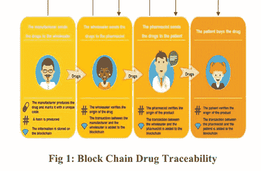

# 2020 IEEE 机器学习与应用网络技术国际会议 (ICMLANT)(印度海德拉巴 2020.12.20-2020.12.21) 2020 IEEE 机器学习与应用网络技术国际会议

Wetha M S 女士
助理教授，
信息科学与工程系
BMS 技术与管理学院
印度，班加罗尔
swethams_isc204@bmsnit

Muneshwari M S 先生
助理教授，
计算机科学与工程系
BMS 技术与管理学院
印度，班加罗尔
muneshwarams@bmsnit

Pushpak K 博士
教授，
信息科学与工程系
BMS 技术与管理学院
印度，班加罗尔
npushpak@bmsnit

**摘要—** 区块链技术以其在金融、银行和加密货币等领域的应用而闻名，这些都是可以安全存储和传输的敏感数据。区块链的一个重要优势是其去中心化的特性。在中心化系统中，数据存储存在许多缺点。区块链使用即时消息传递。区块链面临的风险之一是我们避免了单点故障。区块链的这一优势可以用于增加物联网（IoT）设备的数量，从而转向患者的医疗数据。本文旨在探讨区块链不仅可以用于保护电子健康记录（EHR）中的患者信息，还可以允许他们在在必要时向实体授予权限。我们在这里使用了 Hyperledger，以展示 EHR 如何在医生、患者等网络中的各种实体之间分布。

易于访问。链条是由 EHR 上的数据创建的，我们可以利用它来感知患者状况，并方便地传输数据 [6]。这减少了涉及的时间和金钱。

区块链在哈希方面具有极重要性和效率。正如其名称所示，它是记录的扩展列表，被称为区块。这些区块中的每一个都使用密码学相互相连。每个区块不仅包含自身的密码学哈希值，还包含前一个区块的哈希值。它还包含时间戳或交易。此外，它还包含某些与交易相关的其他数据 [9]。交易通过梅克尔树（Merkle Tree）表示。

**关键词—** 电子健康记录（EHR）、电子医疗记录（EMR）、Hyperledger、以太坊、智能合约

#1 引言

区块链是由中本聪（Satoshi Nakamoto）某个人或一群人发明的。用于比特币的区块链变得流行，它是第一种不需要任何中心或某些第三方就能解决双重花费问题的数字货币 [3]。此后，区块链开始在供应链、物联网、医疗保健等其他领域进行广泛应用。

医疗保健系统中的区块链起着至关重要的作用，并变得越来越流行，因为它有助于患者和医生实时提供数据，其中双方可以在世界的不同部分，创建安全的且

一个区块是一个记录，它是不可修改或删除的。它最重要的属性之一是它是一个开放且分布式的账本。它以一种非常符合规范且几乎永久的方式记录了发生在多个参与方任何两个之间的交易 [2]。区块链在块链链上增加了一个用于通信和存储新区块的平台，并由 P2P（点对点）网络管理。如果任何区块被修复，则需要网络共识。区块链具有拜占庭容错性，因为数据没有被篡改并且已变得非常安全。

区块是记录中的一个，它持有一系列有效交易，这些交易经过哈希处理并以梅克尔树的形式存储。正如我们所说的，区块包含自身的哈希值和前一个区块的哈希，它通过时间戳进一步加密 [8]。因此，如果区块中的任何数据以任何方式被修改或篡改，哈希值就会发生变化，并且与下一个区块中的值不匹配，因此我们就知道它被修改了。另一个重要术语是

区块时间（block time），即网络生成新区块的平均时间。

区块时间与交易速度成反比。因此，较短的区块时间意味着更快的交易。当数据存储在由 P2P 网络管理的数据库中时，它消除了中心化系统中发生的若干缺点 [14]。区块链使用哈希机制。区块链面临的风险之一是避免了单点故障。区块链使用密码学。

混合区块链，正如其名称所示，是公有链和私有链的结合。由于数据是高度分类的且应保持私密，混合链被用于医疗行业。公有链被授予了访问它的人员。

#3 智能合约

密钥（Key），正如其名称所示，是区块链上的地址。私钥类似于所有者可以使用的密码。区块链是一个可以在其上执行合约的平台。智能合约基本上是运行在区块链上的程序。触发条件和业务逻辑，因此智能合约通常控制值和状态 [4]。它们用于两个或多个双方之间。

智能合约的工作方式

工作证明非常困难。但很容易验证。工作证明可以随机产生且概率较低 [16]。因此，需要大量的实验和尝试来触发并执行相应的操作。

-   1. 智能合约在提交之前必须在区块链上达成一致并签署。

-   2. 智能合约在区块链上提交之前。

-   3. 创建智能合约的用户可以通过发送交易来调用合约。

- 4. 矿工随后将验证交易。

-   5. 代码在沙箱执行环境中执行。

- 6. 在预言机（即可信数据源）上并且

#2 区块链的类型

区块链的类型如下所示：

## 公有链
这种类型的区块链没有访问限制。任何拥有互联网连接的人都可以成为验证者。此外，他们还可以进行交易。区块链的流行例子是比特币和以太坊。

### 私有链与公有链不同，除非是网络管理员，否则任何人都可以加入或访问数据。访问权限授予参与者以及验证者。这种类型的区块链对于希望将区块链集成到网络但不想与公共互联网共享任何内容的公司非常有用。

联盟链
这种类型的区块链被认为是去中心化的。这也是一种许可网络，并非完全由私有公司控制，每个运行的节点将控制它。联盟链管理员在必要时向用户授予访问。此外，只有少数一组节点将被授予访问以执行共识协议。

#4 文献综述

电子健康记录（EHR）在医疗保健行业起着至关重要的作用。它是以记录形式存储的患者病史。它包含了患者状况、治疗进展、提供的处方等细节。

Anastasia Theondoni 等人，区块链方法最初设计并用于会计和财务部门。但现在它在各种应用中都有用途，特别是在医学领域 [1]。患者健康详情可以在任何时间保存和共享，在获得患者许可的情况下让任何人需要。本文是

专注于区块链技术，通过保持安全的数据访问来维护患者医疗数据的隐私和共享。

| 关键问题 | 解释 | 当前系统面临的挑战 | 使用区块链提供解决方案 |
| --- | --- | --- | --- |
| 实体认证 | 必须经过验证或认证的信息，如用户名、电子邮件、密码和时间戳 | 在当前系统中，这些非安全数据交换系统中的身份相关信息处于非活跃状态。 | 在区块链上，每笔交易都通过私钥进行数字签名并与私钥共享。 |
| 实体信息 | 这些信息包括用户生成的数据，如偏好 | 这些信息存储在孤岛中，效率非常低。 | 使用区块链时，交易包含数据流并以链的形式存在。 |
| 访问控制 | 关于网络中每个实体获得特定访问的详细信息。 | 用户对可能提供的权限没有控制权，可能无法提供访问控制。 | 区块链防止被允许允许的患者操纵数据。 |
| 效率 | 这包括患者数据的存储、交换和分析。 | 数据传输方法效率低下。即使使用标准化工具，这些操作也都是手动的。 | 区块链为数据传输提供了效率和安全性。 |

Jinglin Ou 等人，本文提供了医疗系统与智慧城市之间的集成，为智慧城市中的患者提供了更方便、质量更高的生活[2]。此外，使用区块链方法帮助系统将患者数据存储在安全的加密存储中。

Thomas K 等人，区块链技术[3]已成为医疗系统中广泛使用的技术，改进每天都在发生。主要关注的三个方面是：i. 降低成本 ii. 数据隐私与患者数据共享。iii. 访问控制、效率和透明度。通过此，能够有效的方式实现智慧城市与区块链的集成。

Tanesh Kumar 等人，众所周知，区块链最初的应用是在金融和银行业，在医疗保健领域[4]，挑战很大，因为透明度和信任起着至关的作用。为了应对这些挑战，正在根据所有利益相关者之间的预定义协议在医疗系统中创建安全的智能合约。

表 1：区块链可用于填补医疗管理系统中目前的空白

Hoai Xuan Huan 等人，物联网 (IoT) 技术在目前的技术起着至关重要的作用 [5]。它被广泛应用于智慧城市、医疗等所有领域。在物联网与区块链的集成中，区块链通过以太坊协议帮助创建区块链方面发挥着至关重要的作用。在这里，患者的健康状况通过传感器进行监测，数据将由医生自动添加到医院管理的区块中，即使他们远离医院，医生也可以独立地治疗患者。

Jayneel Ora 等人，安全泄露事件不断增加，这在医疗保健系统中是一个严重问题。当医疗保健出现安全问题时，我们需要患者信息，而隐私将面临危险[6]。通过提供数据安全存储框架的改变数据共享的方式来解决问题。电子健康记录，通过这种方式，他正在分析患者、数据提供者和第三方之间的需求。

## 5. 建议系统

因此，在考虑了当前系统的各种挑战和空白后，医疗保健领域的区块链技术。利用能够在许多应用中发挥作用的技术技术关重要，例如，用于安全地共享电子健康记录 (EHR)，它还可以提供访问。可以在区块链中进一步构建智能合约，以避免与网络中的任何方交互。医疗系统中的区块链应该提高数据安全性。

因此，本文的目标不仅在于介绍区块链在医疗系统中的利用。此外，它还阐述了使用区块链进行高效数据传输。

由于当前医疗管理系统的主要问题之一是，患者无法访问自己的医疗数据，并且无法控制谁正在或将访问患者的数据以及访问到何种程度。因此，区块链不仅可以保护 EHR 中的患者信息，还可以在必要时授予输入权限。我们在这里使用 hyperledger 来提供数据访问控制。下表 2 提供了建议系统的步骤：

使用区块链的电子健康管理系统目前的空白如表 1 所示：

| 参与者 | 权限 |
|---|---|
| 患者 | 1. 读取其 EHR 的权限。 2. 为医生/医疗从业人员提供在其 EHR 中写入的权限 3. 为研究机构提供权限。 4. 为实验室提供权限。 5. 撤销医生/医疗从业人员访问其 EHR 的权限。 6. 撤销研究机构访问其 EHR 的权限。 7. 撤销实验室访问其 EHR 的权限。 8. 为其紧急联系人读取其 EHR 的权限。 9. 允许其紧急联系人授予其 EHR 的权限。 10. 为其 EHR 添加属性，例如： 10.1 进行的运动 10.2 烟草/酒精摄入 10.3 服用的处方药等。 11. 将 IoT 数据集成到其 EHR 中的权限 |

EHR 使用研究机构的公钥加密，并将由研究机构的私钥进行解密。

# 3. 患者授予实验室访问权限：

- 患者 X 授予实验室 A 访问其 EHR 全部或部分信息。
- 实验室的 ID 被添加到对应账上 X 的授权资产中。
- 患者的 ID 被添加到对应账上实验室的授权资产中。
- EHR 使用患者的私钥加密。
- EHR 使用研究机构的公钥加密，并将由研究机构的私钥进行解密。

# 4. 患者撤销医生的访问权限：

- 患者 X 撤销对医生/医疗从业人员的访问权限。
- 医生的 ID 从对应账上 X 的授权资产中移除。
- 患者的 ID 从对应账上医生的授权资产中移除。
- EHR 使用患者的私钥加密。
- EHR 使用研究机构的公钥加密，并将由研究机构的私钥进行解密。

# 5. 患者撤销研究机构的访问权限：

- 患者 X 撤销对研究机构的访问权限。
- 研究机构的 ID 从对应账上 X 的授权资产中移除。
- 患者的 ID 从对应账上研究机构的授权资产中移除。
- EHR 使用患者的私钥加密。
- EHR 使用研究机构的公钥加密，并将由研究机构的私钥进行解密。

# 6. 患者撤销实验室的访问权限：

- 患者 X 撤销对实验室 A 的访问权限。
- 实验室的 ID 从对应账上 X 的授权资产中移除。
- 患者的 ID 从对应账上实验室的授权资产中移除。
- EHR 使用患者的私钥加密。
- EHR 使用研究机构的公钥加密，并将由研究机构的私钥进行解密。

# 7. 医生/医疗从业人员查阅患者：

- 医生更新患者 X 的权限，以允许医生 M 访问 EHR。
- 代码将检查医生是否拥有患者 EHR 的权限。
- 医生使用其私钥解密 EHR。
- EHR 使用医生的公钥加密。
- 医生的 ID 被添加到对应账上 A 的授权资产中。
- 患者的 ID 被添加到对应账上医生的授权资产中。

表 2：显示了网络中的所有参与者及其权限。与电子健康的任何形式的交互将被记录为交易。正如我们已经讨论过的，区块链是去中心化的并使用公加密。这些交易也展示了其工作原理：

# 1. 患者授予医生访问权限：

- 患者授予医生/医疗从业人员写入权限。
- 医生的 ID 被添加到对应账上 X 的授权资产中。
- 患者的 ID 被添加到对应账上医生的授权资产中。
- EHR 使用患者的私钥加密。
- EHR 使用医生的公钥加密，并将由医生的私钥进行解密。

# 2. 患者授予研究机构访问权限：

- 患者 X 授予研究机构 Z 访问其 EHR 全部或部分信息。
- 研究机构 Z 的 ID 被添加到对应账上 X 的授权资产中。
- 患者的 ID 被添加到对应账上研究机构的授权资产中。
- EHR 使用患者的私钥加密。

# 6. 区块链在医疗领域的其他应用

如所示，区块链技术可以在以下领域进一步扩展和改进。

## 6.1 医疗数据共享

区块链在医疗保健系统中的一个关键且重要的应用是在系统中的各个主体之间以数字方式共享医疗数据。电子健康记录（EHR）和电子病历（EMR）包含了关于患者的高度敏感的医疗信息。因此，保留这些数据是必要的。

此外，这些数据还应该得到安全保护和共享。可以通过数据去中心化来改进这一点——数据可以在网络中的各种参与者（如患者、医生、医疗人员、保险公司、研究人员、药店机构等）之间存储和传输。然而，为了让如此频繁且如此多的实体，

每个实体都对其交易负责，因此具有透明性。这可以通过区块链技术实现。此外，网络中的所有数据都会同元数据一起被记录。

## 6.2 患者病史的维护

患者的病史也非常重要。这对任何当前的健康问题提供诊断至关重要。研究机构可以使用它来预测和分析健康研究，以发现治疗方法甚至预防措施。检查患者的病史非常有帮助。存储患者的病史是非常安全的。

正如我们已经指出的，这是当前医疗系统中的另一个主要问题。当患者去不同的医院时，他必须向几个已经准备好既往史的医生再次解释。例如，一个例子是在这家医院拍 X 光，尽管在上一家医院已经拍过了。这不仅浪费了时间和金钱，而且对患者的健康也有害。通过标准化和使用区块链来跟踪所有细节、报告和医院就诊历史（即审计追踪），可以避免这种情况。

## 6.3 全球数据共享

患者也可能在旅行，并出现需要就某些疾病寻求治疗的情况。显而易见，之前的病史对于医生为该疾病提供诊断非常重要。这可以通过使用区块链来改进。这里举个例子说明为什么如此重要：患者离开了了他的家乡，远在他乡且无法进行沟通。他在某些情况下被指定进行诊断，但医生开具了某些药物，结果却发现患者对其中一种药物过敏。如果医生能够访问患者的电子健康记录（其中包含所有此类数据），就可以避免这种情况。因此，这可以使用区块链安全地实现。

## 6.4 医疗药品供应链管理

### 用于药品溯源的区块链

图 1：药品链溯源

药品供应链管理面临着由于假品带来的几个问题和损失。从正确的来源获取药物非常重要。此外，药物应该到达供应链的末端即患者手中而不被篡改。出于这个原因，溯源非常重要，但可以使用区块链来实现。

为了概述这是实现的，我们可以查看图1。当药品首次制造时，制造商会对其标记一个唯一代码。使用时间戳产生哈值作为防伪证明。此信息被添加到区块链中。然后制造商将药品发送给批发商。

批发商将验证药品的来源。制造商与批发商之间的交易被添加到区块链中。当批发商将药品发送给药剂师时，药剂师也可以验证药品来源，批发商与药剂师之间的交易被添加到区块链中。

最后，药剂师将药品发送给患者并验证其来源。患者与批发商之间的交易也被添加到区块链中。使用区块链进行药品溯源增加了过程的完整性。

## 6.5 研究

有几家医疗机构出于研究目的需要大量的医疗数据。他们使用患者的医疗数据并进行趋势分析，并根据医疗数据在疾病发生前进行预测，以开发疾病的预防措施。此外，他们还致力于开发某些状况和疾病的治疗方法。出于这个原因，患者可能希望分享他们可能患的情况。因此，通过使用区块链，这些数据可以安全地共享，患者还可以对 EHR 中的不同数据授予权限。

## 6.6 通过加密货币和账单支付医院费用

观察到在当前系统中账单方面存在大量欺诈行为。为了这一目的，可以使用区块链使其无法被篡改。当前系统的另一个问题是获得保险公司的信任需要很长时间（长达几周）。使用区块链确保了更快的理赔，并减少了开销和成本。正如我们讨论过的，区块链是一种非常快速、安全的资金传输方式，也可以作为医院和其他医疗机构的支付模式。

# 7 结论

区块链是一项强大的技术，但如上所示，当前系统中存在诸如丢失等几个漏洞。如果实施得当，区块链可以提高准确性和有效性。未来的研究可以扩展这一领域。

