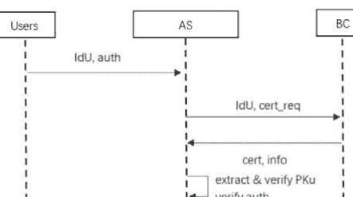
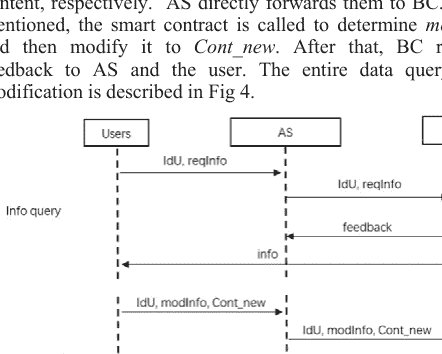

# 2020 IEEE 信息与计算进展国际会议（PIC）（中国上海 2020.12.18-2020.12.20）

摘要—物联网（IoT）用于连接不同领域的用户（设备），如今已变得非常流行。物联网的安全性将发挥日益重要的作用，并需要保护日常生活。然而，物联网仍有许多严重问题待解决，例如去中心化、低功耗设备和轻量级框架、隐私保护。具有去中心化、许可、透明性和不可篡改特性的区块链技术引起了广泛关注。为了解决物联网认证的可信度问题，本文提出了一种基于区块链的物联网框架（BBSF）。它支持证书颁发、更新、撤销和审计功能。我们进行了安全性分析，并展示了数据机密性、完整性和安全性性能。此外，我们部署了带有环境的 BBSF 以验证系统的稳定性、可扩展性和效率。

**关键词—区块链、认证、物联网、智能合约**

# I. 引言

物联网（IoT）是一项代表通信和计算未来的革命性技术。随着物联网的商业化和人工智能的大规模实施，物联网市场已完全出现。然而，当物联网促进先进技术的发展并带来极大便利时，严重的安全问题也出现了。物联网网络中存在严重的安全问题，如去中心化、未经授权的认证、轻量级协议和威胁、恶意攻击等 [1]。

传统的安全机制基于中心化架构。有一个管理所有用户的中心。对于中心化认证，用户的身份由中心机构进行认证和验证。然而，物联网的这种中心化并不适用于去中心化或无中心的网络环境（如物联网网络），在这些环境中，单一中心无法管理各个领域的用户。例如，[4]和[5]中提出的加密方法仅依赖第三方机构，其安全性问题无法通过去中心化认证方法解决，导致服务器容易受到普通攻击，且在多权威假设下实现双向认证 [8]。所有这些问题推动了对区块链应用新型认证机制的需求。

自从区块链概念在2009年提出以来，由于其分布式结构和安全特性，研究领域引起了极大关注。随着以太坊平台的出现，区块链不再仅仅用于加密数字货币。区块链具有广泛的应用场景，包括金融、医疗、教育、信息协会等 [9]。

## A. 文献综述

区块链技术的应用领域不断推动技术的发展。

在[7]中，提出了一种区块链系统方法。算法详述了区块链的原理和应用，并引入了区块链工作的社会发展，为相似研究提供了有用的指导和参考。[8]总结了区块链技术的关键挑战和最新的重要进展，分为三类：公有链、私有链和联盟链。[9]中，作者分析了私有区块链的框架、安全问题，并提供了全面的评估和方法。

许多工作利用区块链并开发了不可信环境下的应用。[10]中，作者提出了一种基于智能合约的物联网认证方案。然而，该方案的计算成本较高；物联网设备[11]提出了一种允许用户进行身份认证和验证的认证授权系统，但可扩展性未得到良好处理。[12]提出了一种用于物联网认证的区块链多无线传感器网络（WSN）认证方案。然而，其分层网络结构具有高可扩展性，且缺乏物联网的去中心化认证方案。我们的方案可以实现方案注册，并抵御伪造攻击和重放攻击等常见攻击。然而，网络中的所有认证都被视为公共账本，导致了（隐私）问题。

为了解决物联网的安全风险，作者提出了一种支持证书、策略和区块链应用的框架[14]。为了维护连接的可信性，[15]提出了一种支持数据完整性的框架；[17]中，提出了一种带带外双因素认证的方案。

## B. 贡献

本文的主要贡献总结如下：

本文使用的符号列于表1。

### 表 I 符号

| 符号 | 描述 |
|---|---|
| `idU` | 用户身份 |
| `ureg` | 用户注册请求 |
| `uSer` | 用户私钥 |
| `pKU` | 用户公钥 |
| `infor` | 用户信息 |
| `info` | 相关信息 |
| `refo` | 区块链信息 |
| `auth` | 认证请求 |
| `ord` | 需要修改的订单 |
| `modif` | 修改的数据类型 |
| `cont` | 修改的内容 |
| `req` | 申请数字证书的请求 |
| `cert` | 证书 |
| `upReg` | 申请更新证书的请求 |
| `verReq` | 申请验证证书的请求 |
| `newCert` | 生成的数字证书 |
| `res` | 撤销当前证书的请求 |
| `aud` | 申请审计的请求 |

# II. 系统模型

## A. 架构概述

所提BBSF的架构如图1所示包含三个组件：用户、认证服务器（AS）和底层区块链。

用户使用相应的公私钥对认证服务器进行注册，证书用于身份。在使用系统之前，用户通过证书向AS进行认证。之后，用户可以使用证书进行更新、撤销和审计。

认证服务器（AS）：AS接收带有相应密钥的用户证书请求。AS生成的证书包含证书、证书有效性、用户公钥和私钥信息。AS还负责认证，并协助用户查询证书和审计。

BBSF（区块链）：BBSF本质上是一个分布式数据系统，智能合约根据定义的规则执行各种操作。我们使用`Truffle`部署合约。

## B. 要求

我们提出了一种能够实现去中心化认证、用户撤销等安全特征的物联网框架。为了适用于物联网网络，必须满足安全性能需求。

1.  **机密性**：这是以明文交换数据的框架的基本要求。
2.  **隐私**：框架中的密钥信息和数据不应被未注册用户或非法修改，以保证系统安全性和所提框架的数据完整性。
3.  **可用**：一方面，当合法用户想要访问时，系统应该是可靠的。另一方面，还应该实现数据可用性，例如数据一致性。此外，数据应该在随时随地可访问。
4.  **审计**：为了检测系统/数据错误，分析记录并报告这些错误，该框架应该是可追溯的。
5.  **系统可靠性**：当系统遇到外部攻击或内部故障等意外情况时，它能够定位故障原因并在系统中进行恢复。
6.  **可扩展性**：该框架应该支持大规模的用户群体。
7.  **效率**：物联网网络中的终端用户通常功耗低且能力有限。因此，设计在小规模存储和计算、短响应时间等方面应该是高效的。
8.  **稳定性与实用性**：系统应尽量避免单点故障，并为用户提供友好的用户界面以执行操作。

# III. 提出的框架 BBSF

针对物联网的去中心化并提高信誉，本节概述了详细的框架和阶段：用户注册、认证、数据查询与修改、证书更新、撤销和审计。

## A. 用户注册

在注册过程中，用户 U 将注册到认证服务器 AS 以申请数字证书，例如 X.509。注册过程如图 2 所示。

图 2. 用户注册阶段

用户 U 首先向 AS 提交注册，包括 `Idc`、注册 U 信息和证书请求。一旦收到请求，AS 会生成一对公钥和私钥 (`SK`)，以及对应于用户的证书 `cert`（例如 `PKU`, `SK`），该证书由 ECC 算法 [3] 生成，证书包含证书主体，通过存储 `cert` 和操作成功将 `cert` 写入新区块的记录。最后，U 将收到注册注册的反馈，`PKU` 和证书将以安全的方式发送给用户。

## B. 用户认证

此过程允许用户执行认证。U 通过发送其身份 `id` 和 `auth` 启动请求，其中 `auth=[timestamp]` 和 `[x]`，`x` 使用密钥 `y` 通过 ECC 算法进行加密。接收到 `Idu` 和 `auth` 后，AS 将验证 `auth`，并将 `cert req` 发给 BC 向 BC 请求相关信息。接下来，AS 验证用户身份。从 BC 接收到相应的 `cert` 信息后，AS 验证 U 的公钥 `PKU`，然后通过 ECC 解密比较接收到的 ID 与解密后的 ID 来验证 `auth`。认证过程如图 3 所示。

图 3. 用户认证阶段

## C. 数据查询与修改

认证后，用户 U 可以从 BC 搜索数据并修改信息。数据查询后，用户 AS 作为请求数据 `Idu` 向 BC 请求 `requinfo`。两个数据都将转发到 BC。随后 BC 将请求的信息 `info` 返回给 AS。如果涉及 BC，U 发送查询：`Idu`, `modifyinfo` 和 `Cont`，其中 `modifyinfo` 和新建的 `Cont` 分别表示要修改的数据类型（例如：个人 U 信息）以及数据查询的类型。AS 直接将上述合约转发到 BC，以确定 `modifyinfo` 然后将其修改为 `Cont`。之后，BC 向 AS 和用户返回反馈。整个数据查询和修改过程如图 4 所示。

图 4. 数据查询与修改阶段

授权许可使用限于：加利福尼亚大学圣塔芭芭分校。IEEE Explorer 于 2021 年 5 月 15 日 UTC 11:33:36 下载。受相关限制。

## D. 证书更新

当 U 想要更新证书的有效期或验证其是否过期时，将向 AS 申请。证书更新过程再次需要智能合约的。认证后，U 将 `upReq` 或 `verifyReq` 发送到 AS。随后 AS 检查并验证证书请求，将其转发到 BC。新证书及其操作被记录并存储在区块链中。更新过程还可以更新证书的内容，例如 AS 使用的私钥。更新证书的过程与发布证书的过程相似。注册后，旧证书将在区块链中标记为已撤销。撤销过程将在下一节介绍。图 5 显示了证书更新的具体过程如下：BC 中的此证书状态标记为“已撤销”。如果某些用户或证书是恶意的，AS 也可以启动撤销过程。

## E. 证书撤销

当 U 想要撤销证书时，向 AS 发送撤销申请。执行撤销需要首先通过 AS 验证，然后 AS 调用智能合约在本地删除证书。最后，证书操作写入 BC，反馈返回给 AS 和 U。

图 6. 证书撤销

## F. 证书审计

证书审计操作可以通过整个系统的操作记录执行，如证书有效期、发布和撤销和其他操作。由于所有记录都存储在大量的区块中，我们的框架在审计过程中提取部分记录。

| users | AS | BC |
|---|---|---|
| `IdU`, `upReq`/`verifyReq` | re-generate | |
| | `IdU`, `newCert` | feedback, `newCert` |

图 5. 证书更新/更新

| users | AS | BC |
|---|---|---|
| | `IdU` | aud info |

图 7. 证书审计过程

# IV. 安全分析

在本节中，我们分析提出的框架 BBSF 的安全性问题。

**隐私性**：在 BBSF 中，只有注册用户可以使用框架并查询相关数据。此外，数据经过加密以确保隐私性，并存储在区块链中。

**完整性**：在注册期间，用户接收由 ECC 算法发布的密钥对 (`PK`, `SK`)。对于数据查询和修改、证书撤销，用户需要通过认证，不能跳过。由于区块链和验证步骤包含 (`PK`, `SK`)，BBSF 保证了完整性。

**可用性**：通过数据可用性和区块链节点的部署，任何节点都可以随时监控区块链的状态，提供可靠且一致的结果。如果发生意外节点故障，区块链中的其他节点将不受影响。其次，BBSF 中的数据是透明、一致且对所有注册用户可靠的。通用智能合约界面使其适用于各种场景。因此支持可用性。

**审计性**：在跟踪审计阶段调用审计以查询区块链的所有记录。框架通过智能合约规则查询区块链网络并为用户提供某些记录。如果有异常记录，用户可以通过审计确认。在 BBSF 中，如果解决了物联网的去中心化并提高了信誉，用户可以审计所有记录。基于区块链，BBSF 通过证书发布、更新、验证以及跟踪和审计实现了认证。数据分析也提供了安全性能讨论。在未来的工作中，我们将 BBSF 部署到公有链或联盟框架中，以确保提出的 BBSF 的可扩展性和效率。

# V. 性能讨论

在本文中，我们从平均时间和可靠性方面评估了 BBSF 的性能。我们在 `v1.9.12-dev-16.6`、`Windows NT x64 10.0.18363` 环境下进行评估，并进行了 100 次测试（每个 20 秒）。

对于平均时间，我们评估了所有阶段的数据效率。由于每个阶段的操作是通过 web3 由智能合约中的相应函数调用的，我们考虑了每个阶段调用相应函数的主要开销。注册阶段调用 `authentication()`，信息查询阶段调用 `authentication()` 和 `modify()`，审计阶段调用 `audit()`，各 20 次。平均响应时间为 10542ms、4399ms、3235ms 和 3089ms。

对于可靠性，我们测量了系统运行时间和故障率。结果总结在表 II 中。

此工作受 NSF (6180253, 6170232)、中央高校基础研究经费 (309202510)、科研基金计划项目 (1711468) 支持。

### 表 II. 提出的框架 BBSF 性能

| 性能 | 具体指标 | 数值 |
|---|---|---|
| 平均响应时间 | `operation duration()` | 10542ms |
| | `information query and modify()` | 4439ms |
| | 证书更新与验证 | 3235ms |
| | `audit()` | 3089ms |
| 可靠性 | 系统稳定运行 | 7*24 |
| | 故障率 | 4/周 |

# 致谢

1.  Dorani, A., Khan, S. J., Jard, R., & 2018
2.  Huang, C., Wei, S., & Fu, A., “A Secure and Efficient Authentication and Architecture for IoT-Based Healthcare using Smart Gateway,” IEEE Journal of Sensors and Networks, 8(4), 19516, 2018.
3.  Khan, Minhaj Salah, “IoT-based security: Review, challenges, and future directions,” Future Computer Systems, 82(3): 395-411, 2019.
4.  Underwood, S., “Blockchain beyond bitcoin,” Communications of the ACM, 2017.
5.  Lamport, L., “Password-based authentication with insecure communication,” Communications of the ACM, 1986.
6.  Chen, X., et al., “Blockchain-based systems for securing IoT,” 2019.
7.  Yuan, Y., Wang F. Y., “The State of the Art and Future Directions of Blockchain,” IEEE Access, 2016.
8.  Zheng, Z., Xie, D., et al., “Over-view of Blockchain Technology: Architecture, Consensus, and Future,” 2017 International Conference on Big Data (pp. 3712-3715). IEEE, 2017.
9.  Dinh T. A., Wang, J., et al., “BLOCKCHAIN: A Framework for Analyzing Private Blockchain,” 2018.
10. Park, S. H., & Kim, J., “Blockchain-Based IoT Authentication Scheme,” Journal of the Korea Institute of Information Security, 2019.
11. Cui Z., Xie, F. S., et al., “A Hybrid-Based Blockchain Framework for Multi-WSN IoT,” IEEE Transactions on Services Computing, 2020.
12. Kim, J., Schmidt, C., Kumar, P., et al., “A Secure and Efficient Authentication and Architecture for IoT-Based Healthcare using Smart Gateway,” Procedia Computer, 2015, 5(2): 451-452.
13. Lee, J., et al., “A secure emergency response solution for mobile healthcare in virtual environments,” The Computer Journal, 2015, 58(10), 2461-2475.
14. Lu, D., Wang, W., et al., “An Out-of-Based Authentication Scheme for Internet of Using Technology,” ICC, 2018.

# VI. 结论

在本文，我们提供了一种物联网区块链安全框架 (BBSF)。BBSF 的目标是
