# 2020 IEEE 国际电子器件会议 (IEDM) ｜｜ 一抗机器学习攻击的 3D PUF

$1$浙江实验室，中国杭州；中国科学院微电子与集成技术重点实验室，中国北京；$^{2}$工业和信息化部第五电子研究所，中国广州；$^{3}$北京大学数学学院ASIC与系统国家关键实验室。 $*xueoyang@gmail.com; lvhang@nju.edu.cn

**摘要—** 在此工作中，我们提出并演示了一种具有内联稳定方案的层层（3D）垂直 RRAM（VRRAM）PUF，以同时提高效率和可靠性。制造了 8 层 RRAM 阵列，具有极佳均匀性和 $10^{9}$ 的良好耐用性。通过 RRAM 电阻的变化，利用 3D 结构的并行性实现了增强的随机性。为了解决 PUF 输出中不稳定位点的问题，通过采用非对称偏置来稳定不稳定位点的内联稳定方案。在 $(3/5)$ 的情况下，误差率降低了 $-(76\%)$。所提出的 PUF 特性表现出对机器学习攻击的卓越抵抗力，并通过了美国标准与技术研究院（NIST）80-22 和 800-10 测试。

## I. 引言

物理不可克隆函数（PUFs）已成为安全物联网（IoT）设备中硬件保护源的一种优势 [1–5]。该区域资源基于工艺偏差，很难在低面积/位成本且具有低误差率或低位错误率（BER）的情况下构建构建 PUF [6]。此外，低 BER 可能会因为高电阻比或纠错误差的额外成本而导致成本效益低。。

传统的 PUF 在 PUF 变化下面临面积效率低和位错误率不理想的问题。通常，强 PUF 基于仲裁器（arbiter）和环振荡器，而弱 PUF 则基于 SRAM、Flash 和 DRAM [11–15]。然而，它们与 CMOS 技术不兼容，因为后者的面积和成本远超 10nm。BER 是由 PUF 变化下的输出不稳定性引起的 [13,14]。稳定和纠错技术（如使用强化算法和纠错码）可以帮助提高输出可靠性，但在结果中需要考虑成本因素 [1–4]。

最近，PUF 已利用存储电阻的固有变化实现，这提供了一种基于硬件的安全原语。由于 RRAM 集成在后端金属（BEOL），可以减少面积。通过使用自选电阻，PUF 也可以变得非常灵活。在这项工作中，我们提出并演示了一种具有内联稳定方案的多层垂直 RRAM（VRRAM）PUF，以同时提高效率和可靠性。使用了基于 8 层 RRAM 阵列的硅基 PUF。

## II. 提出的 PUF 设计

A. 高密度的 3D VRRAM 集成

图 (1a) 中的 3D VRRAM 结构具有跨串扰和 NAND 的优势，可以提供高面积效率。图像如图 (1a) 和 (b) 所示。每一层金属电极和器件结构都可以逐一堆叠。一个 TIN 单元使用金属电极和 Ti 层作为电极。Ti/HfOx 层是开关层。器件工艺流程和模式在我们的工作中已报道 [2]。3D 单元的密度与每层的 2D 阵列进行了比较。图 3 显示了 $10^{5}$ 次循环的 $4.5\sigma$ 和 $10^{6}$ 次循环的 $3.8\sigma$ 耐用性测试结果，这是一个稳健的 PUF 输出。由于生成的单位 PUF 输出，响应是通过比较两个 PUF 单元生成的。对于 1 位 8 层结构，可以独立提取 PUF 单元。

B. 增强型 3D-PUF 概念

RRAM 的电阻表现出稳定特性，可以作为 PUF 的随机源 [5]。在此工作中，采用高阻态（HRS）来实现低功耗。通过应用电压偏置来选择不稳定位，生成一个 PUF 输出。如图 4 所示，测量两个选定位之间的差异。两个不同的位位于同一行，读取时会产生感电流。比较两个位之间的差异。RRAM 阵列中的选行和列分开。得益于 3D VRAM 中的 IR 降和无偏置的漏电流路径，RRAM 的增强随机性得到了保证。互连线中的寄生电阻受到影响，使得读取电流路径更加复杂和多样。其次，来自半选单元的漏电流在选定单元上显示出有效电压，导致不同产生不同的电阻状态。此外，与相同层数的 2D 阵列相比，3D 交叉阵列具有更多的漏电流路径，提高了读取电流的随机性。原因是 3D 交叉阵列不同平面的位是连接的，进入选定平面的电流可能会流过其他未选定区域，形成了比相同层面积 2D 更多的电流路径。假设 3D 生成器在每层中垂直创建 M×N 路径。因此，3D 和 2D 的电流路径计数关系为 (1)。

C. 低 BER 的单元内稳定性

误差率在 $(3/5)$ 的情况下降低了 $-(76\%)$。所提出的 PUF 特性表现出对机器学习攻击的卓越抵抗力，并通过了美国标准与技术研究院（NIST）80-22 和 800-10 测试。

测得的芯片间和芯片内汉明距离（HD）分别为 0.004 和 0.004。测得的芯片间和芯片内汉明距离分别为 0.004 和 0.004。测得的芯片间和芯片内汉明距离分别为 0.004 和 0.004。测得的芯片间和芯片内汉明距离分别为 0.004 和 0.004。

## III. 结果与讨论

测得的芯片间和芯片内汉明距离分别为 0.004 和 0.004。测得的芯片间和芯片内汉明距离分别为 0.004 和 0.004。测得的芯片间和芯片内汉明距离分别为 0.004 和 0.004。测得的芯片间和芯片内汉明距离分别为 0.004 和 0.004。

## IV. 结论

总结来说，一种具有内联稳定方案的多层 3D 垂直 RRAM（VRRAM）PUF 提高了提高了效率和可靠性。制造了 8 层 RRAM 阵列，具有极佳均匀性和 $10^{9}$ 的良好耐用性。所提出的 PUF 特性表现出对机器学习攻击的卓越抵抗力，并通过了美国标准与技术研究院（NIST）80-22 和 800-10 测试。

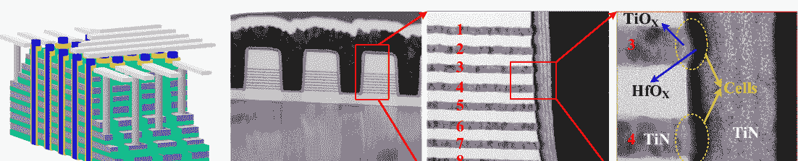

图. 1. (a) 3D VRRAM 架构示意图。(b-d) 所提 3D RRAM 结构的 TEM 图像。可以清晰地观察到 8 层存储单元。一个 TiN 作为顶电极，八个 TiN 作为底电极。HfOx/TiOx 层作为阻变层。

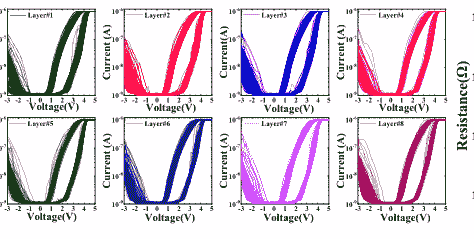

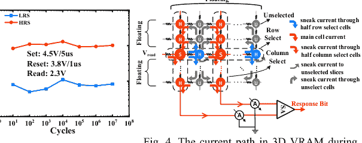

图 2. 八层（Layer 1–Layer 8）RRAM 单元的典型 DC I-V 特性。每个器件都表现出稳定且自选的特性。

图 3. 测得的耐性特性。该 RRAM 器件可以实现 $10^9$ 次脉冲循环。

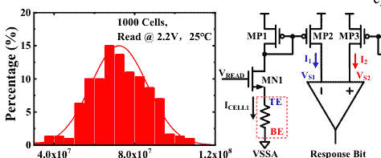

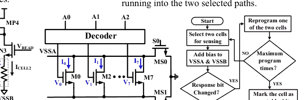

图 5. 1000 个 RRAM 单元的高阻态（HRS）分布。虚线是显示高斯分布的引导线。

图 4. 读取期间 3D VR 中的电流。通过向 2 个选定的 RRAM 单元施加电压，并比较流入两个选定单元的电流来生成一个位输出。

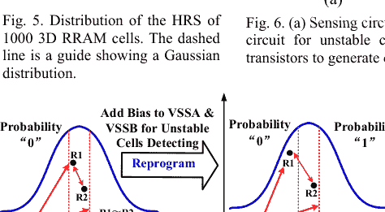

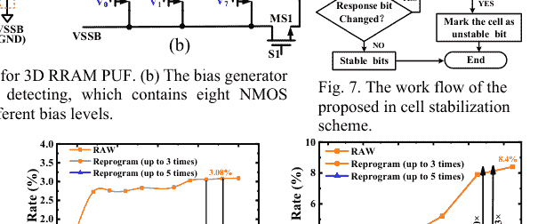

图 6. 3D RRAM 传感电路。(b) 用于不稳定单元检测的偏置电路，包含八个 NMOS 晶体管以产生不同的偏置电平。

图 7. 所提单元稳定方案流程。

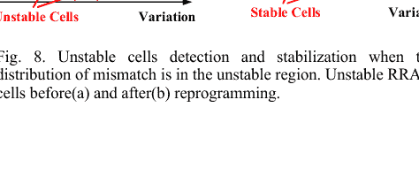

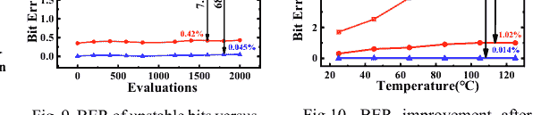

图 8. 不稳定单元检测以及不稳定区域的失配分布。编程前(a)和编程后(b) 的不稳定 RRAM 单元。

图 9. 不稳定位的比特错误率（BER）与重复评估次数。

图 10. 单元内稳定后的 BER 改进随温度的变化。

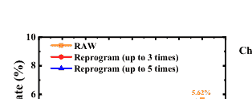

图 11. 单元内稳定性改进随读取偏置偏差的变化。

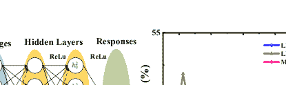

图 12. 用于机器学习架构的 MLPF 网络示意图。

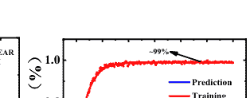

图 13. 三种不同模型在测试中的 ML、注意力机制准确率。

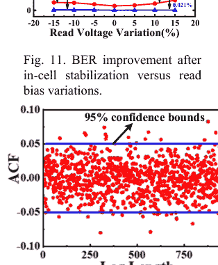

图 14. 10k 训练数据训练期间的准确率。

95% 置信区间，

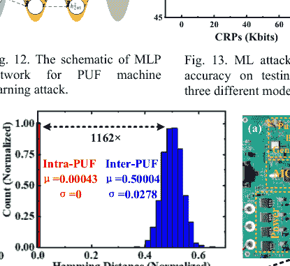

图 15. 来自 10 个单元测得的 PUFF 自相关性测试结果。

img/1bef1471b180a5e9a9ffc78321048a70_3_5.png

图 16. 所提 3D RRAM 设计测得的 PUF 间及内部汉明距离（HD）。

表 1. RRAM PUFF 的 NIST 800-22 测试结果

表 2. RRAM PUFF 的 NIST 800-22 测试结果

| NIST 800-22 | 通过 |
|---|---|---|
| 频率 | 0.521 | 通过 |
| 块频率 | 0.439 | 通过 |
| 累积和-1 | 0.943 | 通过 |
| 累积和-2 | 0.561 | 通过 |
| 序列 | 0.219 | 通过 |
| 最长连续1长度 | 0.652 | 通过 |
| FFT | 0.723 | 通过 |
| 通用频谱 | 0.511 | 通过 |
| 近似熵 | 0.215 | 通过 |
| 非重叠模板 | 通过 |
| 重叠 | 0.739 | 通过 |
| 随机排除方差 | 通过 |
| 线性复杂度 | 0.143 | 通过 |

| NIST PUFF | 结果 |
|---|---|
| ID | 通过 |
| 卡方 | 通过 |
| 拟合优度 (score=-7.27,df=091) | 通过 |
| LRS 测试 | 通过 (Pr=0.81) |
| 最小熵 | 0.9975 |
| 重启测试 | 通过 |

图 17. (a) 8层 3D RRAM 电路测试设置，包括继电器阵、微控制器电路、单元稳定性脉冲生成器以及 (b) 带有 RRAM 测试电路的 FPGA。(c) 3D RRAM 测试电路的显微照片。

| JISC 2018 | IEEE ED 19 | ISISC'18 | ISISC'17 |
|---|---|---|---|
| [1] | [2] | [3] | [4] |
| MOSFET | LEADER | RRAM | 放大器 |
| 1 | 6 | 890 | 194 |

表 3. 与其他硅 PUFF 的结果对比

| PUFF 单元面积 (bit²) | | | | | |
|---|---|---|---|---|---|
| 噪声比特错误 (%) | 5.10% | 2.50% | 11.50% | 12% | 2.50% |
| 稳定方法 | 内置、TMV、 | 掩码 | TM-V, TMV, | 体 |
| 重构 | | | | 偏置 | |
| 85% 温度下稳定后 BEB | 0.01% | 0.44% | 9.50% | | 1% |
| NIST 800-22 测试 | 全部 | 全部 | | | |
| NIST 800-9B 测试 | 全部 | 全部 | | | |
| ML 攻击/预测准确率 | -50 | | -50% | -40% | |

