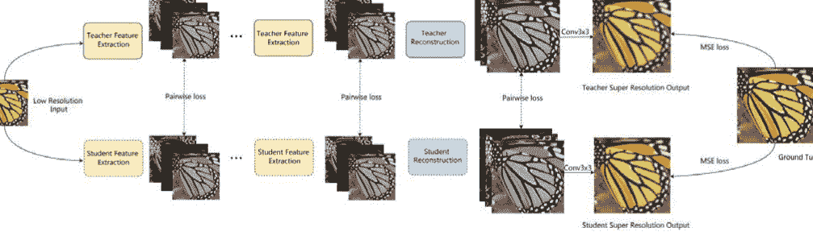

# 2020 IEEE 宽带多媒体系统与广播国际会议（法国巴黎 2020.10.27-2020.10.29） 2020 IEEE 宽带多媒体系统与广播国际会议


第一作者 朱洪辉
北京邮电大学
中国，北京
zhhuonghui51@163.com

第二作者 江志强
北京邮电大学
中国，北京
jiangzhuqing@bpt.cn

第三作者 孟爱东
北京邮电大学
中国，北京
manad@bpt.edu

摘要——由于移动设备的需求，具有小模型、低计算成本和高性能的神经网络设计受到了广泛关注。受知识蒸馏启发，我们设计了一种具有轻量级参数和计算复杂度的多级监督网络（MSCN）。在基准数据集上与两种广泛使用的方法：FSRN 和 EDSR 对我们的方法进行了全面评估。在 PSNR 和 SSIM 方面，我们的方法优于没有多级监督的上下文网络，且提升幅度相当。


自从 Dong 等人 [1] 首次将卷积网络引入超分辨率（SR）以来，深度神经网络成为主流解决方案，其性能显著优于传统方法。Kim 等 [2] 提出了一种名为 VDRN 的极深 CNN 模型，该模型采用了残差学习和深度递归卷积网络（DRCN）。EDSR [4] 通过 ResNet [5] 移除了归一化层并采用了更深、更宽的网络结构。这些方法在信噪比（PSNR）和结构相似性（SSIM）方面表现良好，但仍存在缺点。首先，性能的提升是以大量参数和计算时间为代价的，这使其在移动和嵌入式视觉等实践中的应用性较低。其次，网络越深，性能对结构变化越敏感。此外，由于缺乏网络配置，很难复现论文中的水平。为了解决这些问题，设计参数更少、复杂度更低的网络是可能的。

## I. 引言

高清（UHD）视频已被人们广泛接受，现在是广播行业的主流。然而，由于 UHD 视频采集和制作的限制以及低分辨率（LR）存档的不足，4K 内容仍然短缺。超分辨率（SR）的需求非常迫切。

图像是基于视频的，因此论文中的图像 SR 是我们的初始任务。SR 是计算机视觉中的一个基础问题，学习从 LR 图像到 HR（高分辨率）图像的映射。然而，这个反向问题是一个病态问题，因为 LR 和 HR 之间的映射存在多个解。此外，它需要为每个 LR 图像预测特定值以形成相应的图像。

最近，由于移动设备的需求，具有模型尺寸、轻计算成本和高性能的神经网络设计受到了广泛关注。目前的大多数工作都是为了设计轻量级网络，例如 MobileNet [4]。先进策略（如剪枝和知识蒸馏 [6]）可以在不丢失环境复杂性的情况下压缩神经网络。知识蒸馏策略在分类任务中已验证，例如通过从较大的教师网络迁移知识来训练较小的学生网络。然而，原始的蒸馏仅适用于教师模型的分类决策，而我们通过迁移特征的中间表示来解决这一问题。

受蒸馏的启发，我们为 SR 设计了一种具有轻量级参数和计算复杂度的多级监督网络（MSCN）。在所提出的

本工作受到 Mo-CMCC “人工智能”项目（No. MCM201902071）以及中央高校基础基金 2019PTB-011 支持。



图 1：所提出的 RMUN（用于 x2 SR）架构。

MSCN，我们采用了一个紧凑模型，它不仅受 HR 标签监督，还受教师模型的中间表示监督。我们将 SR 网络分为特征提取和重建两部分。在 MSCN 中，我们采用了两个从 MSR [7] 修改的特征块，充分利用了 MobileNet。我们利用 8 个 MSR 块进行特征提取。PixelShuffle 模块用于 MSCN 和教师模型的重建中。考虑到 SR 问题的特性，我们将浅层 LR 特征、LR 重建特征的信息从紧凑模型进行转移，以对齐紧凑模型与教师模型之间的特征，因此我们提出了一种由弱监督成对随机场启发的成对监督。为此，我们优化了一种结合了一致性损失任务与任务级特征成对损失的方法。值得注意的是，与真值（ground truth）结合的任务级回调是可选的。我们可以将我们的方法应用于未标记数据，并在标记数据有限的情况下，通过调优良好的教师模型进一步提高性能。

在 PSNR 和 SSIM 方面的提升幅度相当。例如，我们的 MSCN 在 Urban100 数据集上 2x SR 上通过应用多级监督在 PSNR 上表现更好。另一方面，MSCN 相比 VSR 少了近 64%，相比 LapSRN 少了 10%。与 SRCNN 和 FSRCNN [9] 相比，我们的 MSCN 在 Urban100 数据集上 4x SR 有约 0.6 到 0.9 dB 的提升。本文的主要贡献如下：

- 我们提出了受知识蒸馏启发的多级监督策略。
- 我们设计了一种特征损失函数，强制紧凑模型和教师模型输出的一致性。
- 我们在基准数据集上进行了多次实验，证明了我们方法的有效性。

## II. 方法

我们在基准数据集上使用质量指标 PSNR 和 SSIM 全面评估了我们的 MSCN。我们在 2x、3x 和 4x SR 上进行了比较。模型是预训练的。然后，在 HR 标签和教师模型的中间表示监督下训练了 MSCN。另一方面，结果表明我们的方法优于没有多级监督的紧凑网络。在本节中，我们首先引入了知识蒸馏方法。输入一个大小为 $W \times H$ 的通道图像。然后我们提取大小为 $W \times H$ 的特征图 $F$，其中 $N$ 是通道数。提取多个特征模块。特征提取后，我们采用 PixelShuffle 生成大小为 $W \times H$ 的重建结果。多级特征和超分辨率结果被用于知识。

表 I：Set5、Set130 和 Urban100 上 x2、x4 的基准结果。PSNR/SSIM。

| 数据集 | Scale | Bicubic | VDSR | LapSRN | MemNet | MSCN(ours) |
| :--- | :--- | :--- | :--- | :--- | :--- | :--- |
| Set5 | x2 | 33.66/0.9299 | 37.53/0.9590 | 37.52/0.9591 | 37.74/0.9591 | 37.83/0.9600 | 37.46/0.9580 |
| Set5 | x4 | 28.42/0.8104 | 31.15/0.8633 | 31.53/0.8850 | 31.68/0.8888 | 31.74/0.8912 | 31.82/0.8931 |
| Set130 | x2 | 30.24/0.8668 | 33.05/0.9130 | 30.09/0.9150 | 31.18/0.9203 | 32.23/0.9216 | 33.28/0.9271 | 33.30/0.9248 |
| Set130 | x4 | 26.00/0.7827 | 28.026/0.7960 | 28.190/0.8072 | 28.217/0.8121 | 28.269/0.8172 | 28.255/0.8177 | 27.90/0.7612 |
| Urban100 | x2 | 29.56/0.8941 | 31.930/0.9386 | 31.989/0.9408 | 32.055/0.9437 | 32.085/0.9462 | 32.088/0.9478 | 31.760/0.9362 | 30.120/0.9179 |
| Urban100 | x4 | 23.154/0.7667 | 25.180/0.8274 | 25.210/0.8356 | 25.246/0.8407 | 25.478/0.8503 | 25.503/0.8560 | 25.461/0.8542 | 24.750/0.7923 |

**逐像素注意力**——我们利用知识蒸馏方法将大型教师超分辨率网络 T 的知识迁移到紧凑网络 S，以更好地训练紧凑超分辨率。我们直接使用损失函数来衡量教师模型和学生模型之间的差异。

损失函数为：

```
$L_{ps} = ||F_t - F_s||_2^2, \quad (1)$
```

其中 $F_t$ 代表教师网络的平均特征，$F_s$ 代表学生模型的平均特征。

### A. 多级知识蒸馏
除了上述逐像素蒸馏，我们提出了一种结构化知识蒸馏方案：空间蒸馏。流程如图 1 所示。
我们将特征图分成多个域，用空间对来表示。每个域表示不同的空间位置，两个域之间的连接表示相似性。我们定义公共范围为 $R$，每个域的大小为 $S$。我们只考虑受空间距离限制的 top-$\alpha$ 邻域和空间位置内 $\beta$ 个像素的相似性来表示该域的特征。

令 $\alpha_i^j$ 和 $\beta_i^j$ 表示来自教师网络 T 和紧凑网络 S 的第 $j$ 个域之间的相似性。损失如下：

```
$L_{po} = \frac{1}{N} \sum_{i=1}^N \sum_{j=1}^M (\alpha_i^j - \beta_i^j)^2, \quad (2)$
```

其中 $R = [1, 2, ..., N]$ 表示所有的域。在实现中，我们使用区域池化将一个域内的 $\alpha$ 和 $\beta$ 特征聚合为 $1 \times S$，并从聚合特征计算两个域之间的相似性。

### B. 网络结构

我们设计了一个多级监督紧凑网络（MSCN），具有轻量级参数和计算复杂度。在提出的 MSCN 中，我们采用了一个紧凑模型，它不仅限于其 HR 头，

**逐像素注意力**：在教师网络中，我们利用教师模型。我们将 SR 网络架构分为两部分：特征提取和重建。
1) **教师网络**：在教师模型中，我们利用每个块进行特征提取。PixelShuffle 模块用于每个模型的重建。
2) **学生网络**：在 MSCN 中，我们采用了从 MSR 修改的两个块，充分利用了 MobileNet。我们使用深度分离卷积来减少参数和复杂度。
3) **知识蒸馏**：虽然 [17] 报道 MAE 损失可以通过更快的收敛达到更好的局部最小值，但比 MSE 损失更稳健。因此我们在第一部分使用 MAE 损失，其公式为：

```
$L_{MAE} = \frac{1}{N} \sum_{i=1}^N ||I_i - \hat{I}_i||_1, \quad (4)$
```

其中 $I_i$ 表示真值图像，$\hat{I}_i$ 是预测的 HR。它指的是块大小。


## 表 II 教师-学生模型之间的基准对比。在 Set5、Set6、BSD100 和 Urban100 数据集上缩放因子 ×2、×4 的 PSNR/SSIM。

| 数据集 | Set5 | Set14 | BSD100 | Urban100 |
|---|---|---|---|---|
| MSN-teacher | ×2 | 37.99/0.9602 | 33.50/0.9152 | 32.14/0.9008 | 31.57/0.9343 |
| | ×4 | 41.93/0.9877 | 28.43/0.9728 | 27.48/0.8599 | 25.79/0.7804 |
| MSN-co | ×2 | 37.40/0.9579 | 32.92/0.9108 | 31.72/0.9069 | 30.04/0.9168 |
| | ×4 | 41.11/0.9837 | 27.98/0.9706 | 27.16/0.8149 | 24.95/0.7505 |
| MSCN | ×2 | 37.46/0.9580 | 32.96/0.9110 | 31.76/0.8962 | 30.12/0.9179 |
| | ×4 | 41.50/0.9875 | 27.91/0.9612 | 27.17/0.8153 | 24.96/0.7513 |

在我们的知识蒸馏中，目标函数由标准的 MAE 损失和多级分布组成，后者对亮度的变化比色差更敏感。

$loss=\lambda_1loss_{MAE}(S)+\lambda_2loss_{pop}(T,S)$（其中 $loss_{MAE}(S)$ 是损失，$loss_{pop}(T,S)$ 是教师网络与学生网络之间的蒸馏，$\lambda_1$ 和 $\lambda_2$ 设置为 1 和 0.1，使得这些值的范围具有可比性。）（5）

我们在学生网络中采用了特征提取。每个卷积层（1×1 除外）的卷积尺寸均为 3×3，步长为 1。每个卷积或反卷积之后都跟着一个负斜率为 0.02 的带极线性激活单元（ReLU），用于非线性映射。

在训练过程中，我们使用的批量大小（batch size）为40，补丁大小为128×128。卷积滤波的设计与 He 的方法相似。初始学习率设置为 $10^{-3}$，并每隔 150 个 epoch 减少一次。优化通过带有 0.9 动量和 $10^{-4}$ 权重衰减的随机梯度下降（SGD）进行。所提方法在 PyTorch 中实现，并在 NVIDIA GPU 2080 Ti GPU 上运行。

表 III：基于 CNN 的模型参数。

| 模型 | 参数 |
|---|---|
| MSN-teacher | 5.06M |
| VDSR | |
| LapSRN | 0.81M |
| MSCN-ours | |

## III. 实验

在本节中，我们首先执行方法中使用的训练和测试。文中介绍了我们训练策略的细节。我们在标准基准数据集上评估了我们的方法。我们讨论了网络中多个组件的影响。

### A. 数据集

为了公平比较，我们使用了 Li 等人 [8] 的数据集进行参考测试。注意，测试数据集包含 291 张图像，其中 91 张来自 Meng 等人的 (T91) 和 (T12)，其余200 张图像来自伯克利大学数据集 [10], [13]。测试在四个广泛应用的基准数据集上执行：Set5、Set14、BSD100 和 Urban100，分别涉及 5、4、100 和 100 张图像。Set5、Set14 和 BSD100 包含，而 Urban100 包含。

### B. 实现

首先，输入图像通过随机缩放、旋转和翻转进行处理。所有 RGB 图像被转换为 YCb 空间，并保留 Y 通道。

- [1] A. Romero, S. French, M. Charles, "Contour detection and hierarchical segmentation," IEEE Transactions on Pattern Analysis and Machine Intelligence, 33, no. 5, p. 909–916, 2011.
- [2] J. Huang, S. Shekar, and N. Ahuja, "Single image super-resolution using residual self-complexs," in 2015 IEEE Conference on Computer Vision and Pattern Recognition (CVPR), June 2015, pp. 5197–5206.
- [3] H. Zhao, G. Gallio, F. Presio, and J. Kant. "Loss functions for image restoration with neural networks," IEEE Transactions on Computational Imaging, vol. 3, no. 1, pp. 47–57, March 2017.
- [4] Y. Tai, J. Yang, X. Liu. "A persistent memory network for image," in 2017 IEEE International Conference on Computer Vision and Pattern Recognition (CVPR), Oct. 2017, pp. 4548–4557.
- [5] B. Lee, S. Hong, and K. Nah. "Efficient residual networks," arXiv:17.2531.
- [6] G. Hinton, O. Vinyals, and J. Dean. "Distilling the knowledge in a Neural Network," arXiv:1503.
- [7] R. Zheng, M. Elad, and M. Protter. "On single image scale-up using sparse-representations," in International Conference on Curves and Surfaces, 2012, pp. 711–738.
- [8] W. Lai, J. Huang, and N. Yang. "Deep laplacian pyramid for fast," in 2017 IEEE Conference on Computer Vision and Pattern Recognition (CVPR), 5835–5843.
- [9] D. Gong, C. Lee, and L. Yang. "Accelerating the super-resolution process with residual," 2016.
- [10] Z. Hui, X. Wang, and X. Gao. "Fast and accurate single image super-resolution via information diversity," in 2016 IEEE/CVF Conference on Computer Vision and Pattern Recognition (CVPR), June 2016, pp. 725–732.
- [11] Y. Zhang, W. John, H. Thomas, and M. Yi. "Image super-resolution via sparse representation," IEEE Transactions on Image Processing, 19, no. 11, pp. 2061–2073.
- [12] A. Romero, S. French, M. Charles, and M. Jitendara. "Contour detection and hierarchical segmentation," IEEE Transactions on Pattern Analysis and Machine Intelligence, 33, no. 5, p. 909–916, 2011.
- [13] M. Chen, R. Murray, C. Guillou, and M. Mehta. "Night-time embedding for single-image super-resolution using nonnegative matrix factorization," in 2012 IEEE International Conference on Acoustics and Signal Processing (ICASSP), March 2012, pp. 1289–1292.

