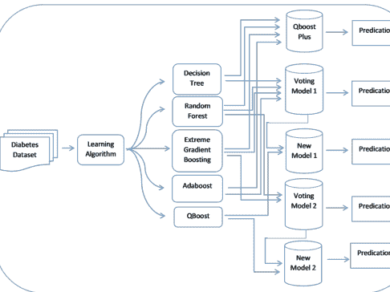

# 2020 IEEE 信号处理与信息技术国际会议 (ISSPIT) (美国肯塔基州路易维尔 2020.12.9-2020.12.11)

**摘要**— 本文介绍了一种应用于糖尿病数据集的机器学习（ML）算法的量子版本。糖尿病是世界第六大疾病，遗憾的是，每年有数百万人受影响。在医疗保健系统中使用各种量子计算（QC）结合量子机器学习（QML）技术，以提高和加速现有机器学习模型的准确性。该量子系统解决了两个不同类患者的二分类分类问题：糖尿病患者和非糖尿病患者。我们比较了使用随机森林、梯度提升、AdaBoost、XGBoost 和 Qboost 的经典算法与量子算法。

**索引术语**— 二分类分类、2 型糖尿病、Qboost、量子与经典计算。

糖尿病是全球第六大死因，但 2 型糖尿病是一个重大的公共健康问题，构成了巨大的风险 [1–2]。有 4600 万糖尿病患者，2.32 亿人患有未诊断的糖尿病，每年有 420 万人死亡 [3]。这种疾病会影响人体的所有重要器官，可能导致失明、肾衰竭、高血压和中风等某些主要疾病。全球糖尿病患者的风险因素到 2045 年可能会增加到 7 亿，其中 3.74 亿面临 2 型糖尿病的风险。1100 万儿童患有糖尿病，2200 万新生在怀孕期间受到影响 [4]。此外，T2DM 的复杂性和流行性可能会导致医疗成本增加。一些研究表明，控制血糖水平是阻止 T2DM 进展和复杂化的重要方面。糖尿病患者血糖的降低减少了入院率和死亡率 [5]。已有若干研究致力于分析机器学习和深度学习来预测 T2DM 患者的急性结果 [11][6][7–8]。所有这些经典方法都使用传统计算机。本文使用了量子处理单元（QPU）并将其与经典方法进行比较。QC 是指数级的，且许多技术已经实现了极高的速度。QC 技术已准备好达到在未来必须实现现实世界应用的水平 [7]。在医疗保健系统中使用 QML 技术的 QC 来提高和加速现有机器学习模型的准确性，是否能允许不同的方法理解复杂性？量子机器学习，例如应用于糖尿病数据集的 Qboost 分类器，将其与经典分类器进行性能比较。这为将真实世界数据集应用于 QML 技术的研究提供了有用信息 [9]。本文从准确性、特异性等方面比较了经典算法和量子算法。

## I. 引言

本文由 5 部分组成。第一部分介绍量子计算、机器学习和糖尿病。第二部分介绍经典算法和量子算法。第四部分涵盖了实验设计和结果评估，而结论在最后部分。

## II. 材料

### A. 患者与数据

本研究基于 Osakidetza（基础健康服务）的电子健康记录（EHRs）。在本研究中，分析和临床参数信息是从 PEST 数据库获取的。在该数据库中，分析是根据国际疾病分类修订版（ICD-CM）进行的，并应用了分期系统调度。它属于分析、治疗和化学类别。2010 年，PEST（分层计划数据库）启动，旨在根据约翰·霍普金斯调整临床组-max 系统对巴斯克公民进行分类 [10]。从之前的文献中可以获得更详细的说明 [11]。关于 2 型糖尿病出现在特定年龄（但更多发生在 40 岁或以后），患者在 35 岁的情况已被排除。这是在三个时期内建立并完成的（年份：2001-09-01 至 2008-08-31；年份：2008-09-01 至 2010-08-31；年份：2010-09-01 至 2011-08-31）。贯穿期间。

## III. 量子计算与人工智能

### A. 量子计算

量子计算（QC）是量子力学的功能 [12]。QC 技术已准备好达到在未来必须实现现实世界应用的水平 [7]。在医疗保健系统中使用 QML 技术的 QC 来提高和加速现有机器学习模型的准确性，是否能允许不同的方法理解复杂性？量子机器学习，例如应用于糖尿病数据集的 Qboost 分类器，将其与经典分类器进行性能比较。

### B. 人工智能

将真实世界数据集应用于 QML 技术的研究 [9]。本文从准确性、特异性等方面比较了经典算法和量子算法。

其中，`L(ω)` 是损失函数，`R(ω)` 是为了使模型简洁的正则化项。标签的复杂选择并非基于 0 范数 `‖ω‖₀`，该范数表示非零权重的数量。`λ` 控制着正则化的相对重要性 [18][19]。

### C. 量子计算模型

1) **QClassifier（量子分类器）**：Qboost 是一种使用量子退火（QA）的集成学习方法。为了充分利用 D-Wave（DWA）的最大能力，需要使用 QUBO 准备目标函数 [15]。为了实现这一点，我们通过用 QUBO 替换加权误差函数改进了 Adaboost [19]。

```
$w^* = \arg\min_{w} \left(\sum_{n=1}^{N} w_n C_n(x_n, y_n) \right) + \lambda|\w|_0$
```

其中，`C(x)` 是每次迭代中的强分类器组合，它选择一个弱分类器并学习减少加权误差函数。权重会经过修改和归一化，以确保权重之和等于 1。

第一部分说明了弱分类器内部与正确标签的关系。第二部分说明了用于最终分类器的弱分类器程度。`λ` 是一个正则化变量，根据总哈密顿量自适应弱分类器的数量 [19]。

这里要求通过将目标函数的第一部分视为已知、第二部分视为约束来最大化该哈密顿量。虽然使用 QA 允许我们创建弱分类器的混合，但第一部分是用于训练数据的。

## IV. 实验设计与结果

### A. 实验设计

模型的训练使用 `Python 3` 和 `ML scikit` 库实现。借助 API（应用程序编程接口）来准备和获取 DWA 系统的量子处理单元（QPU）。而 DWA 系统允许 Qboost 运行在专用的 QPU 上。训练数据用于构建每个分类器，测试数据则与给定已知标签的分类器进行比较。标签 `+1` 和 `-1` 分别代表有急性糖尿病和无急性糖尿病，我们将数据分为 80% 的训练集和 20% 的测试集，并保持子集中类的比例相同（50% 的 `+1` 和 50% 的 `-1`）。

集成方法 [25] 通过汇集所有弱分类器来构建强分类器，以增强预测模型：如通过 bagging、boosting 和 voting 来改进预测。

使用数据集的训练数据集来训练分类器的集成方法如图 1 所示。在 bagging 中，数据因子在被收集到数据集中之前具有相似的出现概率。



额外的区别是 bagging 是并行的，而 boosting 必须逐个连续运行。

决策树、随机森林、XGB 和 Qboost 被用作弱分类器和强分类器。为了充分利用 DWA 的最大能力，需要使用 QUBO 准备目标函数。因此，通过将 Adaboost 中的指数函数替换为以下二次损失，并添加正则化以能够控制权重的稀疏性。Qboost 使用量子退火来优化分类器的最佳组合。

在集成成员中，所有分类器反复迭代。它选择弱分类器并重新减少加权误差函数。投票模型对其分类器集合有两类要求：即要有若干个分类器，且具有多样性 [22]。投票模型 1（决策树、随机森林、XGB 和 Adaboost）、模型 2（随机森林和 XGB）可以基于估计创建独立的投票系统，从量子分类器中获得改进的预测。

QC 分类器如 Qboost 后文、模型 1 和 2 的所有分类器。Qboost 包含（决策树、随机森林、XGB 和 Adaboost），模型 1 由量子分类器组成，模型 2 包含（投票模型 2 和 Qboost），它们构建了在量子系统上持续的新分类器 [19]。通过选择参数来训练分类器以获得更好的结果。集成学习涉及准备多个弱分类器并结合所有这些预测器的结果，从量子状态获得最终预测。

节点数是指从根到最远叶节点的最长路径上的节点数，在 2020 IEEE 国际信号处理与信息技术学术会议（ISSP）上，针对 Qboost 的正则化 (`λ`) 调整了估计器的权重以及弱强分类器的超参数，这是在构建 QBO 方面的考虑 [18]。为了分析分类器的行为，使用的指标是：准确率、精确率、召回率和特异性。特异性在医学分类中至关重要，它提供了关于数据分类器的额外信息。每个分类器的准确率如表 1 至 1 所示。通过获取混淆矩阵 [29]、精确率、召回率、准确率、f-score 和特异性 [30] 来分析我们系统的实现模型。每个实体的公式如下：

| 表 II 随机森林分类器 | 精确率 (Precision) | 召回率 (Recall) | F1-Score | 特异性 (Specificity) |
| :--- | :--- | :--- | :--- | :--- |
| 有急性糖尿病 | 0.65 | 0.69 | 0.67 | 0.69 |
| 无急性糖尿病 | 0.67 | 0.64 | 0.66 | 0.64 |
| 加权平均 | 0.67 | 0.67 | 0.67 | |
| 准确率 | 0.6725 | | | |
| 准确率 | 0.67 | 0.67 | | |

| 表 III XGB分类器 | 精确率 (Precision) | 召回率 (Recall) | F1-Score | 特异性 (Specificity) |
| :--- | :--- | :--- | :--- | :--- |
| 有急性糖尿病 | 0.69 | 0.72 | 0.70 | 0.72 |
| 无急性糖尿病 | 0.64 | 0.67 | 0.66 | 0.67 |
| 加权平均 | 0.68 | 0.68 | 0.68 | 0.68 |
| 准确率 | 0.68 | | | |
| 准确率 | 0.70 | | | |

| 表 IV AdaBoost分类器 | 精确率 (Precision) | 召回率 (Recall) | F1-Score | 特异性 (Specificity) |
| :--- | :--- | :--- | :--- | :--- |
| 有急性糖尿病 | 0.66 | 0.68 | 0.67 | 0.68 |
| 无急性糖尿病 | 0.69 | 0.67 | 0.68 | 0.69 |
| 加权平均 | 0.67 | 0.67 | 0.67 | 0.67 |
| 准确率 | 0.68 | | | |
| 准确率 | 0.69 | | | |

| 表 I 决策树分类器 | 精确率 (Precision) | 召回率 (Recall) | F1-Score | 特异性 (Specificity) |
| :--- | :--- | :--- | :--- | :--- |
| 有急性糖尿病 | 0.63 | 0.66 | 0.64 | 0.66 |
| 无急性糖尿病 | 0.67 | 0.63 | 0.65 | 0.63 |
| 加权平均 | 0.64 | 0.64 | 0.64 | 0.64 |
| 准确率 | 0.64 | | | |
| 准确率 | 0.6412 | | | |

| 表 V 投票模型 1 | 精确率 (Precision) | 召回率 (Recall) | F1-Score | 特异性 (Specificity) |
| :--- | :--- | :--- | :--- | :--- |
| 有急性糖尿病 | 0.69 | 0.69 | 0.69 | 0.69 |
| 无急性糖尿病 | 0.67 | 0.67 | 0.67 | 0.67 |
| 加权平均 | 0.69 | 0.69 | 0.69 | 0.69 |
| 准确率 | 0.69 | | | |
| 准确率 | 0.6909 | | | |

| 表 VI 投票模型 2 | 精确率 (Precision) | 召回率 (Recall) | F1-Score | 特异性 (Specificity) |
| :--- | :--- | :--- | :--- | :--- |
| 有急性糖尿病 | 0.72 | 0.62 | 0.70 | 0.72 |
| 无急性糖尿病 | 0.64 | 0.74 | 0.68 | 0.64 |
| 加权平均 | 0.68 | 0.68 | 0.68 | 0.68 |
| 准确率 | 0.6838 | | | |
| 时间 | 3.632s | | | |

### B. 结果

在本研究中，与经典的模型 1 和模型 2 相比，我们提出的模型在准确率、特异性和计算时间方面表现更好。量子算法在训练和测试时间上优于经典算法，例如投票模型 1 和模型 2 分别为 19s 和 3.632s。

由于 Qboost、Qboost Plus 和 New Model 2 分类器的 QPU 运行时间分别为 0.346s、0.347s 和 0.347s，量子系统在糖尿病数据集上比经典系统快了 55 倍，如表 11 和图 2 所示，这些图对比了所有分类器的结果。为了确保真实性和可靠性

### 表 VII QBOOST 分类器

| 类别 | 精确率 | 召回率 | F1 分数 | 特异性 |
| :--- | :--- | :--- | :--- | :--- |
| 有急性疾病的糖尿病 | 0.66 | 0.61 | 0.63 | |
| 不含急性疾病的糖尿病 | 0.64 | 0.69 | | 0.7 |
| 加权平均 | 0.65 | 0.65 | 0.65 | |
| 准确率 | 0.6505 | | | 0.833s |

### 表 XI 经典分类器与量子分类器的对比

| 分类器 | 准确率 | 精确率 | 召回率 | F1 | 特异性 | 时间 |
| :--- | :--- | :--- | :--- | :--- | :--- | :--- |
| 决策树 | 0.6412 | 0.65 | 0.65 | 0.64 | | 0.042s |
| 随机森林 | 0.675 | 0.67 | 0.66 | 0.67 | | 0.729s |
| XGB Adabo | 0.6820 | 0.68 | 0.68 | 0.68 | | 3.367s |
| 投票模型 1 | 0.6607 | 0.66 | 0.66 | 0.66 | | |
| 投票模型 2 | 0.6838 | 0.68 | 0.68 | 0.68 | | 3.652s |
| Qboost | 0.6500 | 0.65 | 0.65 | | 0.83 | 0.346s |
| Qboost Plus | 0.6810 | 0.68 | 0.68 | 0.68 | | 3.376s |
| 新模型 1 | 0.6900 | 0.69 | 0.69 | 0.69 | | 19.202s |
| 新模型 2 | 0.6838 | 0.68 | 0.68 | 0.68 | | 3.682s |

### 表 VIII QBOOST Plus 分类器

| 类别 | 精确率 | 召回率 | F1 | 特异性 |
| :--- | :--- | :--- | :--- | :--- |
| 有急性疾病的糖尿病 | 0.67 | 0.64 | 0.65 | |
| 不含急性疾病的糖尿病 | 0.69 | 0.71 | 0.76 | |
| 加权平均 | 0.68 | 0.68 | 0.68 | |
| 准确率 | 0.6810 | | | 0.346s |

### 表 IX 新模型 1 分类器

| 类别 | 精确率 | 召回率 | F1 | 特异性 |
| :--- | :--- | :--- | :--- | :--- |
| 有急性疾病的糖尿病 | 0.69 | 0.69 | 0.68 | |
| 不含急性疾病的糖尿病 | 0.69 | 0.68 | 0.69 | |
| 加权平均 | 0.69 | 0.69 | 0.69 | |
| 准确率 | 0.6090 | | | 0.347s |

### 表 X 新模型 2 分类器

| 类别 | 精确率 | 召回率 | F1 | 特异性 |
| :--- | :--- | :--- | :--- | :--- |
| 有急性疾病的糖尿病 | 0.67 | 0.72 | 0.70 | |
| 不含急性疾病的糖尿病 | 0.74 | 0.64 | 0.67 | |
| 加权平均 | 0.68 | 0.68 | 0.68 | |
| 准确率 | 0.6838 | | | 0.342s |


图 2. 测试模型的验证指标

## V. 结论

在这项研究中，我们证明了使用新模型对数据集进行二分类的方法在量子系统上运行时是可行且快速的。所获得的结果令人满意，准确率达到 69% 和 68.38%。测试系统对于提高准确性至关重要，但经典系统所需的时间比量子系统长。在医学领域，需要高特异性。我们选择投票模型 2 是因为它优于模型 1。新模型 1 和新模型 2 等量子算法产生了相似的准确率、召回率、F1 分数并减少了计算时间。量子计算在实时应用中将是一个有用且快速的系统。未来的方向是使用不同的数据集进行 qSVM 和多标签分类。

## 致谢

本研究由巴斯政府 IT-905-16 资助，并获得 Osakidetza 支持。研究代码已获得卢旺达临床研究伦理委员会批准（PK210474）。未获得知情同意是因为健康记录已经过去匿名化处理和定义

## 参考文献

[22] “sklearn.ensemble.RandomForestClassifier.” [在线]. Available: https://scikit-learn.org/stable/modules/sklearn.ensemble.RandomForestClassifier.

[23] “集成学习方法 – scikit-learn 0.2.3 文档。” [在线]. Available: https://scikit-learn.org/stable/modules/ensemble.html

[24] M. Pal, “用于遥感分类的随机森林分类器，” J. Sens. Res., vol. 26, no. 1, pp. 217–222 (2004). [在线]. Available: https://scikit-learn.org/stable/modules/sklearn.ensemble.RandomForestClassifier.

[25] Z. Saha, B. Garcia-Zaparain, J. Agirreco, 和 F. Fernandez-Randa, “使用人工神经网络预测糖尿病，” Computer Methods, vol. 165, pp. 107193 (2019).


[26] Z. Saha, B. Garcia-Zaparain, J. Agirreco, I. Gutierrez, 和 A. M. Vasquez，“使用深度学习方法进行乳腺癌病理图像分析，”*Sensors*, vol. 20, no. 16, pp. 1–17 (2020).
