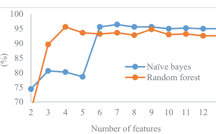
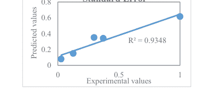
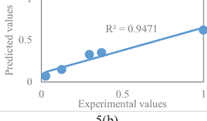
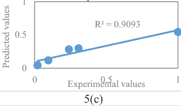
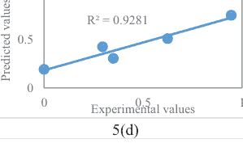
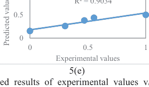

# 2020 IEEE 智能电子系统国际研讨会 (iSES) (原 iNiS) (印度钦奈伊 2020.12.14-2020.12.16)

Naveen Kumar P¹, S. Sakthivel G², J. Jagadeeswaran R³, Dr. Saravanakumar D⁴

¹自动化中心，VIT Chennai，泰米纳德邦，印度

*pallicheerunaveen@gmail.com, sakthivel@vit.ac.in, jagadeeswaran@vit.ac.in, saravanakumar.d@vit.ac.in

**摘要—** 本研究侧重于针对不同燃料差异获取的各种振动信号对压缩点（CI）发动机进行实时监测。通过剪切加速度计在 `1800 rpm` 的恒定速度下以 `5kg` 为等间隔获取振动信号。从每个信号中提取统计特征，并对生物柴油和等载荷的（`20kg`）燃料进行特征确定。使用随机树和朴素贝叶斯算法进行分类，该算法以 `96.4%` 的准确率识别出最小振动和整体最佳性能。进一步将最佳组合频带用于训练开发的神经网络模型，以平均 `0.97` 的相关性预测振动信号。

**关键词：** 振动监测、机器学习、统计特征、随机树、朴素贝叶斯、网络

# I. 引言

振动监测是识别故障和预测发动机故障运行最重要的过程之一。特别是，它正被认为是一种监督维护和决策的有效方法。振动监测收集发动机产生的信号并对其进行分析以判断发动机状态。有许多监测方法，其中主要原因之一是它产生不同类型的振动。发动机的振动系统已得到理解，但可以使用传感器和数据采集系统预测振动信号的特征。

压缩点燃（CI）发动机通常用于海洋运输和车辆，以获得更好的经济性。不可再生能源正在迅速枯竭。为了减少石油的使用，必须使用替代燃料。需要解决生物柴油应作为替代燃料，以及是否有足够的能量满足排放标准（这对减少全球变暖至关重要）。许多研究人员尝试使用甲醇、乙醇和生物柴油等替代燃料来解决能源危机。本研究使用生物柴油作为能源，以实现高效率并最大限度地减少排放 [1]。我们观察了发动机性能和燃烧特性，很少有研究人员监测生物柴油的发动机振动。因此，尝试使用柴油观察振动信号，并将生物柴油（鱼油）按 `20%`、`25%`、`30%`、`35%` 和 `40%` 的比例进行替换。保持 `1800 rpm` 的恒定转速，从无负载到 `5kg`、`10kg`、`15kg` 和 `20kg` 载荷/矩的等间隔。获取振动信号并去除未获取的振动信号。振动不平衡、旋转部件、产生力的变化以及组件的结构特征导致了 CI 发动机中的振动。根据情况检测发动机振动进行状态监测，从发动机气缸获取振动数据，并使用朴素贝叶斯算法等机器学习技术进行观察和分析。

# II. 方法论

## 1. 机器学习技术

## 2. 神经网络模型

在第一种使用机器学习技术的方法中，使用了随机树和朴素贝叶斯等监督学习方法。在训练数据中，算法形成树结构以构建预测学习模型，目标是实现高标准的分类准确率。

由振动信号表征的参数是样本长度、采样频率和样本数量。无负载状态 `DieselL0M4C` 的样本振动特征。

### 测试设置

#### 振动传感器与 DAQ

#### 获取振动信号

#### 统计特征提取

#### 特征分类

1. 随机树
2. 朴素贝叶斯

#### 获取最佳分类结果

图 1. 机器学习方法论

要求，预测振动特征，否则重新映射隐藏层中的神经元并增加隐藏层以满足需求，预测振动特征。

# III. 机器学习技术

在使用机器学习技术的方法中，使用了随机树和朴素贝叶斯等监督学习方法。在训练数据中，算法形成树结构以构建预测学习模型，目标是实现高标准的分类准确率。

# IV. 网络模型

在神经网络模型中，通过激活函数和反向传播算法优化隐藏层。

# V. 结果与讨论

## 5.1 使用随机树算法

## 5.2 使用朴素贝叶斯分类器

类别。这里的主要目标是识别故障，这在“图 5”中实现并绘制。

在比较随机树和朴素贝叶斯两种算法时，在“图 6”中观察到贝叶斯随机树的分类结果。在这里它被选为最佳分类器。

图 6 朴素贝叶斯算法分类准确率随特征数量的变化

从机器学习技术的结果观察到最佳组合的选择。发现 `B25` 混合物是最佳混合物，这种混合数据被用于神经网络方法来预测统计特征。

| 表 III B25 混合物的前向/后向算法 |
| :--- | :--- | :--- | :--- | :--- | :--- |
| 组合 | M4 | M8 | M12 | M4B8C3 | M7C2C4 |
| 4.4N | 0.125 | 0.88 | 0.97 | - | - |
| 标准误差 | 0.93 | 0.89 | 0.97 | - | - |
| 标准差 | 0.94 | 0.89 | 0.97 | - | - |
| 样本 | 0.90 | 0.88 | 0.98 | - | - |
| 范围 | 0.92 | 0.93 | 0.98 | - | - |
| 总平均值 | 0.90 | 0.95 | 0.97 | - | - |

从上表可以观察到相关系数，每个混合物的结果显示，`M4B8C3.2` 和 `M7C2C4.8` 在具有一个隐藏层的情况下 R 平均相关系数为 `0.97`。从表 3 发现，标准误差的相关系数为 `0.97`，标准差为 `0.97`，范围为 `0.97`，最大值为 `0.99`。

5(a)

5(b)

5(c)

5(d)

5(e)

# VI. 结论

实验值与预测值的详细对比如图 5(a)、5(b)、5(c)、5(d) 和 5(e) 所示。

发动机故障分析是基于机器学习方法通过分类来实现故障识别的最佳方法之一。在 `500` 个实例中分类了 `470` 个实例，决策树的分类准确率为 `95.6%`，而贝叶斯分类器在 `500` 个实例中分类了 `490` 个实例，提供了比随机森林算法更好的 `98%` 分类准确率。基于机器学习，`B25` 混合组合确定为最佳燃料混合物。所选混合物神经网络已开发并经过训练，结果显示 `M4` 的预测平均相关系数值为 `0.92`，`M8` 为 `0.07`，`M12` 为 `0.09`，`M4B8C3.2` 为 `0.07`，`M7C24.8` 分别对应 `2-4-4`、`2-12-5`、`15-15-5` 和 `2-4-5` 组合。

# 参考文献

[1] H.G. Howe, H.H. Majjuki, M.A. Kalam, Y.H. Teoh "对氧化的生物柴油燃料混合物的发动机性能、排放和特征的研究" Fuel Vol. 69, 749-759, 2014.

[2] G.S. Sakithil, R. Nagarajan, I. Langakumaran, A.B. Gaikwad "基于醚的油对柴油发动机性能、排放和燃烧的分析" International Journal of Engineering Research Vol. 12, No. 5, 45-50, 2013.

[3] M. Fersok, Saed Ismail "生物柴油燃烧对柴油燃料发动机性能的影响" Energy Vol. 31, 605-610, 2006.

[4] S. Findad "生物柴油发动机的振动特征和发动机参数" Vol 3, Issue 1, 151-162, 2012.

[5] R. Selvam, R. Sugamani "利用统计特征进行汽车制动器故障检测的决策树分类器与优先分类器的比较" Measurement 46, 3247–3260, 2013.

[6] Abhishek Sharma, Deshmaran "使用振动信号和决策树进行柴油发动机失火检测" Measurement 50, 370–380, 2018.

[7] T. Manoharan, R. Rajeshwaran "使用振动和贝叶斯网络对注射发动机进行实时状态监测" Conference Series: Scientific and Engineering, Vol. 62, 2010.

[8] Naveen Kumar, Sakithil "基于树分类器的内燃机振动故障诊断——一种机器学习方法" Smart Electronic Systems, 228-238, 2020.

[9] M. Langakumaran, Rajkumar "使用反向传播算法预测含醚柴油发动机性能的人工神经网络" International Journal of ambient energy, Vol. 20, 45–54, 2015.

[10] Subrata Bhowmik, Rajeshkumar "柴油、醚和混合物燃料的发动机性能和排放的人工神经网络预测。一种模糊逻辑优化" Journal of energy resources, volume 103, 139 (2017).

[11] Ravakumar K.N., Hemanta Kumar "发动机故障分析"

# VI. 结论

实验值与预测值的详细对比如图 5(a)、5(b)、5(c)、5(d) 和 5(e) 所示。

发动机故障分析是基于机器学习方法通过分类来实现故障识别的最佳方法之一。在 500 个实例中分类了 470 个实例，决策树的分类准确率为 95.6%，而贝叶斯分类器在 500 个实例中分类了 490 个实例，提供了比随机森林算法更好的 98% 分类准确率。基于机器学习，B25 混合组合确定为最佳燃料混合物。所选混合物神经网络已开发并经过训练，结果显示 M4 的预测平均相关系数值为 0.92，M8 为 0.07，M12 为 0.09，M4B8C3.2 为 0.07，M7C24.8 分别对应 2-4-4、2-12-5、15-15-5 和 2-4-5 组合。

# 参考文献

[1] H.G. Howe, H.H. Majjuki, M.A. Kalam, Y.H. Teoh "对氧化的生物柴油燃料混合物的发动机性能、排放和特征的研究" Fuel Vol. 69, 749-759, 2014.

[2] G.S. Sakithil, R. Nagarajan, I. Langakumaran, A.B. Gaikwad "基于醚的油对柴油发动机性能、排放和燃烧的分析" International Journal of Engineering Research Vol. 12, No. 5, 45-50, 2013.

[3] M. Fersok, Saed Ismail "生物柴油燃烧对柴油燃料发动机性能的影响" Energy Vol. 31, 605-610, 2006.

[4] S. Findad "生物柴油发动机的振动特征和发动机参数" Vol 3, Issue 1, 151-162, 2012.

[5] R. Selvam, R. Sugamani "利用统计特征进行汽车制动器故障检测的决策树分类器与优先分类器的比较" Measurement 46, 3247–3260, 2013.

[6] Abhishek Sharma, Deshmaran "使用振动信号和决策树进行柴油发动机失火检测" Measurement 50, 370–380, 2018.

[7] T. Manoharan, R. Rajeshwaran "使用振动和贝叶斯网络对注射发动机进行实时状态监测" Conference Series: Scientific and Engineering, Vol. 62, 2010.

[8] Naveen Kumar, Sakithil "基于树分类器的内燃机振动故障诊断——一种机器学习方法" Smart Electronic Systems, 228-238, 2020.

[9] M. Langakumaran, Rajkumar "使用反向传播算法预测含醚柴油发动机性能的人工神经网络" International Journal of ambient energy, Vol. 20, 45–54, 2015.

[10] Subrata Bhowmik, Rajeshkumar "柴油、醚和混合物燃料的发动机性能和排放的人工神经网络预测。一种模糊逻辑优化" Journal of energy resources, volume 103, 139 (2017).

[11] Ravakumar K.N., Hemanta Kumar "发动机故障分析"

# 评审意见 3 (审稿人 C)

| S.No | 意见 | 回复 |
| :--- | :--- | :--- |
| 1 | 主要缺点：输入数据的技术细节不足。 | 由于正文论文限制最多为 6 页，因此难以附上用于训练的完整输入数据。 |
| 2 | 表达较差。 | 已改进并修订 |
| 3 | 存在多处标点符号和语法错误。 | 已修改并修复 |
| 4 | 句子过长且写作风格不符合 IEEE 指南。 | 已修订并修复 |
