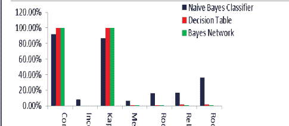

# 2020 IEEE 可持续能源、信号处理与网络安全国际研讨会 (iSSSC)(印度奥里萨邦古纳普尔 2020.12.16-2020.12.17)


第一作者 Umakanta Samanthingar
电子与与科学系，

第二作者 Srinivas Sethi
计算机科学与系

第三作者 Dhruba C. Chanda
电子科学系

BJB 自治学院
印度 布内斯威尔
umakants@rediffmail.com

英迪拉·甘地科技学院
印度 Dhenikanal, Saranga
srinivas_sethi@gmail.com

Berhampur 大学
印度 贝哈甘普
dcpanda@gmail.com

第四作者 Ramesh K. Saho
计算机科学系

英迪拉·甘地科技学院
印度 Dhenikanal, Saranga
ramesh0986@gmail.com

次用户（SUs）的可信度可以通过它们在认知无线电网络（CRN）中对邻居节点感知信誉的过去和现在的信任度来衡量。基于这些值，可以明确次用户能够高效利用空闲频谱。我们提出了一种模型，借助机器学习（ML）方法分析认知无线电网络（CRN）中次用户（SUs）的可信度。事实证明，对于认知无线电网络（CRN）中基于次用户感知信誉预测的数据可以获得更高的准确性。这也有助于识别节点中正确数量的恶意、可疑次用户和诚用户。我们使用的软件是用于数据挖掘任务的机器学习算法集。

信道可以通过频谱识别、感知和划分得到改进，而不会对主用户（PU）产生干扰。感知分为两种：协作和非协作，在这些环境中起着至关重要的作用。协作频谱感知是指每个次用户都意识到 CRN 内的白空间。作为融合中心（Fusion Centre）的中央节点接收来自所有次用户的报告，并根据需求对 CRN 的部分报告开始操作。在非协作感知中，每个次用户在 CRN 内独立运行，对频谱进行感知和分析。

本次任务中分析了不同类型的机器学习方法，如朴素贝叶斯、决策树、支持向量机和神经网络。我们观察到，决策树和神经网络在实现高准确性方面优于朴素贝叶斯。

与非协作相比，协作频谱感知方法对于获得准确的感知信誉、减少虚报和缓解衰落问题具有优势。在协作频谱感知过程中，感知是在规律的时间间隔内进行的。每个节点必须与网络中的其他节点协作以获得准确性，而每个节点的可信度在网络中起着巨大作用。始终指示融合中心（FC）不接受来自频谱不可信节点提供的任何信息。事实上，网络中包含了一种故障管理方案，在次用户（SUs）进入网络之前为其提供有效信息或授权。它不断观察次用户的过去和现在的行为以估计信任值。这种信任管理方案对于网络中次用户信任值的计算非常有用，它为具有高信任值的节点提供了更好的机会来满足其需求，并帮助避免来自恶意用户的攻击。

可信度、机器学习方法（MLA）、感知、信誉、恶意、可疑用户、诚实用户：WEKA、朴素贝叶斯、决策树、树。

## I. 引言

大量的应用程序依赖于通信技术。无线应用和服务对提供的频谱资源有巨大需求。对更多频率频谱的需求是因为主用户（PUs）在其他模式下使用的频谱利用率不足，为了寻找新方法，Jospita Mitali 首次引入了认知无线电网络（CRN）的概念来解决频谱问题。

CRN 通过智能感知和资源分配技术帮助减少无线通信的频率资源短缺。CRN 可以利用未利用频谱，并根据环境条件的变化自动配置传输和接收参数。为了实现这一点，

本文提出了一种协作频谱感知方案，其中实施了机器学习（ML）方法。它对次级用户 SUs 的预测信任值提供了很高的准确性。这些 ML 技术通常用于预测提取出的数据，然后将其插入分类器以归分为某一类。现在数据集被分为两组：i，训练阶段和验证数据集。在训练阶段，数据从每个次用户处本地收集。随着数据量的增加，MLA 在数据支持下次用户（SU）可信度方法上的性能和准确性也会随之提高。可信度的分析有助于实现各种目标。

## II. 相关工作

次用户（SUs）的可信度可以通过它们在认知无线电网络（CRN）中对邻居节点感知信誉的过去和现在的信任度来衡量。基于这些值，可以明确次用户能够高效利用空闲频谱。我们提出了一种模型，借助机器学习（ML）方法分析认知无线电网络（CRN）中次用户（SUs）的可信度。事实证明，对于认知无线电网络（CRN）中基于次用户感知信誉预测的数据可以获得更高的准确性。这也有助于识别节点中正确数量的恶意、可疑次用户和诚用户。我们使用的软件是用于数据挖掘任务的机器学习算法集。

信道可以通过频谱识别、感知和划分得到改进，而不会对主用户（PU）产生干扰。感知分为两种：协作和非协作，在这些环境中起着至关重要的作用。协作频谱感知是指每个次用户都意识到 CRN 内的白空间。作为融合中心（Fusion Centre）的中央节点接收来自所有次用户的报告，并根据需求对 CRN 的部分报告开始操作。在非协作感知中，每个次用户在 CRN 内独立运行，对频谱进行感知和分析。

本次任务中分析了不同类型的机器学习方法，如朴素贝叶斯、决策树、支持向量机和神经网络。我们观察到，决策树和神经网络在实现高准确性方面优于朴素贝叶斯。

与非协作相比，协作频谱感知方法对于获得准确的感知信誉、减少虚报和缓解衰落问题具有优势。在协作频谱感知过程中，感知是在规律的时间间隔上进行的。每个节点必须与网络中的其他节点协作以获得准确性，而每个节点的可信度在网络中起着巨大作用。始终指示融合中心（FC）不接受来自频谱不可信节点提供的任何信息。事实上，网络中包含了一种故障管理方案，在次用户（SUs）进入网络之前为其提供有效信息或授权。它不断观察次用户的过去和现在的行为以估计信任值。这种信任管理方案对于网络中次用户信任值的计算非常有用，它为具有高信任值的节点提供了更好的机会来满足其需求，并帮助避免来自恶意用户的攻击。

可信度、机器学习方法（MLA）、感知、信誉、恶意、可疑用户、诚用户：WEKA、朴素贝叶斯、决策树、树。

## I. 引言

大量的应用程序依赖于通信技术。无线应用和服务对提供的频谱资源有巨大需求。对更多频率频谱的需求是因为主用户（PUs）在其他模式下使用的频谱利用率不足，为了寻找新方法，Jospita Mitali 首次引入了认知无线电网络（CRN）的概念来解决频谱问题。

CRN 通过智能感知和资源分配技术帮助减少无线通信的频率资源短缺。CRN 可以利用未利用频谱，并根据环境条件的变化自动配置传输和接收参数。为了实现这一点，

本文提出了一种协作频谱感知方案，其中实施了机器学习（ML）方法。它对次级用户 SUs 的预测信任值提供了很高的准确性。这些 ML 技术通常用于预测提取出的数据，然后将其插入分类器以归分为某一类。现在数据集被分为两组：i，训练阶段和验证数据集。在训练阶段，数据从每个次用户处本地收集。MLA 在数据支持下次用户（SU）可信度方法上的性能。随着数据量的增加，性能和准确性也会随之提高。可信度的分析有助于实现各种目标。

## II. 相关工作

次用户（SUs）的可信度可以通过它们在认知无线电网络（CRN）中对邻居节点感知信誉的过去和现在的信任度来衡量。基于这些值，可以明确次用户能够高效利用空闲频谱。我们提出了一种模型，借助机器学习（ML）方法分析认知无线电网络（CRN）中次用户（SUs）的可信度。事实证明，对于认知无线电网络（CRN）中基于次用户感知信誉预测的数据可以获得更高的准确性。这也有助于识别节点中正确数量的恶意、可疑次用户和诚用户。我们使用的软件是用于数据挖掘任务的机器学习算法集。

信道可以通过频谱识别、感知和划分得到改进，而不会对主用户（PU）产生干扰。感知分为两种：协作和非协作，在这些环境中起着至关重要的作用。协作频谱感知是指每个次用户都意识到 CRN 内的白空间。作为融合中心（Fusion Centre）的中央节点接收来自所有次用户的报告，并根据需求对 CRN 的部分报告开始操作。在非协作感知中，每个次用户在 CRN 内独立运行，对频谱进行感知和分析。

本次任务中分析了不同类型的机器学习方法，如朴素贝叶斯、决策树、支持向量机和神经网络。我们观察到，决策树和神经网络在实现高准确性方面优于朴素贝叶斯。

与非协作相比，协作频谱感知方法对于获得准确的感知信誉、减少虚报和缓解衰落问题具有优势。在协作频谱感知过程中，感知是在规律的时间间隔上进行的。每个节点必须与网络中的其他节点协作以获得准确性，而每个节点的可信度在网络中起着巨大作用。始终指示融合中心（FC）不接受来自频谱不可信节点提供的任何信息。事实上，网络中包含了一种故障管理方案，在次用户（SUs）进入网络之前为其提供有效信息或授权。它不断观察次用户的过去和现在的行为以估计信任值。这种信任管理方案对于网络中次用户信任值的计算非常有用，它为具有高信任值的节点提供了更好的机会来满足其需求，并帮助避免来自恶意用户的攻击。

可信度、机器学习方法（MLA）、感知、信誉、恶意、可疑用户、诚用户：WEKA、朴素贝叶斯、决策树、树。

## I. 引言

大量的应用程序依赖于通信技术。无线应用和服务对提供的频谱资源有巨大需求。对更多频率频谱的需求是因为主用户（PUs）在其他模式下使用的频谱利用率不足，为了寻找新方法，Jospita Mitali 首次引入了认知无线电网络（CRN）的概念来解决频谱问题。

CRN 通过智能感知和资源分配技术帮助减少无线通信的频率资源短缺。CRN 可以利用未利用频谱，并根据环境条件的变化自动配置传输和接收参数。为了实现这一点，

本文提出了一种协作频谱感知方案，其中实施了机器学习（ML）方法。它对次级用户 SUs 的预测信任值提供了很高的准确性。这些 ML 技术通常用于预测提取出的数据，然后将其插入分类器以归分为某一类。现在数据集被分为两组：i，训练阶段和验证数据集。在训练阶段，数据从每个次用户处本地收集。MLA 在数据支持下次用户（SU）可信度方法上的性能。随着数据量的增加，性能和准确性也会随之提高。可信度的分析有助于实现各种目标。

## II. 相关工作

次用户（SUs）的可信度可以通过它们在认知无线电网络（CRN）中对邻居节点感知信誉的过去和现在的信任度来衡量。基于这些值，可以明确次用户能够高效利用空闲频谱。我们提出了一种模型，借助机器学习（ML）方法分析认知无线电网络（CRN）中次用户（SUs）的可信度。事实证明，对于认知无线电网络（CRN）中基于次用户感知信誉预测的数据可以获得更高的准确性。这也有助于识别节点中正确数量的恶意、可疑次用户和诚用户。我们使用的软件是用于数据挖掘任务的机器学习算法集。

信道可以通过频谱识别、感知和划分得到改进，而不会对主用户（PU）产生干扰。感知分为两种：协作和非协作，在这些环境中起着至关重要的作用。协作频谱感知是指每个次用户都意识到 CRN 内的白空间。作为融合中心（Fusion Centre）的中央节点接收来自所有次用户的报告，并根据需求对 CRN 的部分报告开始操作。在非协作感知中，每个次用户在 CRN 内独立运行，对频谱进行感知和分析。

本次任务中分析了不同类型的机器学习方法，如朴素贝叶斯、决策树、支持向量机和神经网络。我们观察到，决策树和神经网络在实现高准确性方面优于朴素贝叶斯。

与非协作相比，协作频谱感知方法对于获得准确的感知信誉、减少虚报和缓解衰落问题具有优势。在协作频谱感知过程中，感知是在规律的时间间隔上进行的。每个节点必须与网络中的其他节点协作以获得准确性，而每个节点的可信度在网络中起着巨大作用。始终指示融合中心（FC）不接受来自频谱不可信节点提供的任何信息。事实上，网络中包含了一种故障管理方案，在次用户（SUs）进入网络之前为其提供有效信息或授权。它不断观察次用户的过去和现在的行为以估计信任值。这种信任管理方案对于网络中次用户信任值的计算非常有用，它为具有高信任值的节点提供了更好的机会来满足其需求，并帮助避免来自恶意用户的攻击。

## III. 系统模型

在本节中，详细描述了所提出的方案，以衡量计算次用户（SU）可信度和感知信誉的准确程度。由于用户的信任值允许感知恶意用户的自由频率，因此 SU 预测信任值的管理至关重要。

### A. 信任计算

为了计算信任，文献中已经提出了许多重要的方法。CRN 可以根据 SU 的信任值免受未知和无意识的攻击，这些值被视为诚实用户和恶意用户。

| 类别 | 信任值 | 用户 |
|---|---|---|
| A | 0.9-1 | 诚实 |
| B | 0.51-0.89 | 可疑 |
| C | 0-0.5 | 恶意 |

次用户（SUs）的可信度通过考虑权重因子来计算，这些因子是数学模型中使用的系数，用于赋予 CRN 中其他节点更多的“权重”或偏好。最后，每个次用户的识别（SR）计算 [4] 所示：

```
SR[$u_n] = w1*TF[$u_n] + w2*AF[$u_n] + w3*IF[$u_n]
+w4*CF[$u_n] = (1)
```


其中 u1, u2, u3 和 u4 分别是权重因子。

图-1 中混淆矩阵的表示类似于二分类模型。因此，真阳性率（TPR）定义为从混淆矩阵中导出的正确预测输出数量。

TF、AF、IF 和 CF 分别代表信任因子（Trust Factor）、活跃因子（Active Factor）、激励因子（Incentive Factor）和一致性因子（Consistency factor）。

为了计算感知信誉，非常需要计算辅助用户的真实值。辅助用户的信任可以推导为：

```
Positive
Positive + Negative ---------- (2)
```

相反，假阳性率（FPR）定义为导出的错误预测数量。

### B. 机器学习方法

在本文中，通过机器学习（ML）实现了该工作，以提高主用户未利用频谱感知的效率和准确性。因此，我们使用了两组数据：一组是机器学习中的训练集，另一组是验证集。

```
TPR = TP
TPR = TP + FN ---------- (4)
```

机器学习概念的精确率可以定义为实际实例正确预测输出的频率。

- 1. 训练数据用于训练算法或程序，该程序理解如何使用输入数据和预期结果来分类概念。

```
FPR = FP
FPR = FP + TN ---------- (5)
```

F-measure 通过使用指标的理想调和平均值在精确率和召回率之间进行分析和平衡。

- 2. 使用数据集通过人工智能（AI）概念进行训练，对给定问题的数据进行分类。验证集用于在保持训练期间参数的情况下评估网络效率。在受限的情况下，建议完善导致混淆矩阵的原理 [12]，如图 1 所示。

```
Precision = TP
Precision = TP / (TP + FP) ---------- (6)
```

| 实际实例 | |
| :--- | :--- |
| 正性 (P) | 负性 (N) |
| 正性 | 真 (TP) 假 (FP) |
| 负性 | 假 (FN) 真 (TN) |

图 1. 混淆矩阵

## IV. 提出的方案

在本节中，实现了一种方案，以提高认知无线（CR）中辅助用户（SUs）信任度分类和频谱感知的准确性。它也有助于检测恶意用户并从总用户中过滤出主机用户。

从这个混淆矩阵中，假设每行每列分别代表实际输出。真阳性（TP）意味着正确预测与实际正性实例之间的收敛。另一方面，真阴性（TN）是正确预测与实际负性实例之间的交集。同样，假阳性（FP）和假阴性（FN）分别描述了负性和正性的错误预测输出。

该模型已使用 MATLAB 仿真软件进行验证，并现在使用 WEKA 软件 [106] 利用机器学习概念生成的文本文件模型中。它模拟了预处理后的性能，然后用机器学习概念进行分类。WEKA 包用于用于预处理、转换和特征提取进行数据转换。

机器学习算法在 WEKA 中被称为分类器。在每个分类的准确性方面，使用训练数据、模型性能和准确性重点对分类进行分类。

注意的是，TP 对应于正性类的真实预测，TN 对应于负性类。因此，准确性的出现可以称为混淆矩阵 [12]，如下所示：

此后，协作感知系统由 5 个主用户和 60 个辅助用户组成。我们使用权重 w1=0.4, w2=0.2, w3=0.2 分别用于基础信任、活跃因子、激励因子和一致性因子。本文验证了一种基于多因子的信任方案，该方案使系统计算每个辅助节点的感知信誉时更加准确和高效。最后，试图最小化恶意和可疑用户攻击的影响。

```
Accuracy = TP + TN
Accuracy = TP + FP + FN ---------- (3)
```

在本文中，引入了机器学习通过仿真输出验证数据的输出，并提高真实值计算的效率，以获得更好的准确性和信誉。在这种方法中，考虑并比较了三种不同的分类器，如朴素贝叶斯（NB）、决策表（DT）和贝斯网络（BN），并在准确性方面比较了所有分类器的预测值。

## V. 仿真结果与观察

在本节中，我们讨论了不同方向的结果和观察。
表-II 显示了交叉验证数据模型，其中不同分类器具有不同的值，但决策表和贝斯网络的值几乎相同。
图-2 是表 II 的图形表示。从图-2 可以看出，在决策表和贝斯网络分类器中，正确分类的实例为 100%，提供了显著的准确性；在朴素贝叶斯分类器中，为 93%，小于其他两个。同样，决策表和贝斯网络的错误分类实例为 0%，但在贝斯情况下，该值为 7%。



图 2. 不同分类器的分层交叉验证

图, 反映了表 II 的完美表示。图中显示了正确/错误分类实例、Kappa 统计量、平均绝对误差、均方根误差、相对绝对误差、均方根误差。可以看到，正确分类的实例和 Kappa 统计量的...

| 表 II. | 分层交叉验证模型数据 |
| :--- | :--- |
| 实例: 600 | |
| 属性: 3 | |
| PU: 5 | |
| SU-60: 类别：恶意、可疑、诚实 | |
| 测试模式：10 折交叉验证 | |
| 分类器模型（全训练集） | |
| 朴素贝叶斯分类器 | 决策表 | 贝斯网络 |
| 正确分类实例 | 92.33% | 100% | 100% |
| 错误分类实例 | 7.67% | 0% | 0% |
| Kappa 统计量 | 0.8698 | 1 |
| 平均绝对误差 | 0.0648 | 0.0023 | 0.0037 |
| 均方根误差 | 0.0157 | 0.0088 | 0.0044 |
| 相对绝对误差 | 16.69% | 1.88% | 0.94% |
| 均方误差 | 36.27% | 2.00% | 1.01% |

| 表 III. | 不同分类器的准确数据 |
| :--- | :--- |
| TP 率 | FP 率 | 精确率 | 召回率 | F-Me | MC | RO | PRC |
| 朴素贝叶斯分类器 | | | | | | | |
| 0.93 | 79 | 0.688 | 0.93 | | 0.793 | 0.76 | 0.99 |
| 0.0 | 0.76 | | 0.80 | | 3 | 3 |
| 0.765 | 14 | 0.056 | | 0.85 | | 5 | 7 |
| 决策表 | | | | | | | |
| 0 | 1 | | 1 | | 1 | 1 |
| 0 | 1 | | 1 | | 1 | 1 |
| 0 | 1 | | 1 | | 1 | 1 |
| 0.91 | 1 | | 0.92 | | 0.99 | 0.99 |
| 0.923 | 19 | | 0.925 | | 8 | 2 |
| 贝斯网络 | | | | | | | |
| 0 | 1 | | 1 | | 1 | 1 |
| 0 | 1 | | 1 | | 1 | 1 |
| 0 | 1 | | 1 | | 1 | 1 |
| 平均权重 | | | | | | | |
| 0.0 | 0.92 | | 0.90 | | 0.99 | | |
| 0.923 | 16 | 0.939 | 3 | 0.925 | 8 | 2 | | (注：表格重构)

## VI. 结论

在仿真过程中实现的多因子方案使得每个用户的信任度和信誉计算高效准确。首先，通过频谱计算获得数据并通过 WEKA 解决方案进行验证。在此过程中，多个权重因子作为 FC 决策。最后，试图减少感知过程中恶意和可疑用户的影响。本文中，对真实值和 SU 的预测数据集使用了机器学习方法。因此，通过不同的分类器实现了 SU 的信任度。决策树和贝斯网络在提供高准确性方面表现优于贝斯网络。

## REFERENCES

- 1. Mosa, Ahmed and G. Rahman. "Cognitive radio technique for making software more."IEEE personal communications 6 (1999): 13-18.
- 2. Mohtamam, A. "A survey on cognitive spectrum and query in cognitive radio networks."International Journal of Communication Networks and Information Services 5(1) (2013): 19-39.
- 3. Akkyizlar, F., Brandon F. Lo, and Ravindar Balakrishnan. "Cognitive spectrum sensing in cognitive radio networks."Survey Physical communication 44(1) (2011): 40-62.
- 4. Kar, Srinivasaj, Souvitha and Ramesh Kumar Sharma. "A machine learning based spectrum management scheme for spectrum in cognitive radio networks."Wireless Personal Communications 97.2 (2017): 2523-2528.
- 5. Lee, J., S. Kim, and M. Nandi. "Survey on Spectrum Management in Cognitive Radio Networks." (2017).
- 6. Magadelena, A. Hayri and T. Hizumluzan. "Fuzzy logic based method for mitigating Sensing Data Fusion (SSDF) Attack on cognitive radio networks."IEEE International Conference, International Conference on Computer Engineering and Applications (ICCE), 2012, pp.1015-1018.
- 7. M. Young, Khademizadeh, Adele, Nadegha, and Mohammadi. "Shafeizadeh Ghaifzadeh: Tree-multi hop based spectrum sensing in cognitive radio networks." and applications 42(2) (2018): 29-42.
- 8. Kar, Srinivasaj, Souvitha and Ramesh Kumar Sharma. "Techniques of spectrum access in cognitive radio networks."Computers in Analytics 9 (2019): 1-9.
- 9. Tababahee, Hussain, and Vabid Tabataki. "A method for sensing cognitive radio networks under attack."(2018).
- 10. S. Ahmed, M. Sayed, and M. Elif. "Detection of Malicious Node in Cognitive Radio Networks based on ML Neural Network."Fundamental Research in Electrical and Electronics Engineering 5(12) (2018): 1-5.
- 11. Binnassy, Mario, Yang Li, and Sudman K. Jayashera. "A survey on machine learning techniques in cognitive radio."IEEE Journal of Vehicular Technology and Applications 9(1) (2018): 16-.
- 12. Boutaiba, Raf, et al. "A comprehensive survey on spectrum sensing for networking, applications and research opportunities."International Journal of Electronic Services and Applications 9(1) (2018): 16.
- 13. Feng, Jung, et al. "Securing spectrum sensing using false falseback attack in cognitive radio networks."IEEE Transactions on Vehicular Technology 67(9) (2018): 8276-8288.


- [14] Feng, Jingyu, 等人. "认知无线电网络中基于 XOR 距离分析的防止合型 SSDF 攻击的协作频谱感知。" *Sensors* 18.2 (2018): 370。
- [15] Arjoune, Youness, 和 Naima Kaahouch, "认知无线电网络频谱感知综述：近期进展、新挑战与未来研究方向。" *Sensors* 19.1 (2019): 126。
- [16] WEKA 3.8.x 手册 https://downloads.sourceforge.net/project/weka/documentation/3.8.x/WekaManual-3-8-3.pdf 检索于 2020-03-20。

