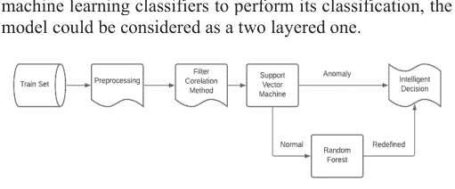
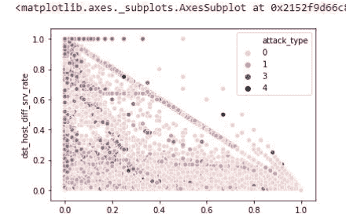

# 2020 IEEE 国际工程女性 (WIE) 电气与计算机工程会议 (WIECON-ECE) (印度巴布斯瓦尔 2020.12.26-2020.12.27)

## 作者信息

**Sabra Afroz**  
计算机科学与工程系  
East West University  
孟加拉，孟加达  
sabrinaafroz44@gmail.com

**S.M Ariful Islam**  
计算机科学与工程系  
East West University  
孟加拉，孟加达  
arisifham.ewu@gmail.com

**Samin Nafer Rifa**  
计算机科学与工程系  
East West University  
孟加拉，孟加达  
terrafifa@gmail.com

**Maheen Islam**  
计算机科学与工程系  
East West University  
孟加拉，孟加达  
maheen285@yahoo.com

## 摘要

未经授权的网络访问是当今的一个威胁问题。本文提出了一种理想入侵检测系统的设计，能够通过对管理员警告各种恶意活动来防御网络。该研究提出了一种基于双层的模型，使用过滤法进行降维，并结合随机森林和支持向量机。该模型对各种类型的攻击均实现了非常高的检测率，且误报率较低。本研究的贡献在于为设计良好的入侵检测系统的科学家提供了一个框架，帮助工业界和组织免受网络威胁的侵害，因为它实现了功能性 `IDS` 模型的预期目标。

## 关键词

入侵检测、异常、特征选择、随机森林、SVM

## 1. 引言

现代时代最重要的问题之一是互联网。虽然许多人将互联网用于建设性目的，但也有人将其视为恶意意图的机会。随着连接到互联网的用户增加，我们的日常生活中网络变得越来越容易，互联网及其连接的计算机正日益成为攻击的目标 [1]。这些攻击可能导致网络泛滥、信息盗取或损坏。

入侵是指对网络或系统的意外中断或未经授权的访问。它是绕过安全系统进入计算机的过程。它可能导致网络泛滥、信息盗取或任何损害。`IDS` 通过监控网络流量和观察网络来检测恶意行为或违反策略的行为。系统管理员将使用安全信息和事件管理系统通知任何恶意行为或入侵 [2]。检测器对冗余数据进行检查，然后确定感知为此类活动迹象的入侵可能性。此外，很难保持截至漏洞数量的入侵检测特征持续进行到 [3]。异常活动可分为四类：`DoS`、探测（`Probe`）、`U2R` 和 `R2L`。

## 2. 相关工作

在 [6] 中，作者提出了一种基于 `SVM` 并结合层次聚类算法的入侵检测系统。他们能够轻松检测常见的攻击类型，但无法有效地检测稀有攻击。在 [4] 中，他们提出了一种双层模型，在两层中用 `LDA` 进行特征选择，并使用 `SVM` 和 `KNN`。该研究对未见和稀见的攻击（如 `U2R` 和 `R2L`）实现了非常好的检测率。然而，结果低于使用的现有方法。在 [7] 中，提出了一种基于子空间方法的聚类的无监督异常检测模型来识别异常。该方法没有指定应该处理哪些特定的攻击。在 [8] 中，他们提出了使用随机森林和 `SVM` 作为分类器的双层模型。该研究实现了非常好的检测率。在 [10] 中，作者解释了特征选择过程的功能，并说明了它为数据集能够提供的显著收益。

与许多共存模型相比，所提出的模型能够获得更高的检测率，但对稀有攻击的检测率并未接近 100%。另一个局限性是所提模型使用了简单常用的技术。

## 3. 提出的方法

在项研究中，提出的入侵检测系统使用过滤相关法选择特征以降低维度。支持向量机（`SVM`）算法在两层中用作分类器。该研究提出的模型能够以较低的计算成本和误报率检测出攻击异常。

在提出的双层模型中，第一层执行数据预处理以及降维。分类使用支持向量机（`SVM`）完成。在所提模型的第二层之后，通过实施随机森林算法的特定分类，增强了异常活动与正常行为之间的区分。

为了更好地区分异常行为和正常行为，将在分类之前执行特征选择过程。在所提出的双层模型中，第一层执行数据预处理以及降维。分类使用支持向量机（`SVM`）完成。在所提模型的第二层之后，通过实施随机森林算法的特定分类，增强了异常活动与正常行为之间的区分。

### 3.1 特征选择

特征选择可以定义为数据挖掘和机器学习中的预处理阶段。它有助于定义有利于类别预测的特征 [11]。特征选择是一种用于减少应用高维数据中特征数量的技术。特征选择技术可以提高性能、预测准确性并降低结果的复杂度 [9]。

对于选择程序，线性相关法是全世界常用的。对于变量对 `(x, y)`，线性相关系数 `r` 可以通过公式得出：

$$r = \frac{\sum(x_i - \bar{x})(y_i - \bar{y})}{\sqrt{\sum(x_i - \bar{x})^2 \sum(y_i - \bar{y})^2}}$$

在这里，$\bar{x}$ 和 $\bar{y}$ 分别视为 `x` 和 `y` 的平均值。`r` 值位于 -1 到 1 之间。如果 `x` 和 `y`...



每一项都通过以下公式根据树的总数进行计数和划分：

```
$Rfi_{ij} = \frac{\sum normf_{ij}}{T} \dots \quad (4)$
```

这里，

- `Rfi_{ij}`: 从随机森林模型中所有树计算出的特征 `i` 的重要性
- `norm_{ij}`: 第 `i` 棵树特征的归一化特征重要性

### 3.2 支持向量机 (SVM)

支持向量机通常被认为是监督学习 [8]。它创建了一个分离数据的超平面。给定一组标记的 `{x, y}`，`SVM` 中最大化间距的计算为：

```
f(w, b) = \frac{1}{2} \|w\|^2 + C \sum_{i=1}^{n} \xi_i
```

受限于：

```
y_i(w^T x_i + b) \geq 1 - \xi_i
```

在这里，间距参数 `C` 控制偏差的影响。支持向量是值不等于 0 的数据点。另一方面，`SVM` 将所有数据映射到更高维空间，能够在该空间内发现并关联最大间距 [6]。

### 3.3 随机森林

一组无监督或分类回归被称为随机森林 [12]。另一方面，一种用于提高准确率的集成分类器是随机森林（`RF`）。随机森林创建了许多分类树，每棵树都是通过对原始数据的自助采样（`bootstrap sample`）开发的。任务通过使用一棵树来完成。在形成森林后，对每一棵树都执行需要归类的的分类。随机森林算法中某一层的特征重要性是在所有树上取平均值。

## 4. 实验设置

### 4.1 数据集描述

使用 `NSL-KDD` 基准数据集来测试所提模型。`KDD` 数据集 [12] 是 `NSL-KDD` 数据集的更新改进版本。该数据曾用于入侵检测系统（`IDS`）的竞赛。每个 `NSL-KDD` 记录包含一个主机间链接，包含 11 个特征（例如：`Normal`、`login`、`Root`、`Source`，命名为攻击或原始 `KDD` 数据集中特定攻击的名称）。

`NSL-KDD` 用于测试所提模型 [12]；`KDD99` 按攻击类型从 `DARPA` 提取。通过消除重复和减少数量，`NSL-KDD` 从 `KDD99` 衍生而来的。包含两个训练集和两个测试集（数据集包含 `DDoS`、`Probe`、`U2R` 和 `R2` 攻击类）。

### 4.2 数据预处理

在预处理阶段，原始数据集被转换为归一化，以便实现决策并减少计算开销；具体如下：

1. 所有类别特征都被标记为不同的数字，如下：(`TCP = 1`, `UDP = 1`, `ICMP = 1`)。
2. 为了避免某种偏置，包含连续值的特征将使用以 2 为底的对数转换为离散值。之后使用以下连续值 `z` 将结果值转换为整数：
   ```
   $if(z \geq 2) = log(z + 1) \dots \quad (5)$
   ```
3. 为了获得更好的分类效果，随后实施了归一化过程，并将攻击分类分为正常类和四类。

## 5. 结果与分析

所提模型通过两个训练集（`Train`, `Test*`）进行了训练，并通过测试集进行了评估。`Set-KDD` 包含 22544 个实例，并使用投影指标进行评估；可以说，我们研究中的大多数结果都是通过测试集评估的。所提模型能够利用随机森林作为其第二个分类器几乎实现这一点。在对测试集进行归一化处理后，投影指标大部分从训练集获得，并已应用于测试集。此时已测试了 45 次迭代。该实验的检测率选择了 `k=5`，以便根据我们选定的值获得对罕见和未见攻击的更高检测率。



图-2 显示了数据集中不同的攻击类型。它也反映了攻击类型的总数。这里 0 代表 `DDoS`，1 代表 `Probe`，`U2R` 和 2 代表 `R2`。生成的模型显示了攻击类型的可见细化。

### 表-1: NSL-KDD 数据类数据集

| | 总计 | Normal | Probe | DDoS | U2R | R2 |
|---|---|---|---|---|---|---|
| Train | 25192 | 13449 | 2289 | 9234 | 11 | 20 |
| Train* | 12597 | 6743 | 11656 | 4592 | 52 | 95 |
| Test* | 22544 | 9711 | 2421 | 7458 | 67 | 2887 |

表-1 代表了数据集中攻击类型的数量。该测试集中存在的攻击数量最多，而 `train_20%` 显示的攻击数量最低。这使得测试集多于其他部分。

### 表-2: 各级（类）异常行为检测率

| | Probe | DDoS | U2R | R2 |
|---|---|---|---|---|
| 第一层 | 98 | 97 | 11 | 9 |
| 第二层 | 85 | 69 | 54 | |

在表-2 中，可以看到在第一层使用 `SVM` 之后，对常见攻击类型 `DDoS` 的检测率是令人满意的。其他类型的检测率较差。第二层大大提高。在应用随机森林分类器后，所有类型的检测率都达到了满意的水平。

共存 `IDS` 模型与所提模型之间显示出改进。可见，所提模型相对于现有模型具有更好的检测率。算法的差异在检测使用的技术方面产生了巨大变化，这些显著变化是关键。技术和分类器的差异在这些显著变化中引起许多困扰。结合 `BIRCH` 聚类的 `SVM` 使用了层次聚类算法的混合。其余的与所提模型类似层。与单层模型相比，多层的检测率更高。

该模型对常见和罕见类型的攻击具有更高的检测率。所提模型具有较低的误报率，这为模型增加了优势。总体而言，所提模型的检测率为 83.8%，优于其他模型对特定攻击的检测率（`Normal`、`DoS`、`U2R` 和 `R2L` 分别为 99%、95%、88%、69%），从结果部分可以看出，这些率高于其他模型，使得所提模型更好。

### 表-3: 罕见攻击的检测率与所提模型的对比

| 模型 | Normal | DoS | U2R | R2L |
|---|---|---|---|---|
| 所提模型 | 99 | 88 | 69 | 54 |
| 结合 BIRCH 聚类的 SVM [6] | 99.3 | 97.5 | 28.8 | 19.7 |
| 结合随机森林的 SVM | 92.99 | 63.1 | 96.3 | 44.8 |
| 朴素贝叶和 KNN 的双层 [4] | 94.56 | 79.76 | 84.6 | 38.1 |

在这项研究中，作者探索了检测领域并提出了一种可以良好处理常见和罕见攻击的模型。所提模型具有较低的误报率，这为模型增加了优势。总体而言，所提模型的检测率为 93.8%，优于其他模型对特定攻击的检测率。未来，所提模型将用于确保检测的。

### 表-4: 所提模型与现有单层模型测试检测率和误报率对比 (%)

| 方法 | 数据集 | 检测率 | 误报率 |
|---|---|---|---|
| 所提模型 | Train-20 | 93.8 | 0.027 |
| 朴素贝叶 [12] | Random | 76.5 | N/A |
| 随机森林 [11] | Random | 80.6 | N/A |
| SVM [6] | Train-20 | 69.2 | N/A |
