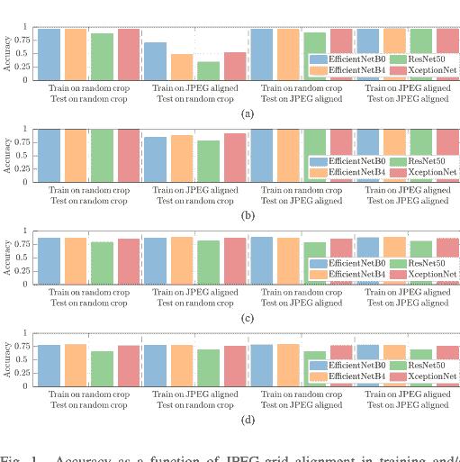
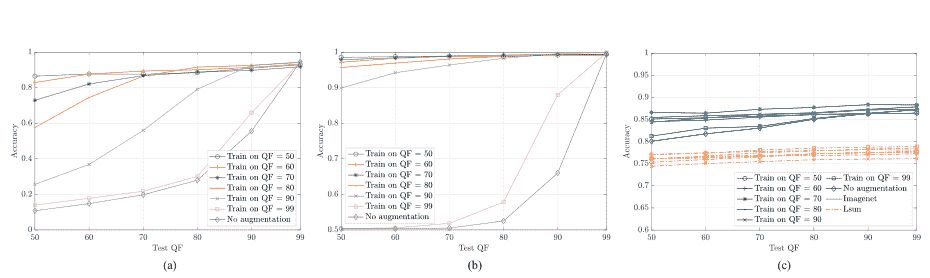
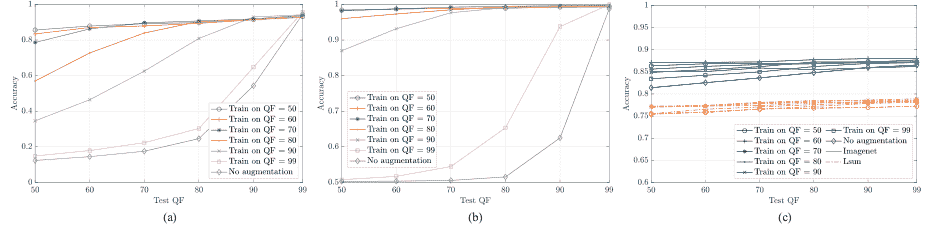
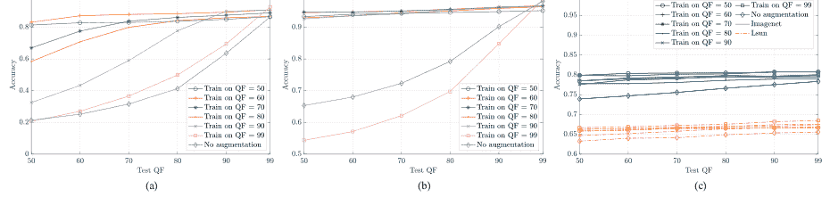
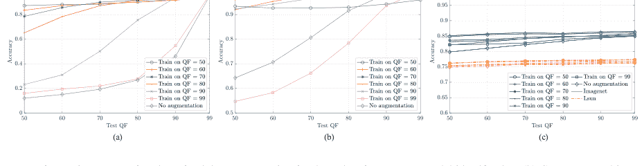

# 2020 IEEE 信息取证与安全国际工作会 (WIFS)

## 摘要

卷积神经网络（`CNNs`）在需要视觉检查的计算机视觉图像分类任务中（如物体识别、人脸检测等）已证明其具有极高的准确性。受这些惊人结果的启发，研究人员开始使用 `CNN` 来解决图像取证问题（如伪造检测）。然而，在计算机视觉中，图像分类方法通常依赖于人类易于检测的视觉线索。相反，取证依赖于分析中不可见的痕迹。由于这种原因，训练 `CNN` 来解决取证任务需要一些特殊处理（例如，重采样、压缩等可能会损害取证）。我们比较了计算机视觉和取证图像分类之间的 `CNN` 训练。具体而言，我们考虑了在生成训练数据集以防止丢失泛化能力时的影响，以及对于计算机视觉任务，是否可以忽略这些影响。

伪造和篡改检测 [10], [11] 只是如今准确解决方案基于 `CNN` 的问题的几个示例。然而，尽管取证和计算机视觉任务具有相似性，但它们也存在差异。一方面，取证任务往往难以通过计算机视觉任务那样的纯基于视觉的方法来解决。例如，考虑图像篡改检测问题，定义一个能够容纳所有图像伪造操作的完整模型是非常不实际的。另一方面，取证任务通常无法通过人类视觉解决。例如，即使图像质量极高，也无法判断图像在拍摄过程中经历了多少压缩步骤。

## I. 引言

得益于数字数据和计算资源可用性的增加，`CNN` 在不同领域的各种任务中表现已远优于其他方法 [1], [2]。例如，它们已用卓越的结果解决了各种计算机视觉问题，如物体检测中的物体识别 [3]、图像分割 [4]、图像检索 [5] 等许多其他。这些任务根据两个属性分类：(i) 使用基于模型的解决方案来解决极具挑战性；(ii) 很难定义图像隐藏的属性以给出分类；它们可以通过人类良好的视觉检查得到合理的解决（即，在图像分析质量低于检测水平的情况下，人类可以清楚地看到物体或场景）。换句话说，我们知道在寻找什么，但无法容易地描述它。

基于 `CNN` 的解决方案相对于传统方法的兴起。在过去的几年里，取证社区也开始用基于 `CNN` 的检测器取代传统的检测器。相机模型识别 [6], [7]，图像篡改定位 [8], [9]，伪造和篡改检测 [10], [11] 只是如今准确解决方案基于 `CNN` 的问题的几个示例。

无法通过简单的视觉检查提取取证信息，是因为取证信息通常隐藏在图像分析的细节中。例如，取证信息可以隐藏在分量、频率和噪声信号中，这些信号会影响用于取证任务的 `CNN`，或者对取证任务的影响可能不同。例如，我们预计典型的图像压缩和增强不会影响我们的物体检测任务（用作对抗攻击）[12]。换句话说，被压缩、裁剪或经过处理的图像类别保持不变，操作者仍然可以识别出物体。相反，很难判断对取证的处理操作是否会产生影响，因为我们并不容易理解 `CNN` 可以捕捉到的哪些是重要线索。

在本文中，我们特别关注了为取证任务训练 `CNN` 时引入的压缩。`JPEG` 是最常用的图像压缩标准，在取证领域为人所知。我们分析了在 `CNN` 的训练和测试期间使用具有不同质量因子的 `JPEG` 压缩的影响。我们比较了在取证任务（即相机模型识别和合成生成图像检测）上，基于两个计算机视觉任务（即在 `ImageNet` [13] 和 `Lsun` [14] 数据集上的图像分类）的结果对比。对于每个任务，我们使用不同的 `CNN` 以避免由于某些特定架构导致的偏置。

为取证任务训练 `CNN` 的结果需要一些 care（细心），而这种关注在计算机视觉任务中是不必要的。

通过预先计算 `DCT` 系数来简化它。在 [28] 中，作者利用 `CNN` 方法对 `JPEG` 压缩图像进行对比度调整。`CNN` 在源设备识别方面已成功优于传统检测器。在 [29] 中，提出了一种基于 `CNN` 的去噪方法来代替传统检测器以提升属性性能，而在 [30] 中，使用 `CNN` 学习像素级的相机指纹和图像噪声方法。生成对抗网络（`GANs`）和 `DeepFakes` [31] 等此类技术的增长，最近专注于同一任务的密度监督。在 [32] 中，作者展示了 `GAN` 如何在生成的图像中留下不同的痕迹，使调查人员能够检测它们。在 [33] 中考虑了学习新类型 `GAN` 的问题。[10] 中提出了一种检测 `DeepFakes` 的残差神经网络，而在 [11] 中，通过带有注意力机制的网络来实现同一任务，通过不同的处理技术（包括 `JPEG` 压缩）。

我们希望这种方法对于从业人员和研究人员有帮助，以便他们在取证场景中使用强大的数据驱动方法。我们也希望我们的实验能促进该领域的研究。

## II. 背景

`JPEG` 是最常用的压缩方案之一，其工作原理如下。图像被分为 `8x8` 不重叠块，通过离散余弦变换 (`DCT`) 计算每个块的系数并转换为整数值。量化步骤会导致信息损失。较低的质量因子表示更强的量化，导致最终解码图像质量较低。量化值随后转换为二进制流。在解码时，二进制流被解码，块通过逆 `DCT` 系数在像素域中重建。

`JPEG` 留下的特殊痕迹在取证领域已研究多年。`8x8` 块留下的伪影可以被用来判断图像是否经过了 `JPEG` 压缩 [15]。众所周知量化系数影响锐边缘的方式。这可以通过对齐和未对齐的 `JPEG` 压缩来利用 [16], [17]。另一种，[19], [20] 提出了基于首数字逻辑的方法来检测多次压缩。同一任务通过非局部性在 [21] 中完成，对于双重压缩的初级量化步骤通过 `DCT` 的统计建模进行估计。`JPEG` 压缩流水线在定义上有多个自由度（量化规则、量化矩阵对应质量因子等），还可以区分不同的实现（即使用的软件）[23]。

为了调查用于多媒体和计算机视觉任务的 `JPEG` `CNN`，我们考虑了两个真实场景作为案例研究：(i) 数据集分析相对于原始 `JPEG` 图像；(ii) 数据集以未知质量因子进行了压缩。对每个场景的详细描述如下。

### A. JPEG 偏移

在社交网络上共享和上传照片时，经常发生图像在不考虑原始 `JPEG` 网格的情况下被裁剪。事实上，这种操作是由大多数用户注意裁剪区域的像素坐标执行的，因为防止 `JPEG` 压缩图像在未识别真实 `8x8` 网格像素的情况下被裁剪更为重要。如果随后将图像保存为 `JPEG`，则原始图像就丢失了。

### B. 多媒体取证中的 CNN

在过去的几年里，遵循新领域的共同趋势，`CNN` 的性能优于传统检测器。相机模型识别在 [7], [25] 中被检测，其中通过 `CNN` 从图像中提取深度特征，然后输入基于模型的算法进行分类任务。在 [26], [27] 中，作者展示了如何训练 `CNN` 来检测 `JPEG` 压缩。

### C. JPEG 压缩的质量因子

当使用 `CNN` 解决问题时，`JPEG` 偏移可能会对特定任务产生问题。在第四节中，我们使用了取证图像和计算机视觉任务进行实验。

理所当然的。同样，众所周知，每个相机模型、图像编辑软件或社交媒体使用不同的 `JPEG` 实现和/或参数（例如，量化矩阵、质量因子等）来压缩图像。因此，我们可以说网络上可以找到各种不同压缩程度的 `JPEG` 图像。

使用不同质量因子压缩图像会留下独特的特征。因此，我们正在研究 `JPEG` 压缩图像的质量如何影响 `CNN`，以及在使用了不同 `JPEG` 压缩的情况下，是否可以使用调整阶段来改进结果。

## IV. 实验设置

### A. 数据集

为了对 `JPEG` 压缩对取证和视觉问题的影响提供足够全面的观点，我们根据以下内容考虑两个任务：

**多媒体取证。** 在取证方面，我们处理两个问题：(i) 相机模型识别，即识别图像的来源；(ii) 从原始照片中检测 `CNN` 生成的图像。如果说第一个问题已经成熟，那么由于基于 `CNN` 技术生成的虚假内容图像视频广泛传播，后者在近年来占据了主导地位。为了研究这些问题，我们使用了文献中常用的数据集。对于相机模型识别，我们利用了 `Vision` [35] 中的数据集，考虑了 28 种可用相机模型。对于每个相机模型，我们使用自然图像（每个模型），每个图像提取 10 个大小为 `512 x 512` 像素的补丁。考虑到 `CNN` 生成图像的情况，我们使用生成/原始图像对作为 `CNN` 生成图像类别（例如，`AppleOrange`, `SummerWinter` [36]）。具体来说，我们从类别中选择图像，每张图像提取一个补丁并调整大小为 `224 x 224` 像素。

**计算机视觉。** 对于常见的视觉任务，我们考虑了图像对象识别，即学习将对象分类为描绘特定主体。我们研究了 `CNN` 在两个数据集上的分类性能。第一个数据集选取自著名的 `ImageNet` 数据库 [13]。第二个数据集选取自 `Lsun` 数据集 [14]。从 20 个不同类别的图像中进行选择。在这两种情况下，我们每张图像提取一个补丁，共同分辨率为 `224 x 224` 像素。详细而言，`ImageNet` 和 `Lsun` 的每类封装了约 1000 和 2000 张图像。

### B. 训练与评估

我们研究了四个网络。其中两个网络选取自最近提出的 `EfficientNet` 模型集 [37]，它们在视觉和取证任务中均表现出优异结果。我们选择 `EfficientNetB0` 和 `EfficientNetB4` 作为模型。其他网络已知为 `ResNet50` [38] 和 `XceptionNet` [39]。

遵循 `CNN` 训练的常用程序，我们使用在 `ImageNet` 上训练的模型来初始化网络。所有 `CNN` 都使用交叉熵损失和 `Adam` 优化器配合默认参数进行训练。学习率初始化为 `0.001`，如果损失在 10 个 epoch 内没有下降，则按 10 倍的因子缩小。如果损失超过 20 个 epoch 仍下降，则停止训练，我们使用验证集选取最佳模型。

关于数据集划分，我们保留了 80% 的图像用于训练（分为 85%/15% 的训练集和验证集），剩余 20% 用于评估。所有实验都在集合封闭场景下进行，即：对于给定的查询，通过准确率识别正确的类别索引。在获得答案后，通过准确率测量预测值（最高 `CNN` 分数）。评估的每个类别的平均准确率为指标。

所有测试均在配备一台 `Intel® Gold 6224` (8 Cores @ 3.30 GHz, RAM 256 GB)、`NVIDIA RTX 3090` (CUDA Cores @ 1350, 24 GB) 的工作站上运行，运行 `Ubuntu 18.04.2`。我们使用 `Albumentations` [40] 作为 `JPEG` 压缩的数据增强，同时使用 `PyTorch` [41] 作为深度学习框架。代码可用于 `https://github.com/polyphonic/pytorch-forensics-vc-`。

### C. 实验

对四个任务和网络进行了测试，以考虑 `JPEG` 压缩的两个方面的影响。

**JPEG 网格对齐。** 在此实验中，对于训练和测试，我们考虑两个问题：(i) 从左上角像素开始的 `$8 \times 8$` `JPEG` 网格；(ii) 图像与 `JPEG` 网格不对齐，从任何像素位置开始。为了模拟这种效果，我们使用 100 的质量因子压缩图像。这保证了图像在任何情况下都能保持其视觉质量。为了获得与 `JPEG` 网格匹配的图像补丁，我们通过裁剪图像的 `$8 \times 8$` 网格来选择补丁。为了获得与网格不对齐的补丁，我们使用随机方法提取它们。

**JPEG 压缩的质量因子。**

在此实验中，我们考虑评估图像可能以不同的质量因子 `$QF \in \{50, 60, 70, 80, 90, 95, 99\}$` 进行压缩。我们执行所有组合。

## V. 结果

### JPEG 网格未对齐

图 1 报告了相机模型识别 (a)、`CNN` 生成图像检测 (b) 以及在 `ImageNet` (c) 和 `Lsun` (d) 数据库提取的子集上的图像分类问题。

考虑到多媒体取证，我们注意到，对于实现准确率，注意提取补丁的 `JPEG` 网格对齐至关重要。当我们在 `JPEG` 对齐的补丁上进行训练并在 `JPEG` 压缩图像上进行测试时，准确率会大幅下降。这在模型生成的图像（图 1a）中尤为明显，除了在 `JPEG` 对齐的图像上训练并在随机副本上测试的情况外，所有 `CNN` 的准确率都在 0.88 以上。

相反，如果我们考虑视觉任务（图 1c 和 1d），在带网格或不带网格的补丁上训练/测试不会以系统的方式改变获得的结果。所有网络的结果几乎是均匀的。因为 `CNN` 确实捕捉到了某些与视觉提示相关的信息，这些信息不会受到简单的 `JPEG` 网格未对齐的影响。

### JPEG 压缩质量因子

图 2、3、4 和 5 描述了关于 `EfficientNetB0`、`EfficientNetB4`、`ResNet50` 和 `XceptionNet` 的 `JPEG` 质量因子的相关研究。

在这些实验中，我们注意到多媒体取证比常见的视觉任务受到 `JPEG` 质量因子的影响更大。例如，训练阶段的相机模型识别可能会损害 `CNN` 性能：通过在 `Q = 50` 的增强数据上训练，准确率低于 85%。对于所有多媒体取证，在训练对齐时选择较低的质量因子似乎允许在测试阶段使用高质量时获得更好的覆盖。

事实上，在 `Q = 99` 的增强数据上训练允许某种程度的上述偏移，且仅当测试因子与之一匹配时才接受结果。相反，随着 `JPEG` 因子的降低，结果对于所有可能的测试 `Q` 呈现平坦的行为。这种现象在视觉任务中很少遇到，因为视觉任务的输出动态范围远大于平均值。

## VI. 结论

在工作中，我们研究了 `JPEG` 压缩对应用于多媒体取证的 `CNN` 的影响。特别是，我们考虑了不同质量因子下训练和测试的有效性。我们将结果与在视觉任务上获得的结果进行了比较。

结果显示，`CNN` 在多媒体取证领域非常敏感。如果我们在未压缩图像上训练 `CNN`，它在应用于压缩图像时会失败。如果我们只考虑特定的 `JPEG` 网格对齐来训练 `CNN`，那么在视觉质量保持良好的情况下，涉及分析和识别的视觉任务对 `JPEG` 压缩具有更强的稳健性。

考虑到这些结果，每当我们训练 `CNN` 或其他更先进的数据驱动模型时，我们将特别注意用于取证目的的方法，因为我们希望避免受到某些特定全局过程的影响。

## 致谢

本材料基于 `DARPA` 和美国空军研究实验室 (`AFRL`) 根据协议 `num-be8750-16-2-2013` 资助的研究。尽管有任何版权概念规定，美国政府均授权为了政府目的复制和分发副本。文中的观点和结论仅代表作者，不应被解释为 `DARPA`、美国空军研究实验室 (`ARFL`) 或美国政府的必然表达或暗示。硬件由 `NVIDIA` 公司生成。

## 参考文献

- [1] D. Wang and J. Chen, "基于深度学习的监督语音分离：概述," ICASSP-国际音频、语音和处理会议, 2020, p. 1170–11726.
- [2] M. Reichstein, G. Pavaskan, B. Stevens, M. Jung, and J. Schlagmayfer, "数据驱动地球系统监测深度学习," Science Advances, 2019, p. 556–594.
- [3] S. Ren, K. He, R. Gribsk, and S. Sun, "Fast fcmnr: 使用深度学习的实时音频分离," 信息处理系统, 2019, p. 911–920.
- [4] O. Ronneher, P. Fischer, and J. Brox, "医学影像语义分割的卷积网络," 医学图像与计算机辅助手术. Springer, 2017.
- [5] J. Yue, H. Fang, and L. Su, "利用深度网络的局部特征进行图像恢复," IEEE 视觉与模式识别会议论文, 2015, p. 53–61.
- [6] A. Tuama, F. Colby, and M. Stamann, "基于字符的图像修复与视频质量增强," IEEE 信息处理与应用国际会议 (IWIPA), 2016.
- [7] L. Bonardi, D. Barifi, J. B. Pesta, J. El, and D. Subaru, "使用深度神经网络的深度视频修复," IEEE Signal Processing Letters, vol. 24, p. 259–263.
- [8] L. Bonadi, S. Damerli, J. B. Pesta, J. El, and D. Subaru, "基于相机的目标检测与定位," IEEE 视觉国际会议 (CVPRW), 2017, p. 1855–1864.
- [9] D. Kozlovina and L. Verbeek, "基于 CNN 的脸分类," IEEE 信息处理与科学, vol. 15.
- [10] D. Guinea and J. El, "深度去块," 2018 IEEE 高级信号与感知会议 (ASAS).
- [11] N. Bonneti, D. Camassi, S. Mandelli, L. Bonardi, and D. Subaru, "使用 CNN 的视频深度去噪," arXiv preprint:2006.0476.
- [12] S. Huang, N. Peragot, J. Goodfellow, and P. Ahmed, "基于注意力的图像生成," arXiv preprint:1702.0234.

## 参考文献

- [13] J. Deng, D. Wang, R. So, L. Li, and J. Fei, "Feat-Net: 用于超分辨率的多尺度融合网络," IEEE, 2019, p. 249–255.
- [14] J. Wang and Y. Zhang, "位图压缩深度学习方法," arXiv preprint:1506.0365.
- [15] T. Bianchi and A. Petra, "使用 CNN 检测非 JPEG 图像," IEEE 取证与安全 (TIFS), vol. 7, p. 842–848.
- [16] M. Bardi, A. Costano, and L. Subaru, "使用深度学习识别篡改的 JPEG 图像," IEEE 系统与电路国际会议, 2019.
- [17] S. Miliani, M. Stagliardi, and T. Subaru, "区分多种 JPEG 压缩," APS信号与信息处理, vol. 39, p. 419.
- [20] C. Pasquini, G. Bott, and P. Perez, "通过 Benford 曲线检测 JPEG 压缩," 2014 IEEE 取证与安全国际会议 (WIFS), p. 113–118.
- [21] S. Mandelli, N. Bonini, P. Bastagni, V. Lipari, and T. Subaru, "任务驱动的 JPEG 去噪神经网络," 2018 IEEE 音频、语音和处理会议 (ICASSP), p. 2110–214.
- [22] J. Li and R. Constantine, "使用离散余弦变换评估双 JPEG 图像中的压缩伪迹," IEEE Access, vol. 7, p. 76203–7216.
- [23] S. Agarwal and F. Hariwal, "来自 JPEG 图像的摄影取证," 2017 IEEE 取证与安全国际会议 (WIFS), 2017.
- [24] N. Bonneti, L. Bonardi, and P. Subaru, "使用卷积神经网络的深度检测," 2019 IEEE 信息处理与应用国际会议 (IWIPA).
- [25] B. Bayar and M. C. Stamann, "使用深度学习的纹理模型识别," 音频、语音和处理会议 (ICASSP), 2018.
- [26] L. Bonardi, N. Bonneti, P. Bastagni, A. Costano, M. Galagni, and D. Subaru, "使用卷积神经网络的目标视频修复," 视觉期刊, vol. 29, p. 1155–1168.
- [27] W. Ahn, S. Moon, H. Lee, and S. Choi, "DCNN 中 3D 卷积网络的端到端深度去噪," 2018, p. 4592–4598.
- [28] M. Bardi, A. Costano, and E. Bondi, "基于深度后处理的通用伪迹检测," 2019 IEEE 视觉国际会议 (WICV).
- [29] Y. Wang and J. Johnson, "CNN-Bonning: 基于深度学习的贝叶斯源相机归因," IEEE 信息处理与应用国际会议 (IWIPA), 2019.
- [30] L. Bonardi, P. Subaru, and E. Elbek, "重绘 (Overpainting): 概述," IEEE 信号处理专题期刊, no. 1, 1–10.
- [31] F. Marra, D. Galagni, L. Veroldi, and G. Pagi, "基于 GAN 的图像修复," IEEE 视觉与模式识别会议 (CVPR), 2019, p. 506–511.
- [32] F. Marri, C. Soti, and G. Subaru, "使用 GANs 的惯性相机图像修复," IEEE 信息处理与应用国际会议 (IWIPA), 2019.
- [33] Y.-S. Wang, Y. Wang, R. Owens, and A. E. Afros, "CNN 生成的图像易于发现，目前," 视觉与模式识别会议, 2020.
- [34] D. Shullani, F. Montani, I. Al Shah, and A. Priya, "VISON: 基于深度学习的图像源检测器," IEEE 信息处理, vol. 15, 2018.
- [35] J.-Y. Yu, T. Park, I. Choi, and A. Efros, "使用卷积网络的非配对图像翻译," IEEE 视觉国际会议 (ICV), 2021.
- [36] M. Tan, Q. and V. K. Lee, "重新思考：基于深度学习的图像超分辨率缩放方法," IEEE 视觉会议论文, 2021.
- [37] K. He, X. Zhang, S. Ren, and J. Sun, "用于图像识别的深度残差学习," IEEE 视觉会议论文, 2016.
