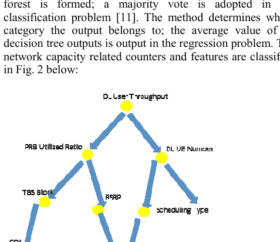
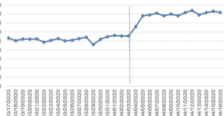

# 2020 IEEE 并行与分布式处理、大数据与云计算、可持续计算与通信、社会计算与网络国际会议 (ISPA／BDCloud／SocialCom／S

**摘要—** 随着新技术的引入，传统的处理流程使得移动通信网络的维护和优化变得日益复杂。用于机器学习的大量用户设备（UE）数据集揭示了通信网络中的独特场景。它针对不同场景适配新的功能和参数并对其进行优化。本文介绍了了机器学习（ML）在移动通信网络容量增强中的应用，并给出了特征提取、聚类以及每次事件后回退梯度维护的分析结果。

*关键词—*场景识别、特征聚类、最优参数*

# I. 引言

如今的移动通信网络随着新技术和服务的出现变得越来越复杂，网络节点增多、过度覆盖以及总网络容量的不可预测分布是一项关键挑战。通过传统的网络维护和优化程序，在不同的客户端和事件利用最高效率利用网络特征一直是一项挑战。

机器学习的关键在于通过大量的 UE 数据集进行开发，学习内部规律并根据获取的规律预测不确定结果。移动通信的大数据使用机器学习算法进行处理，以建立模型、分类通信网络中的不同场景、为不同场景配置新的特征和参数，并优化参数。

本文侧重于基于机器学习的 LTE 移动容量增强分析，选择了与随机森林和统计指标相关的特征和参数进行比较，实施后使用 KMeans 算法聚类适用场景，并应用回归算法。该算法确定了不同场景的结果、参数最优值，最终实现了网络容量性能的提升 [2]。

# II. 解决方案流程

移动通信网络的容量增强分为两个阶段。第一步是基于机器学习算法（如使用随机森林、基于 KMeans 算法的聚类以及网络经验的回归）建立规则和模型 [4]。第二步是在无线接入网络（RAN）部分进行实时参数调整优化，例如收集报告结果、通过决策制定下一步行动，并在强化学习算法的支持下采取行动调整参数。随着网络容量的逐渐增加，参数变得趋于收敛 [5] [6]。

机器学习的关键在于通过大量的 UE 数据集进行开发。

多个参数的在线迭代优化包括以下步骤：第一步是根据工程师经验推荐值；第二步是根据反馈和下行吞吐量确定最优解决方案；第 3 步是有效调整参数和值；最后一步是场景识别和参数推荐过程，如图 1 所示。

具体的构建方法是：使用自助法（bootstrap）从 m 个样本的原始集合中选择 n 个样本；从所有 n 个属性中随机选择 k 个属性（如果 k = n，则基础决策树的构建与传统决策树相同）；选择；选择最佳分割属性以创建树；每棵未剪枝的决策树形成森林；在分类问题中采用多数投票决法 [11]。确定输出类别的方法为：所有决策树输出的平均值位于输出区域。与网络容量相关的计数器和特征分类如图2 所示。

| 规则 | 静态参数优化（A 类） | 动态参数优化（B 类） |
| :--- | :--- | :--- |
| 场景 1 | 特征 A：参数 XX | 小时事件场景识别 |
| 场景识别：计数器 1 计数器 2 | 特征 B：参数 XX | 场景 2 |
| 特征/参数推荐：参数 x | 特征 A = x1 | 特征 Y < c |
| 场景 N | 特征 XX：参数 XX | 回退优先级 |
| | 回退优先级 | 动态场景识别 |

图 1 场景识别与参数推荐

图 2 容量相关计数器和特征分类

## III. 容量增强

### A. 计数器与特征分类

网络容量指的是大量用户和某些情况的管理。例如，LTE 网络使用 20MHz 带宽，默认的 RRU 设备配置功率参数。网络容量需要分别在下行和上行进行增强 [7]。

相关的容量计数器可以通过随机森林算法进行分类。

当小区用户数量增加时，小数据包用户的比例增大，PDCH 资源变得有限，每个 UTI 的调度器数量有限，下行 PDCH 利用率下降 [12][13]。

在这种场景下，根据 PDCH 和 PDDS 资源率，调度器选择大数据包用户并预留 PDCH 资源；在下行最后调度时，将 PDCH 资源分配给选定的大数据包用户。计数器和特征函数如图3 所示：

# PDCCH

| CCE | CCE | CCE |
| :--- | :--- | :--- |
| | | |

# PCH RB

| CCE | CCE | CCE |
| :--- | :--- | :--- |
| | | |

# PDSCH RB

| CCE | CCE | CCE |
| :--- | :--- | :--- |
| | | |

C. 场景识别
该功能利用以下参数：参数 CellDschAlgo.DataTdnPchPdschBal 携带量
RAN 场景：选择“大用户”时，仅选择载波聚合的高优先级资源；载波聚合场景：选择“大数据包”时，仅选择当前的数据量。

# 用户平均下载（DL）吞吐量 (kbps)

图 4. 场景识别解决方案

## IV. 性能基准

当此功能应用于常见场景时，正面影响是该功能可以将链路或 UE 吞吐量提高 5% 到 20%，并保持其他 KPI 稳定。负面影响是迭代优化可能导致 KPI 退化，且在迭代参数优化期间其他 KPI 可能会恶化。

开放观测和性能基准；需要确认小区满足启用 UCI 和 PDCH 功能的条件。观测 KPI：RRC 活跃监测、CCE 利用率、下载速率、UE 平均吞吐量和 UE 阈值 [25][26]。

小区内平均用户数 L.Traffic.Avg. 超过阈值 CCEDillCho.Avg.UeNththildNpdchDechhdail

- CCE 利用率 (L.Mch.CCE.CommUtil/L.Mch.CCE.UeUtil/L.Mch.CCE.UeDeUsed/L.Mch.CCE.Avg) 低于阈值 70%。
- 下载速率-L.Mch.PRB.DL.Used/L.Mch.PRB.DL.Avg 小于 80%

当开启 PDCH 和 PDCH 资源平衡时，我们观察到同一时间内下行 RB 利用率增加，这是有效的。在 3Mbps 带宽的 LTE 平面网络中，部署容量增强后，DL 平均吞吐量速率增加了 17%，如图 5 所示。

图 5. 增强测试效果

考虑到于运维（O&M）中的网络质量保障，要求引入监控区域和回滚机制；在其他情况下，3 月 8 日 Ps 呼叫率出现恶化，因为在 KPI 退化时调整了参数记录。记录显示了哪些参数已回滚以确保 KPI 恢复，最终通过自动参数确保现网的稳定性。

## V. 总结

随着移动通信网络的增长、异构性和不可预测的混沌动力学，其维护和优化变得日益复杂。通过机器学习和规则学习了大量数据，并构建模型以为网络通信增加特定场景。针对不同场景分类适应新功能和参数并优化参数。机器学习在移动通信系统中的应用将带来更多新挑战，特别是在复杂的环境中，有更多问题需要解决，新的需求需要研究，并对技术的适用场景和可行性进行合理分析。

## 参考文献

- [1] C. Jiang, H. Zhang, R. Yen, Z. Han, K. Chen and L. Han, “Machine Learning for Next-Generation Wireless Networks,” in IEEE Communications, vol. 34, no. 2, pp. 98–105, 2017.
- [2] M. Eiza, Y. Con, X. Lu, “Toward Sustainable and Economic Mobile Shaping: The Future of Smart Cities,” Scientific, London (2019).
- [3] L. Xu, et al. “Telecom Big Data Assisted Resource Allocation for LTE/5G Mobile Networks,” in Proc. IEEE ICCC, 2019, Shenzhen, China,
- [4] P. Xu, et al. “Research on LTE Data Platform for LTE/5G Mobile Networks,” in Proc. IEEE ICCC, 2019, Shenzhen, China, pp. 786–791.
- [5] L. Xu, et al. “A Comprehensive Observation and Revenue Analysis for LTE/5G Wireless System based on Telecom Operator Data,” in Proc. IEEE ScalCom, Aug. 2019, Leicester, Kingdom, pp. 1521–1524.
- [6] L. Xu, et al. 'User Perception aware Data Mining and Network Management for LTE/LTE-Advanced Networks,' in Proc. ICSINC, 112, 2016, Qingdao, pp. 237-245.
- [7] S. Liu, J. Liu, X. Gao, L. Liu, J. Liang, 'A Dynamic Beam Off Algorithm for Leo Satellite Satellite Connection,' IEEE Wireless Communications, 2020.
- [8] H. Xu, J. Liu, Y. Wang, L. Xu, J. Zhang, C. Chen, 'A Dynamic Beam Off Algorithm for Leo Satellite Satellite Connection,' IEEE Wireless Communications, 2020.
