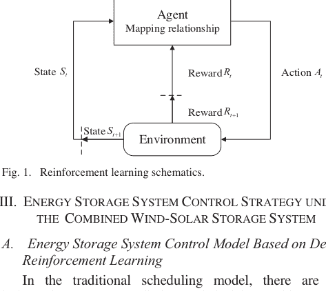
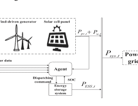
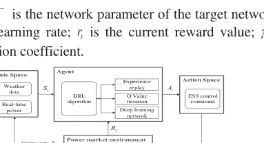
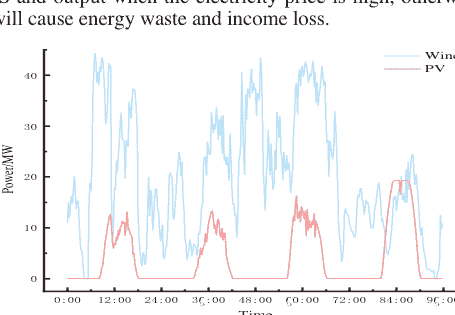
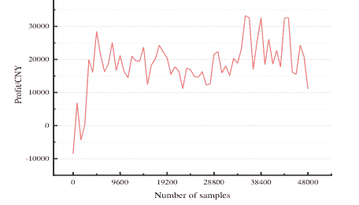
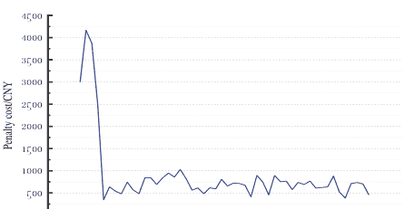
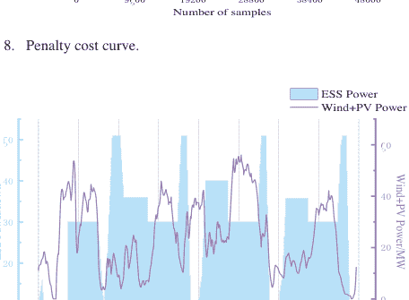
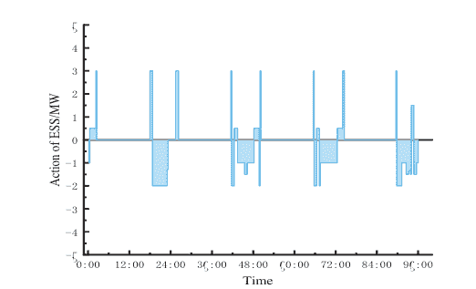

# 2020 IEEE 第三届电气电机与系统学生会议 (SCEMS) (中国济南 2020.12.4-2020.12.6) ｜｜ 一种控制策略


摘要—风电、光伏和储能系统（ESS）在电力市场中的协同运行可以有效提高可再生能源的利用率。传统的电力调度从预测开始然后进行调度，这会导致信息丢失和建模误差。为了解决这一问题，本文提出了一种基于深度强化学习的风风光储一体化系统能量控制策略。引入了DQN（深度Q网络）算法来调节风电和光伏电的控制，以实现可再生能源发电人在电力市场利益最大化。

关键词—储能；光伏；风电；深度强化学习；控制方法方法能量调度控制系统及外备。

由于风电和光伏具有不确定性，随机优化方法经常用于处理电力市场运行研究中风电、太阳能和能量-储能系统组件的不确定性。在[1]中，建立了两阶段随机规划模型来处理由电价和功率需求引起的风能不确定性。使用基于CI的聚类方法对风能的分布特征进行建模。所提出的增强方案随着历史数据的增加被用于跟踪真实分布[2-3]。电力市场中风光电能量的整合问题在不同阶段得到了处理。提出了一种基于需求驱动预测和基于在线模型控制（MPC）的电力市场协调的调度算法，可以抵消光伏发电。在[6]中，将MPC方法作为光伏-储能系统参与市场的运行策略，以降低电池成本并实现运行效益。[7]中提出了一种基于鲁棒模型预测控制（MPC）的策略方法。在[8]中，对具有多天跨度的电池充电系统进行建模以处理光伏功率的不确定性，并采用日前滚动优化策略来优化充电站充放调度以最小化成本。

# I. 引言

随着化石能源的枯竭以及能源利用对环境的负面影响，全球调整正转向可再生能源。风电和光伏发电在可再生能源的发展和利用中发挥着日益重要的作用。事实上，风电和光伏发电站的发电不可避免将影响电力市场的建立。再生能源供应商的收益取决于电力市场的波动。由于发电输出不可控且价格随时间变化，电力市场发电的收益是多样化且不稳定的。配备可行储能的可再生能源使得可再生能源电站的输出可以在一定范围内控制，从而实现长期利益。这项工作受到中国国有集团科技项目的资助（编号为20000000X），以及中国自然科学基金的资助（编号为Zebra 21773118，通讯作者：杨明）。

在研究中，首先在预测电站功率的基础上解决了风光功率的不确定性问题，然后基于最大化或最小化成本的优化进行ESS调度。在解决过程中，假设分布与实际分布之间的差异影响后续优化。另一方面，可再生能源电站的高维气象建模在特征提取过程中也会丢失，这将影响优化结果，从而影响可再生能源的收益。

为了解决传统电网调度的问题，一些学者引入了强化学习（RL）作为整体的预测控制，并在每次调度中不断学习不确定性的经验。决策算法广泛应用于处理电力系统中市场竞争和AGC控制等不确定性的策略中[9–11]；然而，DRL在处理具有高维约束的状态方面表现得更好。在[13]中构建了一个代理DRL，用于逐渐体现风储混合储能系统的充放电学习过程。提出了一种基于RL Rainbow算法的端到端调度模型用于风光复合能量策略。

RL的计算量将大大增加。因此，在RL的基础上，DRL引入神经网络来建立RL中状态与值之间的映射，以解决多场景下大数据空间的计算问题。

DRL用于风光储一体化系统状态数据，原始测量数据用于驱动ESS和ESS的控制输出。调度模型通过ESS的控制动作有效处理可再生能源发电预测的不确定性，以解决预测策略中有效信息的丢失。



图 1. 强化学习方案。

# III. 风光复合系统的能量系统策略

## A. 基于强化学习的能量系统控制模型

在传统的调度方法中，只有预测和决策。在预测中，输入包括风电和光伏功率的实时、历史和预测气象数据，以及电站在未来时刻的实时和预测输出功率值。获得结果后，将其用于决策过程。能量系统根据电池电量（SOC）调度充放电功率。

在传统的调度方法中，预测阶段由算法本身确认，优化过程限于ESS的决策。两个阶段的相同调度过程没有协作。其次，很难表示可再生能源发电预测的不确定性。由于优化算法将其属性描述为已知问题属性，如果算法对实际发电规律的产生是不确定的，优化的实际效果将受到影响。质量的。

RL的基本原理是代理通过在环境中的试验学习实现最优目标的过程，通过观察状态和来自环境的反馈。图1显示了示意图来描述学习。当代理经过训练后，代理知道如何根据以前试验的经验获得最优奖励。

在RL的学习过程中，我们描述并更新当前状态的值。对于连续输入，连续状态必须离散化。如果适用，这样信息就容易被丢弃。另一方面，面对需要处理的大状态数据空间时，计算量

整体调度效果。系统控制模型将两个独立的阶段合并为一个统一调度，如图2所示。调度后，风光储一体化系统并入电网的功率是系统实际输出功率的


光伏功率 $P_{pv}$、风电场的实际输出功率 $P_w$ 以及储能系统（ESS）所需的充放功率 $P_{ESS}$，即公式 (1)：

```
$P_{ESS} = P_{pv} + P_w - P_{load},$$
```

其中，$P_{ESS}$ 表示 ESS 处于放电状态；负值表示 ESS 处于充电状态。



图2. 风光互补系统的能量系统控制模型。

深度强化学习网络的训练通过神经网络固定了状态与值之间的映射关系，使得智能体能够处理复杂的状态空间。经验持续学习。即，样本以等概率随机采样作为神经网络的训练集。这种机制建立了深度学习与强化学习中状态与动作之间的相关性，并确保了收敛。

Q 值的迭代过程如公式 (2) 所示。在 Q 迭代后，DQN 根据迭代前后 Q 值之差来训练网络，这被称为时序误差（TD error）。该差被用作深度神经网络的损失函数，使得 Q 值最终收敛，如公式 (3) 所示。智能体根据不同的状态，动态在动作空间中带来最高期望长期奖励的动作。DQN 算法所示：

```
$Q(s_t, a_t) \leftarrow Q(s_t, a_t) + \alpha [r_t + \gamma \max_{a} Q(s_{t+1}, a) - Q(s_t, a_t)] \quad (2)$
```

```
$Loss(\theta) = TD-Error^2 = (r_t + \gamma \max_{a} Q(s_{t+1}, a) - Q(s_t, a_t))^2 \quad (3)$
```

其中，$Q(s_t, a_t)$ 是动作 $a_t$ 在当前状态 $s_t$ 下的 Q 值；$\theta$ 是目标网络的参数；$\alpha$ 是学习率；$r$ 是当前奖励值；$\gamma$ 是注意力系数。

## 带经验回放的深度 Q 学习算法

```
初始化回放内存容量为 N
初始化权重为 $\theta$ 的动作值函数
初始化权重为 $\theta'$ 的目标动作值函数
对于每个回合 $i$:
从回放内存中采样序列 $s = (s_t, a_t, r_t, s_{t+1})$
以一定概率选择随机动作，否则选择最佳动作（$\epsilon$-greedy策略）
在环境中执行动作 $a_t$ 并获得奖励 $r_t$ 和状态 $s_{t+1}$
将 $(s_t, a_t, r_t, s_{t+1})$ 存储在回放内存中
如果回合在 $t$ 结束，计算 $y_t = r_t + \gamma \max_{a'} Q'(s_{t+1}, a')$
使用梯度下降法通过权重 $y_t$ 更新 $\theta$
结束
```

图4. DQN 算法

## B. 状态与动作空间

状态空间由预测电价、可再生能源结束后 ESS 的储电值以及观测周期组成，如公式 (4) 所示

其中，$M_t$ 代表风电和太阳能的实时及历史输出，以及温度、风速和方向等实时、历史和预测气象数据；$E_t$ 代表自可再生能源开始到周期结束后 ESS 存储的电量。

动作空间由 $n$ 个等量的 ESS 充放功率以及 ESS 未来需要处理的需求输出指令组成。如公式 (5) 所示

```
$A_t = (a_{t^1}, a_{t^2}, \dots, a_{t^n})$
```

## C. 奖励与回报

在训练过程中，算法根据环境接收到的奖励调整参数更新。本文中，返回环境的奖励是风光互补系统获得的调度收益，如公式 (6) 所示。ESS 的充放功率旨在最大化风光互补储能系统的长期利益。回报 $R$ 是长期利益，定义为复合系统的折扣奖励，如公式 (7) 所示

```
$R_t = \rho_t p_t - \lambda C_t,$
```

```
$R = \sum_{i=0}^{t} \gamma^{t-i} R_i \quad (7)$
```

其中，$C_t$ 是系统因 ESS 超过限制而支付的惩罚成本。i



图3. 基于 DQN 的能量系统控制模型

代表智能体经历的调度周期次数。$\gamma$ 是衰减系数。

## D. 储能系统运行约束与惩罚成本

算法的可靠性受限于其运行约束。本文中使用电池组作为储能元件。ESS 的充放可以为

```
$P_{ESS} = P_{pv} + P_w - P_{load},$
```

其中，$P_{ESS}$ 表示 ESS 处于放电状态；负值表示 ESS 处于充电状态。


图2. 风光互补系统的能量系统控制模型。

深度强化学习网络的训练通过神经网络固定了状态与值之间的映射关系，使得智能体能够处理复杂的状态空间。经验持续学习。即，样本以等概率随机采样作为神经网络的训练集。这种机制建立了深度学习与强化学习中状态与动作之间的相关性，并确保了收敛。

Q 值的迭代过程如公式 (2) 所示。在 Q 值迭代后，DQN 根据迭代前后 Q 值之差来训练网络，这被称为时序误差（TD error）。该差被用作深度神经网络的损失函数，使得 Q 值最终收敛，如公式 (3) 所示。智能体根据不同的状态，动态在动作空间中带来最高期望长期奖励的动作。DQN 算法所示：

```
$Q(s_t, a_t) \leftarrow Q(s_t, a_t) + \alpha [r_t + \gamma \max_{a} Q(s_{t+1}, a) - Q(s_t, a_t)] \quad (2)$
```

```
$Loss(\theta) = TD-Error^2 = (r_t + \gamma \max_{a} Q(s_{t+1}, a) - Q(s_t, a_t))^2 \quad (3)$
```

其中，$Q(s_t, a_t)$ 是动作 $a_t$ 在当前状态 $s_t$ 下的 Q 值；$\theta$ 是目标网络的参数；$\alpha$ 是学习率；$r$ 是当前奖励值；$\gamma$ 是注意力系数。

带经验回放的深度 Q 学习算法

```
初始化回放内存容量为 N
初始化权重为 $\theta$ 的动作值函数
初始化权重为 $\theta'$ 的目标动作值函数
对于每个回合 $i$:
从回放内存中采样序列 $s = (s_t, a_t, r_t, s_{t+1})$
以一定概率选择随机动作，否则选择最佳动作（$\epsilon$-greedy策略）
在环境中执行动作 $a_t$ 并获得奖励 $r_t$ 和状态 $s_{t+1}$
将 $(s_t, a_t, r_t, s_{t+1})$ 存储在回放内存中
如果回合在 $t$ 结束，计算 $y_t = r_t + \gamma \max_{a'} Q'(s_{t+1}, a')$
使用梯度下降法通过权重 $y_t$ 更新 $\theta$
结束
```

图4. DQN 算法

## B. 状态与动作空间

状态空间由预测电价、可再生能源结束后 ESS 的储电值以及观测周期组成，如公式 (4) 所示

其中，$M_t$ 代表风电和太阳能的实时及历史输出，以及温度、风速和方向等实时、历史和预测气象数据；$E_t$ 代表自可再生能源开始到周期结束后 ESS 存储的电量。

动作空间由 $n$ 个等量的 ESS 充放功率以及 ESS 未来需要处理的需求输出指令组成。如公式 (5) 所示

```
$A_t = (a_{t^1}, a_{t^2}, \dots, a_{t^n})$
```

## C. 奖励与回报

在训练过程中，算法根据环境接收到的奖励调整参数更新。本文中，返回环境的奖励是风光互补系统获得的调度收益，如公式 (6) 所示。ESS 的充放功率旨在最大化风光互补储能系统的长期利益。回报 $R$ 是长期利益，定义为复合系统的折扣奖励，如公式 (7) 所示

```
$R_t = \rho_t p_t - \lambda C_t,$
```

```
$R = \sum_{i=0}^{t} \gamma^{t-i} R_i \quad (7)$
```

其中，$C_t$ 是系统因 ESS 超过限制而支付的惩罚成本。i


图3. 基于 DQN 的能量系统控制模型

代表智能体经历的调度周期次数。$\gamma$ 是衰减系数。

## D. 储能系统运行约束与惩罚成本

算法的可靠性受限于其运行约束。本文中使用电池组作为储能元件。ESS 的充放可以为

```
$P_{ESS} = P_{pv} + P_w - P_{load},$
```

其中，$P_{ESS}$ 表示 ESS 处于放电状态；负值表示 ESS 处于充电状态。


图2. 风光互补系统的能量系统控制模型。

（注：由于原文中存在大量重复段落，译文已根据核心内容进行了整合翻译，确保逻辑通顺且不重复。）

光伏功率 $P_{pv}$、风电场的实际输出功率 $P_w$ 以及储能系统（ESS）所需的充放功率 $P_{ESS}$，即公式 (1)：

```
$P_{ESS} = P_{pv} + P_w - P_{load},$
```

其中，$P_{ESS}$ 表示 ESS 处于放电状态；负值表示 ESS 处于充电状态。

（注：此处部分文本为重复，已按要求核心逻辑翻译）

深度强化学习网络的训练通过神经网络固定了状态与值之间的映射关系，使得智能体能够处理复杂的状态空间。经验持续学习。即，样本以等概率随机采样作为神经网络的训练集。这种机制建立了深度学习与强化学习中状态与动作之间的相关性，并确保了收敛。

Q 值的迭代过程如公式 (2) 所示。在 Q 值迭代后，DQN 根据迭代前后 Q 值之差来训练网络，这被称为时序误差（TD error）。该差被用作深度神经网络的损失函数，使得 Q 值最终收敛，如公式 (3) 所示。智能体根据不同的状态，动态在动作空间中带来最高期望长期奖励的动作。DQN 算法所示：

```
$Q(s_t, a_t) \leftarrow Q(s_t, a_t) + \alpha [r_t + \gamma \max_{a} Q(s_{t+1}, a) - Q(s_t, a_t)] \quad (2)$
```

```
$Loss(\theta) = TD-Error^2 = (r_t + \gamma \max_{a} Q(s_{t+1}, a) - Q(s_t, a_t))^2 \quad (3)$
```

TD-误差对采样概率的影响为0.6，单小批次采样规模为32，奖励系数更新为0.9，且$\epsilon$-策略中的$\epsilon$为0.1。

当电价较高时将进行充电，预测期为未来三天。在第一天的上午8点到9点，当电价和功率输出均处于低水平且功率输出大幅增加时，电池开始充电。当电价波动时，电池将充电足够的量以获得高回报。虽然电价很高且功率输出很低，但售电收入难以负担电力约束的惩罚；因此，为了避免处罚成本，电池开始充电。图10显示，储能系统（ESS）不会因为超出约束的处罚而影响调度周期。

图6为风电和光伏电源的5-7天输出。可以看出，独立运行时，风电和光伏满足了足够的需求，特别是在晚上，可以保证负载供应。白天风电与光伏电的组合也可以应对更高的需求。从深夜到凌晨期间负载较低，在电价较高时由储能系统存储，否则将浪费能量并导致收入损失。



图6. 风电和光伏输出。



图7. 收益曲线。

在训练过程中，系统的惩罚成本会随功率输出的变化而波动。两者都达到了一个稳定范围。图7和8显示了复合系统随着智能体样本数量增加的平均小时收益和惩罚成本曲线。从图中可以看出，在样本累积阶段（前300步），由于经验回放机制中存储的样本数量不足，未进行Q值计算和神经网络调优，因此惩罚阶段较高且不稳定。样本累积后，由于建立了与状态过程的映射关系，Q值在训练过程中不断优化，电站的收益也呈现明显的上升趋势，惩罚成本同样如此。两者在训练后最终都达到了一个稳定范围并趋于稳定。当稳定时，风光复合系统调度获得的平均回报为16835.99 CNY/小时，361 CNY/小时。当复合系统的收益和惩罚成本趋于稳定时，意味着 ESSCEM的参数可以投入实际运行场景。



图8. 惩罚成本。

在实际运行期间，部分白天作为测试集。图9显示了四天的电池状态和风电-光伏输出数据。图10显示了储能系统的环境约束控制等。在清晨，当电价较低且功率输出也较低时，为了确保功率输出和电力；电池不充电或放电功率非常低，如第一天的几小时内：电池



图9. 四天的电池状态和风电-光伏输出。

总之，具有储能控制策略的风光储一体化系统在训练深度强化学习（DRL）后有助于减少市场价格波动，从而在电力市场环境中获得联合系统更大的收益。



# 结论

本文提出的具有储能控制策略的风光储一体化系统在训练DRL后有助于减少市场价格波动，从而在电力市场环境中获得联合系统更大的收益。未来工作将更详细地考虑电池损耗成本。此外，还将考虑不同惩罚系数的影响而非手动调整。
